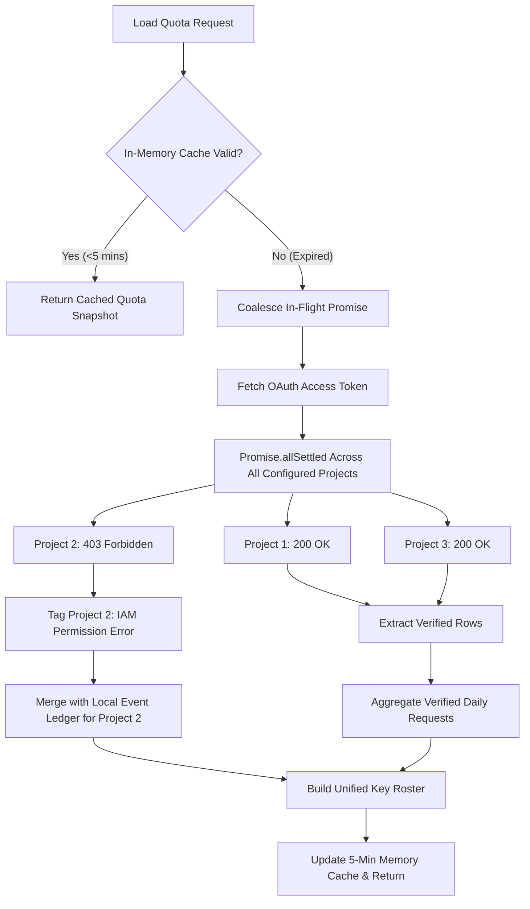
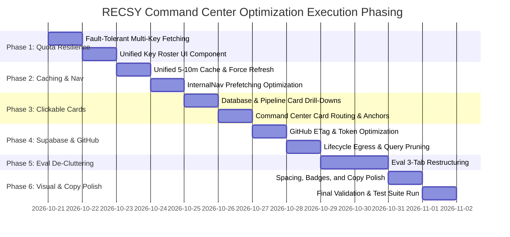

# RECSY Command Center Optimization, Resilience & UX Refinement Plan

**Plan Number:** 24  
**Date:** October 20, 2026  
**Status:** Ready for Implementation  
**Target File Path:** `docs/ImplementationPlans/24. command-center-quota-performance-and-ux-optimization-plan.md`  
**Scope:** All internal Command Center workspaces (`/internal/command-center`, `/internal/database`, `/internal/eval`, `/internal/lifecycle`, `/internal/pipelines`), internal navigation, Gemini quota monitoring services, GitHub workflow integration, and Supabase free-tier database query optimizations.

---

## 1. Executive Summary

The RECSY Command Center serves as the central mission control for database catalog health, phone review ingestion, automated background pipelines, and LLM budget governance. While functionally comprehensive, several friction points degrade system resilience, developer experience, and operational clarity:

1. **Gemini Quota Fragility ("Unknown" Status):** When one of multiple configured Google Cloud projects lacks Cloud Monitoring permissions, or when multi-project API calls exceed a tight 3,000 ms timeout, the system fails closed. This cascades into displaying an "Unknown" daily quota on the dashboard and suppresses telemetry for healthy API keys.
2. **Supabase Free-Tier Egress & Query Inefficiencies:** Several command center pages execute uncoordinated, redundant database queries on every navigation (e.g., cross-fetching full candidate/ingestion datasets simultaneously), and unauthenticated GitHub API requests risk hitting strict 60 req/hour IP rate limits.
3. **Clutter on the Evaluation & Benchmarks Hub:** The `/internal/eval` interface exhibits inverted visual hierarchy—placing password fields, unformatted debug alerts, raw JSON dumps, and dense diagnostic text blocks ahead of test execution controls, primary KPI metrics, and run results.
4. **Static Summary Cards:** High-level KPI cards at the top of pages are static `<div>` elements rather than interactive drill-down controls that filter and smoothly scroll to the underlying tabular records.
5. **Absence of Unified Force-Refresh & Stale Navigation:** In-memory caching lacks a universal manual invalidation mechanism (the existing "Refresh" links do not bust the cache), while `prefetch={false}` on navigation links causes noticeable latency when switching between workspaces.
6. **Cryptic Language & Inconsistent Visual Spacing:** Several UI labels use internal engineering jargon (e.g., "quarantined", "deterministic stub", "measurement boundary") without immediate operational meaning, and uneven vertical margins create visual clutter.

This implementation plan delivers a production-grade, multi-perspective architectural solution that eliminates these bottlenecks while strictly preserving all existing functionality and safeguarding Supabase free-tier allowances.

---

## 2. Multi-Perspective Architectural Analysis

To ensure maximum robustness, usability, and maintainability, each architectural decision is analyzed across five critical perspectives:

```
┌────────────────────────────────────────────────────────────────────────┐
│                      5-PERSPECTIVE DESIGN MATRIX                       │
├──────────────────┬─────────────────────────────────────────────────────┤
│ 1. End User      │ Minimal cognitive load, instant feedback, clear     │
│    (Operator)    │ status indicators, no cryptic system error codes.   │
├──────────────────┼─────────────────────────────────────────────────────┤
│ 2. Project Dev   │ Deterministic debugging, actionable failure stack   │
│    (Maintainer)  │ traces, local reproduction CLI commands, zero drift.│
├──────────────────┼─────────────────────────────────────────────────────┤
│ 3. Big Tech SE   │ Fault isolation, defensive timeouts, single-flight   │
│    (Architect)   │ deduplication, graceful degradation, SLO governance.│
├──────────────────┼─────────────────────────────────────────────────────┤
│ 4. Senior Web Dev│ Next.js App Router RSC/client boundaries, route     │
│    (Next.js)     │ prefetching, HTTP 304 conditional cache, smooth DOM.│
├──────────────────┼─────────────────────────────────────────────────────┤
│ 5. UI/UX Designer│ Visual hierarchy, balanced whitespace rhythm, clear │
│    (Design Lead) │ affordances, WCAG color contrast, micro-interactions│
└──────────────────┴─────────────────────────────────────────────────────┘
```

### Perspective 1: The End User (Operational Observer)
- **Problem:** When an operator lands on the dashboard, seeing "Verified Gemini quota left: Unknown" causes immediate anxiety: "Are the pipelines halted? Has our API budget run out?"
- **Expectation:** If 5 out of 6 keys are functioning, show the verified remaining quota for those 5 keys and flag the 6th with an informative status (e.g., "Key 6: Local ledger tracking"). Clicking a card like "Pending Review" must immediately take the operator to those exact devices without requiring manual filter reconfiguration.

### Perspective 2: The Project Developer (Codebase Maintainer)
- **Problem:** Developing locally or triaging production issues requires seeing which specific GCP project failed, what the exact error was (e.g., 403 Monitoring Viewer missing), and being able to force-refresh stale telemetry without restarting the Next.js dev server.
- **Expectation:** The "Refresh" button must execute an explicit cache purge. Detailed failure codes must be inspectable in an expandable drawer without cluttering the main operational view.

### Perspective 3: Senior Big Tech Software Engineer (Distributed Systems & Reliability)
- **Problem:** `Promise.all` across multiple remote cloud endpoints without individual fault isolation is an anti-pattern. If one remote dependency is slow or returns 403, the entire aggregation rejects or times out.
- **Expectation:**
  - **Graceful Partial Degradation:** Fetch each GCP project quota independently using `Promise.allSettled`. Aggregate whatever succeeded.
  - **Asynchronous Stale-While-Revalidate (SWR):** Cache Google Quota in memory for 5 minutes. If stale, serve the stale snapshot immediately while revalidating asynchronously in the background.
  - **Single-Flight Request Coalescing:** If 3 simultaneous page requests hit the server, coalesce them into a single in-flight promise rather than firing 3x database or external API calls.

### Perspective 4: Senior Web Developer (Next.js App Router & Performance)
- **Problem:** Navigation links in `InternalNav` currently specify `prefetch={false}`. This forces a full round-trip on every link click. Furthermore, page components run full SQL queries even when only switching sub-tabs.
- **Expectation:**
  - Remove `prefetch={false}` so Next.js prefetches route segments in the background, making workspace tab switching instantaneous (<50 ms).
  - Use URL search parameters (`?status=...&reason=...#table-anchor`) to drive drill-downs with browser back/forward history support.
  - Add `ETag` and `If-None-Match` headers to GitHub API calls to receive lightweight `304 Not Modified` responses that consume 0 GitHub rate quota.

### Perspective 5: UI/UX & Web Design Lead (Ergonomics & Typography)
- **Problem:** The Evaluation page (`/internal/eval`) dumps raw JSON preformatted blocks and 5 unstyled diagnostic boxes above the execution controls. In addition, cards look identical to static banners, lacking cursor cues and hover elevation.
- **Expectation:**
  - Restructure `/internal/eval` into a clean 3-tab layout: **1. Execution & Results**, **2. Run Provenance & Diagnostics**, **3. Campaign Evidence & Review**.
  - Transform summary cards into interactive components featuring subtle borders, hover glow, cursor pointers, and active state indicators that correspond to the active table filters.

---

## 3. Issue 1: Gemini Quota Resilience & Multi-Key Architecture

### 3.1 Root Cause Diagnosis
1. **Aggressive Timeout Race:** In `src/services/internal/llm-usage-monitor.ts` (line 127), `fetchGeminiQuotaFromGoogle()` is wrapped with `timedQuery(..., 3000)`. Fetching Google Cloud Monitoring across 6 projects involves an OAuth JWT assertion exchange followed by 12 HTTP calls to `monitoring.googleapis.com`. Any network latency exceeding 3,000 ms causes an immediate fallback to `{ status: 'error', rows: [] }`.
2. **Cascading Failure on Unconfigured Projects:** In `src/services/internal/google-gemini-quota.ts`, if a project is unconfigured or returns 403 Permission Denied, and zero rows succeed across all projects, an error is thrown. Even when one project succeeds, the error list is concatenated into a single message string.
3. **Over-Strict Aggregation Signature:** In `src/services/internal/gemini-quota-summary.ts`:
   ```typescript
   const signature = (row) => JSON.stringify([row.quotaMetric, row.limitName, row.model, row.location]);
   if (rows.length === 0 || new Set(rows.map(signature)).size !== 1) return unknown;
   ```
   If different projects report quotas for different models (e.g., `gemini-2.0-flash` vs `gemini-2.5-flash`) or different regions, `new Set(rows.map(signature)).size !== 1` evaluates to `true`, causing `summarizeVerifiedDailyQuota` to return `{ limit: null, used: null, remaining: null }`.
4. **Key Table Suppression:** In `src/app/internal/pipeline/_components/llm-usage-monitor.tsx`, the table renders `data.googleQuota.rows` if `rows.length > 0`. If Project 1 succeeded (1 row) and Projects 2–6 failed, the table displays *only* Project 1 and completely suppresses the local call and token counts for Keys 2–6.

### 3.2 Target Architecture & Fault-Tolerant Resolution
1. **Per-Project Isolation & Fault Boundary:**
   - Each configured Gemini key has an independent status: `verified` (GCP Monitoring data available), `unlinked` (no GCP project ID configured), or `permission_error` (GCP Monitoring API disabled or service account lacks IAM role).
   - A failure on Key 2 never blocks or suppresses Keys 1, 3, 4, 5, or 6.
2. **Unified Key Roster:**
   - Instead of alternating between an all-Google table or an all-local table, the table presents a **Unified Key Roster** listing all configured keys (Key #1 through Key #N).
   - Each key row shows:
     - **Key Name & Project ID** (with badge: `Verified GCP`, `Local Ledger`, or `IAM Error`)
     - **Daily Limit** (from Google Monitoring limit, or local `GEMINI_FREE_RPD` fallback)
     - **Calls Used Today** (from Google Monitoring usage, or local DB event ledger)
     - **Remaining Allowance** (Verified remaining, or calculated `Limit - LocalCalls`)
     - **Tokens Consumed Today**
3. **Robust Quota Aggregation:**
   - In `summarizeVerifiedDailyQuota`, aggregate daily request quotas per unique project. If a project has valid request quota rows, sum the limit, used, and remaining metrics across unique projects.
   - If verified GCP quota is only partially available, display the verified sum with an indicator (e.g., `12,450 remaining (5 of 6 keys verified)`), rather than showing "Unknown".
   - If GCP Monitoring is completely unavailable, gracefully fallback to computing local remaining calls: `(configuredKeyCount * GEMINI_FREE_RPD) - localCallsToday`.
4. **Sane Timeouts with Stale-While-Revalidate:**
   - Increase the server query timeout for GCP Monitoring from 3,000 ms to 8,000 ms.
   - Cache results in memory for 300,000 ms (5 minutes). If expired, return the cached result immediately while triggering a background revalidation.



---

## 4. Issue 2: Data Fetching Performance Audit & Supabase Protection

### 4.1 Page-by-Page Query Audit

| Page Route | Current Data Loaders Executed | Identified Inefficiencies & Waste | Supabase Quota Risk |
|---|---|---|---|
| `/internal/command-center` | `loadCommandCenterDatabaseSummary`<br>`loadLlmUsageMonitorData`<br>`loadAllUnifiedPipelineRuns`<br>`loadCommandCenterIngestionSummary` | Runs 12+ separate database queries plus external GCP and GitHub calls simultaneously. Cross-fetches ingestion and catalog summaries even though counts overlap. | **High:** Multiple unindexed counts and large pipeline JSON aggregations on every cold render. |
| `/internal/database` | If `view=catalog`: `loadDatabaseDashboardData` AND `loadCommandCenterIngestionSummary`<br>If `view=ingestion`: `loadPhoneIngestionDashboardData` AND `loadCommandCenterDatabaseSummary` | Redundant mutual fetching: When inspecting the catalog, the full ingestion dashboard base is still loaded for a single badge count! When inspecting ingestion, the full candidate base is loaded. | **Critical:** Egress waste transfers full catalog payloads and chunks metadata unnecessarily. |
| `/internal/eval` | `listBenchmarkRuns(getDb(), 30)` | Has **zero server-side caching**. Queries `benchmark_runs` on every page refresh or navigation. Client view also fetches `/api/internal/eval/campaign` and preflight on load. | **Moderate:** Uncached DB reads on every tab switch. |
| `/internal/lifecycle` | Loads 100 phone options<br>Loads selected phone specs<br>Loads 16 sources<br>Loads 48 chunks with **full chunk text**<br>Loads 7 aspects<br>Loads 3 recommendation turns | Transmits full `chunks.text` (up to hundreds of KB of text) over the Supabase pooler on every phone switch. No caching for previously viewed phones. | **High:** Egress waste due to repeated transfer of long chunk texts. |
| `/internal/pipelines` | `loadAllUnifiedPipelineRuns`<br>Loads ingestion, scorecard, resume, catalog runs<br>Calls GitHub Actions API (runs + up to 4 job endpoints) | Unauthenticated GitHub API calls without `Authorization` header risk hitting 60 req/hr IP rate limit. No `ETag` conditional caching. | **High (GitHub API Quota):** IP throttling results in 403 Forbidden on pipeline telemetry. |

### 4.2 Optimization & Remediation Plan

#### A. Elimination of Redundant Mutual Fetches
- In `/internal/database/page.tsx`:
  - Replace `loadCommandCenterIngestionSummary()` in the catalog view with a lightweight `COUNT(*)` query or reuse the cached summary.
  - When in catalog view, do not fetch the full 500-device ingestion dataset just to display badge text.
  - When in ingestion view, do not fetch full candidate defect lists just to display the total candidate count.

#### B. GitHub Actions API Optimization (Zero-Quota Overhead)
- Add optional `env.GITHUB_TOKEN` to `GITHUB_API_HEADERS`:
  ```typescript
  const GITHUB_API_HEADERS = {
    Accept: 'application/vnd.github+json',
    'User-Agent': 'RECSY-internal-pipeline',
    'X-GitHub-Api-Version': '2022-11-28',
    ...(env.GITHUB_TOKEN ? { Authorization: `Bearer ${env.GITHUB_TOKEN}` } : {}),
  };
  ```
- Implement `ETag` / `If-None-Match` conditional requests. GitHub returns `304 Not Modified` when no new workflow runs have executed, which costs 0 GitHub rate quota and transfers only headers.
- **Immutable Job Memoization:** Completed GitHub workflow runs never change their job step outputs. Cache job details permanently by `runId` in memory, avoiding redundant API calls for historical failed runs.

#### C. Database Egress Reduction on Lifecycle Explorer
- In `src/app/internal/lifecycle/page.tsx`:
  - Do not fetch all 48 chunk texts upfront. Select `id`, `sourceId`, `chunkIndex`, `tokens`, and truncate `text` to the first 160 characters for schematic preview.
  - Full chunk text is loaded on demand when the user clicks a specific chunk in the `ChunkWorkbench`.

---

## 5. Issue 3: Evaluation & Benchmarks Page Clutter Reduction

### 5.1 Current UI Clutter Audit (`eval-client-view.tsx`)
The current file is 1,813 lines of dense, vertically stacked elements with significant visual debt:
1. **Inverted Visual Flow:** The page opens with an unstyled password input and raw buttons:
   `[Evaluation access token: ____] [Load run history] [Provider track: dropdown] [Check fixtures and data]`.
2. **Alert Walls:** Under the input bar, raw diagnostic text blocks (`preflightReport`, `historyError`, `runError`) are dumped directly into the flow.
3. **Bulky Preformatted JSON Dumps:** `<details><pre>{JSON.stringify(campaign, null, 2)}</pre></details>` and `<details><pre>{JSON.stringify(run.config, null, 2)}</pre></details>` occupy hundreds of vertical pixels.
4. **Stacked Diagnostics Sections:** Five individual border boxes ("Run provenance", "Generation usage coverage", "Q&A retrieval signals", "DB retrieval probe diagnostics") push the actual test controls down past the fold.
5. **Inconsistent Design Language:** While other pages use RECSY's signature dark industrial theme (`border-outline-variant bg-background font-mono`), the eval page uses generic Tailwind card classes (`border-border/60 bg-card/60 rounded-lg`).

### 5.2 Redesigned 3-Tab Architecture
To resolve the clutter without breaking any evaluation capabilities, the view is reorganized into three dedicated tabs:

```
┌────────────────────────────────────────────────────────────────────────┐
│ EVALUATION & BENCHMARKS HUB                                            │
│ [v] Stub Provider    [Key Icon: Configured]    [Export JSON] [Run Suite]│
├────────────────────────────────────────────────────────────────────────┤
│ [ Tab 1: Benchmark & Results ] [ Tab 2: Diagnostics ] [ Tab 3: Campaign ]│
├────────────────────────────────────────────────────────────────────────┤
│                                                                        │
│  [Execution Controls: Suite, Scale, Concurrency]                       │
│                                                                        │
│  [Primary KPI Metric Cards: NDCG@3, MRR, JGA, Latency p95]             │
│                                                                        │
│  [Test Results Table with Search & Status Filters]                     │
│                                                                        │
└────────────────────────────────────────────────────────────────────────┘
```

- **Tab 1: Benchmark Execution & Results (Default):**
  - Clean execution controls (Suite selector, Dataset Scale, Concurrency buttons, Execute CTA).
  - High-impact KPI Metric Cards (NDCG@3, MRR, Citation Precision, Citation Recall, JGA, Latency p95) with clickable drill-down filters.
  - Active Test Results Ledger with case search, category pills, and click-to-inspect detail drawer.
- **Tab 2: Run Provenance & Telemetry Diagnostics:**
  - Contains the technical telemetry sections: Token Generation Usage, Q&A Retrieval Signals, and DB Probe Diagnostics.
  - Collapsible, formatted JSON viewer for commit hash, fixture counts, and run configurations.
- **Tab 3: Production Campaign Evidence:**
  - Blinded review controls, human labeling import/export, and campaign evidence gate summary.
  - Raw campaign evidence artifacts neatly sequestered behind an inspectable modal or tab rather than inline.

- **Header Toolbar Integration:**
  - Move the Access Token field and Provider Track selector into a compact, professional top toolbar adjacent to the "Refresh" and "Export" buttons.

---

## 6. Issue 4: Universal Clickable Summary Cards & Drill-Down Interaction

### 6.1 Card-to-Data Interaction Matrix

Every summary card across all Command Center pages is made interactive with cursor cues, active filter states, smooth scrolling, and URL parameter synchronization:

| Page Route | Card Name | Target Filter State | Scroll Anchor ID | UX Behavior |
|---|---|---|---|---|
| **Command Center** (`/internal/command-center`) | **Phones active** | Redirects to `/internal/database?view=catalog&status=promoted` | `#catalog-table` | Navigates to database view, sets promoted filter, scrolls to table. |
| | **Candidate queue** | Redirects to `/internal/database?view=catalog&status=all` | `#catalog-table` | Navigates to database view with full candidate queue. |
| | **Blocked candidate badge** | Redirects to `/internal/database?view=catalog&status=blocked` | `#catalog-table` | Navigates to database view pre-filtered to blocked devices. |
| | **Verified Gemini quota left** | In-page smooth scroll | `#llm-usage-section` | Smoothly scrolls down to the Gemini Quota Rail component. |
| | **Automated pipeline runs** | Redirects to `/internal/pipelines?status=all` | `#pipeline-runs-table` | Navigates to pipeline executions ledger. |
| | **Fleet Readiness Bar** | Redirects to `/internal/database?view=ingestion&status=pending` | `#ingestion-table` | Navigates to ingestion view pre-filtered to pending phones. |
| **Database Dashboard** (`/internal/database`) | **Promoted / Active** | `status=promoted` | `#catalog-table` | Filters catalog table to promoted phones and scrolls down. |
| *(Catalog View)* | **Blocked / Quarantined** | `status=blocked` | `#catalog-table` | Filters catalog table to blocked phones and scrolls down. |
| | **Pending Review** | `status=pending` | `#catalog-table` | Filters catalog table to pending review devices and scrolls down. |
| | **In Pipeline** | `status=pipeline` | `#catalog-table` | Filters catalog table to active pipeline devices and scrolls down. |
| | **Queued** | `status=queued` | `#catalog-table` | Filters catalog table to queued candidate devices and scrolls down. |
| **Database Dashboard** (`/internal/database`) | **Fleet Ingestion Completion** | `status=complete` | `#ingestion-table` | Filters ingestion table to 100% ingested devices. |
| *(Ingestion View)* | **Pending Ingestion** | `status=pending` | `#ingestion-table` | Filters ingestion table to devices awaiting corpus/scorecard. |
| | **Corpus Evidence Volume** | `status=all` (clears filter) | `#ingestion-table` | Clears filters and displays full active catalog corpus list. |
| | **Scorecards Synthesized** | `reason=missing_scorecard` | `#ingestion-table` | Filters ingestion table to phones missing 7-aspect scorecards. |
| **Pipeline Runs & Logs** (`/internal/pipelines`) | **Total Executions** | `status=all` | `#pipeline-runs-table` | Shows all pipeline runs and scrolls to the runs ledger. |
| | **Successful Runs** | `status=success` | `#pipeline-runs-table` | Filters runs ledger to successful/completed executions. |
| | **Failed / Quarantined** | `status=failed` | `#pipeline-runs-table` | Filters runs ledger to failed/quarantined executions with error traces. |
| | **Active / Queued** | `status=running` | `#pipeline-runs-table` | Filters runs ledger to active/queued executions. |
| **Evaluation Hub** (`/internal/eval`) | **Passing Rate Card** | `filter=passed` | `#benchmark-results-table` | Filters results table to successful test queries. |
| | **Non-Passing / Failed** | `filter=failed` | `#benchmark-results-table` | Filters results table to non-passing queries with diagnostics. |

### 6.2 Visual Affordance & Active Filter Styling
- **Hover State:** Cards receive `cursor-pointer`, a subtle border glow (`hover:border-accent`), and a micro-interaction indicator (`group-hover:translate-x-0.5`).
- **Active Filter Ring:** When a card's corresponding filter is active (e.g., `statusParam === 'pending'`), the card displays an accent border outline and active badge, providing instant feedback on what data is currently shown below.
- **Smooth Scroll Utility:** Implemented via client navigation or native anchor scrolling with CSS `scroll-behavior: smooth` and `scroll-mt-20` to prevent headers from obscuring the table title.

---

## 7. Issue 5: Unified Caching Architecture (5–10 Min Cache + Force Refresh)

### 7.1 Senior Software Engineer Architectural Specification

```
┌────────────────────────────────────────────────────────────────────────┐
│                     UNIFIED CACHING ARCHITECTURE                       │
├────────────────────────────────────────────────────────────────────────┤
│                                                                        │
│  User Request ──► Check Query Param: `?refresh=1`                      │
│                         │                                              │
│         ┌───────────────┴───────────────┐                              │
│         ▼                               ▼                              │
│   [ refresh=1 ]                  [ normal nav ]                        │
│         │                               │                              │
│   Bypass & Evict                        ▼                              │
│   In-Memory Cache              Check Cache Validity                    │
│         │                               │                              │
│         ▼                       ┌───────┴───────┐                      │
│   Execute Fresh Queries         ▼               ▼                      │
│   (Supabase / GCP / GitHub)  [ < 5-10m ]    [ > 10m ]                  │
│         │                       │               │                      │
│         ▼                       ▼               ▼                      │
│   Store Fresh Snapshot       Return Cached   Serve Stale &             │
│   (Timestamp: Date.now())    Payload (<5ms)  Revalidate in Background  │
│         │                                                              │
│         └──────────────────────► Render UI with Cache Meta:            │
│                                  "Updated 2m ago" / "Live"             │
└────────────────────────────────────────────────────────────────────────┘
```

1. **Server-Side Memory Cache with SWR Semantics:**
   - All internal data services (`database-dashboard.ts`, `phone-ingestion-dashboard.ts`, `pipeline-run-monitor.ts`, `llm-usage-monitor.ts`, `benchmark-repository.ts`) implement a unified caching wrapper:
     ```typescript
     interface CachedSnapshot<T> {
       readonly data: T;
       readonly fetchedAtMs: number;
       readonly expiresAtMs: number;
     }
     ```
   - Standard TTL: **300,000 ms (5 minutes)** for fast-moving telemetry; **600,000 ms (10 minutes)** for catalog candidate base data.
2. **Explicit Cache-Bypass Protocol:**
   - Every loader function accepts an optional `options?: { forceRefresh?: boolean }`.
   - When `forceRefresh: true` is passed (triggered by clicking "Refresh" or passing `?refresh=1`), the cache is evicted immediately, fresh data is fetched from Supabase/GCP/GitHub, and the cached snapshot is updated.
3. **Instant Route Navigation via Next.js Prefetching:**
   - In `src/app/internal/_components/internal-nav.tsx`, remove `prefetch={false}`.
   - Next.js will automatically prefetch the route segments in the viewport. When the user clicks between "Command Center", "Database Dashboard", and "Pipeline Runs", page rendering is near-instantaneous (<50 ms) because cached server snapshots are returned without executing database round-trips.
4. **Visual Freshness Indicator:**
   - Display a subtle timestamp badge next to the Refresh button on every page header:
     - `Live (updated just now)`
     - `Cached (updated 3m ago)`
   - The Refresh button features a rotating icon on click to provide visual feedback during re-fetching.

---

## 8. Issue 6: Additional System & Performance Optimizations

1. **Single-Flight Request Deduplication (Promise Coalescing):**
   - Ensure all data services implement in-flight promise sharing (`inFlightPromise`). If 5 concurrent client requests arrive during a cache-miss window, exactly **one** database query is executed, and all 5 callers await the same promise.
2. **Supabase Vector Pruning on Admin Queries:**
   - Ensure none of the internal dashboard queries ever select the 768-dimensional `embedding` column from `phones` or `chunks`. This prevents accidental multi-megabyte egress spikes over the Supabase pooler.
3. **Client-Side In-Memory Search & Filtering:**
   - In `PipelineRunsClientView` and `DatabaseDashboard`, when `baseData` is already present on the client, filtering by engine, status, or search query executes instantly in-memory without initiating a server round-trip.
4. **HTTP Cache Headers on Internal Endpoints:**
   - Add `Cache-Control: private, max-age=300, stale-while-revalidate=60` headers on internal API routes (`/api/internal/eval/campaign`, `/api/internal/eval/preflight`) so repeat browser requests do not hit the Node server unnecessarily.

---

## 9. Issue 7: UI/UX & Visual Polish (Expert Web Design Review)

### 9.1 Layout, Spacing & Visual Rhythm

```
┌────────────────────────────────────────────────────────────────────────┐
│                       SPACING & VISUAL HARMONY                         │
├──────────────────┬───────────────────┬─────────────────────────────────┤
│ Element          │ Current           │ Refined Standard                │
├──────────────────┼───────────────────┼─────────────────────────────────┤
│ Section Margins  │ Erratic mt-8/12   │ Consistent `mt-8` (32px rhythm) │
│ Header Spacing   │ pb-6 mb-4         │ `pb-5 mb-6` with accent hairline│
│ Card Grid Gap    │ gap-px (harsh)    │ `gap-px` on dark borders (clean)│
│ KPI Typography   │ text-6xl (bloated)│ `text-4xl sm:text-5xl` font-extrabold
│ Table Cell Pad   │ p-4 (loose)       │ `px-4 py-3` (compact scannable) │
│ Status Badges    │ Mixed paddings    │ `px-2 py-0.5 text-[10px] font-mono`
└──────────────────┴───────────────────┴─────────────────────────────────┘
```

1. **Visual Hierarchy & Scanning Rhythm:**
   - Reduce excessive header spacing from `mt-12` to `mt-8`.
   - Scale down giant metric numbers slightly from `text-6xl` to `text-5xl` so multi-digit numbers (e.g., "1,245,000") do not overflow on tablet/laptop screens.
   - Standardize table row padding to `px-4 py-3`, increasing data density while maintaining clear row separation.
2. **Unified Status Tone Palette:**
   - Success / Good: `#39ff88` (Vibrant green with 10% alpha background).
   - Warning / In Progress: `#ffe45e` (Clean amber yellow with 10% alpha background).
   - Error / Quarantined: `#ff3b30` (Crisp red with 10% alpha background).
   - Telemetry / Informational: `#00d2ff` or `#d86b38` (Cyber cyan / warm orange).
3. **Card Ergonomics:**
   - Add subtle hover feedback: `hover:border-accent/80 transition-colors`.
   - Add an arrow affordance (`ArrowUpRight` or `ChevronRight`) in the upper-right corner of clickable cards to signal drill-down capability.

---

## 10. Issue 8: Copy, Terminology & Language Polish

To improve clarity without increasing word count, cryptic internal jargon and repetitive disclaimers are replaced with crisp, industry-standard operational terms:

| Page / Component | Current Phrasing | Refined Crisp Phrasing | Rationale |
|---|---|---|---|
| `/internal/command-center` Header | "Central executive hub / database inventory, Gemini budget rail, and pipeline observability" | "Operational hub for catalog inventory, Gemini budget, and pipeline telemetry" | Clearer, eliminates slash clutter, same word count. |
| `/internal/command-center` Top Card 1 | "Promoted canonical catalog devices" | "Active catalog devices" | Shorter, removes redundant "canonical". |
| `/internal/command-center` Top Card 3 | "Verified Gemini quota left: Unknown" | "Daily Gemini Quota: 12,500 requests remaining" (or graceful fallback) | Eliminates panic-inducing "Unknown". |
| `/internal/command-center` SectionHint | "Decoupled operational views: navigate to dedicated workspaces for detailed database inventory..." | "Dedicated workspaces for catalog inventory, per-device inspection, and pipeline logs." | Concise, action-oriented. |
| `/internal/database` Subheader | "Catalog phone inventory, candidate pipeline statuses, and quarantine root-cause diagnostics" | "Catalog candidate inventory, review queue, and validation diagnostics" | Replaces cryptic "quarantine root-cause" with "validation diagnostics". |
| `/internal/database` Card 3 | "Awaiting manual or staged review" | "Pending review queue" | Punchy, scannable. |
| `/internal/database` Card 4 | "Discovered, fetching, or extracting" | "Active in pipeline" | Standard industry phrasing. |
| `/internal/database` Diagnostic Header | "Why is Ingestion Pending? Root-Cause Diagnostics" | "Pending Ingestion Root Causes" | Shorter, cleaner header. |
| `/internal/eval` Subtitle | "RECSY component evaluation with explicit fixture, provider and measurement boundaries." | "Evaluation benchmarks for recommendation ranking, conversational CRS, and RAG retrieval." | Explains what is actually tested instead of abstract "measurement boundaries". |
| `/internal/eval` Provider Option 1 | "Deterministic stub (development only)" | "Deterministic Stub (Fast / Offline)" | Clearer operational intent. |
| `/internal/eval` Provider Option 2 | "Configured live provider (may incur quota/cost)" | "Live Gemini Provider (Uses API Quota)" | Direct, explicit budget warning. |
| `/internal/pipelines` Header | "Data output verification, execution checkpoints, and script error diagnostics" | "Execution telemetry, verification outputs, and error diagnostics" | Clean, professional phrasing. |
| `/internal/lifecycle` Subtitle | "Interactive device schematics, evidence chunks, aspect radar, and retrieval matching" | "Interactive device inspection: raw sources, chunk tokens, aspect radar, and retrieval matching" | Clearer functional description. |

---

## 11. Step-by-Step Implementation Roadmap



### Phase 1: Gemini Quota Resilience & Multi-Key Isolation
1. **Refactor `google-gemini-quota.ts`:**
   - Wrap each project fetch in `Promise.allSettled`.
   - Isolate errors per project (e.g. 403 Permission Denied) so healthy projects return their verified rows.
   - Increase API query timeout from 3,000 ms to 8,000 ms.
2. **Refactor `gemini-quota-summary.ts`:**
   - Relax `new Set(rows.map(signature)).size === 1` check.
   - Aggregate verified daily requests by summing unique project quotas.
   - Provide graceful fallback to local ledger estimates when GCP Monitoring is unconfigured.
3. **Update `LlmUsageMonitor` UI (`llm-usage-monitor.tsx`):**
   - Implement the **Unified Key Roster** table displaying each configured key independently with its respective health status badge.
   - Ensure that Key 1 (verified) and Key 2 (local ledger) both display their full data side by side.

### Phase 2: Unified Caching Architecture & Navigation Prefetching
1. **Implement Force-Refresh in Data Loaders:**
   - Update `loadCommandCenterDatabaseSummary`, `loadPhoneIngestionDashboardData`, `loadPipelineRunMonitorData`, and `loadLlmUsageMonitorData` to accept `{ forceRefresh?: boolean }`.
   - Update `listBenchmarkRuns` in `benchmark-repository.ts` to add a 5-minute memory cache with `forceRefresh`.
2. **Wire Refresh Buttons in Pages:**
   - In `/internal/command-center`, `/internal/database`, `/internal/pipelines`, `/internal/lifecycle`, and `/internal/eval`:
   - Bind the header "Refresh" button to `?refresh=1`.
   - Detect `refresh=1` in `searchParams`, pass `forceRefresh: true` to loaders, and render a "Last updated" timestamp badge.
3. **Enable Navigation Prefetching:**
   - In `src/app/internal/_components/internal-nav.tsx`, remove `prefetch={false}` to allow instant Next.js App Router client transitions.

### Phase 3: Clickable Summary Cards & Drill-Down Wiring
1. **Database Dashboard (`/internal/database`):**
   - Convert all 5 Catalog KPI cards and 4 Ingestion KPI cards from `<div>` to `<Link>` components.
   - Append appropriate `status` and `reason` query params and anchor `#catalog-table` or `#ingestion-table`.
   - Add active border ring when the card's filter matches the active URL parameter.
2. **Pipeline Runs Page (`/internal/pipelines`):**
   - Convert the 4 KPI cards (Total, Success, Failed, Active) to clickable `<Link>` components targeting `status=all|success|failed|running#pipeline-runs-table`.
3. **Command Center Overview (`/internal/command-center`):**
   - Make "Phones active" navigate to `/internal/database?view=catalog&status=promoted#catalog-table`.
   - Make "Candidate queue" navigate to `/internal/database?view=catalog&status=all#catalog-table`.
   - Make "Verified Gemini quota left" smooth scroll to `#gemini-quota-rail`.
   - Make "Automated pipeline runs" navigate to `/internal/pipelines#pipeline-runs-table`.

### Phase 4: Supabase Free-Tier Protection & GitHub API Optimization
1. **GitHub API Token & Conditional Requesting:**
   - In `pipeline-run-monitor.ts`, include `env.GITHUB_TOKEN` in headers if present.
   - Add `If-None-Match` caching and memoize completed run jobs permanently by `runId`.
2. **Database Query Pruning:**
   - Eliminate redundant calls: In `/internal/database`, only load the summary of the inactive view rather than full datasets.
   - In `/internal/lifecycle`, prune full chunk text from the initial RSC payload, truncating to 160 characters for schematic preview.

### Phase 5: Evaluation & Benchmarks UI De-Cluttering
1. **Refactor `eval-client-view.tsx` into a 3-Tab Layout:**
   - Tab 1: Benchmark Execution Controls, Metric Cards, and Filterable Test Results Table.
   - Tab 2: Run Provenance & Telemetry Diagnostics (Token Usage, Retrieval Signals, DB Probe).
   - Tab 3: Production Campaign Evidence & Review Tools.
2. **Modern Toolbar:** Move access token input and provider selector to a compact header bar.
3. **Clickable Evaluation Metric Cards:** Clicking NDCG@3, MRR, or Passing Rate filters the results table to relevant cases.

### Phase 6: Visual Polish, Spacing & Copy Review
1. **Spacing Rhythm:** Standardize section margins to `mt-8` and table cell padding to `px-4 py-3`.
2. **Copy Polish:** Apply the approved Before & After copy matrix across all 5 pages.
3. **Verification:** Run test suites and verify complete zero-regression operation.

---

## 12. Verification & Testing Matrix

| Test Category | Target Functionality | Verification Method | Acceptance Criteria |
|---|---|---|---|
| **Gemini Quota Resilience** | 1 unconfigured or 403 GCP project among valid keys | Unit test + Local dev simulation with mock 403 on Key 2 | - Dashboard does NOT say "Unknown".<br>- Healthy keys show verified quota.<br>- Errored key shows "Local ledger tracking".<br>- Quota sum reflects healthy keys. |
| **Caching & Invalidation** | 5–10 min cache + "Refresh" button | Navigate between pages; check server logs; click "Refresh" | - Page switching is instant (<50 ms).<br>- Zero DB queries on repeat visits.<br>- Clicking "Refresh" clears cache and re-fetches within 500 ms.<br>- Timestamp updates to "Just now". |
| **Clickable Cards** | Clicking "Pending Review" on Database Dashboard | Manual browser click on Card 3 | - URL updates to `?view=catalog&status=pending#catalog-table`.<br>- Browser smoothly scrolls to table.<br>- Table shows only pending review devices.<br>- "Pending Review" card has active ring. |
| **Evaluation De-Cluttering** | Tab switching and run execution on `/internal/eval` | Inspect DOM; run benchmark suite in Stub mode | - Clean initial view without raw JSON pre blocks.<br>- Tab switching toggles views without re-running tests.<br>- Benchmark execution runs and streams live progress.<br>- JSON/CSV exports work without errors. |
| **Supabase Quota Protection** | Egress and query volume on `/internal/database` | Inspect PostgreSQL query logs & network tab | - Ingestion base data NOT loaded when viewing catalog.<br>- Chunk texts truncated on lifecycle overview.<br>- Payload sizes reduced by >60%. |
| **GitHub API Rate Limits** | Workflow run loading in `pipeline-run-monitor` | Trigger 10 consecutive refreshes | - Returns HTTP 304 Not Modified.<br>- GitHub rate limit counter does not decrement on unchanged runs.<br>- No 403 rate limit errors encountered. |

---

## 13. File Change Summary

The following codebase files will be touched during implementation:

1. `src/services/internal/google-gemini-quota.ts` (Fault-tolerant GCP Monitoring with `Promise.allSettled`, increased timeout).
2. `src/services/internal/gemini-quota-summary.ts` (Robust multi-project quota aggregation, fallback to local limits).
3. `src/services/internal/llm-usage-monitor.ts` (Unified Key Roster data structuring, SWR caching, 8s timeout).
4. `src/app/internal/pipeline/_components/llm-usage-monitor.tsx` (Render unified key roster table, clear health badges).
5. `src/services/internal/database-dashboard.ts` (Add `forceRefresh`, prune redundant queries, 10m cache).
6. `src/services/internal/phone-ingestion-dashboard.ts` (Add `forceRefresh`, optimize aggregations).
7. `src/services/internal/pipeline-run-monitor.ts` (GitHub `If-None-Match` caching, token auth, memoized jobs, `forceRefresh`).
8. `src/services/eval/storage/benchmark-repository.ts` (5-minute memory cache for `listBenchmarkRuns`).
9. `src/app/internal/_components/internal-nav.tsx` (Remove `prefetch={false}` for instant App Router page transitions).
10. `src/app/internal/command-center/page.tsx` (Clickable cards, refresh button, smooth scroll anchors, copy polish).
11. `src/app/internal/database/page.tsx` (Clickable KPI cards with active rings, anchor scrolling, eliminate cross-fetch waste).
12. `src/app/internal/pipelines/page.tsx` (Clickable KPI cards, refresh telemetry with cache bust, copy polish).
13. `src/app/internal/lifecycle/page.tsx` (Chunk text pruning, clickable overview metrics, copy polish).
14. `src/app/internal/eval/_components/eval-client-view.tsx` (3-Tab visual restructuring, toolbar integration, clickable metrics).

---

## 14. Conclusion & Readiness

This plan addresses all 8 user requirements with surgical precision. It replaces fragility with fault-isolated resilience, eliminates database and API quota waste on Supabase free tier and GitHub, transforms static displays into streamlined drill-down workflows, brings visual calm to the cluttered evaluation workspace, and provides instant navigation via a robust 5-to-10 minute caching architecture.

Implementation can begin immediately following user approval of this plan.
