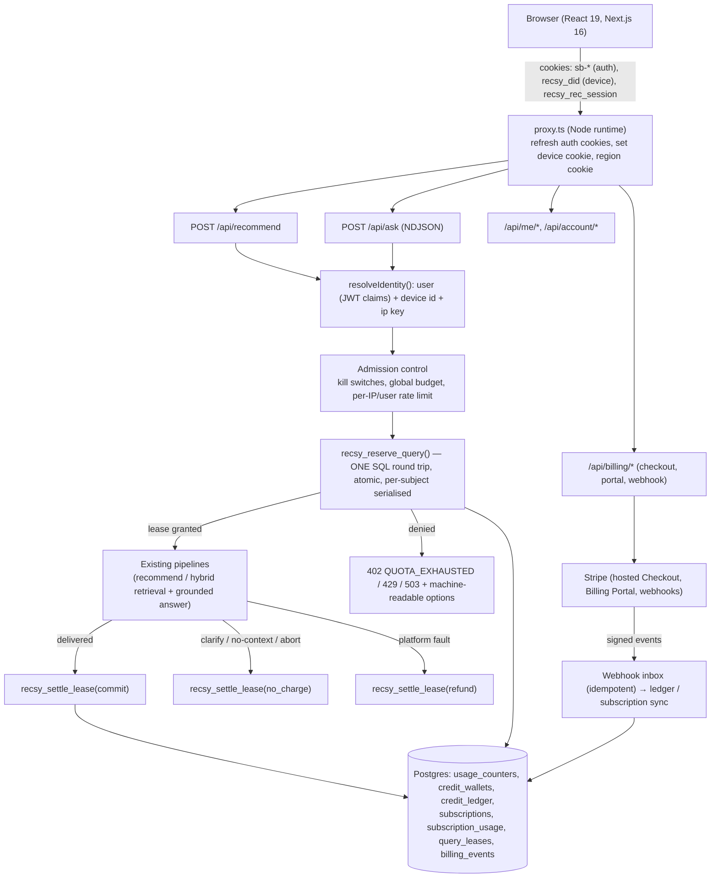
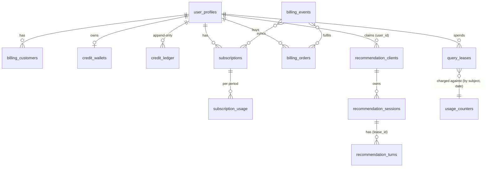
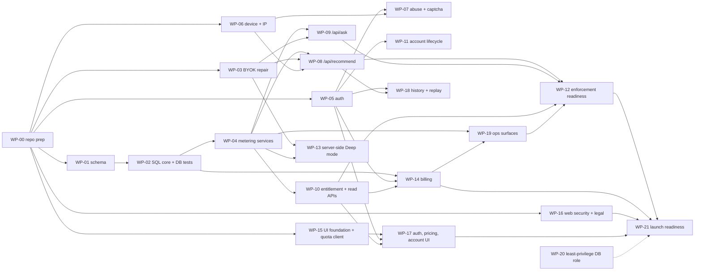

# RECSY Multi-User Platform: Accounts, Metering, Billing, Scale & Artful Experience

> **Plan number:** 25  
> **Document version:** 2.0.0 (supersedes v1.0.0, which is preserved unchanged at `docs/ImplementationPlans/archive/25. multi-user-platform-quotas-billing-and-artful-experience-plan.v1.0.0.md`; v1 findings are itemised in [Section 2](#2-critical-review-of-v100-what-was-wrong-and-why-it-matters))  
> **Status:** Ready for implementation **after the Decision Gate in [Section 1.4](#14-decision-register-owner-decisions-required-before-wp-gates)** is answered by the owner  
> **Target system:** RECSY v2 as of 2026-10-21 (Next.js 16.2.4 App Router, React 19.2, Drizzle ORM 0.45, `postgres` driver, Supabase Postgres + pgvector, `motion` 12, Tailwind v4, Model Gateway)  
> **Authoring perspectives:** Principal software architect (large-scale consumer platforms), Staff SRE, Application-security engineer, FinTech/payments engineer, Senior UI/UX designer and creative technologist  
> **Target file:** `docs/ImplementationPlans/25. multi-user-platform-quotas-billing-and-artful-experience-plan.md`  
> **Companion docs to update when work lands:** `docs/RECSY_V2_PROJECT_CONTEXT.md` (see [Section 17.6](#176-documentation-obligations-repo-rule-docs-move-with-code)), new ADRs 0019 to 0022 ([Section 17.5](#175-adrs-to-author))

**How v2 was produced.** Every claim about the existing system below was checked against the code in the repository at the commit `a46362b` (master, 2026-10-21) and cited as `path:line` or `path`. The core reservation SQL in [Section 6.4](#64-reference-sql-the-tested-metering-core) was **executed against a real PostgreSQL 16 instance** and load-tested with `pgbench` (200 concurrent reservation calls from 40 connections on one user: exactly 2 admitted; credits: 7 granted, 200 concurrent attempts, exactly 7 admitted, balance 0; in-flight cap: exactly 2). The v1 reservation SQL was executed the same way: its anonymous path **crashes on every call** (ambiguous column) and, once that is patched, **admits 29 queries against a limit of 2** under 40-way concurrency. Anything that could not be verified from this environment (third-party pricing, provider terms, regulations, dashboard settings) is tagged **[VERIFY]** and must be re-checked by the implementing agent before relying on it.

---

## Contents

- [0. How agents must use this document](#0-how-agents-must-use-this-document)
- [1. Executive summary, product rules and decisions](#1-executive-summary-product-rules-and-decisions)
  - [1.1 What RECSY is today (one paragraph, verified)](#11-what-recsy-is-today-one-paragraph-verified)
  - [1.2 Business rules (final, unambiguous; the single source for all WPs)](#12-business-rules-final-unambiguous-the-single-source-for-all-wps)
  - [1.3 Architecture in one picture](#13-architecture-in-one-picture)
  - [1.4 Decision register (owner decisions required before WP gates)](#14-decision-register-owner-decisions-required-before-wp-gates)
  - [1.5 Other things that need attention (checklist beyond the engine)](#15-other-things-that-need-attention-checklist-beyond-the-engine)
- [2. Critical review of v1.0.0: what was wrong and why it matters](#2-critical-review-of-v100-what-was-wrong-and-why-it-matters)
- [3. Ground truth: the system as it exists today](#3-ground-truth-the-system-as-it-exists-today)
  - [3.1 Request surfaces and identity](#31-request-surfaces-and-identity)
  - [3.2 Data layer](#32-data-layer)
  - [3.3 LLM layer](#33-llm-layer)
  - [3.4 Frontend](#34-frontend)
  - [3.5 Operations](#35-operations)
  - [3.6 Constraints this plan must respect](#36-constraints-this-plan-must-respect)
- [4. Target architecture](#4-target-architecture)
  - [4.1 Components](#41-components)
  - [4.2 Request lifecycle: `POST /api/recommend` (target)](#42-request-lifecycle-post-apirecommend-target)
  - [4.3 Trust boundaries and secrets](#43-trust-boundaries-and-secrets)
- [5. Domain rules in detail (normative)](#5-domain-rules-in-detail-normative)
  - [5.1 Subjects](#51-subjects)
  - [5.2 Consumption order and counters (authenticated user)](#52-consumption-order-and-counters-authenticated-user)
  - [5.3 Anonymous visitor](#53-anonymous-visitor)
  - [5.4 Outcome mapping (what gets charged)](#54-outcome-mapping-what-gets-charged)
  - [5.5 Time](#55-time)
  - [5.6 Concurrency rules](#56-concurrency-rules)
  - [5.7 Entitlement snapshot (what the UI reads)](#57-entitlement-snapshot-what-the-ui-reads)
- [6. Data model](#6-data-model)
  - [6.1 Principles](#61-principles)
  - [6.2 Entity overview](#62-entity-overview)
  - [6.3 Drizzle definitions (`src/services/db/schema.ts`, append after `rateLimits`)](#63-drizzle-definitions-srcservicesdbschemats-append-after-ratelimits)
  - [6.4 Reference SQL: the tested metering core](#64-reference-sql-the-tested-metering-core)
  - [6.5 RLS, grants, smoke, setup changes](#65-rls-grants-smoke-setup-changes)
  - [6.6 Retention and pruning (extend `scripts/db-prune.ts`)](#66-retention-and-pruning-extend-scriptsdb-prunets)
  - [6.7 Required database tests (WP-02)](#67-required-database-tests-wp-02)
- [7. The metering engine (services, routes, BYOK repair)](#7-the-metering-engine-services-routes-byok-repair)
  - [7.1 Configuration (`src/services/metering/config.ts`, backed by `src/env.ts`)](#71-configuration-srcservicesmeteringconfigts-backed-by-srcenvts)
  - [7.2 Identity resolution (`src/services/auth/identity.ts`)](#72-identity-resolution-srcservicesauthidentityts)
  - [7.3 Reserve, run, settle (the contract every metered route follows)](#73-reserve-run-settle-the-contract-every-metered-route-follows)
  - [7.4 Lease TTL, expiry, sweeper](#74-lease-ttl-expiry-sweeper)
  - [7.5 Admission control: kill switch, global budget, load shedding](#75-admission-control-kill-switch-global-budget-load-shedding)
  - [7.6 BYOK repair (WP-03, prerequisite for R6)](#76-byok-repair-wp-03-prerequisite-for-r6)
  - [7.7 Error contract (HTTP + JSON), see also Section 15.2](#77-error-contract-http--json-see-also-section-152)
  - [7.8 Entitlement endpoint (`GET /api/me/entitlements`)](#78-entitlement-endpoint-get-apimeentitlements)
  - [7.9 Cost attribution](#79-cost-attribution)
  - [7.10 What does not change](#710-what-does-not-change)
- [8. Authentication, identity and abuse defence](#8-authentication-identity-and-abuse-defence)
  - [8.1 Choices and Supabase project checklist (WP-05, owner-assisted)](#81-choices-and-supabase-project-checklist-wp-05-owner-assisted)
  - [8.2 `proxy.ts` (replaces `src/middleware.ts`)](#82-proxyts-replaces-srcmiddlewarets)
  - [8.3 Server helpers (`src/services/auth/`)](#83-server-helpers-srcservicesauth)
  - [8.4 Device identity and anonymous behaviour](#84-device-identity-and-anonymous-behaviour)
  - [8.5 Sign-in flows and routes](#85-sign-in-flows-and-routes)
  - [8.6 Anonymous-to-account graduation (`claimAnonymousState`)](#86-anonymous-to-account-graduation-claimanonymousstate)
  - [8.7 Abuse defence stack (defence in depth, cheapest first)](#87-abuse-defence-stack-defence-in-depth-cheapest-first)
  - [8.8 Account lifecycle](#88-account-lifecycle)
- [9. Billing](#9-billing)
  - [9.1 Principles](#91-principles)
  - [9.2 Pricing and unit economics](#92-pricing-and-unit-economics)
  - [9.3 Provider abstraction and files](#93-provider-abstraction-and-files)
  - [9.4 Flows](#94-flows)
  - [9.5 Webhook route and inbox state machine: `POST /api/billing/webhook`](#95-webhook-route-and-inbox-state-machine-post-apibillingwebhook)
  - [9.6 Event matrix (what each event does)](#96-event-matrix-what-each-event-does)
  - [9.7 Refund and dispute policy (to be published on `/refunds`, wording reviewed by counsel)](#97-refund-and-dispute-policy-to-be-published-on-refunds-wording-reviewed-by-counsel)
  - [9.8 Reconciliation (`pnpm billing:reconcile`, WP-14)](#98-reconciliation-pnpm-billingreconcile-wp-14)
  - [9.9 Billing configuration](#99-billing-configuration)
  - [9.10 Billing tests (WP-14; Section 14 lists tooling)](#910-billing-tests-wp-14-section-14-lists-tooling)
- [10. Security, privacy and compliance](#10-security-privacy-and-compliance)
  - [10.1 Assets, adversaries and the controls that matter](#101-assets-adversaries-and-the-controls-that-matter)
  - [10.2 Data-access posture (fixes F-04, F-11, F-12)](#102-data-access-posture-fixes-f-04-f-11-f-12)
  - [10.3 Web-application security](#103-web-application-security)
  - [10.4 Privacy, retention and compliance](#104-privacy-retention-and-compliance)
  - [10.5 Data export and account deletion (R10)](#105-data-export-and-account-deletion-r10)
  - [10.6 Authorisation checklist (IDOR defence)](#106-authorisation-checklist-idor-defence)
  - [10.7 Logging, redaction and secrets](#107-logging-redaction-and-secrets)
  - [10.8 Supply chain](#108-supply-chain)
  - [10.9 Security test and review gates](#109-security-test-and-review-gates)
- [11. Capacity, scaling, reliability and operations](#11-capacity-scaling-reliability-and-operations)
  - [11.1 Where the real bottleneck is](#111-where-the-real-bottleneck-is)
  - [11.2 Throughput model (Little's law, parameterised)](#112-throughput-model-littles-law-parameterised)
  - [11.3 Service level objectives (SLOs) and the SLIs behind them](#113-service-level-objectives-slos-and-the-slis-behind-them)
  - [11.4 Scaling levers, in the order to pull them](#114-scaling-levers-in-the-order-to-pull-them)
  - [11.5 Degradation ladder (every rung is a flag, none needs a deploy)](#115-degradation-ladder-every-rung-is-a-flag-none-needs-a-deploy)
  - [11.6 Failure modes and effects analysis (FMEA)](#116-failure-modes-and-effects-analysis-fmea)
  - [11.7 Runbooks (one page each lives in `docs/runbooks/`, authored in WP-19/WP-21)](#117-runbooks-one-page-each-lives-in-docsrunbooks-authored-in-wp-19wp-21)
- [12. UI and UX specification](#12-ui-and-ux-specification)
  - [12.1 Design principles (the test every screen must pass)](#121-design-principles-the-test-every-screen-must-pass)
  - [12.2 Tokens and primitives (these are the real tokens; do not invent others)](#122-tokens-and-primitives-these-are-the-real-tokens-do-not-invent-others)
  - [12.3 Information architecture](#123-information-architecture)
  - [12.4 The Quota HUD](#124-the-quota-hud)
  - [12.5 Auth Sheet and sign-in](#125-auth-sheet-and-sign-in)
  - [12.6 Quota and denial UI](#126-quota-and-denial-ui)
  - [12.7 `/account`](#127-account)
  - [12.8 Transactional email templates](#128-transactional-email-templates)
  - [12.9 `/pricing` and checkout return](#129-pricing-and-checkout-return)
  - [12.10 Motion choreography (all `transform`/`opacity` only)](#1210-motion-choreography-all-transformopacity-only)
  - [12.11 Performance budgets (enforced in CI by `scripts/check-bundle-budget.ts` reading `.next` build stats; thresholds are gzip)](#1211-performance-budgets-enforced-in-ci-by-scriptscheck-bundle-budgetts-reading-next-build-stats-thresholds-are-gzip)
  - [12.12 Accessibility (WCAG 2.2 AA target)](#1212-accessibility-wcag-22-aa-target)
  - [12.13 Responsive behaviour](#1213-responsive-behaviour)
  - [12.14 Copy deck (single source: `src/content/copy.ts`, typed, no inline strings in components)](#1214-copy-deck-single-source-srccontentcopyts-typed-no-inline-strings-in-components)
  - [12.15 Component inventory and file map (ownership for WPs 15 to 17)](#1215-component-inventory-and-file-map-ownership-for-wps-15-to-17)
  - [12.16 Visual QA and the UI lab](#1216-visual-qa-and-the-ui-lab)
- [13. Observability](#13-observability)
  - [13.1 Principles and decisions](#131-principles-and-decisions)
  - [13.2 The per-request summary line (WP-04)](#132-the-per-request-summary-line-wp-04)
  - [13.3 Event catalogue](#133-event-catalogue)
  - [13.4 Alerts (SQL-driven, no vendor required)](#134-alerts-sql-driven-no-vendor-required)
  - [13.5 Internal dashboards (WP-19, behind the existing operator auth; reuse `src/app/internal/_components`)](#135-internal-dashboards-wp-19-behind-the-existing-operator-auth-reuse-srcappinternal_components)
  - [13.6 Tracing and support lookups](#136-tracing-and-support-lookups)
  - [13.7 Product funnel (privacy-preserving, no third-party tracker)](#137-product-funnel-privacy-preserving-no-third-party-tracker)
  - [13.8 Invariant audit job (`scripts/metering-audit.ts`, nightly + on demand)](#138-invariant-audit-job-scriptsmetering-auditts-nightly--on-demand)
- [14. Testing strategy](#14-testing-strategy)
  - [14.1 Layers and gates](#141-layers-and-gates)
  - [14.2 Hard rules for test environments](#142-hard-rules-for-test-environments)
  - [14.3 Required unit-test inventory (non-exhaustive; each WP lists its own)](#143-required-unit-test-inventory-non-exhaustive-each-wp-lists-its-own)
  - [14.4 Route contract matrix (service integration)](#144-route-contract-matrix-service-integration)
  - [14.5 End-to-end journeys (Playwright, fake auth + fake billing, controlled LLM)](#145-end-to-end-journeys-playwright-fake-auth--fake-billing-controlled-llm)
  - [14.6 Load and contention tests (local Postgres only)](#146-load-and-contention-tests-local-postgres-only)
  - [14.7 Chaos and failure injection](#147-chaos-and-failure-injection)
  - [14.8 Migration tests](#148-migration-tests)
  - [14.9 Definition of done (applies to every WP)](#149-definition-of-done-applies-to-every-wp)
- [15. Appendices](#15-appendices)
  - [15.1 Environment variable catalogue](#151-environment-variable-catalogue)
  - [15.2 API contracts](#152-api-contracts)
  - [15.3 New and changed file map (merge-conflict radar)](#153-new-and-changed-file-map-merge-conflict-radar)
  - [15.4 Glossary](#154-glossary)
- [16. Work packages](#16-work-packages)
  - [16.1 Parallelisation map and merge hotspots](#161-parallelisation-map-and-merge-hotspots)
  - [16.2 Template every WP follows](#162-template-every-wp-follows)
  - [WP-00 Repository preparation (S)](#wp-00-repository-preparation-s)
  - [WP-01 Schema and migration `0012` (M)](#wp-01-schema-and-migration-0012-m)
  - [WP-02 Metering SQL core, seeds, and the DB test suite (L)](#wp-02-metering-sql-core-seeds-and-the-db-test-suite-l)
  - [WP-03 BYOK repair (M) — prerequisite for R6](#wp-03-byok-repair-m--prerequisite-for-r6)
  - [WP-04 Metering services (L)](#wp-04-metering-services-l)
  - [WP-05 Authentication (L) — needs D1, D12](#wp-05-authentication-l--needs-d1-d12)
  - [WP-06 Device and IP identity (M) — needs D7, D8](#wp-06-device-and-ip-identity-m--needs-d7-d8)
  - [WP-07 Abuse defence and captcha (M) — needs D13](#wp-07-abuse-defence-and-captcha-m--needs-d13)
  - [WP-08 `/api/recommend` integration (M)](#wp-08-apirecommend-integration-m)
  - [WP-09 `/api/ask` integration (M)](#wp-09-apiask-integration-m)
  - [WP-10 Entitlement and read APIs (M)](#wp-10-entitlement-and-read-apis-m)
  - [WP-11 Account lifecycle and email service (M) — needs D12](#wp-11-account-lifecycle-and-email-service-m--needs-d12)
  - [WP-12 Enforcement readiness (M) — needs D3, D4](#wp-12-enforcement-readiness-m--needs-d3-d4)
  - [WP-13 Server-side Deep reasoning (M)](#wp-13-server-side-deep-reasoning-m)
  - [WP-14 Billing (L) — needs D2, D5, D6, D9, D10, D11](#wp-14-billing-l--needs-d2-d5-d6-d9-d10-d11)
  - [WP-15 UI foundation and quota client (L)](#wp-15-ui-foundation-and-quota-client-l)
  - [WP-16 Web security and compliance (M)](#wp-16-web-security-and-compliance-m)
  - [WP-17 Auth, pricing and account UI (L)](#wp-17-auth-pricing-and-account-ui-l)
  - [WP-18 History sync and request replay (M)](#wp-18-history-sync-and-request-replay-m)
  - [WP-19 Operations surfaces (M)](#wp-19-operations-surfaces-m)
  - [WP-20 Least-privilege database role (S, recommended before launch)](#wp-20-least-privilege-database-role-s-recommended-before-launch)
  - [WP-21 Launch readiness (M)](#wp-21-launch-readiness-m)
- [17. Rollout, governance, risks](#17-rollout-governance-risks)
  - [17.1 Rollout stages (each reversible by flags; migrations are forward-only and additive)](#171-rollout-stages-each-reversible-by-flags-migrations-are-forward-only-and-additive)
  - [17.2 Go / no-go checklist (S3 and S5; each item needs an evidence link in the PR)](#172-go--no-go-checklist-s3-and-s5-each-item-needs-an-evidence-link-in-the-pr)
  - [17.3 Deployment mechanics](#173-deployment-mechanics)
  - [17.4 Risk register](#174-risk-register)
  - [17.5 ADRs to author](#175-adrs-to-author)
  - [17.6 Documentation obligations (repo rule: docs move with code)](#176-documentation-obligations-repo-rule-docs-move-with-code)
  - [17.7 Open questions for the owner (answers change scope, not architecture)](#177-open-questions-for-the-owner-answers-change-scope-not-architecture)
  - [17.8 Implementation status (agents tick as they merge)](#178-implementation-status-agents-tick-as-they-merge)
  - [17.9 Review log](#179-review-log)

---

## 0. How agents must use this document

1. **Read order for an implementing agent:** Section 0, Section 3 (ground truth), Section 5 (domain rules), then only the Work Package (WP) you own in [Section 16](#16-work-packages) plus the sections it links. Do not re-derive decisions; they are recorded in Section 1.4.
2. **Work packages (WPs) are the unit of delegation.** Each WP lists its dependencies, the exact files it may touch, interfaces it must expose, tests, and acceptance criteria. A WP must not edit files owned by another WP except through the "shared hotspot" protocol in [Section 16.1](#161-parallelisation-map-and-merge-hotspots).
3. **Repository rules that apply to every WP** (from `docs/RECSY_V2_PROJECT_CONTEXT.md` section 24, verified against `eslint.config.mjs`, `commitlint.config.mjs`, `.husky`):
   - Every `.ts`/`.tsx` file opens with a JSDoc header: purpose, contents, implementation notes, "Used by".
   - Never read `process.env` outside `src/env.ts` (ESLint `no-process-env`); add new variables to `src/env.ts` (server schema plus `runtimeEnv` mapping), `.env.example`, and the CI e2e env block in `.github/workflows/ci.yml`.
   - Every new module ships with a colocated `*.test.ts` (Vitest, node env, no live DB or LLM in unit tests). Database-level behaviour is tested by the **integration suite introduced in WP-02** against the CI Postgres service container.
   - Conventional Commits with the scopes allowed by `commitlint.config.mjs`: `recommend, chat, phones, aspects, ingest, ui, theme, db, llm, logger, infra, ci, deps, docs, repo`. There is no `auth`, `billing`, or `metering` scope: use `db` for schema and SQL, `infra` for auth/proxy/billing plumbing, `ui` for components, `recommend`/`chat` for route changes. (WP-00 may add scopes `auth`, `billing`, `metering` to `commitlint.config.mjs` as its first commit; if it does, later WPs may use them.)
   - `pnpm format:check`, `pnpm lint`, `pnpm typecheck`, `pnpm test`, `pnpm build`, and `pnpm db:smoke` must pass. After any migration run `pnpm db:setup` then `pnpm db:smoke` locally against a **local** Postgres (never run load or staging campaigns against the hosted Supabase database; see `src/services/eval/workload-guard.ts` and Section 26 of the context doc).
   - Forward-only migrations; no destructive DDL; `IF NOT EXISTS` everywhere; every new table is added to `drizzle/rls.sql` (ENABLE ROW LEVEL SECURITY and REVOKE from `anon`/`authenticated`) and to the `REQUIRED_TABLES` list in `scripts/db-smoke.ts`.
   - UI: 0px radius is enforced globally (`src/app/globals.css`, `* { border-radius: 0 !important }`); use semantic tokens (`bg-background`, `text-primary`, `border-outline-variant`, `text-accent`), never raw hex in feature code.
4. **Honesty rule.** If a WP discovers that a statement in this plan is false against the code, the WP must stop, write the discrepancy in its PR description, fix the plan paragraph in the same PR, and continue. The plan is a living document.

---

## 1. Executive summary, product rules and decisions

### 1.1 What RECSY is today (one paragraph, verified)

RECSY is a single-tenant-by-accident, anonymous web app: there is **no authentication anywhere** (`@supabase/ssr` is not installed; `@supabase/supabase-js` is present but only the public URL/anon key are declared), identity is an HttpOnly random cookie `recsy_rec_session` that maps 1:1 to a `recommendation_clients` row and one `recommendation_sessions` row (`src/services/recommender/session.ts:51-76`), abuse control is a per-IP-hash fixed-window counter in the `rate_limits` table (30 `/api/ask` and 24 `/api/recommend` per minute, `src/lib/constants.ts`), cost control is "free tier keys plus an in-process quota governor", and the whole stack runs on Vercel Hobby, Supabase Free, and free-tier LLM keys (`docs/deployment/README.md`). It is excellent at what it does (grounded recommendations), but nothing in it can say "this person has used their two free queries today" or "this person paid".

### 1.2 Business rules (final, unambiguous; the single source for all WPs)

| # | Rule | Notes |
| - | ---- | ----- |
| R1 | Every person gets **2 free billable queries per UTC calendar day**. | Configurable: `FREE_DAILY_QUERIES` (default 2). Reset at 00:00:00 UTC; UI shows an exact countdown plus the user's local reset time. |
| R2 | A **billable query** is one *delivered* result: a `/api/recommend` response of kind `results` with at least one pick, or a `/api/ask` answer generated from at least one retrieved chunk. | Clarifying questions, empty result sets ("no catalog entries matched"), "no evidence" answers, errors, upstream failures, and client aborts are **not** billed (non-error cases are free only up to the abuse cap in Section 5.4). This is the most important UX rule in the plan: without it, two clarifying questions would burn the whole day for zero value. |
| R3 | After free queries are used, consumption order is **subscription included allowance, then purchased credits**. | A paying user never loses a credit while a cheaper included query remains. |
| R4 | **Credit packs** never expire (initial policy; legal review flagged in D9). 1 credit = 1 billable query. | Prices in [Section 9.2](#92-pricing-and-unit-economics). |
| R5 | **Pro subscription**: monthly, N included queries per billing period (default 150), plus the benefits that actually exist at launch (Section 9.2). | Period-keyed usage; no counter reset by webhook order. |
| R6 | **BYOK (bring your own key)**: a request that carries a user key executes **only** on that key, never falls back to platform keys, and is exempt from the free/paid quota but subject to a generous daily cap (default 100) and the normal rate limits. | Requires the Phase-0 BYOK repair (WP-03); v1's "any header means unlimited" was a platform-funded loophole. |
| R7 | **Anonymous visitors** may use RECSY immediately. They receive the same daily allowance **counted per device** (`ANON_DAILY_QUERIES`, default 2). When it is used, the only way forward is sign-in (then purchase). | Setting `ANON_DAILY_QUERIES=0` makes sign-in mandatory for every query. Anonymous usage carries over to the account on sign-in (no reset, no double). |
| R8 | **Fail safe for the user, fail closed for the budget.** If RECSY cannot run the query (platform fault), the user is not charged. If RECSY cannot verify entitlement (metering database unreachable), it does not call a model. | Details in the FMEA (Section 11.6). |
| R9 | Refunds of money (Stripe) claw back unspent credits; disputes freeze purchases for the account until resolved. | Section 9.7. |
| R10 | Users can export and delete their data; financial records are retained pseudonymously. | Section 10.5. |

### 1.3 Architecture in one picture



### 1.4 Decision register (owner decisions required before WP gates)

Each decision has a **recommendation**, which implementing agents follow by default unless the owner overrides. "Gate" is the first WP that cannot start without the answer.

| ID | Decision | Recommendation | Why | Gate |
| -- | -------- | -------------- | --- | ---- |
| D1 | Identity provider | **Supabase Auth** via `@supabase/ssr`, Google OAuth plus email one-time code/magic link, no passwords | Already in the stack, free tier supports 50k monthly active users (see `docs/ImplementationPlans/22...` usage table), no extra network vendor, JWT verification can be local **[VERIFY]** | WP-05 |
| D2 | Hosting plan | **Move the app off Vercel Hobby before taking money** (Vercel Pro or equivalent) | Hobby is restricted to non-commercial use **[VERIFY current terms]**; also Hobby function limits shape capacity (Section 11) | WP-14 (billing live) |
| D3 | Database plan | **Supabase Pro (or equivalent) before public launch** | Free tier has no point-in-time recovery, projects can be paused after inactivity, a 500 MB database cap, and a 5 GB egress cap that was already exceeded once (context doc section 26) **[VERIFY current plan limits]** | WP-12 (enforce) |
| D4 | LLM capacity | **Paid LLM tier(s) with SLA** for the platform pool before enforcing quotas on the public | The platform pool is built on free-tier keys with per-key RPD of 20 in the shipped pacing profile (`src/env.ts: GEMINI_FREE_RPD default 20`); free-tier terms commonly allow provider-side use of content and prohibit or limit production use **[VERIFY each provider's current terms]** | WP-12 |
| D5 | Payment provider | **Stripe** (hosted Checkout, Billing Portal, webhooks) behind a `BillingProvider` interface; evaluate a **merchant of record** (Paddle, Lemon Squeezy, or similar) if the owner does not want to register for VAT/GST/sales tax | A solo operator selling globally inherits indirect-tax obligations; a merchant of record absorbs them for a higher fee. Provider availability depends on the owner's legal entity country **[VERIFY]** | WP-14 |
| D6 | Price points | Start from the table in Section 9.2 (minimum pack >= $3, packs sized to keep payment fees under ~13% of revenue) | The v1 prices ($2/20 queries) lose about 18% to Stripe's fixed fee alone **[VERIFY Stripe pricing]** | WP-14 |
| D7 | Anonymous allowance | `ANON_DAILY_QUERIES=2` (per device) | Preserves zero-friction first value; owner can set 1 or 0 | WP-06 |
| D8 | Daily reset boundary | **UTC midnight** with explicit countdown and local time display | Simple, exploit-resistant; for India this is 05:30 IST, so the UI must say so | WP-06 |
| D9 | Credit expiry / stored-value law | **No expiry at launch**, ledger supports adding expiry later; obtain legal review for prepaid-credit rules in launch jurisdictions | Regulation of prepaid balances varies by jurisdiction **[VERIFY, not legal advice]** | WP-14 |
| D10 | Pro benefits that are real at launch | Included query volume, **server-enforced Deep reasoning mode** (maps to the existing `userMode: 'deep'` router path, Gemini 2.5 Pro class model), higher in-flight concurrency (2), saved conversation history across devices (WP-18). **Not at launch:** PDF comparison export, "priority queue", "unconstrained aspect filtering" (v1 promised these; none exist) | Never sell what is not built | WP-14 |
| D11 | Currency | **USD at launch**; INR as Phase 2 (one-time packs first; recurring card billing in India has additional regulatory friction **[VERIFY]**) | Region cookie supports only `US` and `IN` today (`src/lib/regions.ts`) | WP-14 |
| D12 | Transactional email | **Custom SMTP provider** (Resend, Postmark, SES) configured in Supabase Auth; the default Supabase mailer is for testing and heavily rate-limited **[VERIFY]** | Magic links are the primary login path | WP-05 |
| D13 | Bot protection | **Cloudflare Turnstile** on sign-in (Supabase Auth captcha setting) and on risk-flagged anonymous queries; not on every request | Friction only where abuse concentrates | WP-07 |
| D14 | Rollout | `QUOTA_MODE` = `off` then `shadow` then `enforce`; paid features behind `BILLING_ENABLED` and an allowlist for the first live-mode transactions | De-risks real money and real users | WP-12/14 |
| D15 | Log retention | Add a **log drain** to a free-tier log service before public launch; use DB-derived metrics and alerts meanwhile | Small hosting plans retain logs briefly **[VERIFY]**, which makes incident debugging impossible | WP-19 |
| D16 | Error reporting | **Server-side only** Sentry (`@sentry/nextjs` via `instrumentation.ts`), no client SDK; optional | A client SDK adds tens of KB to every page; `SENTRY_DSN` already exists in `src/env.ts` but the package is not installed | WP-19 |

If the owner answers nothing, agents proceed with the recommendations **except** D2, D3, D4, and D5, which are hard external prerequisites: WPs 12 and 14 will not be merged to run in production until those are confirmed. D15 and D16 are introduced in Section 13 and default to the recommendation.

### 1.5 Other things that need attention (checklist beyond the engine)

These are easy to forget and each has an owner in Section 16:

| Topic | What | Where |
| ----- | ---- | ----- |
| Search and crawling | `noindex` on `/account`, `/login`, billing return; `robots.ts` disallows `/api/` and `/auth/`; `/pricing` in the sitemap with an OG image | WP-16 |
| Bots and crawlers | JavaScript-running crawlers must not trigger per-page database reads (the entitlement endpoint answers cookie-less requests from static defaults, 7.8); bots hitting metered routes are stopped by the same quota | WP-10 |
| Legal and trust | Terms, Privacy, Refunds, Contact, cookie statement, sub-processor list, age statement, reviewed by counsel before billing is live | WP-16, WP-21 |
| Support | a monitored support address, a response-time promise on `/contact`, the account Usage tab so people can see why a query was or was not charged, operator tools to grant credits | WP-17, WP-19 |
| Transactional email | custom SMTP with SPF/DKIM/DMARC, branded templates, plain-text parts, deliverability test | WP-05, WP-11, WP-14 |
| Hosting, database, and LLM plans | commercial-use terms, backups, capacity, paid LLM tier (D2 to D4) | owner, WP-12 |
| Money operations | tax approach, refund policy, dispute handling, reconciliation, payout monitoring, bookkeeping export from Stripe | WP-14, WP-21 |
| Data lifecycle | retention jobs, export, deletion with cooling period, backup disclosure | WP-11, WP-16 |
| Incident readiness | alerts that work when the database is down, runbooks, kill switch drill, rollback per stage | WP-19, WP-21 |
| Accessibility and mobile | keyboard, screen reader, 44 px targets, iOS zoom fix, forced colors, reduced motion | WP-15, WP-17 |
| Communication | release notes entry, an About/FAQ update describing the free allowance, a short in-app notice when enforcement starts (S3) | WP-17, WP-21 |
| Deliberately excluded | referral programmes and promo codes (abuse surface; admin grants only), annual plans, team/organisation accounts, API access for third parties, usage-based invoicing | revisit after launch |

---

## 2. Critical review of v1.0.0: what was wrong and why it matters

This section is the audit the owner asked for. Severity: **B** = blocker (would lose money, leak data, or not work), **H** = high, **M** = medium, **L** = low. "Evidence" is something an agent can reproduce. The last column says where v2 fixes it.

| ID | Sev | Finding in v1 | Evidence | v2 fix |
| -- | --- | ------------- | -------- | ------ |
| F-01 | B | **BYOK header = unlimited free queries on the platform's money.** v1 sets `p_has_byok = Boolean(header x-recsy-user-key)` and exempts it from quota. But in the shipped code the gateway does not use the user key for Gemini and silently falls through to the platform cascade for providers without an adapter. | `src/services/llm/gateway/cascade-executor.ts:84-92` (`byokProvider === 'gemini'` calls `this.geminiProvider.chat(input)` with no key), `:184-192` same for structured, `:297-310` stream; `src/services/llm/keys/byok-parser.ts` accepts `openai` but `initAdapters()` registers only groq, nvidia, cerebras, github, openrouter; `GeminiProvider` has no `userByokKey` reference (`grep userByokKey src/services/llm/gemini.ts` is empty); embeddings (`retriever.ts:309`) always use platform keys. Any 8-character string in `x-recsy-user-key` currently runs on platform Gemini. | R6, Section 7.6, WP-03 |
| F-02 | B | **Anonymous quota is not atomic.** v1 does `SELECT COUNT(*)` then `INSERT`, with no lock and no unique constraint. | Executed v1 SQL: 40 concurrent clients on one cookie admitted **29** queries (limit 2) after patching F-03b. | Section 6.4 (conditional upsert plus advisory lock); tested |
| F-03 | B | **v1 reservation SQL does not run for anonymous callers.** (a) `charge_type` is both a `RETURNS TABLE` output column and a table column: `ERROR: column reference "charge_type" is ambiguous` on every anonymous call. (b) the timezone bug in F-15. | Reproduced on PostgreSQL 16 (see header). | Section 6.4 uses prefixed OUT names, tested |
| F-04 | B | **Public RPC exposure.** `SECURITY DEFINER` functions in the `public` schema are callable through Supabase PostgREST `/rest/v1/rpc/...` by anyone holding the public anon key unless `EXECUTE` is revoked. v1 also omitted `SET search_path` (classic definer-function hijack). An attacker could burn any user's quota by passing their `p_user_id`, or call a refund function to mint free queries. | `NEXT_PUBLIC_SUPABASE_ANON_KEY` is public by design (`src/env.ts`); `drizzle/rls.sql` revokes table access but v1 never revokes function `EXECUTE`. | Functions are `SECURITY INVOKER`, pin `search_path`, and explicitly revoke `EXECUTE` from `anon`/`authenticated` (verified: `REVOKE ... FROM PUBLIC` alone leaves `anon` able to execute when Supabase-style default privileges exist; Section 6.4) |
| F-05 | B | **Stripe webhook idempotency loses paid credits.** v1: insert event id, `ON CONFLICT DO NOTHING`, "if row exists respond 200". If the process crashes after the insert and before fulfilment, Stripe's retry sees a duplicate and returns 200: the customer paid and never receives credits. | v1 section 8.3 | Atomic effect plus inbox status machine; ledger idempotency key as the real guard (Section 9.5) |
| F-06 | H | **Reservations never expire.** If a serverless function is killed (platform timeout, crash, deploy), the `catch` block never runs: the lease stays `reserved` forever and the user is silently charged. | v1 section 7.2 has only a `try/catch` | Lease TTL, lazy per-subject expiry inside the reserve function, plus a sweeper (Section 7.4) |
| F-07 | H | **`refundQueryLease` is called but never defined**; daily-free vs subscription vs credit refund semantics (and the day-boundary case) are unspecified. | v1 section 7.2 vs section 5 | `recsy_settle_lease` / `recsy_undo_lease_charge` (Section 6.4) |
| F-08 | H | **The wrapper `withQueryQuotaLease(executor)` does not fit `/api/ask`.** That route returns a `ReadableStream` immediately; generation happens inside `ReadableStream.start()` and failures become in-stream `{type:'error'}` chunks under HTTP 200 (`src/app/api/ask/route.ts:85-155`). A closure that "commits when executor resolves" would commit before the answer exists or never see the failure. | code | Explicit lease handle with `commit/noCharge/refund`, settled inside the stream (Section 7.3) |
| F-09 | H | **"Query" is undefined**, and every POST would be charged. Many first messages legitimately end in a `clarify` turn (`RECOMMENDER_CLARIFY_THRESHOLD = 0.6` in `src/lib/constants.ts`; `hasActionableRecommendationInput` requires both a budget and a preference, `run-recommendation.ts:105-120`), and `/api/ask` short-circuits with `NO_CONTEXT_MODEL` and no LLM call (`src/services/chat/answer.ts`). Charging those is a UX and fairness failure. | code | Rule R2, Section 5 |
| F-10 | H | **Anonymous identity by `session_cookie OR ip_hash`** over-blocks (carrier-grade NAT on Indian and other mobile networks puts thousands of users behind one IP; offices and universities too) and is trivially bypassed by clearing cookies. v1 mentions a "fingerprint hash" it never specifies. | v1 section 5.2 step 5 | Device id plus wide per-IP-prefix soft cap plus sign-in (Section 8.4) |
| F-11 | H | **Supabase `auth.users` trigger and `auth.uid()` RLS break the repo's own setup**: CI e2e runs `pgvector/pgvector:pg16`, a vanilla Postgres with no `auth` schema and no `anon`/`authenticated` roles (`.github/workflows/ci.yml`, `scripts/db-setup.ts`), and evaluation runs use `eval_*` schemas. | files cited | No dependency on the `auth` schema; profile rows created by the server; RLS stays default-deny |
| F-12 | H | **RLS `auth.uid()` policies are security theatre for this app**: all server queries use a direct Postgres connection (`src/services/db/client.ts`) which does not evaluate JWT claims; a client-writable `user_profiles.tier` policy would let users self-upgrade. | code | No client-direct DB access to new tables at all (Section 10.2) |
| F-13 | H | **Payments and platform terms ignored**: Vercel Hobby is non-commercial **[VERIFY]**; Supabase Free has no PITR and a 5 GB egress cap already exceeded; LLM pool is free-tier keys. "Thousands of concurrent users" and "sub-millisecond" DB performance are asserted with no capacity math. | `docs/deployment/README.md`, context doc section 26 | Section 11 capacity model and decisions D2 to D4 |
| F-14 | H | **Pro features are promised that do not exist or are not reachable**: a "Studio comparison PDF export" (no PDF code anywhere: `grep -rli pdf src` is empty), "priority queries" (no queue exists), and "unconstrained aspect filtering" (no filter is constrained today). "Deep reasoning" does exist as a router tier (`src/services/llm/gateway/task-profiles.ts:150-175`, Gemini 2.5 Pro then `deepseek-ai/deepseek-r1` on NVIDIA NIM) but today it is reachable **only** when a BYOK key header is present, because `userMode` is parsed solely inside `extractByokFromHeaders` (`byok-parser.ts:30-38`); a Pro user would get nothing without new server-side plumbing. | repo | D10, Section 9.2, WP-13 |
| F-15 | M | **Timezone bug:** `v_today_utc TIMESTAMPTZ := date_trunc('day', NOW() AT TIME ZONE 'UTC')` yields a timestamp *without* zone which is then interpreted in the session `TimeZone`. Reproduced: with `SET timezone='Asia/Kolkata'` the "UTC day" becomes `2026-10-21 00:00:00+05:30` (that is 2026-10-20 18:30 UTC). | executed | Use a `date` column and `(now() AT TIME ZONE 'UTC')::date` |
| F-16 | M | **Subscription counter reset by webhook** (`invoice.payment_succeeded` sets `queries_used_this_period = 0`) races with consumption and depends on event order; also uses a legacy event name (prefer `invoice.paid`). | v1 section 8.3 | Usage keyed by `(subscription_id, period_start)` |
| F-17 | M | **Fulfilment ignores `payment_status`**: async payment methods complete a Checkout Session as `unpaid`; credits would be granted before money arrives. Missing `checkout.session.async_payment_succeeded`, refunds (`charge.refunded`), and disputes entirely. | v1 section 8.3 | Section 9.6 event matrix |
| F-18 | M | **Pricing destroys margin**: $2 for 20 queries loses ~18% to Stripe's $0.30 fixed fee; no tax; no minimum. | arithmetic in Section 9.2 | D6 |
| F-19 | M | **v1 stores the raw `session_cookie` (a bearer secret) in `query_metering_logs`** with an index, widening exposure of every active session to anyone with log-table read. (The pre-existing `recommendation_sessions.session_cookie` also stores the raw token; v2 does not extend that pattern and flags it for migration.) | v1 section 5.1; `schema.ts:469-488` | Device id is stored only as an HMAC digest |
| F-20 | M | **`user_tier` enum is denormalised state** (drifts from subscription/credit truth) and mixes in `admin`, which conflicts with the existing operator auth (`src/services/internal/auth.ts`, cookie `recsy_operator_session`). | v1 section 5.1 | Tier is derived on read; operator auth unchanged |
| F-21 | M | **Deleting a user cascades away quota history** (`user_daily_usage ON DELETE CASCADE`): re-register to reset. | v1 section 5.1 | Counters are keyed by id with no FK; deletion semantics in Section 10.5 |
| F-22 | M | **Edge/Turnstile/middleware claims are wrong for this repo**: the existing middleware matcher excludes `/api` entirely (`src/middleware.ts`), Next.js 16 renames the `middleware` convention to `proxy` **[VERIFY against installed `next` docs]**, and Turnstile tokens are single-use so they cannot be checked "per request at the edge". | `src/middleware.ts` | Section 8.2, 8.5 |
| F-23 | M | **Design-system claims contradict the code**: tokens are hex (`src/styles/theme.css`), not OKLCH; `--border` is `#444748`, not `rgba(255,255,255,0.08)`; the theme is forced dark (`ThemeProvider forcedTheme="dark"`, `src/app/layout.tsx`), so no light variant exists; the accent is orange `#d86b38`, the warning is `#ffd166` (v1 says "amber"); `DESIGN.md` does not exist (design lives in `design/`, ADR 0002, `docs/ImplementationPlans/7.` and `8.`); the animation library is the `motion` package (`motion/react`), and the "tactile auditory feedback" in v1 is undefined and undesirable. The context doc itself is stale on this point (section 15 still says OKLCH and light/dark toggle). | files cited | Section 12 uses the real tokens; context doc corrected in WP-17 |
| F-24 | M | **UI spec is thin**: no sign-in UI, no account page content, no pricing page, no checkout-return state, no error/empty/loading states, no mobile layout, no accessibility plan for dialogs (the existing `RegionSelector` drawer has no focus trap and `aria-hidden` toggling), the two-pip HUD cannot represent credits or subscription, no multi-tab sync, no copy deck. | v1 section 9 | Section 12 |
| F-25 | M | **Operational gaps**: no CSP (docs claim CSP in `next.config.ts` but only HSTS, nosniff, frame, referrer, permissions headers exist), no CSRF/origin checks for billing routes, no transactional email plan, no legal pages (terms, privacy, refunds are required by payment processors and privacy law), no data export/deletion, no kill switch, no global budget cap, no alerting (Sentry DSN env exists but `@sentry/*` is not a dependency), no automated production migration workflow (`docs/deployment/STATUS_AND_GAPS.md`). | repo | Sections 10, 11, 13 |
| F-26 | M | **Session graduation assumed columns that do not exist**: `UPDATE recommendation_sessions SET user_id ...` (no such column; ownership is `recommendation_clients`, and `insertRecommendationSession` creates one client per session, so the "multi-session" schema is not realised in code). | `schema.ts:456-499`, `session.ts:51-76` | Section 8.6 |
| F-27 | L | **Roadmap unrealistic and conflict-prone**: 1-day tasks for auth, billing, and a full UI; all phases edit `schema.ts`, `rls.sql`, `env.ts`, and both API routes. | v1 section 11 | Section 16 |
| F-28 | L | **Status code semantics conflated**: v1 returns 429 for quota exhaustion; rate-limit 429 and entitlement exhaustion need different client behaviour. | v1 section 7.1 | 402 / 429 / 503 contract (Section 15.2) |
| F-29 | L | **Test plan too weak**: a 25-request HTTP concurrency test proves little; no vanilla-Postgres CI coverage for SQL functions, no webhook signature replay tests, no killed-function chaos test, no timezone test. | v1 section 12 | Section 14 |
| F-30 | L | **Supabase Auth practicalities missing**: custom SMTP, redirect URL allow-list, JWT signing keys for local verification (`getClaims`) vs network `getUser`, email link prefetch by mail scanners consuming one-time links, PKCE, Google OAuth consent-screen verification, email normalisation (`a.b+x@gmail.com` farming), session lifetime. | v1 section 6 | Section 8 |
| F-31 | L | **`payment_webhooks.payload` stores whole provider payloads** (PII and payment metadata) with no retention or minimisation. | v1 section 5.1 | Section 9.5, 10.4 |

**What v1 got right (kept):** two-phase reserve/commit/refund idea; per-subject atomic accounting; ledger for credits; idempotent webhooks as a goal; provider abstraction; strong aesthetic direction (precision-instrument HUD, hairlines, mono telemetry); UTC reset with live countdown; phase-based execution with agent specialisation; stress-test acceptance criterion (kept and strengthened).

---

## 3. Ground truth: the system as it exists today

Everything an implementing agent needs to know about the current code so nothing is assumed. File paths are relative to the repo root.

### 3.1 Request surfaces and identity

| Surface | Behaviour today | File |
| ------- | --------------- | ---- |
| `POST /api/recommend` | Node runtime, `force-dynamic`. Order: IP rate limit (`consumeRecommendRateLimit`) → read JSON (16 KiB cap) → load/create session by cookie `recsy_rec_session` → `runRecommendationPipeline` (1 structured LLM extraction call, optional 1 embedding call, in-process ranking over a cached catalog) → insert `recommendation_turns` in a short transaction → JSON response `{kind: 'results' \| 'clarify', ...}`. Not streaming. Errors map to `{code, message}` with `AppError.status`. | `src/app/api/recommend/route.ts` |
| `POST /api/ask` | Node runtime. IP rate limit → JSON (24 KiB cap) → phone lookup → returns a `ReadableStream` (NDJSON). Generation (hybrid retrieval, up to 2 LLM chat calls on citation-retry, 1 embedding call) completes **before** the first `delta` is written; `delta` chunks are a replay of the finished text (`chunkTextForStream`). Failures after the stream starts are `{type:'error'}` chunks under HTTP 200. `NO_CONTEXT_MODEL` short-circuits without an LLM call. Persists to `chat_queries`. | `src/app/api/ask/route.ts`, `src/services/chat/answer.ts` |
| `POST /api/set-region`, `GET /api/exchange-rate`, `GET /api/health` | Public, no DB for health. `set-region` runs on the edge runtime and sets cookie `recsy_region` (US or IN only). | `src/app/api/*` |
| `/internal/*`, `/api/internal/*` | Operator-only: HMAC-signed cookie `recsy_operator_session`, enabled by `INTERNAL_DASHBOARD_ENABLED`. Entirely separate from end-user identity; **must stay separate**. | `src/services/internal/auth.ts` |
| Proxy/middleware | `src/middleware.ts` only sets the region cookie; its matcher **excludes `/api`**. | `src/middleware.ts` |
| Identity | Anonymous cookie only. `recommendation_clients.client_token` = `recommendation_sessions.session_cookie` = same random 24-byte base64url token; one client per session. Raw token is stored in the DB. | `src/services/recommender/session.ts:51-76`, `schema.ts:456-499` |
| Rate limiting | Fixed 60 s window per `sha256("recsy|ask|v1|" + ip)` in `rate_limits`, atomic `INSERT ... ON CONFLICT DO UPDATE`. One write per request. IP = first `x-forwarded-for` hop else `x-real-ip` else `"unknown"` (all unknown clients share one bucket). | `src/services/rate-limit/consume.ts`, `src/lib/request-ip.ts` |
| BYOK | Browser `localStorage` (`recsy:setting:*`) → headers `x-recsy-user-key`, `x-recsy-user-provider`, `x-recsy-user-mode` on every `/api/ask` and `/api/recommend` call (`src/lib/byok-client.ts`). Server parses with `extractByokFromHeaders` (key length >= 8; `userMode` honoured **only** when a key is present). Provider honouring is incomplete (finding F-01). Log redaction exists for `userByokKey` and `headers.x-recsy-user-key`. | `src/services/llm/keys/byok-parser.ts`, `src/services/llm/gateway/cascade-executor.ts` |

### 3.2 Data layer

- Drizzle schema: `src/services/db/schema.ts` (1,401 lines, `casing: 'snake_case'` in `drizzle.config.ts`). Migrations `0000` to `0011` in `drizzle/migrations`; journal `drizzle/migrations/meta/_journal.json` (idx 0 to 11); snapshots exist only through `0010` (0011 was hand-authored RLS SQL). Setup orchestrator `scripts/db-setup.ts` runs: extensions → `drizzle migrate` → `drizzle/fts.sql` → `drizzle/rls.sql` → seeds. `scripts/db-smoke.ts` asserts a hard-coded table list.
- Connection: `postgres` driver, `max: 2` connections per process in production (`max: 4` otherwise), `prepare: false` (Supabase pooler transaction mode), `search_path` = `${DATABASE_SCHEMA}, extensions`, where `DATABASE_SCHEMA` matches `^(public|eval_[a-z0-9_]+)$` (`src/env.ts`). Evaluation campaigns create `eval_*` schemas **inside the hosted DB**; the workload guard now forces load tests to a local DB.
- RLS: default deny, `service_role`/owner connection bypasses RLS; `anon`/`authenticated` have SELECT only on public catalog tables (`drizzle/rls.sql`).
- CI database: `pgvector/pgvector:pg16` service container, plain Postgres (no `auth` schema, no Supabase roles) → **new SQL must not reference Supabase-only objects unguarded**.
- Egress budget: 2.0 GB/month target of the 5 GB Free allowance; public requests allocated 0.6 GB (context doc section 26.3). Any per-request payload added by this plan counts.

### 3.3 LLM layer

- `getLlm()` returns `CachedLlmProvider(ModelGatewayProvider | GeminiProvider ...)`. The gateway routes by task class and effort to tier pools (`TIER_MODEL_POOLS` in `src/services/llm/gateway/task-profiles.ts`): fast = Groq llama-3.1-8b → Cerebras → Gemini Flash; balanced = Gemini 3 Flash preview → Groq 70B → NVIDIA 70B → GitHub Models gpt-4o-mini; reasoning = Gemini 2.5 Pro → NVIDIA DeepSeek-R1 → Groq 70B → GitHub Models Llama 70B. Circuit breaker (3 failures, 60 s cooldown) and a **per-process, in-memory** quota governor (RPM/TPM/RPD per key) protect providers. **Both are per serverless instance**: at N instances the effective pacing is N times looser; they are not a global admission control.
- Calls per billable action (for cost and capacity math): **recommend** = 1 structured extraction (fast tier) + 0/1 embedding (only when phones have spec embeddings) + 0 other LLM calls; ranking is local. **ask** = 1 query embedding + 1 grounded generation (balanced tier, up to 2 on citation-retry) + optional rerank (off by default `RETRIEVAL_LLM_RERANK`). `llm_usage_events` records every call with tokens, model, `usageArea`, `usageFeature`, latency (`schema.ts:603`).
- Response cache: `llm_cache` (sha256 prompt key, 30-day TTL) deduplicates identical prompts across users; a cache hit costs the platform nothing, but it **is** a delivered answer (it is billed per R2).
- Embeddings (`input.llm.embed`) run through the Gemini provider with platform keys regardless of BYOK.
- Free-tier pacing profile: `GEMINI_RATE_LIMIT_PROFILE=google_ai_studio_free` (default `off`) with defaults `GEMINI_FREE_RPM=5`, `GEMINI_FREE_TPM_INPUT=250000`, `GEMINI_FREE_RPD=20` per key; up to 6 named keys plus extras. This is the real ceiling of the platform pool today.

### 3.4 Frontend

- Next.js App Router, React 19, Tailwind v4 with `@theme inline` tokens in `src/app/globals.css` + hex tokens in `src/styles/theme.css`; fonts via `next/font` (Inter body, Hanken Grotesk 700/800 display, JetBrains Mono data); theme **forced dark** (`ThemeProvider forcedTheme="dark"`); `* { border-radius: 0 !important }` global; `prefers-reduced-motion` collapses transitions globally; motion tokens `--motion-fast: 150ms`, `--motion-medium: 260ms`, `--motion-slow: 520ms`, `--ease-editorial: cubic-bezier(0.16, 1, 0.3, 1)`, `--ease-schematic: cubic-bezier(0.65, 0, 0.35, 1)`.
- Real colour tokens (hex): background `#000000`, foreground `#e2e2e2`, card/popover `#0e0e0e`, primary `#ffffff`, **accent `#d86b38`** (burnt orange, contrast on black ≈ 6.1:1), warning `#ffd166`, success `#a7f3d0`, destructive `#ffb4ab`, border/outline-variant `#444748`, outline `#8e9192`, surfaces `#131313 / #1b1b1b / #1f1f1f / #2a2a2a / #353535`.
- Established component vocabulary: `.meta-label` (mono 11px uppercase tracking 0.16em), `.display-heading`, `.brutalist-border`, `.interactive-panel` (accent border + 1px lift on hover), `.heading-scanline`, `.accent-hairline`, `.status-dot` states (`ready`, `running`, `failed`, ...), `BrutalistButton`/`BrutalistLinkButton` (`src/components/ui/button.tsx`: 1px outline, invert on hover), `BrutalistCard`, `SideNav` (desktop `lg:` left rail, used on `/recommend`), `AppHeader` (async server component; desktop nav + horizontally scrolling mobile nav; `RegionSelector` is a hand-rolled right drawer without focus trap).
- Motion usage today: `motion/react` imported only in `/internal/pipeline` components. Public pages are CSS-transition driven. `sonner` Toaster is mounted in the root layout (`position="top-right" richColors`).
- Client state: recommend page persists chat + snapshots to `sessionStorage` (`src/lib/recommend-session.ts`, 24 h TTL); settings (BYOK, reasoning mode, enter-to-send) in `localStorage` via `useSyncExternalStore` (`src/lib/client-settings.ts`).
- Mobile: `layout-overflow.spec.ts` guards against horizontal scroll at 390×844 and 1280×800 on `/`, `/browse`, `/recommend`, `/compare`, `/about`, `/settings`, `/p/apple-iphone-16-pro`. New pages must be added to that spec.
- PWA manifest has stale colours (`background_color: '#fafaf8'`, `theme_color: '#111114'`) that contradict the black theme (`viewport.themeColor '#000000'`); fix opportunistically in WP-15.

### 3.5 Operations

- Hosting: Vercel Hobby, auto-deploy `main`; DB: Supabase Free (single project, preview and prod share it); jobs: GitHub Actions crons (ingest, resume, scorecard, catalog, keepalive for the Actions crons themselves). **No workflow applies migrations to production** (`docs/deployment/STATUS_AND_GAPS.md:80-84`): schema changes in this plan need a manual or new automated step (WP-01).
- Observability: `pino` JSON logs (redaction list in `src/services/logger/index.ts`), `X-Trace-Id` response header on both routes, `llm_usage_events`, `@vercel/analytics`, `@vercel/speed-insights`. `SENTRY_DSN` is an env var but no Sentry package is installed.
- Security headers: `X-Content-Type-Options`, `X-Frame-Options: DENY`, `Referrer-Policy`, `Permissions-Policy`, HSTS. **No CSP.**
- Tests: Vitest (node env, colocated), Playwright specs in `e2e/` (mocked `/api/ask`, layout overflow, phone page), `scripts/db-smoke.ts`, evaluation scripts including `eval:http:load` with `LLM_PROVIDER=controlled` (deterministic stub, no real LLM) for local-DB load tests.

### 3.6 Constraints this plan must respect

1. Serverless: no shared in-process state across instances; anything global lives in Postgres (or a later Redis).
2. Two DB connections per instance and pooler transaction mode: **one round trip per hot-path operation**, no session-level features (`SET`, session advisory locks, `LISTEN`), transaction-scoped advisory locks are fine.
3. Egress and free-tier ceilings (Section 11).
4. No new framework: extend the existing conventions (Zod at boundaries, `AppError` subclasses, pino child loggers, colocated tests).

---

## 4. Target architecture

### 4.1 Components

| Component | Responsibility | New / changed | Owner WP |
| --------- | -------------- | ------------- | -------- |
| `proxy.ts` | Refresh Supabase auth cookies when present; mint the **device cookie** `__Host-recsy_did` when absent; keep region cookie logic. Runs only for page navigations and the `/api` routes that need auth (matcher in 8.2). Does **no** database work. | replaces `middleware.ts` | WP-05/06 |
| `services/auth/*` | `getAuthContext(request)`: verified user claims (local JWT verification), device id, ip key, risk flags. Profile upsert (`ensureUserProfile`). Email normalisation and disposable-domain filter. | new | WP-05, WP-07 |
| `services/metering/*` | `reserveQuery`, `QueryLease` (`commit`, `noCharge`, `refund`), config, global budget, error types, entitlement snapshot reader. | new | WP-04, WP-08 |
| SQL core | `recsy_reserve_query`, `recsy_settle_lease`, `recsy_sweep_expired_leases`, `recsy_link_device_to_user`, `recsy_apply_credit_delta`. | new (Section 6.4, tested) | WP-02 |
| `services/billing/*` | `BillingProvider` interface; Stripe implementation; catalog; webhook inbox; fulfilment; reconciliation. | new | WP-14 |
| BYOK repair | Honour user keys end to end; never fall back to platform; embeddings; supported-provider list. | changed `services/llm/*` | WP-03 |
| Route integration | `/api/recommend`, `/api/ask` use identity + lease + quota payloads. | changed | WP-08/09 |
| Account APIs | `/api/me/*` (WP-10), `/api/account/*` (WP-11), `/api/billing/*` (WP-14). | new | WP-10, 11, 14 |
| UI | Quota HUD, account menu, auth sheet, quota sheet, pricing page, account hub, checkout return, shared sheet primitive. | new + changed | WP-15..17 |
| Ops surfaces | `/internal/usage`, `/internal/billing` (operator-only), alerts, runbooks, reconciliation job, sweeper job. | new | WP-19 |

### 4.2 Request lifecycle: `POST /api/recommend` (target)

Latency budget (same-region Vercel↔Supabase; each DB round trip ≈ 5 to 20 ms, cross-region 80 to 150 ms **[VERIFY region co-location, decision in WP-12]**):

| # | Step | DB RTs | Added vs today | Failure behaviour |
| - | ---- | ------ | -------------- | ----------------- |
| 1 | `proxy.ts` (cookies only; JWT refresh only when `sb-*` cookies exist and the access token is near expiry) | 0 | 0 to 1 network call to Supabase Auth, only on refresh (about once an hour per user) | Page routes render as anonymous. For metered API routes, an auth cookie that cannot be verified in time yields `503 AUTH_UNAVAILABLE` (never a silent downgrade to the anonymous device, 11.6.2); a cookie that is positively invalid is treated as anonymous |
| 2 | IP rate limit (existing, `rate_limits` upsert) | 1 | 0 | 429 `RATE_LIMITED` |
| 3 | Parse + validate body, read headers (`x-request-id`: a uuid; **optional**, the server generates one when absent so cached old clients keep working, at the cost of double-submit protection for that request) | 0 | 0 | 400 |
| 4 | `getAuthContext`: verify JWT claims locally (asymmetric signing keys) → `{userId, deviceId, ipKey}`; profile `ensureUserProfile` only on first sight (cached in-process 5 min) | 0 (steady state) | 0 | invalid token → anonymous |
| 5 | Admission control: kill switches and global daily platform budget from a 10 s in-process cache of `platform_flags` + `query_leases` count | 0 steady state (1 per 10 s per instance) | 0 | `503 CAPACITY_BUSY` / `PLATFORM_PAUSED` with `Retry-After`, **no quota consumed** |
| 6 | `recsy_reserve_query(...)` | 1 | +1 | denied → 402/429; DB error → 503 `METERING_UNAVAILABLE`, no LLM call |
| 7 | Session load/create + ownership (existing) | 1 to 2 | 0 | existing |
| 8 | Pipeline (existing) | existing | 0 | exception → step 9b |
| 9 | Settle: (a) `commit` for `results` with picks, `no_charge` for `clarify`/empty; (b) `refund` on any thrown error | 1 | +1 (folded into the existing turn-insert transaction, see 7.3) | If settle itself fails the lease stays reserved and is auto-refunded by expiry (user-favourable) |
| 10 | Response includes `quota` snapshot so the UI updates without another request | 0 | +~200 bytes | — |

Net added latency on the hot path: **two DB round trips (reserve, settle)**, i.e. roughly 10 to 40 ms same-region, against a pipeline that already spends hundreds of milliseconds to seconds in the LLM. Net added egress: a few hundred bytes per query.

`POST /api/ask` follows the same steps with the lease handle passed into the stream closure; denial returns plain JSON **before** the stream is created (Section 7.3).

### 4.3 Trust boundaries and secrets

| Boundary | Rule |
| -------- | ---- |
| Browser ↔ server | Only cookies and the documented headers cross. Auth cookies `sb-*` (HttpOnly, set by `@supabase/ssr`); device cookie `__Host-recsy_did` (HttpOnly, Secure, SameSite=Lax, Path=/, no Domain). |
| Server ↔ Postgres | Direct pooled connection as the app role (bypasses RLS). All new tables/functions are default-deny for `anon`/`authenticated`; no PostgREST exposure (Section 10.2). |
| Server ↔ Stripe | Secret key server-only (`STRIPE_SECRET_KEY` in `src/env.ts`, never `NEXT_PUBLIC_`); webhook secret separate; restricted API key recommended **[VERIFY]**. |
| Server ↔ Supabase Auth | Anon key for user flows; **service-role key only** for account deletion (`auth.admin.deleteUser`) in a dedicated server module. |
| Operator ↔ app | Operator cookie remains separate; operator tooling that can adjust credits requires the operator session **and** writes an audit ledger entry with `admin_adjustment`. |

---

## 5. Domain rules in detail (normative)

### 5.1 Subjects

| Subject | How identified | Used for |
| ------- | -------------- | -------- |
| **user** | Supabase user id (uuid) from verified JWT `sub` | free allowance, subscription, credits |
| **device** | HMAC-SHA256 of the device cookie value with `DEVICE_ID_SECRET`, hex, 32 chars | anonymous allowance, anti-farming, linking anonymous usage on sign-in |
| **ip** | `/24` (IPv4) or `/56` (IPv6) prefix, HMAC with `IP_HASH_SECRET`, then truncated | wide soft cap on anonymous traffic only |

Raw cookie values and raw IPs are never stored. (The pre-existing `recommendation_sessions.session_cookie` raw token is out of scope for this plan; WP-04 adds a follow-up task to hash it.)

### 5.2 Consumption order and counters (authenticated user)

1. **Free daily** while `usage_counters(user).free_used < FREE_DAILY_QUERIES`. Each consumption also increments the *device* counter (`total_used`), and the first free consumption of a day by a user on a device increments `users_seen` for that device; if more than `DEVICE_ACCOUNT_CAP` (default 3) distinct accounts burned free quota on one device today, further free consumption on that device is refused (reason `DEVICE_ACCOUNT_CAP`) and the user falls through to paid sources. The cap is enforced by atomic row updates but serialised per *account*, so simultaneous first-use by several different accounts on one device can overshoot by at most the number of simultaneous accounts; accepted as best-effort anti-farming.
2. **Subscription** if the user has a subscription with `entitled_until > now()`: increments `subscription_usage(subscription_id, period_start).used` while `used < included_queries`.
3. **Credits** if `credit_wallets.balance > 0`: ledger entry `-1` kind `consume`, `idempotency_key = 'consume:<lease id>'`.
4. Otherwise deny `QUOTA_EXHAUSTED` (or `SUBSCRIPTION_EXHAUSTED` when an entitled subscription is used up, so the UI can say so).

### 5.3 Anonymous visitor

- Allowed if `device.total_used < ANON_DAILY_QUERIES` **and** `ip.anon_used < ANON_IP_DAILY_CAP` (default 30; deliberately wide so carrier NAT does not punish honest users; it exists to cap farm scripts).
- When denied: `ANON_QUOTA_EXHAUSTED` (offer: sign in), `ANON_IP_CAP` (offer: sign in), `SIGNIN_REQUIRED` (when `ANON_DAILY_QUERIES=0`).
- Anonymous consumption increments the device counter's `anon_used` and `total_used`; authenticated consumption on the same device increments `total_used` only. Consequence: a user who burns their free queries signed in cannot sign out and receive another batch as anonymous on the same device that day, while a *different* human signing in on a shared device is not charged for someone else's anonymous use.
- On sign-in, `recsy_link_device_to_user` sets `user.free_used = GREATEST(user.free_used, device.anon_used)` for today. Never a sum, never a reset. Residual risk (documented, accepted): one human with N devices and N accounts can obtain up to `FREE_DAILY_QUERIES` per account per day; the controls against that are email normalisation, captcha at sign-in, the per-device account cap, and the global platform budget.

### 5.4 Outcome mapping (what gets charged)

| Situation | Settlement | Charged? | Notes |
| --------- | ---------- | -------- | ----- |
| `/api/recommend` → `kind: results`, picks ≥ 1 | `commit` | yes | |
| `/api/recommend` → `kind: results`, zero picks | `no_charge` | no | counts toward the clarify/no-result free cap |
| `/api/recommend` → `kind: clarify` | `no_charge` | no | counts toward `CLARIFY_FREE_CAP` (default 10/day/subject); above the cap the lease is converted to `commit` |
| `/api/ask` → answer generated, citations valid | `commit` | yes | cache hits are delivered answers: charged |
| `/api/ask` → `NO_CONTEXT_MODEL` | `no_charge` | no | same cap |
| LLM/DB/internal error before delivery | `refund` | no | uncapped; monitored (refund ratio alert, Section 13.3) |
| Client abort before the answer was written | `no_charge` | no | same cap |
| Request denied (quota, rate, capacity, auth) | no lease | no | |
| Lease expired (function killed) | `expire` | no | auto-refund by TTL |
| BYOK | lease with `charge_source = 'byok'` | no | counts toward `BYOK_DAILY_CAP`; LLM failure refunds the BYOK counter |

### 5.5 Time

All boundaries use the database clock: `(now() AT TIME ZONE 'UTC')::date`. The client only displays. A lease remembers the `usage_date` it was charged against so a refund after midnight restores the *original* day's counter (never grants extra capacity today).

### 5.6 Concurrency rules

- Max in-flight leases per subject: `MAX_INFLIGHT_FREE = 1` (anonymous, free), `2` for subscribers (`MAX_INFLIGHT_PRO`). Excess → `429 TOO_MANY_INFLIGHT` with `Retry-After: 2`, **no quota consumed**. Rationale: protects the shared LLM pool from one person fanning out tabs; a second tab is told to wait for the first answer rather than being queued invisibly.
- Lease TTL `LEASE_TTL_SECONDS` default 75 s (must be greater than the route's `maxDuration`, WP-08 sets `export const maxDuration = 60` on both routes **[VERIFY plan limit]**).
- Duplicate `X-Request-Id` for the same device → `409 DUPLICATE_REQUEST` (prevents double-click double charge). Replaying a completed answer by request id is an optional enhancement (WP-18).

### 5.7 Entitlement snapshot (what the UI reads)

```ts
// src/services/metering/entitlement.ts
export interface EntitlementSnapshot {
  readonly signedIn: boolean;
  readonly mode: 'off' | 'shadow' | 'enforce';
  readonly free: { readonly used: number; readonly allowance: number; readonly remaining: number };
  readonly resetAt: string;                 // ISO, next 00:00:00 UTC
  readonly credits: number;                 // 0 when anonymous
  readonly subscription: null | {
    readonly planCode: string;
    readonly status: 'active' | 'trialing' | 'past_due' | 'canceled';
    readonly includedQueries: number;
    readonly usedThisPeriod: number;
    readonly periodEnd: string;
    readonly cancelAtPeriodEnd: boolean;
    readonly graceUntil: string | null;
  };
  readonly byok: { readonly active: boolean; readonly usedToday: number; readonly dailyCap: number };
  readonly capacity: 'ok' | 'busy' | 'paused';   // from global budget / kill switch
  readonly nextSource: 'free' | 'subscription' | 'credit' | 'byok' | 'none';
  readonly features: { readonly signIn: boolean; readonly billing: boolean }; // sign-in enabled (SIGNUPS_ENABLED and flag); checkout available to this viewer (BILLING_ENABLED, flag, allowlist)
}
```

`mode` and `features` decide what the UI shows at all: the HUD renders only when `mode === 'enforce'`; sign-in controls only when `features.signIn`; purchase CTAs only when `features.billing` (otherwise `/pricing` says "Paid plans open soon"). `nextSource` is the single value the HUD renders from ("what will my next query consume").

---

## 6. Data model

### 6.1 Principles

1. **Additive and online-safe.** Only new tables, new nullable columns, new functions. Nothing existing is dropped or rewritten; anonymous browsing keeps working at every step.
2. **No dependency on the Supabase `auth` schema.** User ids are plain `uuid`s that equal `auth.users.id`; there is no FK to `auth.users` (it would not exist in CI's vanilla Postgres or in `eval_*` schemas). The server creates the profile row (`ensureUserProfile`) on first authenticated request and in the auth callback.
3. **Money-like state is append-only or conditionally updated.** Credits only change through `recsy_apply_credit_delta` (idempotent by key). Counters only change through conditional upserts. Nothing computes a balance in application code.
4. **No tier column.** "Tier" (free / credits / pro / byok) is derived from rows at read time (`EntitlementSnapshot`). Stored tiers drift.
5. **Day = UTC `date`.** Never `timestamptz` for "a day".
6. **No raw secrets or raw identifiers in new tables.** Device ids are HMAC digests; IP keys are HMAC'd prefixes; provider payloads are not stored (only ids and amounts in `refs`).
7. **Counters have no FK to profiles** so account deletion cannot be used as a quota reset (Section 10.5 defines the 30-day cooling period).
8. **All new tables are default-deny** (RLS on, `anon`/`authenticated` revoked), and the SQL functions have `EXECUTE` revoked from `PUBLIC`.

### 6.2 Entity overview



| Table | Purpose | Written by | Retention |
| ----- | ------- | ---------- | --------- |
| `user_profiles` | Account metadata and compliance flags (no tier) | server on first auth; account APIs | until deletion (+30 days cooling) |
| `usage_counters` | Per-subject per-UTC-day counters (`user`, `device`, `ip`) | SQL functions only | 14 days, then pruned |
| `query_leases` | One row per reserved query: charge source, status, timing, tokens, cost; the audit trail | SQL functions only | detail 90 days (30 on Free DB plan), then rolled up |
| `usage_daily_rollup` | Daily aggregates of leases for long-term analytics | prune job | forever (tiny) |
| `credit_wallets` | Current credit balance per user | `recsy_apply_credit_delta` only | until deletion |
| `credit_ledger` | Immutable credit history (purchase, consume, refund, promo, adjustment, reversal) | `recsy_apply_credit_delta` only | forever (pseudonymous after deletion) |
| `subscriptions` | Provider subscription mirror + `entitled_until` | webhook sync | forever |
| `subscription_usage` | Included-query usage per `(subscription, period_start)` | `recsy_reserve_query` / settle | forever (tiny) |
| `billing_customers` | User ↔ provider customer id | checkout creation | until deletion |
| `billing_orders` | One row per credit-pack purchase (history, refunds, reconciliation) | checkout + webhook | forever (financial record) |
| `billing_events` | Webhook inbox / state machine (ids only) | webhook route | 180 days |
| `abuse_blocks` | Manual and automatic blocks (email domain, normalised email, ip key, device, user) | operator tooling, abuse jobs | until expiry |
| `platform_flags` | Runtime switches: kill switch, signups, paid checkout, global daily cap | operator tooling | forever |
| `account_requests` | Export and deletion requests with execute-after | account APIs, job | 1 year |
| existing: `recommendation_clients.user_id`, `recommendation_turns.lease_id`, `chat_queries.user_id/lease_id` | Ownership and traceability | routes | existing policies |

### 6.3 Drizzle definitions (`src/services/db/schema.ts`, append after `rateLimits`)

Column names are explicit and must match the reference SQL in 6.4 exactly because the SQL functions reference them. Use `drizzle-kit generate` for the table migration (WP-01) and a custom migration for the functions (WP-02).

```typescript
// ---------------------------------------------------------------------------
// Multi-user: accounts, metering, credits, subscriptions, billing inbox.
// See docs/ImplementationPlans/25.*.md section 6. Names here MUST match the
// SQL functions in drizzle/migrations/0013_*.sql.
// ---------------------------------------------------------------------------
import { check, date, primaryKey } from 'drizzle-orm/pg-core'; // add to the existing import list

export const leaseStatusEnum = pgEnum('lease_status', [
  'reserved', 'committed', 'refunded', 'expired', 'no_charge',
]);
export const chargeSourceEnum = pgEnum('charge_source', [
  'daily_free', 'anon_free', 'subscription', 'credit', 'byok',
]);
export const ledgerKindEnum = pgEnum('ledger_kind', [
  'purchase', 'subscription_grant', 'consume', 'refund', 'promo', 'admin_adjustment', 'payment_reversal',
]);
export const billingEventStatusEnum = pgEnum('billing_event_status', [
  'received', 'processing', 'processed', 'failed', 'ignored',
]);
export const orderStatusEnum = pgEnum('order_status', [
  'pending', 'paid', 'failed', 'refunded', 'partially_refunded', 'disputed',
]);

export const userProfiles = pgTable(
  'user_profiles',
  {
    id: uuid('id').primaryKey(), // equals auth.users.id; no FK on purpose
    email: text('email').notNull(),
    emailNormalized: text('email_normalized').notNull(),
    displayName: text('display_name'),
    avatarUrl: text('avatar_url'),
    country: text('country'),
    locale: text('locale'),
    termsVersion: text('terms_version'),
    termsAcceptedAt: timestamp('terms_accepted_at', { withTimezone: true }),
    marketingOptIn: boolean('marketing_opt_in').notNull().default(false),
    status: text('status').$type<'active' | 'suspended' | 'pending_deletion'>().notNull().default('active'),
    billingHold: boolean('billing_hold').notNull().default(false),
    createdAt: timestamp('created_at', { withTimezone: true }).notNull().defaultNow(),
    updatedAt: timestamp('updated_at', { withTimezone: true }).notNull().defaultNow(),
    lastSeenAt: timestamp('last_seen_at', { withTimezone: true }).notNull().defaultNow(),
    deletionRequestedAt: timestamp('deletion_requested_at', { withTimezone: true }),
  },
  (t) => [
    uniqueIndex('user_profiles_email_norm_uniq').on(t.emailNormalized),
    check('user_profiles_status_chk', sql`${t.status} in ('active','suspended','pending_deletion')`),
  ],
);

export const usageCounters = pgTable(
  'usage_counters',
  {
    subjectKind: text('subject_kind').$type<'user' | 'device' | 'ip'>().notNull(),
    subjectId: text('subject_id').notNull(),
    usageDate: date('usage_date', { mode: 'string' }).notNull(),
    freeUsed: integer('free_used').notNull().default(0),
    anonUsed: integer('anon_used').notNull().default(0),
    totalUsed: integer('total_used').notNull().default(0),
    byokUsed: integer('byok_used').notNull().default(0),
    clarifyUsed: integer('clarify_used').notNull().default(0),
    usersSeen: integer('users_seen').notNull().default(0),
    updatedAt: timestamp('updated_at', { withTimezone: true }).notNull().defaultNow(),
  },
  (t) => [
    primaryKey({ columns: [t.subjectKind, t.subjectId, t.usageDate] }),
    check('usage_counters_kind_chk', sql`${t.subjectKind} in ('user','device','ip')`),
    check('usage_counters_nonneg_chk', sql`${t.freeUsed} >= 0 and ${t.anonUsed} >= 0 and ${t.totalUsed} >= 0 and ${t.byokUsed} >= 0 and ${t.clarifyUsed} >= 0 and ${t.usersSeen} >= 0`),
    index('usage_counters_date_idx').on(t.usageDate), // prune job
  ],
);

export const creditWallets = pgTable('credit_wallets', {
  userId: uuid('user_id').primaryKey(),
  balance: integer('balance').notNull().default(0), // may go negative after a payment reversal
  updatedAt: timestamp('updated_at', { withTimezone: true }).notNull().defaultNow(),
});

export const creditLedger = pgTable(
  'credit_ledger',
  {
    id: uuid('id').primaryKey().defaultRandom(),
    userId: uuid('user_id').notNull(),
    delta: integer('delta').notNull(),
    balanceAfter: integer('balance_after').notNull(),
    kind: ledgerKindEnum('kind').notNull(),
    refType: text('ref_type'),
    refId: text('ref_id'),
    idempotencyKey: text('idempotency_key').notNull(),
    metadata: jsonb('metadata').$type<Record<string, unknown>>().notNull().default({}),
    createdAt: timestamp('created_at', { withTimezone: true }).notNull().defaultNow(),
  },
  (t) => [
    uniqueIndex('credit_ledger_idem_uniq').on(t.idempotencyKey),
    index('credit_ledger_user_created_idx').on(t.userId, t.createdAt.desc()),
    check('credit_ledger_delta_chk', sql`${t.delta} <> 0`),
  ],
);

export const subscriptions = pgTable(
  'subscriptions',
  {
    id: uuid('id').primaryKey().defaultRandom(),
    userId: uuid('user_id').notNull(),
    provider: text('provider').notNull(),
    providerSubscriptionId: text('provider_subscription_id').notNull(),
    planCode: text('plan_code').notNull(),
    status: text('status').notNull(), // provider status string, mirrored
    includedQueries: integer('included_queries').notNull(),
    currentPeriodStart: timestamp('current_period_start', { withTimezone: true }).notNull(),
    currentPeriodEnd: timestamp('current_period_end', { withTimezone: true }).notNull(),
    entitledUntil: timestamp('entitled_until', { withTimezone: true }), // computed by sync, the ONLY column the reserve function reads for access
    cancelAtPeriodEnd: boolean('cancel_at_period_end').notNull().default(false),
    providerEventAt: timestamp('provider_event_at', { withTimezone: true }).notNull().defaultNow(),
    createdAt: timestamp('created_at', { withTimezone: true }).notNull().defaultNow(),
    updatedAt: timestamp('updated_at', { withTimezone: true }).notNull().defaultNow(),
  },
  (t) => [
    uniqueIndex('subscriptions_provider_sub_uniq').on(t.provider, t.providerSubscriptionId),
    index('subscriptions_user_entitled_idx').on(t.userId, t.entitledUntil),
    check('subscriptions_included_chk', sql`${t.includedQueries} >= 0`),
  ],
);

export const subscriptionUsage = pgTable(
  'subscription_usage',
  {
    subscriptionId: uuid('subscription_id').notNull().references(() => subscriptions.id, { onDelete: 'cascade' }),
    periodStart: timestamp('period_start', { withTimezone: true }).notNull(),
    used: integer('used').notNull().default(0),
  },
  (t) => [primaryKey({ columns: [t.subscriptionId, t.periodStart] }), check('subscription_usage_used_chk', sql`${t.used} >= 0`)],
);

export const queryLeases = pgTable(
  'query_leases',
  {
    id: uuid('id').primaryKey().defaultRandom(),
    requestId: uuid('request_id').notNull(),
    userId: uuid('user_id'),
    deviceId: text('device_id').notNull(),
    ipKey: text('ip_key'),
    route: text('route').notNull(),
    chargeSource: chargeSourceEnum('charge_source').notNull(),
    status: leaseStatusEnum('status').notNull().default('reserved'),
    usageDate: date('usage_date', { mode: 'string' }).notNull(),
    periodStart: timestamp('period_start', { withTimezone: true }),
    reservedAt: timestamp('reserved_at', { withTimezone: true }).notNull().defaultNow(),
    expiresAt: timestamp('expires_at', { withTimezone: true }).notNull(),
    settledAt: timestamp('settled_at', { withTimezone: true }),
    settleReason: text('settle_reason'),
    traceId: text('trace_id'),
    model: text('model'),
    tokensIn: integer('tokens_in'),
    tokensOut: integer('tokens_out'),
    latencyMs: integer('latency_ms'),
    cacheHit: boolean('cache_hit'),
    costMicros: integer('cost_micros'),
  },
  (t) => [
    uniqueIndex('query_leases_device_request_uniq').on(t.deviceId, t.requestId),
    index('query_leases_open_idx').on(t.expiresAt).where(sql`${t.status} = 'reserved'`),
    index('query_leases_user_idx').on(t.userId, t.reservedAt.desc()).where(sql`${t.userId} is not null`),
    index('query_leases_reserved_at_idx').on(t.reservedAt),
  ],
);

export const usageDailyRollup = pgTable(
  'usage_daily_rollup',
  {
    usageDate: date('usage_date', { mode: 'string' }).notNull(),
    route: text('route').notNull(),
    chargeSource: chargeSourceEnum('charge_source').notNull(),
    status: leaseStatusEnum('status').notNull(),
    leases: integer('leases').notNull(),
    tokensIn: integer('tokens_in').notNull().default(0),
    tokensOut: integer('tokens_out').notNull().default(0),
    costMicros: integer('cost_micros').notNull().default(0),
  },
  (t) => [primaryKey({ columns: [t.usageDate, t.route, t.chargeSource, t.status] })],
);

export const billingCustomers = pgTable(
  'billing_customers',
  {
    userId: uuid('user_id').notNull(),
    provider: text('provider').notNull(),
    providerCustomerId: text('provider_customer_id').notNull(),
    createdAt: timestamp('created_at', { withTimezone: true }).notNull().defaultNow(),
  },
  (t) => [
    primaryKey({ columns: [t.userId, t.provider] }),
    uniqueIndex('billing_customers_provider_cust_uniq').on(t.provider, t.providerCustomerId),
  ],
);

export const billingOrders = pgTable(
  'billing_orders',
  {
    id: uuid('id').primaryKey().defaultRandom(),
    userId: uuid('user_id').notNull(),
    provider: text('provider').notNull(),
    providerCheckoutId: text('provider_checkout_id').notNull(),
    providerPaymentId: text('provider_payment_id'),
    productCode: text('product_code').notNull(),
    credits: integer('credits').notNull().default(0),
    amountMinor: integer('amount_minor').notNull(),
    currency: text('currency').notNull(),
    status: orderStatusEnum('status').notNull().default('pending'),
    refundedMinor: integer('refunded_minor').notNull().default(0),
    createdAt: timestamp('created_at', { withTimezone: true }).notNull().defaultNow(),
    paidAt: timestamp('paid_at', { withTimezone: true }),
    updatedAt: timestamp('updated_at', { withTimezone: true }).notNull().defaultNow(),
  },
  (t) => [
    uniqueIndex('billing_orders_provider_checkout_uniq').on(t.provider, t.providerCheckoutId),
    index('billing_orders_user_created_idx').on(t.userId, t.createdAt.desc()),
    index('billing_orders_payment_idx').on(t.provider, t.providerPaymentId),
  ],
);

export const billingEvents = pgTable(
  'billing_events',
  {
    id: uuid('id').primaryKey().defaultRandom(),
    provider: text('provider').notNull(),
    eventId: text('event_id').notNull(),
    eventType: text('event_type').notNull(),
    status: billingEventStatusEnum('status').notNull().default('received'),
    attempts: integer('attempts').notNull().default(0),
    lockedUntil: timestamp('locked_until', { withTimezone: true }),
    livemode: boolean('livemode').notNull().default(false),
    refs: jsonb('refs').$type<Record<string, unknown>>().notNull().default({}), // object ids only, never payloads
    error: text('error'),
    providerCreatedAt: timestamp('provider_created_at', { withTimezone: true }),
    receivedAt: timestamp('received_at', { withTimezone: true }).notNull().defaultNow(),
    processedAt: timestamp('processed_at', { withTimezone: true }),
  },
  (t) => [
    uniqueIndex('billing_events_provider_event_uniq').on(t.provider, t.eventId),
    index('billing_events_pending_idx').on(t.receivedAt).where(sql`${t.status} in ('received','processing','failed')`),
  ],
);

export const abuseBlocks = pgTable(
  'abuse_blocks',
  {
    id: uuid('id').primaryKey().defaultRandom(),
    kind: text('kind').$type<'email_domain' | 'email_normalized' | 'ip_key' | 'device' | 'user'>().notNull(),
    value: text('value').notNull(),
    reason: text('reason'),
    createdBy: text('created_by'),
    createdAt: timestamp('created_at', { withTimezone: true }).notNull().defaultNow(),
    expiresAt: timestamp('expires_at', { withTimezone: true }),
  },
  (t) => [uniqueIndex('abuse_blocks_kind_value_uniq').on(t.kind, t.value)],
);

export const platformFlags = pgTable('platform_flags', {
  key: text('key').primaryKey(),
  value: jsonb('value').$type<Record<string, unknown>>().notNull(),
  updatedAt: timestamp('updated_at', { withTimezone: true }).notNull().defaultNow(),
  updatedBy: text('updated_by'),
});

export const accountRequests = pgTable(
  'account_requests',
  {
    id: uuid('id').primaryKey().defaultRandom(),
    userId: uuid('user_id').notNull(),
    kind: text('kind').$type<'export' | 'delete'>().notNull(),
    status: text('status').$type<'pending' | 'completed' | 'canceled' | 'failed'>().notNull().default('pending'),
    requestedAt: timestamp('requested_at', { withTimezone: true }).notNull().defaultNow(),
    executeAfter: timestamp('execute_after', { withTimezone: true }),
    completedAt: timestamp('completed_at', { withTimezone: true }),
  },
  (t) => [index('account_requests_due_idx').on(t.executeAfter).where(sql`${t.status} = 'pending'`)],
);

// Existing tables: add (nullable) columns
//   recommendationClients.userId  uuid  + partial index where user_id is not null
//   recommendationTurns.leaseId   uuid  + partial index where lease_id is not null (replay, audit)
//   chatQueries.userId, chatQueries.leaseId  uuid  + partial indexes on user_id and on lease_id
// Seed rows for platform_flags are inserted by the custom migration (6.4).
```

### 6.4 Reference SQL: the tested metering core

This is the **verified behavioural contract**. It was run on PostgreSQL 16.15 (also valid on Supabase's PG 17) and load-tested with `pgbench`:

| Scenario (200 calls = 40 clients x 5 transactions each) | Expected | Observed |
| -------- | -------- | -------- |
| Same user, `FREE_DAILY_QUERIES=2`, no credits | exactly 2 admitted | **2** |
| Same anonymous device, allowance 2 | exactly 2 admitted, IP counter = 2 | **2 / 2** |
| User with 7 credits, free allowance 0 | exactly 7 admitted, balance 0, ledger sums to 0 | **7 / 0 / 0** |
| Same user, `max_inflight = 2`, 90 calls | exactly 2 admitted | **2** |
| Refund → re-reserve, settle twice, expiry sweep, subscription exhaustion, device account cap, graduation merge, `no_charge` cap | per Section 5 | **all matched** (script in WP-02 as `test/db/metering.sql.test.ts`) |

**Reference-file note.** The listings below were tested as two scripts (tables + functions, then accounts/billing), and the full set was re-applied twice on a clean database with identical results. In the repository the split is different (next section): every table, enum, index, and ALTER (6.4.1 and 6.4.3 without the seed `INSERT`) goes into the generated `0012`; the functions (6.4.2), the privilege block, and the `platform_flags` seed go into the custom `0013`. Statement order within each group is preserved.

**Migration plan (decided, to avoid drizzle snapshot drift):**

1. `0012_multi_user_tables` is **generated** by `pnpm db:generate` from the Drizzle definitions in 6.3 (all new tables, enums, indexes, CHECKs, the four ALTERs). The generated DDL must be equivalent to 6.4.1 and 6.4.3 (same names, types, constraints, partial indexes). If drizzle-kit cannot express a constraint, add it by hand in the generated file and say so in the PR.
2. `0013_metering_functions` is a **custom** migration (`pnpm exec drizzle-kit generate --custom --name=metering_functions`) containing 6.4.2 verbatim, plus the `platform_flags` seed `INSERT` from 6.4.3.
3. Every statement in both files ends with `--> statement-breakpoint`, because `scripts/eval-stage.ts:36-47` replays journal migrations statement by statement into `eval_*` schemas and rewrites `"public".` to the schema name.
4. The tested files here are the contract: WP-02's integration tests (6.7) run against the *generated* tables and the verbatim functions and must pass identical assertions.

**Privileges (verified on PG16 with Supabase-style default privileges):** `REVOKE ALL ON FUNCTION ... FROM PUBLIC` alone leaves `anon` able to execute (`has_function_privilege('anon', ..., 'execute')` stayed `true`); Supabase's default privileges grant `EXECUTE` on new `public` functions to `anon`, `authenticated`, and `service_role` directly. The guarded `DO` block at the end of 6.4.2 revokes from `anon` and `authenticated` explicitly; after it, `SET ROLE anon; SELECT recsy_reserve_query(...)` fails with `permission denied for function`. `drizzle/rls.sql` must repeat the same revoke (it is re-run on every `db:setup`) and add `ALTER DEFAULT PRIVILEGES IN SCHEMA public REVOKE EXECUTE ON FUNCTIONS FROM anon, authenticated` inside the existing `pg_roles` guard so future functions are safe by default.

#### 6.4.1 Metering tables and enums: reference DDL (verified)

```sql
-- Migration 0012: multi-user metering core (tables, enums, functions).
-- Additive only. Safe to run on vanilla Postgres 16 (CI) and Supabase (PG 17).
-- No dependency on the Supabase `auth` schema: user ids are plain uuids.

DO $$ BEGIN
  CREATE TYPE "lease_status" AS ENUM ('reserved','committed','refunded','expired','no_charge');
EXCEPTION WHEN duplicate_object THEN NULL; END $$;
--> statement-breakpoint
DO $$ BEGIN
  CREATE TYPE "charge_source" AS ENUM ('daily_free','anon_free','subscription','credit','byok');
EXCEPTION WHEN duplicate_object THEN NULL; END $$;
--> statement-breakpoint
DO $$ BEGIN
  CREATE TYPE "ledger_kind" AS ENUM ('purchase','subscription_grant','consume','refund','promo','admin_adjustment','payment_reversal');
EXCEPTION WHEN duplicate_object THEN NULL; END $$;
--> statement-breakpoint

CREATE TABLE IF NOT EXISTS "usage_counters" (
  "subject_kind" text NOT NULL CHECK ("subject_kind" IN ('user','device','ip')),
  "subject_id"   text NOT NULL,
  "usage_date"   date NOT NULL,
  "free_used"    integer NOT NULL DEFAULT 0 CHECK ("free_used" >= 0),
  "anon_used"    integer NOT NULL DEFAULT 0 CHECK ("anon_used" >= 0),
  "total_used"   integer NOT NULL DEFAULT 0 CHECK ("total_used" >= 0),
  "byok_used"    integer NOT NULL DEFAULT 0 CHECK ("byok_used" >= 0),
  "clarify_used" integer NOT NULL DEFAULT 0 CHECK ("clarify_used" >= 0),
  "users_seen"   integer NOT NULL DEFAULT 0 CHECK ("users_seen" >= 0),
  "updated_at"   timestamptz NOT NULL DEFAULT now(),
  PRIMARY KEY ("subject_kind","subject_id","usage_date")
);
--> statement-breakpoint
CREATE TABLE IF NOT EXISTS "credit_wallets" (
  "user_id"    uuid PRIMARY KEY,
  "balance"    integer NOT NULL DEFAULT 0,
  "updated_at" timestamptz NOT NULL DEFAULT now()
);
--> statement-breakpoint
CREATE TABLE IF NOT EXISTS "credit_ledger" (
  "id"              uuid PRIMARY KEY DEFAULT gen_random_uuid(),
  "user_id"         uuid NOT NULL,
  "delta"           integer NOT NULL CHECK ("delta" <> 0),
  "balance_after"   integer NOT NULL,
  "kind"            "ledger_kind" NOT NULL,
  "ref_type"        text,
  "ref_id"          text,
  "idempotency_key" text NOT NULL,
  "metadata"        jsonb NOT NULL DEFAULT '{}'::jsonb,
  "created_at"      timestamptz NOT NULL DEFAULT now()
);
--> statement-breakpoint
CREATE UNIQUE INDEX IF NOT EXISTS "credit_ledger_idem_uniq" ON "credit_ledger" ("idempotency_key");
--> statement-breakpoint
CREATE INDEX IF NOT EXISTS "credit_ledger_user_created_idx" ON "credit_ledger" ("user_id","created_at" DESC);
--> statement-breakpoint
CREATE TABLE IF NOT EXISTS "subscriptions" (
  "id"                       uuid PRIMARY KEY DEFAULT gen_random_uuid(),
  "user_id"                  uuid NOT NULL,
  "provider"                 text NOT NULL,
  "provider_subscription_id" text NOT NULL,
  "plan_code"                text NOT NULL,
  "status"                   text NOT NULL,
  "included_queries"         integer NOT NULL CHECK ("included_queries" >= 0),
  "current_period_start"     timestamptz NOT NULL,
  "current_period_end"       timestamptz NOT NULL,
  "entitled_until"           timestamptz,
  "cancel_at_period_end"     boolean NOT NULL DEFAULT false,
  "provider_event_at"        timestamptz NOT NULL DEFAULT now(),
  "created_at"               timestamptz NOT NULL DEFAULT now(),
  "updated_at"               timestamptz NOT NULL DEFAULT now()
);
--> statement-breakpoint
CREATE UNIQUE INDEX IF NOT EXISTS "subscriptions_provider_sub_uniq" ON "subscriptions" ("provider","provider_subscription_id");
--> statement-breakpoint
CREATE INDEX IF NOT EXISTS "subscriptions_user_entitled_idx" ON "subscriptions" ("user_id","entitled_until");
--> statement-breakpoint
CREATE TABLE IF NOT EXISTS "subscription_usage" (
  "subscription_id" uuid NOT NULL REFERENCES "subscriptions"("id") ON DELETE CASCADE,
  "period_start"    timestamptz NOT NULL,
  "used"            integer NOT NULL DEFAULT 0 CHECK ("used" >= 0),
  PRIMARY KEY ("subscription_id","period_start")
);
--> statement-breakpoint
CREATE TABLE IF NOT EXISTS "query_leases" (
  "id"            uuid PRIMARY KEY DEFAULT gen_random_uuid(),
  "request_id"    uuid NOT NULL,
  "user_id"       uuid,
  "device_id"     text NOT NULL,
  "ip_key"        text,
  "route"         text NOT NULL,
  "charge_source" "charge_source" NOT NULL,
  "status"        "lease_status" NOT NULL DEFAULT 'reserved',
  "usage_date"    date NOT NULL,
  "period_start"  timestamptz,
  "reserved_at"   timestamptz NOT NULL DEFAULT now(),
  "expires_at"    timestamptz NOT NULL,
  "settled_at"    timestamptz,
  "settle_reason" text,
  "trace_id"      text,
  "model"         text,
  "tokens_in"     integer,
  "tokens_out"    integer,
  "latency_ms"    integer,
  "cache_hit"     boolean,
  "cost_micros"   integer
);
--> statement-breakpoint
CREATE UNIQUE INDEX IF NOT EXISTS "query_leases_device_request_uniq" ON "query_leases" ("device_id","request_id");
--> statement-breakpoint
CREATE INDEX IF NOT EXISTS "query_leases_open_idx" ON "query_leases" ("expires_at") WHERE "status" = 'reserved';
--> statement-breakpoint
CREATE INDEX IF NOT EXISTS "query_leases_user_idx" ON "query_leases" ("user_id","reserved_at" DESC) WHERE "user_id" IS NOT NULL;
--> statement-breakpoint
CREATE INDEX IF NOT EXISTS "query_leases_reserved_at_idx" ON "query_leases" ("reserved_at");
--> statement-breakpoint
```

#### 6.4.2 Metering functions: verbatim migration body (verified)

```sql
-- ---------------------------------------------------------------------------
-- Internal: undo the charge of a reserved lease. Caller holds the lease row lock.
-- ---------------------------------------------------------------------------
CREATE OR REPLACE FUNCTION recsy_undo_lease_charge(l query_leases)
RETURNS void LANGUAGE plpgsql SET search_path FROM CURRENT AS $$
BEGIN
  IF l.charge_source = 'daily_free' THEN
    UPDATE usage_counters SET free_used = GREATEST(free_used - 1, 0), updated_at = now()
     WHERE subject_kind = 'user' AND subject_id = l.user_id::text AND usage_date = l.usage_date;
    UPDATE usage_counters SET total_used = GREATEST(total_used - 1, 0), updated_at = now()
     WHERE subject_kind = 'device' AND subject_id = l.device_id AND usage_date = l.usage_date;
  ELSIF l.charge_source = 'anon_free' THEN
    UPDATE usage_counters SET anon_used = GREATEST(anon_used - 1, 0),
                              total_used = GREATEST(total_used - 1, 0), updated_at = now()
     WHERE subject_kind = 'device' AND subject_id = l.device_id AND usage_date = l.usage_date;
    IF l.ip_key IS NOT NULL THEN
      UPDATE usage_counters SET anon_used = GREATEST(anon_used - 1, 0), updated_at = now()
       WHERE subject_kind = 'ip' AND subject_id = l.ip_key AND usage_date = l.usage_date;
    END IF;
  ELSIF l.charge_source = 'subscription' THEN
    UPDATE subscription_usage SET used = GREATEST(used - 1, 0)
     WHERE subscription_id = (SELECT id FROM subscriptions WHERE user_id = l.user_id
                               AND current_period_start <= l.period_start ORDER BY current_period_start DESC LIMIT 1)
       AND period_start = l.period_start;
  ELSIF l.charge_source = 'credit' THEN
    PERFORM recsy_apply_credit_delta(l.user_id, 1, 'refund', 'lease', l.id::text, 'refund:' || l.id::text, '{}'::jsonb);
  ELSIF l.charge_source = 'byok' THEN
    UPDATE usage_counters SET byok_used = GREATEST(byok_used - 1, 0), updated_at = now()
     WHERE subject_kind = CASE WHEN l.user_id IS NULL THEN 'device' ELSE 'user' END
       AND subject_id = COALESCE(l.user_id::text, l.device_id) AND usage_date = l.usage_date;
  END IF;
END $$;
--> statement-breakpoint

-- ---------------------------------------------------------------------------
-- Credits: single entry point for every balance change (idempotent).
-- Returns (applied, balance). applied=false means the idempotency key was seen.
-- ---------------------------------------------------------------------------
CREATE OR REPLACE FUNCTION recsy_apply_credit_delta(
  p_user_id uuid, p_delta integer, p_kind ledger_kind, p_ref_type text, p_ref_id text,
  p_idem_key text, p_metadata jsonb
) RETURNS TABLE (applied boolean, balance integer)
LANGUAGE plpgsql SET search_path FROM CURRENT AS $$
DECLARE v_bal integer; v_inserted uuid;
BEGIN
  INSERT INTO credit_wallets (user_id, balance) VALUES (p_user_id, 0) ON CONFLICT (user_id) DO NOTHING;
  SELECT w.balance INTO v_bal FROM credit_wallets w WHERE w.user_id = p_user_id FOR UPDATE;

  INSERT INTO credit_ledger (user_id, delta, balance_after, kind, ref_type, ref_id, idempotency_key, metadata)
  VALUES (p_user_id, p_delta, v_bal + p_delta, p_kind, p_ref_type, p_ref_id, p_idem_key, COALESCE(p_metadata,'{}'::jsonb))
  ON CONFLICT (idempotency_key) DO NOTHING
  RETURNING id INTO v_inserted;

  IF v_inserted IS NULL THEN
    RETURN QUERY SELECT false, v_bal;
    RETURN;
  END IF;
  UPDATE credit_wallets SET balance = v_bal + p_delta, updated_at = now() WHERE user_id = p_user_id;
  RETURN QUERY SELECT true, v_bal + p_delta;
END $$;
--> statement-breakpoint

-- ---------------------------------------------------------------------------
-- Reserve one query. One round trip, atomic, serialised per subject.
-- ---------------------------------------------------------------------------
CREATE OR REPLACE FUNCTION recsy_reserve_query(
  p_user_id          uuid,
  p_device_id        text,
  p_ip_key           text,
  p_request_id       uuid,
  p_route            text,
  p_trace_id         text,
  p_byok             boolean,
  p_free_allowance   integer,
  p_anon_allowance   integer,
  p_anon_ip_cap      integer,
  p_device_user_cap  integer,
  p_byok_daily_cap   integer,
  p_max_inflight     integer,
  p_lease_ttl_secs   integer,
  p_shed_free        boolean DEFAULT false   -- admission control: platform-funded free sources are paused
) RETURNS TABLE (
  allowed boolean, lease_id uuid, charge_source charge_source, reason text,
  free_remaining integer, credit_balance integer, sub_remaining integer, reset_at timestamptz
) LANGUAGE plpgsql SET search_path FROM CURRENT AS $$
DECLARE
  v_today      date := (now() AT TIME ZONE 'UTC')::date;
  v_reset      timestamptz := ((v_today + 1)::timestamp AT TIME ZONE 'UTC');
  v_subject    text := COALESCE(p_user_id::text, p_device_id);
  v_lease      uuid;
  v_inflight   integer;
  v_used       integer;
  v_sub        record;
  v_sub_used   integer;
  v_applied    boolean;
  v_balance    integer := 0;
  v_dev_users  integer;
  v_dup        record;
  v_capped     boolean := false;
  v_sub_full   boolean := false;
BEGIN
  -- Serialise all reservations for this subject (transaction-scoped; pooler-safe).
  PERFORM pg_advisory_xact_lock(hashtextextended('recsy:reserve:' || v_subject, 0));

  -- Duplicate request id (client retry / double submit).
  SELECT q.id, q.status INTO v_dup FROM query_leases q WHERE q.device_id = p_device_id AND q.request_id = p_request_id;
  IF FOUND THEN
    RETURN QUERY SELECT false, v_dup.id, NULL::charge_source, 'DUPLICATE_REQUEST'::text, 0, 0, 0, v_reset;
    RETURN;
  END IF;

  -- Lazily expire this subject's stale leases (refund) so a crashed function never strands quota.
  FOR v_lease IN
    SELECT q.id FROM query_leases q
     WHERE q.status = 'reserved' AND q.expires_at < now()
       AND ((p_user_id IS NOT NULL AND q.user_id = p_user_id) OR q.device_id = p_device_id)
     FOR UPDATE SKIP LOCKED
  LOOP
    PERFORM recsy_settle_lease(v_lease, 'expire', 'lease_expired');
  END LOOP;

  -- Concurrency cap per subject (not a money limit; protects LLM budget and fairness).
  SELECT count(*) INTO v_inflight FROM query_leases q
   WHERE q.status = 'reserved' AND q.expires_at >= now()
     AND ((p_user_id IS NOT NULL AND q.user_id = p_user_id) OR (p_user_id IS NULL AND q.device_id = p_device_id));
  IF v_inflight >= p_max_inflight THEN
    RETURN QUERY SELECT false, NULL::uuid, NULL::charge_source, 'TOO_MANY_INFLIGHT'::text, 0, 0, 0, v_reset;
    RETURN;
  END IF;

  v_lease := gen_random_uuid();

  -- ---------------------------------------------------------------- BYOK
  IF p_byok THEN
    IF p_byok_daily_cap <= 0 THEN
      RETURN QUERY SELECT false, NULL::uuid, NULL::charge_source, 'BYOK_DAILY_CAP'::text, 0, 0, 0, v_reset;
      RETURN;
    END IF;
    INSERT INTO usage_counters (subject_kind, subject_id, usage_date, byok_used)
    VALUES (CASE WHEN p_user_id IS NULL THEN 'device' ELSE 'user' END, v_subject, v_today, 1)
    ON CONFLICT (subject_kind, subject_id, usage_date)
    DO UPDATE SET byok_used = usage_counters.byok_used + 1, updated_at = now()
      WHERE usage_counters.byok_used < p_byok_daily_cap
    RETURNING byok_used INTO v_used;
    IF v_used IS NULL THEN
      RETURN QUERY SELECT false, NULL::uuid, NULL::charge_source, 'BYOK_DAILY_CAP'::text, 0, 0, 0, v_reset;
      RETURN;
    END IF;
    INSERT INTO query_leases (id, request_id, user_id, device_id, ip_key, route, charge_source, usage_date, expires_at, trace_id)
    VALUES (v_lease, p_request_id, p_user_id, p_device_id, p_ip_key, p_route, 'byok', v_today, now() + make_interval(secs => p_lease_ttl_secs), p_trace_id);
    RETURN QUERY SELECT true, v_lease, 'byok'::charge_source, 'BYOK'::text, 0, 0, 0, v_reset;
    RETURN;
  END IF;

  -- ---------------------------------------------------------- authenticated
  IF p_user_id IS NOT NULL THEN
    -- 1) daily free allowance (atomic conditional increment).
    --    NB: the WHERE guard only protects the UPDATE branch; a fresh INSERT always writes 1,
    --    so allowance <= 0 must be handled explicitly.
    IF p_free_allowance > 0 AND NOT p_shed_free THEN
      INSERT INTO usage_counters (subject_kind, subject_id, usage_date, free_used)
      VALUES ('user', v_subject, v_today, 1)
      ON CONFLICT (subject_kind, subject_id, usage_date)
      DO UPDATE SET free_used = usage_counters.free_used + 1, updated_at = now()
        WHERE usage_counters.free_used < p_free_allowance
      RETURNING free_used INTO v_used;
    END IF;

    IF v_used IS NOT NULL THEN
      -- Device-level anti-farming: how many distinct accounts burned free quota on this device today.
      IF v_used = 1 THEN
        INSERT INTO usage_counters (subject_kind, subject_id, usage_date, users_seen, total_used)
        VALUES ('device', p_device_id, v_today, 1, 1)
        ON CONFLICT (subject_kind, subject_id, usage_date)
        DO UPDATE SET users_seen = usage_counters.users_seen + 1, total_used = usage_counters.total_used + 1, updated_at = now()
        RETURNING users_seen INTO v_dev_users;
        IF v_dev_users > p_device_user_cap THEN
          -- Roll back this free consumption; fall through to paid sources only.
          UPDATE usage_counters SET free_used = free_used - 1
           WHERE subject_kind = 'user' AND subject_id = v_subject AND usage_date = v_today;
          UPDATE usage_counters SET users_seen = users_seen - 1, total_used = total_used - 1
           WHERE subject_kind = 'device' AND subject_id = p_device_id AND usage_date = v_today;
          v_used := NULL;
          v_capped := true;
        END IF;
      ELSE
        INSERT INTO usage_counters (subject_kind, subject_id, usage_date, total_used)
        VALUES ('device', p_device_id, v_today, 1)
        ON CONFLICT (subject_kind, subject_id, usage_date)
        DO UPDATE SET total_used = usage_counters.total_used + 1, updated_at = now();
      END IF;
    END IF;

    IF v_used IS NOT NULL THEN
      INSERT INTO query_leases (id, request_id, user_id, device_id, ip_key, route, charge_source, usage_date, expires_at, trace_id)
      VALUES (v_lease, p_request_id, p_user_id, p_device_id, p_ip_key, p_route, 'daily_free', v_today, now() + make_interval(secs => p_lease_ttl_secs), p_trace_id);
      RETURN QUERY SELECT true, v_lease, 'daily_free'::charge_source, 'DAILY_FREE'::text,
                          GREATEST(p_free_allowance - v_used, 0), 0, 0, v_reset;
      RETURN;
    END IF;

    -- 2) subscription allowance (atomic conditional increment per billing period)
    SELECT s.id, s.included_queries, s.current_period_start INTO v_sub
      FROM subscriptions s
     WHERE s.user_id = p_user_id AND s.entitled_until > now()
     ORDER BY s.entitled_until DESC LIMIT 1;
    IF FOUND THEN
      INSERT INTO subscription_usage (subscription_id, period_start, used)
      VALUES (v_sub.id, v_sub.current_period_start, 1)
      ON CONFLICT (subscription_id, period_start)
      DO UPDATE SET used = subscription_usage.used + 1 WHERE subscription_usage.used < v_sub.included_queries
      RETURNING used INTO v_sub_used;
      IF v_sub_used IS NOT NULL THEN
        INSERT INTO query_leases (id, request_id, user_id, device_id, ip_key, route, charge_source, usage_date, period_start, expires_at, trace_id)
        VALUES (v_lease, p_request_id, p_user_id, p_device_id, p_ip_key, p_route, 'subscription', v_today, v_sub.current_period_start, now() + make_interval(secs => p_lease_ttl_secs), p_trace_id);
        RETURN QUERY SELECT true, v_lease, 'subscription'::charge_source, 'SUBSCRIPTION'::text,
                            0, 0, GREATEST(v_sub.included_queries - v_sub_used, 0), v_reset;
        RETURN;
      END IF;
      v_sub_full := true;
    END IF;

    -- 3) purchased credits
    SELECT w.balance INTO v_balance FROM credit_wallets w WHERE w.user_id = p_user_id FOR UPDATE;
    IF FOUND AND v_balance > 0 THEN
      SELECT a.applied, a.balance INTO v_applied, v_balance
        FROM recsy_apply_credit_delta(p_user_id, -1, 'consume', 'lease', v_lease::text, 'consume:' || v_lease::text, '{}'::jsonb) a;
      INSERT INTO query_leases (id, request_id, user_id, device_id, ip_key, route, charge_source, usage_date, expires_at, trace_id)
      VALUES (v_lease, p_request_id, p_user_id, p_device_id, p_ip_key, p_route, 'credit', v_today, now() + make_interval(secs => p_lease_ttl_secs), p_trace_id);
      RETURN QUERY SELECT true, v_lease, 'credit'::charge_source, 'CREDIT'::text, 0, v_balance, 0, v_reset;
      RETURN;
    END IF;

    RETURN QUERY SELECT false, NULL::uuid, NULL::charge_source,
      (CASE WHEN v_sub_full THEN 'SUBSCRIPTION_EXHAUSTED' WHEN v_capped THEN 'DEVICE_ACCOUNT_CAP' WHEN p_shed_free THEN 'CAPACITY_BUSY' ELSE 'QUOTA_EXHAUSTED' END)::text,
      0, COALESCE(v_balance,0), 0, v_reset;
    RETURN;
  END IF;

  -- -------------------------------------------------------------- anonymous
  -- Per-IP-prefix soft cap first (wide: survives CGNAT), then the per-device hard cap.
  IF p_shed_free THEN
    RETURN QUERY SELECT false, NULL::uuid, NULL::charge_source, 'CAPACITY_BUSY'::text, 0, 0, 0, v_reset;
    RETURN;
  END IF;
  IF p_anon_allowance <= 0 THEN
    RETURN QUERY SELECT false, NULL::uuid, NULL::charge_source, 'SIGNIN_REQUIRED'::text, 0, 0, 0, v_reset;
    RETURN;
  END IF;
  IF p_ip_key IS NOT NULL AND p_anon_ip_cap <= 0 THEN
    RETURN QUERY SELECT false, NULL::uuid, NULL::charge_source, 'ANON_IP_CAP'::text, 0, 0, 0, v_reset;
    RETURN;
  END IF;
  IF p_ip_key IS NOT NULL THEN
    INSERT INTO usage_counters (subject_kind, subject_id, usage_date, anon_used)
    VALUES ('ip', p_ip_key, v_today, 1)
    ON CONFLICT (subject_kind, subject_id, usage_date)
    DO UPDATE SET anon_used = usage_counters.anon_used + 1, updated_at = now()
      WHERE usage_counters.anon_used < p_anon_ip_cap
    RETURNING anon_used INTO v_used;
    IF v_used IS NULL THEN
      RETURN QUERY SELECT false, NULL::uuid, NULL::charge_source, 'ANON_IP_CAP'::text, 0, 0, 0, v_reset;
      RETURN;
    END IF;
  END IF;

  INSERT INTO usage_counters (subject_kind, subject_id, usage_date, anon_used, total_used)
  VALUES ('device', p_device_id, v_today, 1, 1)
  ON CONFLICT (subject_kind, subject_id, usage_date)
  DO UPDATE SET anon_used = usage_counters.anon_used + 1, total_used = usage_counters.total_used + 1, updated_at = now()
    WHERE usage_counters.total_used < p_anon_allowance
  RETURNING total_used INTO v_used;

  IF v_used IS NULL THEN
    IF p_ip_key IS NOT NULL THEN  -- give back the IP slot we just took
      UPDATE usage_counters SET anon_used = GREATEST(anon_used - 1, 0)
       WHERE subject_kind = 'ip' AND subject_id = p_ip_key AND usage_date = v_today;
    END IF;
    RETURN QUERY SELECT false, NULL::uuid, NULL::charge_source, 'ANON_QUOTA_EXHAUSTED'::text, 0, 0, 0, v_reset;
    RETURN;
  END IF;

  INSERT INTO query_leases (id, request_id, user_id, device_id, ip_key, route, charge_source, usage_date, expires_at, trace_id)
  VALUES (v_lease, p_request_id, NULL, p_device_id, p_ip_key, p_route, 'anon_free', v_today, now() + make_interval(secs => p_lease_ttl_secs), p_trace_id);
  RETURN QUERY SELECT true, v_lease, 'anon_free'::charge_source, 'ANON_FREE'::text,
                      GREATEST(p_anon_allowance - v_used, 0), 0, 0, v_reset;
END $$;
--> statement-breakpoint

-- ---------------------------------------------------------------------------
-- Settle a lease. outcome: 'commit' | 'refund' | 'no_charge' | 'expire'
-- Idempotent: settling a non-reserved lease returns its current status unchanged.
-- ---------------------------------------------------------------------------
CREATE OR REPLACE FUNCTION recsy_settle_lease(
  p_lease_id uuid, p_outcome text, p_reason text DEFAULT NULL,
  p_model text DEFAULT NULL, p_tokens_in integer DEFAULT NULL, p_tokens_out integer DEFAULT NULL,
  p_latency_ms integer DEFAULT NULL, p_cache_hit boolean DEFAULT NULL, p_cost_micros integer DEFAULT NULL,
  p_clarify_free_cap integer DEFAULT 10
) RETURNS lease_status LANGUAGE plpgsql SET search_path FROM CURRENT AS $$
DECLARE l query_leases; v_new lease_status; v_clarify integer; v_kind text; v_sid text;
BEGIN
  SELECT * INTO l FROM query_leases WHERE id = p_lease_id FOR UPDATE;
  IF NOT FOUND THEN RETURN NULL; END IF;
  IF l.status <> 'reserved' THEN RETURN l.status; END IF;

  IF p_outcome = 'commit' THEN
    v_new := 'committed';
  ELSIF p_outcome = 'no_charge' THEN
    v_kind := CASE WHEN l.user_id IS NULL THEN 'device' ELSE 'user' END;
    v_sid  := COALESCE(l.user_id::text, l.device_id);
    INSERT INTO usage_counters (subject_kind, subject_id, usage_date, clarify_used)
    VALUES (v_kind, v_sid, l.usage_date, 1)
    ON CONFLICT (subject_kind, subject_id, usage_date)
    DO UPDATE SET clarify_used = usage_counters.clarify_used + 1, updated_at = now()
    RETURNING clarify_used INTO v_clarify;
    IF v_clarify > p_clarify_free_cap THEN
      v_new := 'committed';              -- clarify spam beyond the free cap is charged
    ELSE
      PERFORM recsy_undo_lease_charge(l);
      v_new := 'no_charge';
    END IF;
  ELSIF p_outcome = 'refund' THEN
    PERFORM recsy_undo_lease_charge(l);
    v_new := 'refunded';
  ELSIF p_outcome = 'expire' THEN
    PERFORM recsy_undo_lease_charge(l);
    v_new := 'expired';
  ELSE
    RAISE EXCEPTION 'unknown outcome %', p_outcome;
  END IF;

  UPDATE query_leases SET status = v_new, settled_at = now(), settle_reason = p_reason,
         model = COALESCE(p_model, model), tokens_in = COALESCE(p_tokens_in, tokens_in),
         tokens_out = COALESCE(p_tokens_out, tokens_out), latency_ms = COALESCE(p_latency_ms, latency_ms),
         cache_hit = COALESCE(p_cache_hit, cache_hit), cost_micros = COALESCE(p_cost_micros, cost_micros)
   WHERE id = p_lease_id;
  RETURN v_new;
END $$;
--> statement-breakpoint

-- Batch sweeper for cron (pg_cron / GitHub Action / opportunistic).
CREATE OR REPLACE FUNCTION recsy_sweep_expired_leases(p_limit integer DEFAULT 200)
RETURNS integer LANGUAGE plpgsql SET search_path FROM CURRENT AS $$
DECLARE r record; n integer := 0;
BEGIN
  FOR r IN SELECT id FROM query_leases WHERE status = 'reserved' AND expires_at < now()
           ORDER BY expires_at LIMIT p_limit FOR UPDATE SKIP LOCKED
  LOOP
    PERFORM recsy_settle_lease(r.id, 'expire', 'lease_expired');
    n := n + 1;
  END LOOP;
  RETURN n;
END $$;
--> statement-breakpoint

-- Anonymous -> account graduation: carry today's anonymous usage onto the user (never reset, never double).
CREATE OR REPLACE FUNCTION recsy_link_device_to_user(p_user_id uuid, p_device_id text)
RETURNS integer LANGUAGE plpgsql SET search_path FROM CURRENT AS $$
DECLARE v_today date := (now() AT TIME ZONE 'UTC')::date; v_anon integer; v_free integer;
BEGIN
  SELECT anon_used INTO v_anon FROM usage_counters
   WHERE subject_kind = 'device' AND subject_id = p_device_id AND usage_date = v_today;
  v_anon := COALESCE(v_anon, 0);
  INSERT INTO usage_counters (subject_kind, subject_id, usage_date, free_used)
  VALUES ('user', p_user_id::text, v_today, v_anon)
  ON CONFLICT (subject_kind, subject_id, usage_date)
  DO UPDATE SET free_used = GREATEST(usage_counters.free_used, EXCLUDED.free_used), updated_at = now()
  RETURNING free_used INTO v_free;
  RETURN v_free;
END $$;
--> statement-breakpoint

-- Lock the functions down. `REVOKE ... FROM PUBLIC` is not enough on Supabase: its default
-- privileges grant EXECUTE on new public functions directly to anon/authenticated/service_role,
-- which would expose these functions through PostgREST /rpc with the public anon key.
DO $$
DECLARE r text; f text;
BEGIN
  FOREACH f IN ARRAY ARRAY[
    'recsy_apply_credit_delta(uuid,integer,ledger_kind,text,text,text,jsonb)',
    'recsy_reserve_query(uuid,text,text,uuid,text,text,boolean,integer,integer,integer,integer,integer,integer,integer,boolean)',
    'recsy_settle_lease(uuid,text,text,text,integer,integer,integer,boolean,integer,integer)',
    'recsy_sweep_expired_leases(integer)',
    'recsy_link_device_to_user(uuid,text)',
    'recsy_undo_lease_charge(query_leases)'
  ] LOOP
    EXECUTE format('REVOKE ALL ON FUNCTION %s FROM PUBLIC', f);
    FOREACH r IN ARRAY ARRAY['anon','authenticated'] LOOP
      IF EXISTS (SELECT 1 FROM pg_roles WHERE rolname = r) THEN
        EXECUTE format('REVOKE ALL ON FUNCTION %s FROM %I', f, r);
      END IF;
    END LOOP;
  END LOOP;
END $$;
```

#### 6.4.3 Accounts, billing, flags, ownership columns: reference DDL (verified idempotent)

```sql
-- Migration 0013: accounts, billing inbox, abuse blocks, platform flags, ownership columns.
-- Additive only. No dependency on the Supabase `auth` schema.

DO $$ BEGIN
  CREATE TYPE "billing_event_status" AS ENUM ('received','processing','processed','failed','ignored');
EXCEPTION WHEN duplicate_object THEN NULL; END $$;
--> statement-breakpoint
DO $$ BEGIN
  CREATE TYPE "order_status" AS ENUM ('pending','paid','failed','refunded','partially_refunded','disputed');
EXCEPTION WHEN duplicate_object THEN NULL; END $$;
--> statement-breakpoint

CREATE TABLE IF NOT EXISTS "user_profiles" (
  "id"                uuid PRIMARY KEY,
  "email"             text NOT NULL,
  "email_normalized"  text NOT NULL,
  "display_name"      text,
  "avatar_url"        text,
  "country"           text,
  "locale"            text,
  "terms_version"     text,
  "terms_accepted_at" timestamptz,
  "marketing_opt_in"  boolean NOT NULL DEFAULT false,
  "status"            text NOT NULL DEFAULT 'active' CHECK ("status" IN ('active','suspended','pending_deletion')),
  "billing_hold"      boolean NOT NULL DEFAULT false,
  "created_at"        timestamptz NOT NULL DEFAULT now(),
  "updated_at"        timestamptz NOT NULL DEFAULT now(),
  "last_seen_at"      timestamptz NOT NULL DEFAULT now(),
  "deletion_requested_at" timestamptz
);
--> statement-breakpoint
CREATE UNIQUE INDEX IF NOT EXISTS "user_profiles_email_norm_uniq" ON "user_profiles" ("email_normalized");
--> statement-breakpoint

CREATE TABLE IF NOT EXISTS "billing_customers" (
  "user_id"              uuid NOT NULL,
  "provider"             text NOT NULL,
  "provider_customer_id" text NOT NULL,
  "created_at"           timestamptz NOT NULL DEFAULT now(),
  PRIMARY KEY ("user_id","provider")
);
--> statement-breakpoint
CREATE UNIQUE INDEX IF NOT EXISTS "billing_customers_provider_cust_uniq" ON "billing_customers" ("provider","provider_customer_id");
--> statement-breakpoint

CREATE TABLE IF NOT EXISTS "billing_orders" (
  "id"                   uuid PRIMARY KEY DEFAULT gen_random_uuid(),
  "user_id"              uuid NOT NULL,
  "provider"             text NOT NULL,
  "provider_checkout_id" text NOT NULL,
  "provider_payment_id"  text,
  "product_code"         text NOT NULL,
  "credits"              integer NOT NULL DEFAULT 0 CHECK ("credits" >= 0),
  "amount_minor"         integer NOT NULL CHECK ("amount_minor" >= 0),
  "currency"             text NOT NULL,
  "status"               "order_status" NOT NULL DEFAULT 'pending',
  "refunded_minor"       integer NOT NULL DEFAULT 0 CHECK ("refunded_minor" >= 0),
  "created_at"           timestamptz NOT NULL DEFAULT now(),
  "paid_at"              timestamptz,
  "updated_at"           timestamptz NOT NULL DEFAULT now()
);
--> statement-breakpoint
CREATE UNIQUE INDEX IF NOT EXISTS "billing_orders_provider_checkout_uniq" ON "billing_orders" ("provider","provider_checkout_id");
--> statement-breakpoint
CREATE INDEX IF NOT EXISTS "billing_orders_user_created_idx" ON "billing_orders" ("user_id","created_at" DESC);
--> statement-breakpoint
CREATE INDEX IF NOT EXISTS "billing_orders_payment_idx" ON "billing_orders" ("provider","provider_payment_id");
--> statement-breakpoint

CREATE TABLE IF NOT EXISTS "billing_events" (
  "id"                  uuid PRIMARY KEY DEFAULT gen_random_uuid(),
  "provider"            text NOT NULL,
  "event_id"            text NOT NULL,
  "event_type"          text NOT NULL,
  "status"              "billing_event_status" NOT NULL DEFAULT 'received',
  "attempts"            integer NOT NULL DEFAULT 0,
  "locked_until"        timestamptz,
  "livemode"            boolean NOT NULL DEFAULT false,
  "refs"                jsonb NOT NULL DEFAULT '{}'::jsonb,
  "error"               text,
  "provider_created_at" timestamptz,
  "received_at"         timestamptz NOT NULL DEFAULT now(),
  "processed_at"        timestamptz
);
--> statement-breakpoint
CREATE UNIQUE INDEX IF NOT EXISTS "billing_events_provider_event_uniq" ON "billing_events" ("provider","event_id");
--> statement-breakpoint
CREATE INDEX IF NOT EXISTS "billing_events_pending_idx" ON "billing_events" ("received_at") WHERE "status" IN ('received','processing','failed');
--> statement-breakpoint

CREATE TABLE IF NOT EXISTS "abuse_blocks" (
  "id"         uuid PRIMARY KEY DEFAULT gen_random_uuid(),
  "kind"       text NOT NULL CHECK ("kind" IN ('email_domain','email_normalized','ip_key','device','user')),
  "value"      text NOT NULL,
  "reason"     text,
  "created_by" text,
  "created_at" timestamptz NOT NULL DEFAULT now(),
  "expires_at" timestamptz
);
--> statement-breakpoint
CREATE UNIQUE INDEX IF NOT EXISTS "abuse_blocks_kind_value_uniq" ON "abuse_blocks" ("kind","value");
--> statement-breakpoint

CREATE TABLE IF NOT EXISTS "platform_flags" (
  "key"        text PRIMARY KEY,
  "value"      jsonb NOT NULL,
  "updated_at" timestamptz NOT NULL DEFAULT now(),
  "updated_by" text
);
--> statement-breakpoint
INSERT INTO "platform_flags" ("key","value") VALUES
  ('kill_switch',            '{"enabled": false, "message": null}'::jsonb),
  ('signups_open',           '{"enabled": true}'::jsonb),
  ('paid_checkout_enabled',  '{"enabled": false}'::jsonb),
  ('global_daily_platform_cap', '{"value": 0}'::jsonb)
ON CONFLICT ("key") DO NOTHING;
--> statement-breakpoint

CREATE TABLE IF NOT EXISTS "account_requests" (
  "id"           uuid PRIMARY KEY DEFAULT gen_random_uuid(),
  "user_id"      uuid NOT NULL,
  "kind"         text NOT NULL CHECK ("kind" IN ('export','delete')),
  "status"       text NOT NULL DEFAULT 'pending' CHECK ("status" IN ('pending','completed','canceled','failed')),
  "requested_at" timestamptz NOT NULL DEFAULT now(),
  "execute_after" timestamptz,
  "completed_at" timestamptz
);
--> statement-breakpoint
CREATE INDEX IF NOT EXISTS "account_requests_due_idx" ON "account_requests" ("execute_after") WHERE "status" = 'pending';
--> statement-breakpoint

-- Ownership / traceability columns on existing tables (all nullable, no backfill needed).
ALTER TABLE "recommendation_clients" ADD COLUMN IF NOT EXISTS "user_id" uuid;
--> statement-breakpoint
CREATE INDEX IF NOT EXISTS "recommendation_clients_user_idx" ON "recommendation_clients" ("user_id") WHERE "user_id" IS NOT NULL;
--> statement-breakpoint
ALTER TABLE "recommendation_turns" ADD COLUMN IF NOT EXISTS "lease_id" uuid;
--> statement-breakpoint
ALTER TABLE "chat_queries" ADD COLUMN IF NOT EXISTS "user_id" uuid;
--> statement-breakpoint
ALTER TABLE "chat_queries" ADD COLUMN IF NOT EXISTS "lease_id" uuid;
--> statement-breakpoint
CREATE INDEX IF NOT EXISTS "chat_queries_user_idx" ON "chat_queries" ("user_id") WHERE "user_id" IS NOT NULL;
--> statement-breakpoint
CREATE INDEX IF NOT EXISTS "recommendation_turns_lease_idx" ON "recommendation_turns" ("lease_id") WHERE "lease_id" IS NOT NULL;
--> statement-breakpoint
CREATE INDEX IF NOT EXISTS "chat_queries_lease_idx" ON "chat_queries" ("lease_id") WHERE "lease_id" IS NOT NULL;
--> statement-breakpoint

-- Long-term aggregate of pruned leases (written by scripts/db-prune.ts; tiny).
CREATE TABLE IF NOT EXISTS "usage_daily_rollup" (
  "usage_date"    date NOT NULL,
  "route"         text NOT NULL,
  "charge_source" "charge_source" NOT NULL,
  "status"        "lease_status" NOT NULL,
  "leases"        integer NOT NULL,
  "tokens_in"     integer NOT NULL DEFAULT 0,
  "tokens_out"    integer NOT NULL DEFAULT 0,
  "cost_micros"   integer NOT NULL DEFAULT 0,
  PRIMARY KEY ("usage_date","route","charge_source","status")
);
```

### 6.5 RLS, grants, smoke, setup changes

- `drizzle/rls.sql`: add `ALTER TABLE <t> ENABLE ROW LEVEL SECURITY;` for every new table; extend the `REVOKE ALL ON TABLE ...` lists for `anon` and `authenticated` with all new tables (they are server-only). Add **no** `CREATE POLICY` for them. Add a guarded block that revokes `EXECUTE` on the `recsy_*` functions from `anon`/`authenticated` (roles may not exist in CI, hence the existing `pg_roles` guard pattern).
- `scripts/db-smoke.ts`: add the new tables to `REQUIRED_TABLES`; add checks: functions exist; `has_function_privilege('anon', ...)` is false when the role exists; a reserve/settle round trip on a throwaway uuid; counters never negative.
- `scripts/db-setup.ts`: no change needed (migrations run first, then rls). `scripts/eval-stage.ts` replays the new migrations automatically because they are in the journal; the new tables are intentionally **not** copied into eval schemas.
- CI `e2e` job env gets the new variables from Section 15.1 (dummy values).

### 6.6 Retention and pruning (extend `scripts/db-prune.ts`)

| Data | Rule |
| ---- | ---- |
| `usage_counters` | delete rows older than 14 days (`usage_date`), batches of 500 |
| `query_leases` | roll up rows older than 90 days into `usage_daily_rollup` (30 days while on the Free DB plan to protect the 500 MB cap), then delete in batches of 500; never touch `reserved` rows |
| `billing_events` | delete `processed`/`ignored` older than 180 days |
| `rate_limits` | existing 24 h rule stays |
| `account_requests` | keep 1 year |
| `credit_ledger`, `billing_orders`, `subscriptions` | never pruned (financial records; pseudonymised on account deletion, Section 10.5) |

Row-growth estimate (to size the Free→Pro decision): at 10,000 billable queries/day, `query_leases` ≈ 10,000 rows × ~170 B plus ~3 indexes ≈ 4 MB/day (≈ 360 MB at 90 days), `usage_counters` ≈ 30,000 rows/day × ~110 B ≈ 3.3 MB/day (14-day window ≈ 46 MB). The Free 500 MB cap cannot hold this alongside the corpus (already ≈ 260 MB measured in plan 22), which is why D3 requires a paid DB before public launch.

### 6.7 Required database tests (WP-02)

All run against the CI Postgres service container (`DATABASE_URL`), not mocked. Place under `test/db/*.test.ts` and run with a new `pnpm test:db` script (and a CI job `db-tests` using the same `pgvector/pgvector:pg16` image, running `pnpm db:setup` first). Vitest's default config excludes `tests/integration/**`; use a separate config `vitest.db.config.ts` with `include: ['test/db/**/*.test.ts']` and `pool: 'forks'`.

1. Free allowance: N sequential reserves → exactly `FREE_DAILY_QUERIES` allowed, then `QUOTA_EXHAUSTED`.
2. **Concurrency:** 50 parallel connections (use `postgres` with `max: 50`, *not* the app client) → exactly 2 admitted; repeat for anonymous, credits, subscription, BYOK cap, in-flight cap.
3. Refund restores the counter of the lease's own `usage_date` even when a simulated day has passed (insert a lease dated yesterday; refund; assert today's counter untouched).
4. Settle idempotency (double commit, commit after refund, refund after expire).
5. Expiry: lease with negative TTL is swept; counters restored; late `commit` returns `expired` and charges nothing.
6. Credits: grant idempotency (same key twice → one ledger row, balance +N once); consume/refund symmetry; ledger sum equals wallet balance (property test over random sequences); negative balance after reversal blocks consumption but not free/sub paths.
7. Subscription: period roll (new `period_start` → fresh usage), `entitled_until` in the past → not used, exhaustion reason, refund restores.
8. Anonymous: allowance, IP cap with CGNAT-like many devices on one ip key, give-back of the IP slot when the device cap denies, `ANON_DAILY_QUERIES=0` → `SIGNIN_REQUIRED`.
9. Graduation: anonymous 2 → link → user denied; anonymous 1 → link → user gets 1 more; two users on one device (cap).
10. `no_charge` cap: 10 free, 11th converted to `commit`.
11. Timezone: run the whole suite with `SET timezone = 'Asia/Kolkata'` and `'America/Los_Angeles'`; results must not change.
12. Privileges: with an `anon` role present (create in test), `SET ROLE anon; SELECT recsy_reserve_query(...)` must fail with `permission denied`.
13. Eval-schema replay: create schema `eval_test`, replay migrations 0012/0013 with `"public".` replaced as `eval-stage.ts` does, call the function through that schema, assert counters land in `eval_test.usage_counters`.
14. Idempotent re-run: applying 0012/0013 twice is a no-op.

---

## 7. The metering engine (services, routes, BYOK repair)

### 7.1 Configuration (`src/services/metering/config.ts`, backed by `src/env.ts`)

| Env var | Default | Meaning |
| ------- | ------- | ------- |
| `QUOTA_MODE` | `off` | `off` (no metering, today's behaviour), `shadow` (reserve and log decisions but never block; no lease is required to proceed), `enforce`. **Forced to `off`** when `LLM_PROVIDER === 'controlled'` or `DATABASE_SCHEMA !== 'public'` so evaluation campaigns and load tests are never metered (unit-tested). Metering tests that need the controlled provider set `QUOTA_TEST_OVERRIDE=1`, which is honoured **only** when `isHostedDatabaseUrl(DATABASE_URL)` is false (14.2). |
| `FREE_DAILY_QUERIES` | `2` | R1 |
| `ANON_DAILY_QUERIES` | `2` | R7 (`0` = sign-in required) |
| `ANON_IP_DAILY_CAP` | `30` | per IP-prefix anonymous soft cap |
| `DEVICE_ACCOUNT_CAP` | `3` | distinct accounts that may burn free quota on one device per day |
| `BYOK_DAILY_CAP` | `100` | R6 |
| `CLARIFY_FREE_CAP` | `10` | free non-delivered outcomes per subject per day |
| `MAX_INFLIGHT_FREE` / `MAX_INFLIGHT_PRO` | `1` / `2` | concurrent leases per subject |
| `LEASE_TTL_SECONDS` | `75` | must exceed route `maxDuration` |
| `GLOBAL_DAILY_PLATFORM_CAP_DEFAULT` | `0` (off) | fallback if `platform_flags.global_daily_platform_cap` unset; platform-funded charge sources per UTC day |
| `DEVICE_ID_SECRET`, `IP_HASH_SECRET` | required in production | HMAC keys for device and IP keys (>= 32 chars); rotating them resets device/IP counters, which is acceptable |

All parsed through Zod in `src/env.ts` (server section + `runtimeEnv`), mirrored in `.env.example` and the CI e2e env block. `getMeteringConfig()` returns a frozen object so tests can inject overrides.

### 7.2 Identity resolution (`src/services/auth/identity.ts`)

```typescript
export interface RequestIdentity {
  readonly userId: string | null;          // verified Supabase user id
  readonly emailVerified: boolean;
  readonly deviceId: string;               // HMAC digest of cookie (or 'nocookie:<ipKey>')
  readonly deviceCookieIsNew: boolean;     // route must Set-Cookie when true
  readonly ipKey: string | null;           // HMAC'd /24 or /56 prefix
  readonly ipHashForRateLimit: string;     // existing hashClientIp(ip)
  readonly isSuspended: boolean;           // profile.status !== 'active' or abuse_blocks hit
}
export async function resolveRequestIdentity(request: NextRequest): Promise<RequestIdentity>;
```

Rules:
- `userId` comes from `supabase.auth.getClaims()` (local JWT verification) in routes. `getUser()` (a network call to Supabase Auth) is reserved for billing/account-sensitive endpoints. Never trust a user id from the body, a header, or an unverified cookie. If `sb-*` cookies are present but verification fails or times out (`AUTH_VERIFY_TIMEOUT_MS`), return `503 AUTH_UNAVAILABLE`; a garbage or expired cookie that verification positively rejects is treated as anonymous.
- Device id: read cookie `__Host-recsy_did`. Missing cookie (curl, cookies blocked, first request before proxy ran) → `deviceId = 'nocookie:' + ipKey` so cookie-less clients share **one** tight per-IP-prefix anonymous bucket and gain nothing by dropping cookies.
- IP: on Vercel use the platform-provided client IP header **[VERIFY: `x-real-ip` / `x-vercel-forwarded-for`]**; `getRequestClientIp` currently takes the first `x-forwarded-for` hop, which is only safe where the platform overwrites that header. WP-06 hardens `src/lib/request-ip.ts` behind an env switch `TRUST_PROXY_HEADER` (default: the Vercel header) and adds IPv6 /56 truncation; unit tests for IPv4, IPv6, missing, spoofed multi-hop.
- Suspended/blocked users and devices are checked against an in-process cached (30 s) `abuse_blocks` snapshot to avoid a DB call per request.

### 7.3 Reserve, run, settle (the contract every metered route follows)

```typescript
// src/services/metering/reserve.ts
export type ReserveDenial =
  | 'QUOTA_EXHAUSTED' | 'SUBSCRIPTION_EXHAUSTED' | 'ANON_QUOTA_EXHAUSTED' | 'ANON_IP_CAP'
  | 'SIGNIN_REQUIRED' | 'DEVICE_ACCOUNT_CAP' | 'BYOK_DAILY_CAP'
  | 'TOO_MANY_INFLIGHT' | 'DUPLICATE_REQUEST' | 'CAPACITY_BUSY';

export interface ReservedLease {
  readonly leaseId: string;
  readonly chargeSource: 'daily_free' | 'anon_free' | 'subscription' | 'credit' | 'byok';
  readonly quota: QuotaSnapshotLite;      // remaining after this reservation
}

// Throws QuotaDeniedError (maps to 402/429/503, section 7.7). Never returns a denial.
export async function reserveQuery(input: {
  db: AppQueryDb; identity: RequestIdentity; requestId: string; route: 'POST /api/recommend' | 'POST /api/ask';
  traceId: string; byok: boolean; shedFree: boolean; config: MeteringConfig;
}): Promise<QueryLease>;

// src/services/metering/lease.ts — idempotent, safe to call from finally blocks
export class QueryLease {
  readonly id: string; readonly chargeSource: ...; readonly quota: QuotaSnapshotLite;
  commit(meta?: { model?: string; tokensIn?: number; tokensOut?: number; latencyMs?: number; cacheHit?: boolean }): Promise<'committed' | 'no_charge' | LeaseStatus>;
  noCharge(reason: 'clarify' | 'no_results' | 'no_context' | 'client_abort'): Promise<LeaseStatus>;
  refund(reason: string): Promise<LeaseStatus>;        // platform fault
  projectedQuota(outcome: 'commit' | 'refund' | 'no_charge'): QuotaSnapshotLite; // pure, for the response body
  readonly settled: boolean;                            // in-memory guard against double settle
}
```

In-flight cap selection (no extra query on the hot path): `reserveQuery` first calls the SQL function with `p_max_inflight = MAX_INFLIGHT_FREE`. Only if it answers `TOO_MANY_INFLIGHT` **and** the caller is signed in does it run one indexed lookup (`subscriptions WHERE user_id = :id AND entitled_until > now()`); for a subscriber it re-reserves once with `MAX_INFLIGHT_PRO`. A free user colliding with their own second tab therefore costs one extra cheap query, and subscribers pay it only when they actually run two requests at once.

Mode behaviour inside `reserveQuery`: `off` → returns a no-op lease (`id: 'off'`, all settle methods resolve immediately, zero DB calls); `shadow` → calls the SQL function; when it **allows**, the real lease is kept and settled normally (so counters accumulate exactly as they will under `enforce`, which makes the denial projection honest); when it **denies**, logs `quota_shadow_deny` with the reason and returns a no-op lease so the request proceeds anyway; `enforce` → real lease, denial throws.

#### 7.3.1 `/api/recommend` target flow (edit `src/app/api/recommend/route.ts`)

```typescript
export const maxDuration = 60; // WP-08 [VERIFY allowed on the active plan]

export async function POST(request: NextRequest) {
  const traceId = randomBytes(16).toString('hex');
  const log = requestLogger({ traceId, route: 'POST /api/recommend' });
  let lease: QueryLease | null = null;
  try {
    const ip = getRequestClientIp(request);
    await consumeRecommendRateLimit(ip);                      // unchanged, cheap abuse shield first
    const body = bodySchema.parse(await readRequestJson(request, 16_384));
    const requestId = parseRequestId(request.headers.get('x-request-id')) ?? crypto.randomUUID();   // uuid (400 if malformed); generated when absent
    const identity = await resolveRequestIdentity(request);
    const platform = await getPlatformState();                // 10 s cache; kill switch + global cap
    assertPlatformAcceptsRequest(platform, identity);         // 503 PLATFORM_PAUSED for non-BYOK when paused
    const byok = extractByokFromHeaders(request.headers);     // already exists
    lease = await reserveQuery({ db, identity, requestId, route: 'POST /api/recommend', traceId,
                                 byok: byok != null, shedFree: platform.shedFreeFor(identity), config });

    // ... existing session load/create, now ownership-aware (section 8.6) ...
    const result = await runRecommendationPipeline({ ..., byok, serverMode: await resolveReasoningMode(identity, lease), leaseId: lease.id });

    const outcome = result.kind === 'results' && result.picks.length > 0 ? 'commit' : 'no_charge';
    await db.transaction(async (tx) => {                      // existing turn insert + settlement are atomic
      const turnIndex = await nextTurnIndex(tx, sessionId);
      await tx.insert(recommendationTurns).values({ ..., leaseId: lease!.id });
      outcome === 'commit' ? await lease!.commit(meta, tx) : await lease!.noCharge(result.kind === 'clarify' ? 'clarify' : 'no_results', tx);
    });
    return NextResponse.json({ ...existingBody, quota: lease.projectedQuota(outcome) }, { headers: { 'X-Trace-Id': traceId, ...deviceCookieHeader(identity) } });
  } catch (err) {
    if (lease && !lease.settled) await lease.refund(errorCodeOf(err)).catch((e) => log.error({ e }, 'refund failed; lease will expire'));
    // existing ZodError / AppError mapping + QuotaDeniedError mapping (7.7)
  }
}
```

Notes: (a) `commit`/`noCharge` accept an optional transaction handle so they run inside the existing short transaction (the SQL function is a single statement; the `postgres` driver runs it on the transaction's connection). (b) `maxDuration` and `LEASE_TTL_SECONDS` (75) are linked by a unit test that fails if `ttl <= maxDuration + 10`. (c) The `x-request-id` header is generated client-side with `crypto.randomUUID()` per submit; it is what makes double-click and network-retry safe (`DUPLICATE_REQUEST` → 409; the UI treats 409 as "already running").

#### 7.3.2 `/api/ask` target flow (streaming)

```typescript
// Reservation happens BEFORE the stream exists so denial is a normal JSON response (402/429/503).
const lease = await reserveQuery({ ... route: 'POST /api/ask' });

const stream = new ReadableStream<Uint8Array>({
  cancel() { cancelled = true; },
  async start(controller) {
    const t0 = performance.now();
    try {
      const result = await runPhoneQna({ ..., byok, signal: request.signal, leaseId: lease.id });

      // Persist BEFORE settling, settle BEFORE writing the answer: "charged iff delivered".
      await persistChatQuery({ ..., userId: identity.userId, leaseId: lease.id });
      const meta = { model: result.model, tokensIn: result.generationAccounting.tokensIn, tokensOut: ..., latencyMs: Math.round(performance.now() - t0), cacheHit: result.generationAccounting.cacheHits > 0 };
      let outcome: 'commit' | 'no_charge';
      if (result.model === NO_CONTEXT_MODEL) { await lease.noCharge('no_context'); outcome = 'no_charge'; }
      else if (cancelled || request.signal.aborted) { await lease.noCharge('client_abort'); outcome = 'no_charge'; }
      else { await lease.commit(meta); outcome = 'commit'; }

      write({ type: 'meta', ... });
      for (const piece of chunkTextForStream(result.text)) write({ type: 'delta', text: piece });
      write({ type: 'done', ..., quota: lease.projectedQuota(outcome) });
    } catch (err) {
      await lease.refund(toAppError(err).code).catch(() => undefined);
      write({ type: 'error', code, message, quota: lease.projectedQuota('refund') });
    } finally { if (!cancelled) controller.close(); }
  },
});
```

The client contract for the `error` chunk now includes the same `quota` object, and a new chunk type is reserved for the future: `{ type: 'quota', ... }`. `maxDuration = 60`.

### 7.4 Lease TTL, expiry, sweeper

- Per-subject lazy expiry runs inside every `recsy_reserve_query` call (refunds that subject's stale leases first), so a crashed function can never strand an individual's quota.
- Global sweeper: `scripts/metering-maintenance.ts` (`pnpm metering:maintain`) runs `SELECT recsy_sweep_expired_leases(500)`, prunes counters (6.6), and rolls up old leases. Scheduled by `.github/workflows/metering-maintenance.yml` every 15 minutes (GitHub cron is best-effort; correctness does not depend on it) and optionally by `pg_cron` every minute on plans that allow it: `select cron.schedule('recsy-sweep', '* * * * *', $$select recsy_sweep_expired_leases(500)$$);` (db-setup already treats `pg_cron` as optional).
- A lease that is committed late after expiry returns its current status (`expired`) and charges nothing; log `lease_late_commit` and alert if the rate is above 0.5 percent (indicates TTL too short or functions overrunning).

### 7.5 Admission control: kill switch, global budget, load shedding

`getPlatformState()` (`src/services/metering/platform.ts`) performs **one** SQL statement at most every 10 s per instance (single-flight, stale-while-revalidate, serves last good value on error):

```sql
SELECT
  (SELECT value FROM platform_flags WHERE key = 'kill_switch')               AS kill_switch,
  (SELECT value FROM platform_flags WHERE key = 'global_daily_platform_cap') AS cap,
  (SELECT count(*) FROM query_leases
     WHERE reserved_at >= ((now() AT TIME ZONE 'UTC')::date)::timestamp AT TIME ZONE 'UTC'
       AND charge_source <> 'byok' AND status IN ('reserved','committed')) AS used_today;
```

Policy (priority-based shedding; thresholds configurable, defaults shown):

| Condition | Effect |
| --------- | ------ |
| `kill_switch.enabled` | Platform-funded charge sources return `503 PLATFORM_PAUSED` (with operator message). BYOK continues. Browse, Compare, phone pages are unaffected. |
| `cap > 0` and `used_today >= 0.8 * cap` | **Anonymous** requests are shed (`CAPACITY_BUSY`, no quota consumed, UI says "high demand, sign in or try later"). |
| `used_today >= 1.0 * cap` | **Free-allowance** users shed: SQL receives `p_shed_free = true` so paid sources (subscription, credits) still work and the free counter is untouched. |
| `used_today >= 1.25 * cap` | **No further automatic shedding.** Subscription and credit queries are revenue-funded and are honoured; the paid usage is bounded by what people bought. The operator is paged to raise the cap, add LLM capacity, or flip the kill switch. (A broken promise to a paying customer costs more than the overshoot; the SQL deliberately has no "shed paid" parameter.) |

Paging alerts fire at 0.8 and 1.0 of the cap (Section 13.4). The **kill switch** is the only control that also pauses paid sources.

The count is an approximation (up to `instances x 10 s` of slack). It is a **budget guard, not an accounting system**; the ledger and counters remain exact. Operator changes flags from `/internal/usage` (WP-19) with an audit line in logs.

Per-user fairness beyond quota: existing IP window limiter stays first; add `consumeUserRateLimit(userId)` with keys `recommend:user:v1:<id>` / `ask:user:v1:<id>` (same table, 60 s window; recommend 12/min, ask 20/min, tunable) so one account on many IPs cannot flood.

### 7.6 BYOK repair (WP-03, prerequisite for R6)

Invariant: **a request that carries a user key never touches a platform key, for generation, structured output, streaming, or embeddings, and an invalid or unsupported key produces an error, not a fallback.**

Concrete changes (verified against current code):

1. `cascade-executor.ts`: in `executeChat`, `executeStructured`, `executeStream`, replace the `if (byokKey && byokProvider) { ... }` fall-through with a function `runOnByok()` that (a) for `gemini` constructs a **per-request** Gemini client with the user's key (new `GeminiProvider.withKey(apiKey)` returning an instance that bypasses `GeminiRequestGovernor`, key rotation, and the shared cache), (b) for `groq|nvidia|cerebras|openai` uses the adapter (register an `openai` adapter with `https://api.openai.com/v1`), (c) for an unsupported provider **throws** `LlmError('BYOK provider not supported')` (maps to 400 `BYOK_UNSUPPORTED`), and (d) on provider 401/403 throws `BYOK_REJECTED` (400, message "Your API key was rejected by the provider"), on 429 `BYOK_RATE_LIMITED` (429). Never `continue` into the platform candidate loop.
2. Router: for BYOK requests, restrict the candidate chain to the user's provider; honour `userMode`.
3. Embeddings: `GeminiProvider.embed` accepts `usageContext.userByokKey` when provider is `gemini`; for other providers retrieval embeddings still use the platform key (documented, bounded by `BYOK_DAILY_CAP`), and the Settings copy says so.
4. `CachedLlmProvider`: BYOK requests may *read* the shared cache (identical prompts are free to everyone) but must not write entries whose creation depended on a user's private key... (they may; the output is not secret). Decision: allow reads and writes, since the cache key is the prompt hash, not the user; the privacy implication of `prompt_raw` is handled in Section 10.4.
5. `byok-parser.ts`: provider list aligns with the adapter list; reject unknown providers with 400 instead of defaulting to `gemini`; add `openrouter` if the Settings UI claims it (context doc says it does; parser does not).
6. Validation UX (not security): `POST /api/byok/test` (rate limited 10/hour/device) performs a cheap provider call and returns ok/rejected; the Settings page uses it. Security does not depend on this endpoint because of the invariant above.
7. Tests: for each provider, a request with a garbage key must not call any platform adapter (spy on the key pool) and must return the typed error; an integration test asserts zero `llm_usage_events` rows with `api_key_index` set (platform key) for BYOK requests.

`userMode` ('fast' | 'deep') currently only exists inside the BYOK parser. WP-13 adds a **server-side** `resolveReasoningMode(identity, lease)` so that Deep mode is available to subscribers (D10) and to BYOK users, and ignored (downgraded to `fast`) for everyone else, regardless of what headers the client sends.

### 7.7 Error contract (HTTP + JSON), see also Section 15.2

| Situation | HTTP | `code` | Extra fields |
| --------- | ---- | ------ | ------------ |
| Quota exhausted (any reason in `ReserveDenial` except below) | 402 | `QUOTA_EXHAUSTED` | `quota: {reason, resetAt, signedIn, credits, subscription}`, `actions: ['sign_in' \| 'buy_credits' \| 'subscribe' \| 'byok']` ordered by relevance |
| Sign-in required | 402 | `SIGNIN_REQUIRED` | `actions: ['sign_in']` |
| In flight / duplicate | 429 / 409 | `TOO_MANY_INFLIGHT` / `DUPLICATE_REQUEST` | `Retry-After: 2` |
| IP/user rate limit | 429 | `RATE_LIMITED` | `Retry-After` |
| Capacity shedding | 503 | `CAPACITY_BUSY` | `Retry-After: 30`, `actions: ['sign_in' \| 'byok']` |
| Platform paused | 503 | `PLATFORM_PAUSED` | `message` from flag |
| Metering DB unavailable | 503 | `METERING_UNAVAILABLE` | `Retry-After: 10`; **no model call was made** |
| Auth cookies present but the session cannot be verified in time (Auth/JWKS outage) | 503 | `AUTH_UNAVAILABLE` | `Retry-After: 10`; **no quota consumed and the request is never silently charged to the anonymous device** |
| BYOK key rejected / unsupported | 400 / 429 | `BYOK_REJECTED` / `BYOK_UNSUPPORTED` / `BYOK_RATE_LIMITED` | no quota change |

Add the new codes to `ErrorCode` and `DEFAULT_STATUS` in `src/lib/errors.ts`, plus `QuotaDeniedError extends AppError` carrying the structured `quota` payload (never place secrets in `context`).

### 7.8 Entitlement endpoint (`GET /api/me/entitlements`)

- Returns `EntitlementSnapshot` (5.7). `Cache-Control: private, no-store`. Works for anonymous (device counters) and signed-in. **A request with neither an auth cookie nor a device cookie (crawlers, first paint) is answered from static defaults with no database read.** `features` is computed from `SIGNUPS_ENABLED` plus `platform_flags.signups_open`, and from `BILLING_ENABLED` plus `paid_checkout_enabled` plus the allowlist for the caller's email. Target p95 < 60 ms: one SQL statement reading `usage_counters` (user and device rows for today), `credit_wallets`, the best `subscriptions` row with its `subscription_usage`, plus the cached platform state.
The read model is one statement (verified on PostgreSQL 16 against the 6.4 tables; `$1` may be NULL):

```sql
-- $1 user uuid (NULL when anonymous), $2 device digest
SELECT
  (SELECT free_used  FROM usage_counters WHERE subject_kind = 'user'   AND subject_id = $1::text AND usage_date = (now() AT TIME ZONE 'UTC')::date) AS user_free_used,
  (SELECT byok_used  FROM usage_counters WHERE subject_kind = 'user'   AND subject_id = $1::text AND usage_date = (now() AT TIME ZONE 'UTC')::date) AS user_byok_used,
  (SELECT total_used FROM usage_counters WHERE subject_kind = 'device' AND subject_id = $2       AND usage_date = (now() AT TIME ZONE 'UTC')::date) AS device_total_used,
  (SELECT anon_used  FROM usage_counters WHERE subject_kind = 'device' AND subject_id = $2       AND usage_date = (now() AT TIME ZONE 'UTC')::date) AS device_anon_used,
  (SELECT byok_used  FROM usage_counters WHERE subject_kind = 'device' AND subject_id = $2       AND usage_date = (now() AT TIME ZONE 'UTC')::date) AS device_byok_used,
  (SELECT balance FROM credit_wallets WHERE user_id = $1) AS credits,
  (SELECT jsonb_build_object('planCode', s.plan_code, 'status', s.status, 'included', s.included_queries,
                             'used', COALESCE(su.used, 0), 'periodEnd', s.current_period_end,
                             'cancelAtPeriodEnd', s.cancel_at_period_end, 'entitledUntil', s.entitled_until)
     FROM subscriptions s
     LEFT JOIN subscription_usage su ON su.subscription_id = s.id AND su.period_start = s.current_period_start
    WHERE s.user_id = $1 AND s.entitled_until > now()
    ORDER BY s.entitled_until DESC LIMIT 1) AS subscription;
```

Derivation in `src/services/metering/entitlement.ts`: signed in → `free.remaining = max(FREE_DAILY_QUERIES - user_free_used, 0)`; anonymous → `free.remaining = max(ANON_DAILY_QUERIES - device_total_used, 0)`; `byok.usedToday` from the user or device `byok_used`; `subscription.remaining = included - used`; `nextSource` = the first of free (remaining > 0), subscription (remaining > 0), credit (balance > 0), else `none`. `nextSource` and `free.remaining` are **predictions for display**: the device-account cap or load shedding can still deny at reserve time, and the response to that denial carries the authoritative `quota`. `capacity` comes from the cached platform state; `features` as above.
- Rate limit: 60/min per identity (reuse limiter). The UI calls it on load, on tab focus (debounced 15 s), after checkout return, and never in a polling loop.
- ETag on a hash of the JSON; `If-None-Match` returns 304 (saves bytes on egress-sensitive plan).

### 7.9 Cost attribution

`lease.commit(meta)` stores tokens and `cost_micros`. `src/services/metering/pricing.ts` holds a static map `model -> {inPerMTok, outPerMTok}` in micro-USD, marked approximate and covered by a test that fails when a model in `TIER_MODEL_POOLS` is missing from the map (forces updates when the gateway changes). Authoritative cost still comes from provider invoices; this exists for per-query margin dashboards (`/internal/usage`). Free-tier calls are recorded at list price so that margin reports reflect what the same traffic would cost on paid tiers.

### 7.10 What does not change

Retrieval, ranking, scorecards, ingestion, catalog caching, the recommender request shape (`{message}`), citation validation, and the NDJSON event types remain untouched except for the additive fields named above (`quota` in responses/`done`/`error`, optional `leaseId` threaded through `usageContext.metadata`).

---

## 8. Authentication, identity and abuse defence

### 8.1 Choices and Supabase project checklist (WP-05, owner-assisted)

| Item | Decision / action |
| ---- | ----------------- |
| Library | Add `@supabase/ssr` (not installed today). Keep `@supabase/supabase-js`. |
| Methods | Google OAuth; email one-time code (6 digits) **and** magic link; no passwords. Prefer the code as the primary path because enterprise mail scanners pre-fetch one-time links and consume them. |
| Flow | PKCE; redirect URLs allow-listed to the production origin, Vercel preview wildcard **only for non-production Supabase projects**, and `http://localhost:3000`. |
| Email delivery | Custom SMTP (D12) with SPF, DKIM, DMARC on the sending domain; branded templates (Section 12.8); the built-in Supabase mailer is not acceptable for launch **[VERIFY limits]**. |
| JWT verification | Enable asymmetric JWT signing keys so `getClaims()` verifies locally via JWKS; otherwise every request pays a network round trip **[VERIFY dashboard setting and `getClaims` availability in installed `@supabase/supabase-js` types]**. |
| Captcha | Turnstile configured in Supabase Auth (D13); client passes `captchaToken` on `signInWithOtp`. |
| Session | Access token default lifetime; refresh handled by `proxy.ts`; sign-out revokes the refresh token (scope `local` by default; "sign out everywhere" is `global`). |
| Google OAuth | Own OAuth client; app name, logo, and privacy URL set; consent screen verification may take days **[VERIFY]**: start early. |
| Environments | Separate Supabase projects for preview/staging and production once D3 is executed; until then, preview shares production (known limitation; auth redirect allow-list must then include preview URLs, so keep sign-in disabled on preview via `SIGNUPS_ENABLED=false`). |

### 8.2 `proxy.ts` (replaces `src/middleware.ts`)

Next.js 16 uses the `proxy` file convention (runs on the Node.js runtime) **[VERIFY against `node_modules/next/dist/docs` and the build output; if the installed 16.2.4 still prefers `middleware.ts`, keep the file name and adapt]**. Responsibilities, in order, all cookie-only:

1. Keep today's region cookie logic unchanged (same cookie name, same detection order).
2. If any `sb-*` auth cookie exists: construct the Supabase server client (request/response cookie adapters) and call `getClaims()` so refreshed tokens are written to the response. If none exist, **skip** (anonymous traffic pays zero cost).
3. If `__Host-recsy_did` is missing: mint 16 random bytes (base64url), set `HttpOnly; Secure; SameSite=Lax; Path=/; Max-Age=31536000`. In development over `http`, use the non-`__Host-` name `recsy_did` (the `__Host-` prefix requires `Secure`), selected by `env.NODE_ENV`.
4. Never touch the database, never call providers, never block on Turnstile.

Matcher: pages as today **plus** `/api/recommend`, `/api/ask`, `/api/me/:path*`, `/api/account/:path*`, `/api/billing/checkout`, `/api/billing/portal`. **Exclude** `/api/billing/webhook` (raw body, no cookies), `/api/health`, `/api/internal/*`, static assets. The route handlers also tolerate a missing device cookie (7.2), so a proxy outage degrades to the tight shared bucket instead of failing.

### 8.3 Server helpers (`src/services/auth/`)

| File | Exports |
| ---- | ------- |
| `supabase-server.ts` | `createSupabaseServerClient()` (cookie adapter for route handlers and server components), `createSupabaseProxyClient(request, response)` |
| *(no browser client)* | **The browser never loads `supabase-js`** (Section 12.11 budget). Google OAuth is started by `GET /auth/google` (server-side PKCE), OTP is sent and verified by `POST /auth/otp/send` and `POST /auth/otp/verify`, sign-out is `POST /auth/signout`; all set the auth cookies server-side through `createSupabaseServerClient()`. |
| `identity.ts` | `resolveRequestIdentity` (7.2) |
| `profile.ts` | `ensureUserProfile(db, claims)` (upsert with `email_normalized`; insert-or-ignore, then `last_seen_at` update at most once per 10 min), `getProfile`, `requireUser(request)` which throws `UNAUTHORIZED` |
| `email.ts` | `normalizeEmail()` (lower-case; for Gmail/Googlemail strip dots and `+tag`; for other domains strip `+tag` only when the domain is on a known-plus-addressing list; keep IDN as ASCII punycode), `isDisposableEmail()` backed by a vendored, versioned blocklist file `src/services/auth/disposable-domains.json` plus `abuse_blocks` (`email_domain`) |
| `return-to.ts` | `safeReturnTo(next: string \| null)` allows only same-origin relative paths starting with a single `/`, rejects `//`, backslashes, protocol-relative and encoded variants; used by `/auth/callback` and `/login` (open-redirect defence, unit-tested with a corpus) |

Server components that need the user (account page, header menu) call `getClaims()` through the cached helper `getCurrentUser()` using React `cache()` so one request makes one verification.

### 8.4 Device identity and anonymous behaviour

- Device cookie described in 8.2/7.2. Stored server-side only as `HMAC(DEVICE_ID_SECRET, cookie)` truncated to 32 hex chars.
- Anonymous visitors can use `/recommend` and phone-page chat immediately. After the anonymous allowance is used, the **Auth Sheet** opens in context (Section 12.5) and preserves the typed message.
- Honest limits: clearing cookies mints a fresh device. The wide `ANON_IP_DAILY_CAP` and sign-in are the real backstops; `ANON_DAILY_QUERIES` can be lowered to 1 or 0 without code changes if abuse appears (watch `anon_ip_cap` denials and anonymous-to-signup conversion).
- Risk-flagged anonymous queries (IP prefix above 70 percent of its cap, or a previous captcha failure) require a Turnstile token in header `x-turnstile-token`; the route verifies it server-side (`POST https://challenges.cloudflare.com/turnstile/v0/siteverify` with a 2 s timeout, fail-closed for flagged traffic only) and the client loads the widget lazily only after a `428 CAPTCHA_REQUIRED` response. Unflagged traffic never sees a challenge.

### 8.5 Sign-in flows and routes

| Route | Type | Purpose |
| ----- | ---- | ------- |
| `/login` | page | Full-page sign-in (Google button, email field, OTP entry). Honours `?next=`. Used for deep links and the OAuth return. |
| *Auth Sheet* | component | In-context sheet used from the quota flow and the header; same form, no navigation. |
| `/auth/google` | GET route | Starts the Google OAuth PKCE flow server-side and redirects (`next` validated by `safeReturnTo`). |
| `/auth/otp/send` | POST route | `signInWithOtp` (code and link); always answers `{sent:true}` to avoid account enumeration; verifies the Turnstile token when captcha is enabled; per-IP and per-email limits. |
| `/auth/otp/verify` | POST route | `verifyOtp` with the 6-digit code; sets cookies; runs `ensureUserProfile` and `claimAnonymousState`. |
| `/auth/callback` | route handler | PKCE `exchangeCodeForSession`, `ensureUserProfile`, `claimAnonymousState` (8.6), redirect to `safeReturnTo(next)`. |
| `/auth/confirm` | route handler | `verifyOtp` for token-hash magic links (handles mail-scanner prefetch by requiring a POST-confirm step: the link opens a tiny page that submits the token on click, so a scanner's GET does not consume it). |
| `/auth/signout` | POST route | `signOut`, clear Supabase cookies; keeps the device cookie. |
| `/account` | page | See Section 12.7. Requires user; unauthenticated → `/login?next=/account`. |

Edge cases to implement and test: OTP expired / reused / wrong (specific, non-leaky messages); OAuth cancelled (return to origin with a toast, nothing lost); email changed in provider; user opens magic link on a different device than where they started (works, but graduation claims the *current* device's anonymous state only); sign-in while a request is in flight (the in-flight lease finishes under the anonymous subject); sign-in in two tabs (BroadcastChannel `recsy-auth` refreshes the other tab's state); account with `status = pending_deletion` (login allowed to cancel deletion, queries blocked).

### 8.6 Anonymous-to-account graduation (`claimAnonymousState`)

Run once in `/auth/callback` and again lazily on first authenticated `/api/*` call if the user has a `recsy_rec_session` cookie whose client has `user_id IS NULL` (idempotent):

1. `SELECT recsy_link_device_to_user(user, device)` → merges today's anonymous usage into the user counter (`GREATEST`).
2. `UPDATE recommendation_clients SET user_id = :user WHERE client_token = :sessionCookie AND user_id IS NULL`. If the client already belongs to a different user, do **not** steal it: leave it, and create a fresh client on the next request.
3. Because ownership is now on `recommendation_clients`, the user's other devices can list their sessions (WP-18). The existing `recommendation_sessions` rows remain keyed by cookie, so the active conversation continues without any client-side change; `sessionStorage` snapshots keep working.
4. Record `claimed_at` in logs only (no table needed). Failure to claim must never fail sign-in.

Quota consequence is exactly Section 5.3. Test: anonymous 2 → sign up → 0 remaining; anonymous 1 → sign up → 1 remaining; anonymous 0 → sign up → 2 remaining; sign out and back in same day → same counts.

### 8.7 Abuse defence stack (defence in depth, cheapest first)

| Layer | Control | Stops |
| ----- | ------- | ----- |
| L0 Edge | Vercel/Cloudflare bot and DDoS protections on the host plan **[VERIFY]**; consider WAF rate rules for `/auth/*` | volumetric abuse |
| L1 Request shape | body size caps (existing), Zod, required `x-request-id` | malformed floods |
| L2 IP window | existing `rate_limits` limiter (30 ask / 24 recommend per minute per IP hash) | bursts from one IP |
| L3 Subject window | per-user and per-device rate limits (7.5), in-flight cap | account/tab fan-out |
| L4 Quota | atomic counters (Section 6) | free-tier farming volume |
| L5 Identity | email normalisation (unique), disposable-domain blocklist, Turnstile on sign-in, OAuth preferred, per-device account cap | account farming |
| L6 Global | kill switch, global daily cap, priority shedding | budget exhaustion by any means |
| L7 Detection | nightly job flags: many accounts per ip key or device, high refund ratio, same message hash across accounts, rapid account churn → insert `abuse_blocks` (expiring) and alert | slow-burn abuse |
| L8 Response | operator tooling to block device/ip/user/domain; blocked subjects get `403 ACCOUNT_RESTRICTED` with support contact | repeat offenders |

Abuse tooling lives in `/internal/usage` (WP-19). No automatic permanent bans; automatic blocks expire (default 24 h) and are reviewable.

### 8.8 Account lifecycle

- **Creation:** first successful auth → `ensureUserProfile`, terms version recorded at sign-up (checkbox copy: "I agree to the Terms and Privacy Policy", links open in new tab).
- **Email change:** handled by Supabase; on change, recompute `email_normalized`; if it collides with another profile, reject and keep the old email.
- **Suspension:** `status = 'suspended'` blocks metered routes (`403 ACCOUNT_RESTRICTED`), keeps login so the user can see why and contact support.
- **Deletion and export:** Section 10.5.

---

## 9. Billing

### 9.1 Principles

1. **The database ledger is the source of truth for what a user may consume; the provider is the source of truth for what a user paid.** Webhooks are *triggers to re-read provider state*, not instructions. Handlers re-fetch the object by id from the provider API, so duplicated, delayed, or out-of-order events converge to the same result.
2. **Every money-to-entitlement effect is idempotent by a deterministic key** (`purchase:<checkout_session_id>`, `reversal:<refund_id>`, `dispute:<dispute_id>`), enforced by the unique index `credit_ledger_idem_uniq`, not by the webhook inbox. The inbox is for observability and retry, never for correctness (this is the fix for F-05).
3. **Fulfilment never trusts client or provider metadata for *what* was bought.** Credits and plan come from our own catalogue (`src/services/billing/catalog.ts`) keyed by the Stripe **price id** found in the session's line items, cross-checked against the `billing_orders.product_code` that our server wrote at checkout creation.
4. **Hosted checkout only.** Card data never touches RECSY (PCI SAQ-A scope; no Stripe.js on our pages, so the CSP stays small).
5. **Test mode and live mode cannot be confused.** `STRIPE_MODE` (`test` | `live`) is validated at boot against the key prefix (`sk_test_`/`rk_test_` vs `sk_live_`/`rk_live_`) in `src/env.ts`; the webhook route drops events whose `livemode` disagrees (200, logged).
6. **A billing outage must not break browsing or free queries.** Billing routes are isolated; the metering path reads only local tables.

### 9.2 Pricing and unit economics

**Fee arithmetic** (Stripe US card pricing of 2.9 % + $0.30 per successful charge **[VERIFY current rates, country, and whether Stripe Billing / Stripe Tax add percentage fees]**). This arithmetic is exact; the rates are the assumption:

| Product | Price | Stripe fee | Net | Fee share | Net per query |
| ------- | ----- | ---------- | --- | --------- | ------------- |
| v1 pack: 20 queries | $2.00 | $0.358 | $1.642 | **17.9 %** | $0.082 |
| `pack_s`: 25 credits | $3.00 | $0.387 | $2.613 | 12.9 % | $0.105 |
| `pack_m`: 100 credits | $9.00 | $0.561 | $8.439 | 6.2 % | $0.084 |
| `pro_monthly`: 150 queries / month | $9.99 | $0.590 | $9.400 | 5.9 % | $0.063 (before ~0.5 to 0.7 % Billing fee **[VERIFY]**) |

Recommended catalogue (D6; owner may change prices without code changes by editing Stripe prices and `catalog.ts`):

| `productCode` | Kind | Credits / included | Price (USD) | Notes |
| ------------- | ---- | ------------------ | ----------- | ----- |
| `pack_s` | one-time | 25 credits | $3.00 | never expire (D9) |
| `pack_m` | one-time | 100 credits | $9.00 | "best value" label is computed from price per query, not hard-coded |
| `pro_monthly` | subscription | 150 queries / period, Deep reasoning, 2 concurrent, cross-device history | $9.99 / month | cancel any time; no annual plan at launch |

**Margin rule (must hold before enabling live payments):** the measured *cost of goods per delivered query* (`query_leases.cost_micros`, Section 7.9, at list price of the models actually used) must satisfy `COGS_per_query <= 0.35 x net_price_per_query` for every product, i.e. at most about **$0.022** for Pro and **$0.030** for `pack_m`. If shadow-mode data (Section 17.1) shows a higher average COGS (Deep mode is far more expensive than Fast mode), either raise prices, lower `included_queries`, or count Deep queries as 2 credits (the ledger and counters support a `cost` of N by calling reserve N times; this is deliberately **not** in scope for launch because a variable price hurts the "buttery" mental model; the escape hatch is documented in Section 17.4, risk R-11).

**What a user sees:** price per query on every pack ("$0.12 per query"), what happens at period end, and that credits never expire. No dark patterns: no pre-selected upsell, no countdown timers on prices, cancellation reachable in two clicks from `/account`.

**Tax (D5).** Selling to consumers across borders creates indirect-tax obligations (VAT/GST/US sales tax) **[VERIFY with an accountant for the owner's country]**. Two supported paths behind the same interface:

- *Stripe + Stripe Tax:* `automatic_tax: {enabled: true}`, `billing_address_collection: 'required'`, prices `tax_behavior: 'exclusive'` for US/`inclusive` elsewhere; owner registers where required. Fulfilment compares **price ids**, not `amount_total`, so tax does not break verification.
- *Merchant of record (Paddle / Lemon Squeezy / similar):* implement a second `BillingProvider`. Webhook shapes differ but the contract in 9.3 (verify, map to `NormalizedBillingEvent`, re-fetch, apply idempotent effects) does not. This is the recommended path if the owner does not want to register for tax anywhere.

Prices shown in the UI come from `GET /api/billing/catalog` (server-rendered from `catalog.ts` plus a cached Stripe price lookup at build/ISR time), so a price change in Stripe cannot desynchronise from the page by more than the cache TTL (600 s); the checkout itself always charges the Stripe price, and the success page shows what was actually charged.

### 9.3 Provider abstraction and files

```
src/services/billing/
  catalog.ts            // products, price ids (from env), credits, included queries; pure + tested
  provider.ts           // BillingProvider interface + NormalizedBillingEvent types
  stripe-provider.ts    // the only file that imports 'stripe'
  fake-provider.ts      // in-memory provider for unit/e2e tests (also used when BILLING_ENABLED=false in dev)
  checkout.ts           // startCheckout(user, productCode), startPortal(user)
  fulfil.ts             // fulfilCheckoutSession(sessionId), applyRefund(...), applyDispute(...)
  subscription-sync.ts  // syncSubscription(providerSubscriptionId)
  inbox.ts              // claim/complete/fail billing_events rows (state machine 9.5)
  reconcile.ts          // used by scripts/billing-reconcile.ts
  entitlement-write.ts  // thin wrappers over recsy_apply_credit_delta + subscription upsert
src/app/api/billing/{catalog,checkout,portal,webhook}/route.ts
src/app/api/me/billing/route.ts          // orders + ledger for /account
src/app/account/billing/return/page.tsx  // checkout return (12.9)
scripts/billing-reconcile.ts
```

```typescript
// provider.ts
export interface BillingProvider {
  readonly id: 'stripe' | 'fake' | string;
  createCheckout(input: {
    userId: string; email: string; providerCustomerId: string | null;
    product: CatalogProduct; successUrl: string; cancelUrl: string; idempotencyKey: string;
  }): Promise<{ checkoutId: string; url: string; customerId: string }>;
  createPortalSession(input: { providerCustomerId: string; returnUrl: string }): Promise<{ url: string }>;
  /** Throws SignatureError on bad/stale signature. Never trusts the body before verification. */
  verifyWebhook(rawBody: string, signatureHeader: string): NormalizedBillingEvent;
  fetchCheckout(checkoutId: string): Promise<ProviderCheckout>;           // line items expanded
  fetchSubscription(subscriptionId: string): Promise<ProviderSubscription>;
  fetchCharge(chargeId: string): Promise<ProviderCharge>;                  // refund / dispute resolution
  listPaidCheckoutsSince(since: Date): AsyncIterable<ProviderCheckout>;    // reconciliation
  listActiveSubscriptions(): AsyncIterable<ProviderSubscription>;          // reconciliation
}

export interface NormalizedBillingEvent {
  provider: string; eventId: string; type: string; livemode: boolean; createdAt: Date;
  refs: { checkoutId?: string; subscriptionId?: string; customerId?: string; invoiceId?: string;
          chargeId?: string; paymentIntentId?: string; refundId?: string; disputeId?: string };
}
```

Implementation notes for `stripe-provider.ts`: use the official `stripe` package **[VERIFY latest major and pin the API version in the constructor via `STRIPE_API_VERSION`]**; Node runtime only (`export const runtime = 'nodejs'` on every billing route); `maxNetworkRetries: 2`, `timeout: 8000`; every POST uses an `idempotencyKey`; use a **restricted API key** (`rk_...`) with only: Checkout Sessions (write), Customers (write), Customer portal (write), Subscriptions (read), Invoices (read), Charges/Payment Intents/Refunds/Disputes (read), Events (read) **[VERIFY exact permission names]**. Map Stripe's `current_period_start/end`: newer API versions expose them on subscription *items* instead of the subscription **[VERIFY against the pinned version]**; the mapper is the single place that knows.

### 9.4 Flows

#### 9.4.1 Start a checkout: `POST /api/billing/checkout`

Request `{ productCode: 'pack_s' | 'pack_m' | 'pro_monthly' }` (Zod, strict). Response `{ url }` (client does `window.location.assign(url)`; no popup, which survives blockers and Safari ITP).

Guards, in order, each with its own error code (Section 15.2):

1. `assertSameOrigin` (10.3), `requireUser` using **`getUser()`** (network-verified; not just `getClaims()`), `emailVerified`.
2. `BILLING_ENABLED`, `platform_flags.paid_checkout_enabled`, and (while D14 allowlist is active) `BILLING_ALLOWLIST_EMAILS` contains the normalised email, else `403 BILLING_NOT_AVAILABLE`.
3. `profile.status = 'active'` and `billing_hold = false`, else `403 ACCOUNT_RESTRICTED`.
4. Rate limit: 10 per hour per user, 30 per hour per IP key (reuse limiter; keys `checkout:user:v1:<id>`, `checkout:ip:v1:<hash>`).
5. For `pro_monthly`: if the user already has a subscription with `entitled_until > now()` → `409 ALREADY_SUBSCRIBED` plus a portal URL, so double-subscription is prevented in the normal path. (Two tabs racing can still create two subscriptions; `subscription-sync` detects "two live subscriptions for one user and plan", emits `billing_duplicate_subscription` and pages the operator with the Stripe refund/cancel runbook, Section 11.7. We deliberately do not auto-cancel money-affecting objects.)
6. Resolve the Stripe customer: `SELECT` from `billing_customers`; if absent create with idempotency key `customer:<userId>` and `metadata.user_id`, then `INSERT ... ON CONFLICT DO NOTHING`, then re-read (two concurrent first checkouts converge on one customer).
7. Create the Checkout Session: `mode` = `payment` (packs) or `subscription`; `customer`; `client_reference_id = userId`; `metadata = { user_id, product_code }`; `line_items = [{ price: catalog.priceId, quantity: 1 }]` (quantity locked: `adjustable_quantity` off); `success_url = ${NEXT_PUBLIC_SITE_URL}/account/billing/return?session_id={CHECKOUT_SESSION_ID}`; `cancel_url = ${NEXT_PUBLIC_SITE_URL}/pricing?checkout=canceled`; `expires_at = now + 30 min`; `locale: 'auto'`; `allow_promotion_codes: false` at launch; `customer_update: {address: 'auto'}` when tax is on; Stripe idempotency key `checkout:<userId>:<productCode>:<5-minute bucket>` so a double click returns the *same* session.
8. Insert `billing_orders` (`status='pending'`, packs only) with `ON CONFLICT (provider, provider_checkout_id) DO NOTHING`. **If the process dies between steps 7 and 8, nothing is lost**: fulfilment (9.4.3) is able to create the order row from the provider session (it carries `client_reference_id` and the price id). The pending row exists only for the UI ("Payment pending" in history) and abandoned-checkout analytics.
9. Log `billing_checkout_created` (ids only).

Origin/URL hygiene: `successUrl`/`cancelUrl` are built **only** from `NEXT_PUBLIC_SITE_URL`, never from request headers.

#### 9.4.2 Customer portal: `POST /api/billing/portal`

Requires user and an existing `billing_customers` row (else `404 NO_BILLING_ACCOUNT`). Returns a portal session URL with `return_url = /account`. Portal configuration (set once in the Stripe dashboard, mirrored in the runbook): cancel at period end, update payment method, view invoices; **plan switching disabled** (one plan), no "cancel immediately".

#### 9.4.3 Fulfil a pack purchase: `fulfilCheckoutSession(sessionId)`

Called from the webhook handler **and** from the return page (so the user sees credits immediately, 9.4.4). Pure function of provider state, safe to run any number of times concurrently.

```
1. s = provider.fetchCheckout(sessionId)                         // line_items expanded
2. product = catalog.byPriceId(s.lineItems[0].priceId)           // unknown price => ignore + alert
   require s.lineItems.length == 1 and quantity == 1
   require s.clientReferenceId is a uuid of an existing user_profiles row
3. if s.mode == 'subscription': return syncSubscription(s.subscriptionId)   // 9.4.5
4. if s.paymentStatus != 'paid':  // 'unpaid' = async method pending; 'no_payment_required' is rejected for packs
      upsert order status 'pending' ; return {fulfilled:false}
5. BEGIN
     INSERT billing_orders (...) VALUES (..., status 'paid', credits = product.credits, amount_minor = s.amountTotal,
                                         currency = s.currency, paid_at = now(), provider_payment_id = s.paymentIntentId)
       ON CONFLICT (provider, provider_checkout_id) DO UPDATE SET status='paid', paid_at=COALESCE(billing_orders.paid_at, now()),
                                         provider_payment_id=EXCLUDED.provider_payment_id, updated_at=now()
       RETURNING id, credits, user_id;
     SELECT * FROM recsy_apply_credit_delta(user_id, credits, 'purchase', 'order', order_id::text,
                                            'purchase:' || checkoutId, jsonb_build_object('product', code));
   COMMIT
6. emit billing_fulfilled {applied}   // applied=false means already fulfilled (normal on the second path)
```

If the `billing_orders` row already exists for a *different* user than `client_reference_id`, fulfilment **stops, marks the event `failed` with error `USER_MISMATCH`, and alerts** (this should be impossible; it is a tamper/bug canary). Credits are applied even if `billing_hold` is set (the customer paid); consumption is still gated by account status in the routes.

#### 9.4.4 Return from checkout: `/account/billing/return?session_id=cs_...`

Server component: require user → `provider.fetchCheckout(session_id)` → require `clientReferenceId === user.id` (else render a generic "we could not find that purchase" without leaking existence) → call `fulfilCheckoutSession`. States rendered (Section 12.9): *paid and credited*, *payment processing* (async method; client polls `GET /api/me/entitlements` with backoff 1 s, 2 s, 4 s, 8 s, then every 15 s up to 3 minutes, then shows "this can take a few minutes; we will email you"), *payment failed*, *session expired*, *not found*. The page never grants anything by itself: the only effects are the idempotent ones above.

#### 9.4.5 Subscription synchronisation: `syncSubscription(providerSubscriptionId)`

All subscription events funnel here. It fetches the subscription (and its latest invoice status) and upserts the mirror row; it never increments or resets usage counters (usage is keyed by `(subscription_id, period_start)`, so a new period is simply a new row, fixing F-16).

| Provider status | `entitled_until` | Reason |
| --------------- | ---------------- | ------ |
| `active`, `trialing` | `current_period_end` | paid through period end |
| `past_due` | `LEAST(current_period_end, current_period_start + PAST_DUE_GRACE_DAYS)` (default 3 days) | renewal failed; grace window while the provider retries the card |
| `canceled` | `LEAST(now(), current_period_end)` | ended (a user cancel-at-period-end ends exactly at period end, so this is already in the past) |
| `unpaid`, `incomplete`, `incomplete_expired`, `paused` | `now()` | not entitled |

```sql
INSERT INTO subscriptions (user_id, provider, provider_subscription_id, plan_code, status, included_queries,
                           current_period_start, current_period_end, entitled_until, cancel_at_period_end, provider_event_at)
VALUES (...)
ON CONFLICT (provider, provider_subscription_id) DO UPDATE SET
  status = EXCLUDED.status, plan_code = EXCLUDED.plan_code, included_queries = EXCLUDED.included_queries,
  current_period_start = EXCLUDED.current_period_start, current_period_end = EXCLUDED.current_period_end,
  entitled_until = EXCLUDED.entitled_until, cancel_at_period_end = EXCLUDED.cancel_at_period_end,
  provider_event_at = EXCLUDED.provider_event_at, updated_at = now()
WHERE subscriptions.provider_event_at <= EXCLUDED.provider_event_at;   -- later fetch wins
```

`provider_event_at` is **our fetch timestamp** (Stripe subscriptions have no monotonic version), so the later of two concurrent syncs wins; a stale overwrite is possible only if two fetches interleave with a provider change in between, and the reconciliation job (9.8) heals it within 30 minutes. `user_id` is resolved from `billing_customers` (customer id) or `subscription.metadata.user_id` as a fallback; unresolved → `failed` + alert. `included_queries` comes from `catalog.byPriceId`.

#### 9.4.6 Cancellation, plan end, downgrade behaviour

- Cancel is `cancel_at_period_end = true` through the portal: the user keeps Pro until the period ends (HUD shows "Pro until 14 Nov"). At the end, `customer.subscription.deleted` → sync → `entitled_until` already past; the user returns to free/credits automatically with no code path to forget.
- Credits purchased remain usable. Consumption order is unchanged (free → subscription → credits).
- Unused included queries do not roll over (stated in copy).
- Deep mode and the second in-flight slot follow `entitled_until` at request time (Section 7.6), so they switch off with no batch job.

### 9.5 Webhook route and inbox state machine: `POST /api/billing/webhook`

```
raw = await request.text()                                  // never request.json(): the signature covers raw bytes
event = provider.verifyWebhook(raw, header['stripe-signature'])   // 400 on SignatureError (no detail in body)
if event.livemode != (STRIPE_MODE == 'live') -> 200 {ignored:'mode'} ; log
row = INSERT INTO billing_events (provider,event_id,event_type,livemode,refs,provider_created_at)
        VALUES (...) ON CONFLICT (provider,event_id) DO UPDATE SET attempts = billing_events.attempts RETURNING *
if row.status IN ('processed','ignored') -> 200 {duplicate:true}
claimed = UPDATE billing_events SET status='processing', locked_until = now() + interval '60 seconds', attempts = attempts + 1
          WHERE id = row.id AND (status IN ('received','failed') OR (status='processing' AND locked_until < now()))
          RETURNING *
if not claimed -> 409 {busy:true}          // another worker is on it; Stripe retries later
try:   handle(event)                       // 9.6; idempotent effects, <= ~3 provider fetches, one SQL txn
       UPDATE billing_events SET status = 'processed', processed_at = now(), error = NULL WHERE id = row.id
       -> 200
catch e: UPDATE billing_events SET status = 'failed', error = left(e.message, 300), locked_until = NULL WHERE id = row.id
       -> 500            // Stripe retries with backoff for up to several days [VERIFY]
```

State machine: `received → processing → processed`; `processing → failed → (retry) processing`; `received|processing(expired) → processing` (crash recovery); `ignored` is terminal for unknown event types. **The crash window of F-05 is closed because a duplicate delivery of a `received`/`failed`/stale-`processing` event is re-processed, and re-processing is idempotent by ledger key.** Route config: `runtime = 'nodejs'`, `maxDuration = 30`, `dynamic = 'force-dynamic'`; exempt from the proxy matcher (8.2) and from CSRF/Origin checks (it is authenticated by signature); no IP rate limit (Stripe's addresses vary), but a coarse global limiter (600 per minute per instance) protects against signature-guessing floods; signature failures are logged at `warn` with a counter and **never** include the body.

Signing secrets: `STRIPE_WEBHOOK_SECRET` accepts a comma-separated list (current and previous) so rotation has zero downtime; tolerance 300 s **[VERIFY default]**.

### 9.6 Event matrix (what each event does)

Subscribe the endpoint to exactly these events; anything else is `ignored`.

| Event | Action |
| ----- | ------ |
| `checkout.session.completed` | `fulfilCheckoutSession(refs.checkoutId)` (pack paid → credits; pack unpaid → order stays pending; subscription → sync) |
| `checkout.session.async_payment_succeeded` | `fulfilCheckoutSession` |
| `checkout.session.async_payment_failed` | order → `failed`; email "payment did not go through" (12.8) |
| `checkout.session.expired` | pending order → `failed` (reason `expired`) |
| `customer.subscription.created`, `.updated`, `.deleted`, `.paused`, `.resumed` | `syncSubscription` |
| `invoice.paid` | `syncSubscription(<subscription id of the invoice>)` (recent API versions moved this under `invoice.parent.subscription_details.subscription` **[VERIFY against the pinned version; the mapper in `stripe-provider.ts` is the only place that knows]**); send "renewal receipt" (Stripe also emails receipts; ours is optional) |
| `invoice.payment_failed` | `syncSubscription`; email "update your payment method" with portal link; HUD banner |
| `invoice.payment_action_required` | email (3-D Secure / SCA needed) with portal link |
| `charge.refunded` | `applyRefund(chargeId)` (below) |
| `charge.dispute.created` | `applyDispute(open)` |
| `charge.dispute.closed` | `applyDispute(won \| lost)` |
| everything else | `ignored` |

`applyRefund(chargeId)`: fetch charge → resolve order via `provider_payment_id` (pack) or invoice (subscription). **Pack:** `refunded_minor = charge.amountRefunded`; `target_reversed = floor(order.credits x refunded_minor / order.amount_minor)`; `already_reversed` = sum of existing `payment_reversal` ledger rows for the order (keys `reversal:<order>:<n>`; the delta is applied as `target_reversed - already_reversed` with idempotency key `reversal:<order>:<target_reversed>`), so repeated/partial refund events converge. Status becomes `refunded` or `partially_refunded`. The wallet may go negative (R9, Section 6.7 test 6): consumption from credits is blocked until a new purchase brings it above zero; free and subscription paths are unaffected. **Subscription invoice refund:** no automatic entitlement change (operator decides whether to also cancel; event is surfaced on `/internal/billing`). This asymmetry is deliberate: automatic clawback of subscription access on refund is a support-quality risk, while the abuse it prevents (pay, use, refund) is bounded by the per-account refund ratio alert (Section 13.3).

`applyDispute`: on `created`: order → `disputed` (or invoice's subscription flagged), `user_profiles.billing_hold = true`, reverse **all credits of that order** (key `dispute:<dispute_id>`), set subscription `entitled_until = now()` if it is a subscription charge, email the operator, not the user. On `closed` + won: lift hold, re-grant credits (key `dispute_won:<dispute_id>`), restore entitlement via sync. On `closed` + lost: keep hold until the operator clears it; mark order `refunded`.

### 9.7 Refund and dispute policy (to be published on `/refunds`, wording reviewed by counsel)

- Credit packs: refundable within 14 days of purchase if at least 90 % of the credits are unspent; otherwise pro-rata for unspent credits at the operator's discretion. Done by the operator in the Stripe dashboard; the webhook does the rest.
- Pro: cancel any time (effective at period end); no pro-rata refund except for platform faults or where consumer law requires **[VERIFY: EU/UK 14-day withdrawal for digital services, India, US state rules]**.
- A "service failed" refund of *queries* (not money) is automatic: R2/R8 (a failed query is never charged).
- Operator tool (`/internal/billing`, WP-19): search user by email, view orders/ledger/subscription/leases, grant credits (`admin_adjustment`, reason mandatory, idempotency key `admin:<uuid>`), set/clear `billing_hold`, link out to the Stripe object. No refund button in v1 of the tool (money movement stays in Stripe's dashboard with its own audit trail).

### 9.8 Reconciliation (`pnpm billing:reconcile`, WP-14)

Webhook delivery is at-least-once but not guaranteed (endpoint down for days, misconfigured secret, Stripe incident). A script runs **every 30 minutes** (GitHub Actions cron `billing-reconcile.yml`; secrets via repo secrets) and **daily deep**:

1. Re-drive inbox rows in `received`, `failed`, or expired-`processing` older than 2 minutes (handlers re-fetch from refs, so no stored payloads are needed).
2. `listPaidCheckoutsSince(now - 72h)`: every paid pack session must have a `credit_ledger` row with key `purchase:<id>`; if missing → `fulfilCheckoutSession` and emit `billing_reconcile_fixed{kind:'purchase'}`.
3. `listActiveSubscriptions()`: sync any whose mirror is missing or `provider_event_at` older than 24 h.
4. DB-side: any `subscriptions.entitled_until > now()` whose provider status is not active → sync.
5. Abandoned `pending` orders older than 48 h → `failed`.
6. Exit code 1 and a `billing_reconcile_fixed > 0` alert (webhooks are broken if reconciliation keeps finding work).

### 9.9 Billing configuration

`BILLING_ENABLED` (default false), `BILLING_ALLOWLIST_EMAILS` (comma list; empty = everyone), `STRIPE_MODE`, `STRIPE_SECRET_KEY`, `STRIPE_WEBHOOK_SECRET`, `STRIPE_API_VERSION`, `STRIPE_PRICE_PACK_S`, `STRIPE_PRICE_PACK_M`, `STRIPE_PRICE_PRO_MONTHLY`, `PAST_DUE_GRACE_DAYS` (3), `NEXT_PUBLIC_SITE_URL` (existing variable, default `http://localhost:3000`; must be the exact production origin). Fulfilment code fails closed at boot if `BILLING_ENABLED` is true and any of these is missing (Zod refine in `src/env.ts`).

### 9.10 Billing tests (WP-14; Section 14 lists tooling)

Signature: valid, tampered body, wrong secret, stale timestamp, rolling secret (old and new both accepted). Inbox: duplicate delivery after success (no second credit); **crash after claim and before effect** (simulate `throw`, second delivery completes and credits exactly once); concurrent duplicate deliveries (two parallel requests → one 200 processed + one 409/200, exactly one ledger row). Fulfilment: return-page and webhook racing (one ledger row); tampered metadata (`product_code` says `pack_m`, price id is `pack_s` → credits for `pack_s`); unknown price id; quantity 2 rejected; async payment (`unpaid` → no credits → later `async_payment_succeeded` → credits); user mismatch canary. Subscriptions: out-of-order (`deleted` processed before `updated`) converges to canceled; past_due grace boundary; period roll gives fresh usage; two subscriptions alert. Refunds: property test over random partial-refund sequences (credits reversed monotonic, never exceed order credits, idempotent per refund); negative-wallet behaviour; dispute lifecycle (open → lost; open → won restores). Mode: `livemode` mismatch ignored. Reconcile: delete ledger row in test, run reconcile, credits restored once.

---

## 10. Security, privacy and compliance

### 10.1 Assets, adversaries and the controls that matter

| Asset | Adversary and attack | Control (section) |
| ----- | -------------------- | ----------------- |
| Platform LLM budget | free-tier farmer (cookie clearing, account farming, scripts); BYOK loophole; double submit; killed-function leak | atomic reserve (6.4), device/IP/account caps (5.3, 8.7), BYOK repair (7.6), leases + sweeper (7.4), global cap and kill switch (7.5) |
| Credits and subscription entitlement | forged webhook; replayed webhook; tampered checkout metadata; self-upgrade via client-writable table; function RPC from the public anon key | signature verification + livemode check (9.5), price-id fulfilment (9.4.3), no client DB access and revoked `EXECUTE` (10.2) |
| User accounts | OTP brute force; phishing links; open redirect after login; email-link prefetch consumption; session theft via XSS; CSRF on billing | Supabase rate limits + Turnstile, POST-confirm for magic links (8.5), `safeReturnTo` (8.3), CSP + HttpOnly cookies (10.3), Origin checks (10.3) |
| Personal data (email, queries, billing refs) | IDOR on sessions/history; log leakage; over-retention; broad DB role | ownership checks (10.6), log redaction (10.7), retention and deletion (10.4, 10.5), least-privilege role (10.2) |
| Operator console | credential stuffing; confusion between operator and user sessions | unchanged separate operator auth (`recsy_operator_session`); new `/internal/billing` and `/internal/usage` use the same guard and are never reachable with a user cookie |
| Availability | volumetric floods, slow-loris on streaming route, webhook endpoint flood | platform protections **[VERIFY]**, IP limiter first, bounded body sizes, kill switch |

Explicit non-goals at launch: SOC 2, device attestation, end-to-end encryption of queries. Prompt injection via catalogue text is out of scope for *this* plan because no model has tools with side effects and answers are citation-validated (existing); do not add tool-using agents to metered routes without a new threat model.

### 10.2 Data-access posture (fixes F-04, F-11, F-12)

1. **The browser never talks to the database.** Supabase's PostgREST ("Data API") and Realtime are not used by RECSY. Recommended: **disable the Data API in the Supabase project settings** **[VERIFY setting name]**, which removes the whole `anon`-key attack surface; the RLS/`REVOKE` configuration below remains as defence in depth (and is what protects anyone who re-enables it).
2. Every new table: `ENABLE ROW LEVEL SECURITY`, no policies, `REVOKE ALL ... FROM anon, authenticated` (6.5). Every `recsy_*` function: `SECURITY INVOKER`, pinned `search_path`, `EXECUTE` revoked from `PUBLIC`, `anon`, `authenticated` (verified, 6.4). `db-smoke` asserts all of it.
3. The runtime connection string in Supabase is by default the `postgres` superuser-like role, which bypasses RLS. **Hardening WP-20 (recommended before public launch, not blocking):** create a login role `recsy_app` with `GRANT` on the application schema only (no DDL, no `auth`/`storage` access, no `pg_cron`), used by the Vercel runtime; keep the migration/ingest role separate. Everything in this plan works under either role (functions are `SECURITY INVOKER` and need ordinary table privileges).
4. The Supabase **service-role key** is already a required server variable (`SUPABASE_SERVICE_ROLE_KEY`, `src/env.ts:26`; the CI e2e job supplies a dummy) but **no application code reads it today** (verified by grep). This plan gives it exactly one job: deleting the auth user at the end of account deletion (10.5). It is read in one module, `src/services/auth/admin-client.ts`, and an ESLint `no-restricted-imports` rule forbids importing that module anywhere else. If the owner prefers zero service-role exposure in the web runtime, run deletion from the GitHub Actions maintenance job instead (supported by the same function). Because it bypasses all access rules, it must never be exposed to a `NEXT_PUBLIC_` variable, logged, or passed to client components.
5. Supabase `anon` key stays public by design (browser auth calls). The Supabase project's **email enumeration protection** and **secure email change** options are enabled **[VERIFY names]**.

### 10.3 Web-application security

**Headers (extends `next.config.ts`, WP-16).** Keep existing headers (`next.config.ts` currently has HSTS, `nosniff`, `X-Frame-Options: DENY`, `Referrer-Policy`, `Permissions-Policy`; its comment claims a strict CSP that does **not** exist, F-25). Add `Cross-Origin-Opener-Policy: same-origin`, `Cross-Origin-Resource-Policy: same-site`, and `Cache-Control: private, no-store` on `/api/me/*`, `/api/account/*`, `/api/billing/*` (not the catalogue), `/auth/*`, `/account/*`.

**CSP rollout (do not skip the report-only phase).** The app uses `next/font/google` (self-hosted at build time, so no font CDN at runtime), `next/image` with Wikimedia remote patterns (`upload.wikimedia.org`), Vercel Analytics/Speed Insights (same-origin scripts under `/_vercel/*` on Vercel), and Next's inline bootstrap scripts.

| Phase | Policy | Exit criterion |
| ----- | ------ | -------------- |
| 1 (WP-16) | `Content-Security-Policy-Report-Only`: `default-src 'self'; script-src 'self' 'unsafe-inline' https://challenges.cloudflare.com; style-src 'self' 'unsafe-inline'; img-src 'self' data: blob: https://upload.wikimedia.org; font-src 'self' data:; connect-src 'self' https://*.supabase.co wss://*.supabase.co https://challenges.cloudflare.com; frame-src https://challenges.cloudflare.com; frame-ancestors 'none'; base-uri 'self'; form-action 'self'; object-src 'none'; report-uri /api/csp-report` | 14 days of reports with no unexplained violation |
| 2 | Same policy **enforced** | no user-visible breakage in monitoring |
| 3 (optional) | Nonce-based `script-src` via `proxy.ts` and `'strict-dynamic'`, dropping `'unsafe-inline'` for scripts | acceptable only if its cost is understood: nonce CSP forces dynamic rendering of every page and defeats static/ISR caching **[VERIFY against Next 16 docs]**; on Vercel Hobby/Pro function budgets this may be a bad trade, so keep phase 2 unless the threat model changes |

Add the extra hosts only when a feature needs them (Stripe-hosted checkout is a top-level navigation, so it needs no CSP entry). `POST /api/csp-report` accepts `application/csp-report` and `application/reports+json`, caps body at 8 KB, rate limits per IP hash, logs a sanitised line, and never stores bodies.

**CSRF and cross-site requests.** Auth cookies are `SameSite=Lax`. Defence in depth: `assertSameOrigin(request)` (new `src/lib/same-origin.ts`) on every non-GET route under `/api` and `/auth` **except** `/api/billing/webhook` and `/api/csp-report`: pass if `Origin` equals the app origin, or `Origin` is absent and `Sec-Fetch-Site` is `same-origin`/`none`, or (both absent and the request carries no `sb-*` cookie, i.e. non-browser clients such as curl, which cannot be CSRF-ed because they hold no ambient credentials). Otherwise `403 BAD_ORIGIN`. Corpus-tested.

**XSS.** No `dangerouslySetInnerHTML` with user or model text (verify with a grep guard in CI: allowlist the current JSON-LD uses); model output is rendered as text/markdown with the existing safe renderer; the Auth/Quota sheets render server-provided strings only through React text nodes. `Referrer-Policy: strict-origin-when-cross-origin` already prevents leaking `?next=` query strings cross-origin.

**Open redirect.** `safeReturnTo` (8.3). The `next` parameter is never reflected unvalidated into `Location`, HTML, or JSON.

**Clickjacking.** `X-Frame-Options: DENY` plus `frame-ancestors 'none'`.

**Cookies.** `__Host-recsy_did`: `HttpOnly; Secure; SameSite=Lax; Path=/`, no Domain. Supabase cookies via `@supabase/ssr` defaults (chunked, `HttpOnly` where the library allows; the browser client needs to read the session only for OAuth initiation, so prefer server-side session handling and avoid exposing tokens to client JS **[VERIFY helper defaults]**). Strictly necessary cookies only; see 10.4.

### 10.4 Privacy, retention and compliance

**Personal data inventory (feeds the privacy policy; counsel must review the final text).**

| Data | Where | Purpose | Retention |
| ---- | ----- | ------- | --------- |
| Email, display name, avatar URL (Google) | `user_profiles`, Supabase Auth | sign-in, receipts, support | until deletion executes |
| Region, locale, country hint | cookie, `user_profiles.country` | currency/pricing display | until deletion |
| Device digest, IP-prefix digest | `usage_counters`, `query_leases` | quota, abuse | 14 days (counters), 90 days (leases) |
| Query text and answers | `recommendation_turns`, `chat_queries` (now linkable to `user_id`) | product function, history | account-linked history: 12 months, then `user_id`/`session_cookie` set to NULL (anonymised, kept for quality analytics) by `db-prune`; user can "Delete my history" any time |
| Prompt text | `llm_cache.prompt_raw` (shared cache, not user-keyed) | cache debugging | **change:** stop persisting `prompt_raw` in production (`LLM_CACHE_STORE_RAW=false`, default false in prod) because a shared cache must not retain user free text longer than the response TTL; verify TTL pruning exists in `db-prune.ts` |
| Orders, ledger, subscription mirror | billing tables | accounting, support, disputes | statutory period (commonly 6 to 7 years **[VERIFY per jurisdiction]**), pseudonymised after deletion (10.5) |
| Payment instruments | **not stored** (Stripe) | | |
| BYOK keys | **never stored server-side**; browser `localStorage` only (existing behaviour) and sent per request; never logged (redaction list extended with `x-recsy-user-key`, already present) | | |

**Sub-processors to list publicly:** Supabase (database, auth), Vercel (hosting, analytics), Stripe (payments), Google (OAuth and, for Gemini requests, model inference), the LLM providers in `TIER_MODEL_POOLS` (Groq, NVIDIA, Cerebras, GitHub Models, OpenRouter, Google), Cloudflare (Turnstile), the transactional email provider, and Sentry if adopted. The privacy policy must say plainly that **query text is sent to third-party model providers**, and that BYOK queries go to the user's chosen provider under their own key.

**Cookies and consent.** Launch with strictly necessary cookies only (auth, device id, region, recommender session). Under ePrivacy rules these are generally exempt from consent **[VERIFY with counsel]**. Vercel Analytics/Speed Insights are cookieless by design **[VERIFY current docs]**; if any non-essential tracker is ever added, a consent banner (decline-by-default, same visual language as the sheets) becomes a prerequisite.

**Legal pages (WP-16, required by payment processors and privacy law).** `/terms`, `/privacy`, `/refunds`, `/contact` (support email + response SLA), linked from the footer, the Auth Sheet and checkout buttons. They are static server components rendering reviewed text from `src/content/legal/*.md` (do not invent legal text in code; WP-16 ships clearly marked placeholder drafts that **must be replaced by reviewed text before billing goes live**; a CI check fails the production build when `LEGAL_PLACEHOLDER` markers remain and `BILLING_ENABLED=true`). `LEGAL_VERSION` (a date string) is stored in `user_profiles.terms_version` at sign-up; a version bump triggers a one-time acknowledgement sheet.

**Age.** Terms state a minimum age (16 recommended to simplify consent rules **[VERIFY]**); sign-up copy includes it; no data is collected from age-gating.

### 10.5 Data export and account deletion (R10)

**Export** `POST /api/account/export` (Origin check, `requireUser`, session younger than 24 h else re-auth, rate limit 1 per day): returns a JSON attachment (`Content-Disposition: attachment; filename="recsy-export-<date>.json"`) with `profile`, `sessions` (turns), `chatQueries`, `creditLedger`, `orders` (amounts, dates, product), `subscription`, `usageSummary` (counts by day), `consents` (terms version/time). It excludes other people's data, abuse flags, and internal identifiers that expose security state. Streamed NDJSON if the user has more than 5,000 rows. An `account_requests` row of kind `export` is recorded for audit.

**Deletion** `POST /api/account/delete` (Origin check; requires re-authentication within 10 minutes via a fresh OTP **[VERIFY Supabase `reauthenticate`]**; typed confirmation "DELETE"):

1. Set `user_profiles.status = 'pending_deletion'`, `deletion_requested_at = now()`; insert `account_requests` (`kind='delete'`, `execute_after = now() + 30 days`). Metered routes now refuse the user with `403 ACCOUNT_RESTRICTED`; login stays possible so the user can **cancel** (button on `/account`), which restores `active`.
2. If a subscription is live, request cancellation at period end at once; if the provider call fails the request is blocked (shown to the user) so we never delete someone who is still being charged.
3. Email confirmation with the cancel link (12.8).
4. After 30 days, `scripts/account-maintenance.ts` (same workflow as the sweeper) executes due requests: (a) abort if `billing_hold` or an open dispute; (b) cancel any remaining subscription immediately; (c) delete `recommendation_clients WHERE user_id = :id` (the existing `ON DELETE CASCADE` chain removes sessions, turns, and their children; **WP-18 verifies the FK chain with a test before relying on it**) and `chat_queries WHERE user_id = :id`; (d) delete `billing_customers`, `user_profiles` (email gone); (e) keep `credit_ledger`, `billing_orders`, `subscriptions` rows keyed by the bare uuid (pseudonymous once the profile and auth user are gone) for the statutory period; (f) keep `usage_counters` until their 14-day prune; (g) redact name/email on the Stripe customer where retention rules allow, otherwise record "provider retains invoices" in the runbook **[VERIFY]**; (h) delete the Supabase auth user via the admin client; (i) mark `completed`.
5. Residual facts disclosed in the privacy policy: database backups keep deleted data for the backup retention window; forfeited unused credits are not refunded unless the refund policy applies.

Quota-reset exploit check: deleting and re-registering yields a new uuid and fresh free queries, but the 30-day cooling period, the unique normalised email while the old profile exists, the per-device account cap, and Turnstile at sign-in bound this to roughly the same economics as creating a second account with another email. Accepted.

### 10.6 Authorisation checklist (IDOR defence)

- Every route that touches a session, turn, history item, order, ledger entry, or lease derives the owner from the verified identity and includes it in the `WHERE` clause: `recommendation_clients.user_id = :user OR client_token = :cookieToken`. Never `WHERE id = :id` alone.
- Resource ids that appear in URLs are uuids and are never treated as capabilities.
- `/api/me/*` returns only the caller's data and never accepts a `userId` parameter. A test enumerates all routes under `src/app/api` and asserts the allowlist of routes that accept a resource id.
- Operator routes (`/internal/*`, `/api/internal/*`) keep their separate cookie and are blocked from user sessions by construction.

### 10.7 Logging, redaction and secrets

- `src/services/logger/index.ts` already redacts `authorization`, `headers.cookie`, `token`, `apiKey`, `userByokKey`, and `x-recsy-user-key`. WP-04 extends `REDACT_PATHS` with `sb-*` cookie names, `stripe-signature`, `x-turnstile-token`, `email`, `*.email`, `clientSecret`, `*.secret`, and adds a unit test that logs a fixture request containing every sensitive header and asserts none of the values appear in the serialised output. Emails are logged only as a salted 8-char digest (`emailRef`).
- Never log request bodies of `/api/billing/*` or auth routes; never log provider payloads. Log ids and outcomes only.
- New secrets: `DEVICE_ID_SECRET`, `IP_HASH_SECRET`, `STRIPE_*`, `SUPABASE_SERVICE_ROLE_KEY`, `TURNSTILE_SECRET_KEY`, `EMAIL_PROVIDER_API_KEY`, `OPERATOR_*` (existing). All server-only; none use the `NEXT_PUBLIC_` prefix; `.env.example` holds placeholders only; `gitleaks` (or GitHub secret scanning) is added to CI (WP-00). Rotation runbook in Section 11.7.

### 10.8 Supply chain

New runtime dependencies are limited to `@supabase/ssr` and `stripe` (Turnstile is a 30-line lazy script loader in-repo, not a package; transactional email uses `fetch` against the provider's HTTP API, not an SDK). CI adds `pnpm audit --prod --audit-level=high` (blocking), lockfile frozen installs (already `pnpm install --frozen-lockfile` **[VERIFY in ci.yml]**), and Dependabot/Renovate for security updates.

### 10.9 Security test and review gates

Automated (WP-16 + each WP): IDOR matrix; CSRF/Origin corpus; open-redirect corpus (`//evil.com`, `/\evil.com`, `%2f%2fevil.com`, `https:evil.com`, `javascript:`, tab/newline tricks); forged/expired/garbage `sb-*` cookie degrades to anonymous (never 500, never elevated); webhook signature suite (9.10); `anon`-role privilege test (6.7 #12); header snapshot test; redaction test; Turnstile fail-closed for flagged traffic; BYOK key never reaches a platform adapter (7.6). Manual before launch: threat-model review of this section by someone who did not write the code, an OWASP ZAP baseline scan on a preview deployment, a fresh-eyes pass over the Supabase dashboard settings against the checklist in 8.1 and 10.2, and a billing dry run in Stripe test mode with the failure cases in 9.10 executed by hand (including a card that requires 3-D Secure and a delayed-notification payment method).

---

## 11. Capacity, scaling, reliability and operations

### 11.1 Where the real bottleneck is

The system's scarce resource is **LLM calls**, not database or web capacity. The platform pool is assembled from free-tier keys (`GEMINI_FREE_RPD` defaults to 20 requests per key per day in `src/env.ts`; the other providers in `TIER_MODEL_POOLS` have their own limits that change over time **[VERIFY each provider's current free-tier limits and terms]**), guarded by an in-process governor that does not coordinate across serverless instances. Everything in the metering design exists so that *demand is bounded by an explicit number* before it reaches that pool.

**Capacity budget (WP-12 delivers a script `pnpm capacity:report`, `scripts/capacity-report.ts`):** it reads the same env and `TIER_MODEL_POOLS`/task profiles the gateway reads and prints

```
daily_platform_llm_calls   = sum over providers (keys x rpd_per_key)          // from env + pacing profile
calls_per_delivered_query  = measured median from llm_usage_events grouped by lease (shadow mode, Section 17.1), default 3 until measured
safe_daily_queries         = floor(0.8 x daily_platform_llm_calls / calls_per_delivered_query)
recommended GLOBAL_DAILY_PLATFORM_CAP = safe_daily_queries
```

The 0.8 headroom absorbs cache misses, retries across tiers, and the non-billable calls (clarify turns, failed attempts). `platform_flags.global_daily_platform_cap` is set from this output; shedding thresholds (7.5) then protect the budget automatically. An agent must run this script and paste its output in the PR description of WP-12 and WP-21 (launch checklist); a plan that says "scales to thousands of users" without this number is not acceptable.

### 11.2 Throughput model (Little's law, parameterised)

`in_flight = arrival_rate x mean_duration`. Replace the measured values after shadow mode; the structure is what matters.

| Symbol | Meaning | Starting estimate (measure!) |
| ------ | ------- | ---------------------------- |
| Q | delivered + non-delivered queries per day | scenario |
| peak | share of daily traffic in the busiest hour | 0.15 |
| burst | peak-minute factor over the peak-hour mean | 3 |
| T | mean seconds per metered request (recommend ~8 s, ask ~6 s streaming) | measure via `latencyMs` |
| C = Q x peak / 3600 x burst x T | concurrent in-flight requests at the peak minute | |

Worked scenarios (arithmetic only, T = 8 s):

| Scenario | Q / day | peak-minute concurrency C | Function instances (1 req each, no multiplexing) | DB connections at pool `max: 2` | Reserve + settle statements per second at peak |
| -------- | ------- | -------------------------- | -------------------------------------------------- | ------------------------------- | ----------------------------------------------- |
| Soft launch | 500 | 0.5 | 1 | 2 | < 1 |
| Early growth | 5,000 | 5.0 | 5 | up to 10 | about 2 |
| Success | 50,000 | 50 | 50 | up to 100 (exceeds a Free/Pro pooler default) | about 20 |

Two consequences. (1) The database connection count scales with **concurrent requests**, not users: the Supabase pooler (Supavisor, transaction mode) must be used at runtime (`DATABASE_URL` on the pooler port, already the repo's `prepare: false` setting) and the app pool must stay at `max: 2` per instance. At the "Success" row the pooler client limit of the plan **[VERIFY]** becomes binding; the mitigations are Vercel Fluid-style request multiplexing in one instance **[VERIFY availability on the plan]**, a larger pooler plan, or moving reads of cached state off the database (11.4). (2) SQL work per query is small: roughly 8 row writes (`rate_limits` x2, `usage_counters` x1 to 2, `query_leases` insert and update, optional `subscription_usage`/`credit_ledger`), all on indexed keys. Postgres is not the limit at these volumes; the *connection fan-in* and the LLM pool are.

**Midnight (UTC) herd.** At 00:00 UTC every exhausted user becomes eligible at once (05:30 IST in India). The burst is bounded by the quota itself (users x `FREE_DAILY_QUERIES`) and by per-subject in-flight caps, and the client adds 0 to 5 s random jitter before its post-reset entitlement refetch. No automatic query is ever fired at reset.

### 11.3 Service level objectives (SLOs) and the SLIs behind them

| SLO | SLI (how measured) | Target |
| --- | ------------------ | ------ |
| Metered availability | 1 - (5xx on `/api/recommend`, `/api/ask`, excluding intentional 503 `CAPACITY_BUSY`/`PLATFORM_PAUSED`) / total, 30-day | 99.5 % |
| Metering overhead | server-side duration of `reserveQuery` and of each settle | p95 < 25 ms, p99 < 80 ms (same region as the database) |
| Entitlement read | `GET /api/me/entitlements` duration | p95 < 60 ms |
| **Fair charging** | (a) committed leases with no delivered turn/answer; (b) delivered turns/answers whose lease is not committed; computed nightly by `scripts/metering-audit.ts` | (a) = 0, (b) < 0.1 % |
| Lease hygiene | leases in `reserved` older than TTL + 5 min at any time | 0 (alert at 1) |
| Payment freshness | time from checkout completion to credits visible | p99 < 60 s (return-page fulfilment makes the typical case instant) |
| Webhook backlog | `billing_events` in `received/failed` older than 10 min | 0 |
| Page experience | field LCP / INP / CLS on `/recommend`, `/pricing` (Vercel Speed Insights already installed) | LCP < 2.5 s, INP < 200 ms, CLS < 0.05 at p75 |

Error budget policy: when the 30-day availability budget is burned by more than 50 %, new feature work on metered routes stops until the budget recovers (applies once there are paying users).

### 11.4 Scaling levers, in the order to pull them

1. **Cache what is read per request.** `getPlatformState()` already caches 10 s per instance. Add: abuse-block snapshot 30 s; `EntitlementSnapshot` client-side stale-while-revalidate; catalogue prices ISR 600 s. None of these cache anything that grants access (access is decided by `recsy_reserve_query` alone).
2. **Move hot counters off the database** only when measurements force it: if `rate_limits` upserts exceed about 50 per second sustained or the pooler saturates, replace the IP/user window limiter with a Redis-compatible store (Upstash or similar) **behind the existing `consumeRateLimit` interface**; the quota engine stays in Postgres because it must be transactional with the ledger.
3. **Right-size the database**: Pro compute add-ons before read replicas; there is no read-heavy workload on the new tables.
4. **Raise LLM capacity**: add paid-tier keys to the pool (D4); extend the gateway's per-provider pacing profile; run `pnpm capacity:report` and bump the global cap in the same change.
5. **Queue Deep mode** if its latency or cost threatens the SLO (an async job model is a separate plan; the lease TTL and `maxDuration` here assume synchronous responses). Not in scope.
6. **Regions**: pin Vercel function region to the Supabase region (`preferredRegion`/project setting **[VERIFY]**); every cross-region round trip adds tens of milliseconds to each of the 3 to 4 sequential DB calls per request.

Advisory-lock note for SQL authors: `recsy_reserve_query` serialises per subject with `pg_advisory_xact_lock` (transaction-scoped, released at commit/rollback). That is safe under Supavisor *transaction* pooling. **Never use session-level `pg_advisory_lock`** anywhere in this codebase; a pooled connection can be handed to a different client and the lock leaks.

### 11.5 Degradation ladder (every rung is a flag, none needs a deploy)

| Rung | Trigger | Effect | Operator control |
| ---- | ------- | ------ | ---------------- |
| 0 | normal | everything on | |
| 1 | `used_today >= 0.8 x cap` | anonymous queries shed (`CAPACITY_BUSY`) | automatic |
| 2 | `>= 1.0 x cap` | free-allowance users shed; paid sources unaffected | automatic |
| 3 | `>= 1.25 x cap` | no automatic change (paid sources are revenue-funded); the operator is paged to raise the cap or capacity | `platform_flags.global_daily_platform_cap` |
| 4 | LLM outage or budget emergency | `kill_switch` pauses **all** platform-funded queries (paid included, nobody is charged) with an operator message; browse, compare, phone pages, account, billing unaffected | operator |
| 5 | database trouble | `METERING_UNAVAILABLE` for metered routes (no model call is made); static/cached pages keep serving | automatic (fail closed) |
| 6 | catastrophic | maintenance mode: proxy serves a static banner for `/recommend` only | env `MAINTENANCE_MODE=1` redeploy |

Emergency off-switch for the whole feature set: `QUOTA_MODE=off` returns the app to today's behaviour within one deploy (or one env change plus redeploy). **This also removes the protection**, so it is only for a bug in the metering path itself; the kill switch is the budget tool.

### 11.6 Failure modes and effects analysis (FMEA)

Legend: **Det** = how it is detected; **Eff** = effect on the user; **Mit** = designed mitigation (already part of this plan unless marked *runbook*).

#### 11.6.1 Client

| Failure | Det | Eff | Mit |
| ------- | --- | --- | --- |
| Double click / double Enter | UI state; `x-request-id` | none | button disabled while `busy`; one request id per submit; server `DUPLICATE_REQUEST` 409 treated as "already running" |
| Network drops after the request left | fetch rejects | user unsure if charged | request id retained; HUD refetches entitlements on failure; refund/expiry is server-side so a lost response never double charges; (WP-18) replaying the same id returns the stored result |
| Two tabs submit at once | `TOO_MANY_INFLIGHT` | second tab told to wait | `Retry-After: 2`; BroadcastChannel keeps both HUDs in sync |
| Stale tab after midnight UTC | countdown reaches 0 | HUD shows old numbers | reset timer triggers jittered refetch; any `402` carries fresh quota |
| `localStorage`/`sessionStorage` blocked | try/catch | no cached snapshot, no pending-intent restore | all storage access wrapped; flows work without it |
| Cookies blocked | no `__Host-recsy_did` | anonymous user lands in the tight shared `nocookie:<ip>` bucket | HUD says "Enable cookies to use free queries" when `deviceCookieIsNew` persists across two responses; sign-in still works only if auth cookies are allowed (message explains) |
| Clock skew on device | countdown wrong | cosmetic | countdown derived from server `resetAt` minus `serverNow` delta captured at fetch time |
| Typed text lost on denial | | trust damage | message restored to the composer on every non-success path (12.6) |

#### 11.6.2 Edge, `proxy.ts`, auth

| Failure | Det | Eff | Mit |
| ------- | --- | --- | --- |
| `proxy.ts` throws | error logs; synthetic probe | pages could 500 | wrap in try/catch; on error continue without cookies (device cookie missing is tolerated, 7.2); never block navigation |
| Supabase Auth down or slow | `getClaims()` timeout (2 s) | signed-in users look anonymous for that request | **never silently downgrade a quota decision**: if `sb-*` cookies are present and claims cannot be verified, metered routes return `503 AUTH_UNAVAILABLE` (no query consumed) instead of charging the anonymous device; pages render with a neutral header; status shown on `/account` |
| JWKS fetch fails | | local verification impossible | keys cached in memory with stale-while-error 24 h; fall back to `getUser()` |
| OTP email not delivered | support tickets; SMTP provider webhooks **[optional]** | cannot sign in | Google OAuth alternative on the same sheet; resend cooldown 30 s; "check spam" hint; provider dashboards in runbook |
| OTP/magic-link consumed by mail scanner | | link says expired | code is the primary path; link uses POST-confirm page (8.5) |
| Turnstile outage | Supabase captcha errors | sign-in blocked | *runbook*: disable captcha in the Supabase dashboard (break-glass), tighten per-IP limits; flagged-anonymous queries fail closed only for risky traffic |
| Google OAuth misconfiguration/consent-screen unverified | callback errors | Google users blocked | email OTP remains; verification started early (8.1) |
| Open-redirect / `next` abuse | corpus tests | phishing risk | `safeReturnTo` |
| Account `suspended` | profile status | `403 ACCOUNT_RESTRICTED` with support contact | login allowed to see the reason |

#### 11.6.3 Metering path

| Failure | Det | Eff | Mit |
| ------- | --- | --- | --- |
| Metering DB unreachable / timeout (3 s) | reserve throws | cannot verify entitlement | `503 METERING_UNAVAILABLE`, **no model call** (R8); alert on rate; in `shadow` mode the request proceeds (shadow never blocks) |
| Pooler exhausted | connection errors, latency | same as above | app pool `max: 2`; alert on pooler wait; scale plan; rung 5 |
| Reserve function bug (over/under-admit) | nightly audit (11.3), counters CHECKs | money or budget leak | integration + concurrency tests (6.7); `QUOTA_MODE=shadow` first; counters never negative (CHECK); `scripts/metering-audit.ts` recomputes counters from leases and reports drift |
| Deadlock | Postgres log | request error | locks are always taken in one order (per-subject advisory lock → counter rows → lease row); function runs in one statement/transaction; retry once on `40P01` in the TS wrapper |
| Function killed mid-request (timeout/deploy/OOM) | lease stays `reserved` | would strand a query | TTL 75 s + lazy per-subject expiry in the next reserve + sweeper (7.4): user never loses a query to a crash |
| Settle fails (DB blip after the answer was produced) | `lease_settle_failed` | user got an answer | one retry with backoff inside the request; else lease expires → refund (a free answer); logged; *this is the fail-safe-for-user direction on purpose* |
| Client aborts mid-stream | `cancel()`/`request.signal` | partial answer | `no_charge('client_abort')` (capped by the clarify cap to prevent abuse) |
| Commit after answer written to DB but response lost | user sees nothing, charged | support ticket | WP-18 replay by request id; interim *runbook*: grant a credit via `/internal/billing` (`admin_adjustment`) after checking the lease by trace id |
| Day boundary during a request | lease spans 00:00 UTC | none | lease remembers `usage_date`; refund restores that day's counter only (tested) |
| Anonymous cookie reset farm | `anon_ip_cap`, accounts-per-ip alerts | budget bleed | IP-prefix cap, global cap, Turnstile on flagged traffic, `ANON_DAILY_QUERIES` can be lowered to 0 live (needs env change; consider moving to `platform_flags` in WP-12 if abuse appears) |
| `QUOTA_MODE` misconfigured in prod (off) | boot log + `/api/health` reports mode | unmetered spend | `/api/health` includes `quotaMode`; deploy check in CI for production env; alert if production is not `enforce` after launch |
| Platform flags cache stale | up to 10 s per instance | kill switch lags | accepted and documented; hard stop via env if needed |

#### 11.6.4 LLM gateway and routes

| Failure | Det | Eff | Mit |
| ------- | --- | --- | --- |
| All platform pools exhausted (RPD/RPM) | gateway errors, 429s | cannot answer | refund (not charged); user sees "RECSY is at capacity right now. You were not charged."; global cap normally prevents this; alert on `llm_pool_exhausted` |
| One provider outage | circuit breaker open | slower or degraded tier | existing cascade; alert on breaker open > 10 min |
| BYOK key rejected / rate limited | typed errors | user informed | no fallback to platform keys (7.6); no quota change |
| Slow model call crosses `maxDuration` | platform timeout | function killed | TTL > maxDuration; lease expires |
| Stream fails after headers sent (HTTP 200) | in-stream `error` chunk | user sees error | refund executed before the error chunk; error chunk carries `quota` |
| Prompt cache poisoning across users | | wrong answer | cache key is prompt hash + model + parameters (existing); no user-scoped data in prompts (verify in WP-08) |
| Cost spike from Deep mode | `cost_micros` dashboard | margin loss | Pro-only; per-lease cost visible; price/quota lever (R-11) |

#### 11.6.5 Billing

| Failure | Det | Eff | Mit |
| ------- | --- | --- | --- |
| Stripe API outage | checkout creation errors | cannot buy | `503 BILLING_UNAVAILABLE`; free and existing paid usage unaffected; banner on `/pricing`; no partial state is written before a session exists |
| Webhook endpoint down / wrong secret | Stripe dashboard + `billing_events` backlog + reconcile alert | credits delayed | return-page fulfilment covers the interactive case; reconciliation job covers the rest within 30 min (9.8) |
| Duplicate / replayed / out-of-order events | | double credit risk | ledger idempotency keys; re-fetch handlers; tested (9.10) |
| Crash between claim and effect | `processing` older than lock | event stuck | lock expiry + Stripe retry + reconcile (F-05 closed) |
| Async payment method stays `unpaid` | order `pending` | user waits | UI "processing" state with email follow-up; no credits until paid |
| Refund after credits spent | `charge.refunded` | wallet negative | blocks credit use, not free/sub; documented; operator may waive |
| Dispute | `charge.dispute.created` | funds withdrawn | credits clawed back, `billing_hold`, operator email (9.6) |
| Duplicate subscriptions | sync detects | double charge | alert + runbook (cancel one, refund) |
| Price mismatch / tampering | price-id check | none | unknown price ids ignored with alert |
| Test/live mix-up | boot validation, `livemode` check | | refuse to boot on mismatch |
| Currency/tax errors | accountant review | compliance | D5 decision before live mode |
| Stripe key leak | secret scanning | critical | restricted key; rotation runbook; webhook secret rolling |
| Customer pays while account `pending_deletion` | | | allowed; credits still granted; deletion blocked while `billing_hold` |

#### 11.6.6 Data, jobs, platform

| Failure | Det | Eff | Mit |
| ------- | --- | --- | --- |
| Free-tier DB hits 500 MB / is paused / egress cap | Supabase alerts, health check | outage | D3 (paid plan) before launch; retention jobs (6.6); weekly size alert at 70 % |
| Sweeper/cron not running (GitHub disables scheduled workflows after prolonged repo inactivity **[VERIFY]**, cron delays) | lease-hygiene SLO | strands nothing (lazy per-subject expiry) but leaves global stats stale | alert on `reserved` leases older than 10 min; `pg_cron` where available; `keepalive.yml` already exists for the free tier |
| Bad migration | CI `db-tests`, `db:smoke` | outage | forward-only, additive, `IF NOT EXISTS`; functions via `CREATE OR REPLACE` (atomic); expand/contract for signature changes (new overload first, code switch, drop old overload in a later migration) |
| Hot row / bloat on `usage_counters` | table stats | slow upserts | rows are per subject per day (low update count); 14-day prune; if bloat is ever observed, `ALTER TABLE usage_counters SET (fillfactor = 80)` |
| Timezone drift on the DB session | tests under 3 time zones | | all day logic uses `(now() AT TIME ZONE 'UTC')::date` |
| Secret rotation | runbook | rotating `DEVICE_ID_SECRET` or `IP_HASH_SECRET` resets device/IP counters (acceptable, 1 day of looseness) | rotate off-peak; `STRIPE_WEBHOOK_SECRET` supports two values |
| Deploy during in-flight requests | | functions killed | leases expire; clients retry safely with the same request id |
| Operator mistake (wrong flag) | audit log lines | | flags editable only from `/internal/usage` with a reason field; every change logged `platform_flag_changed` with before/after |
| Backup/restore | | data loss | Supabase Pro daily backups, PITR add-on recommended **[VERIFY]**; billing tables can be re-derived from Stripe via `pnpm billing:reconcile --since=<date>`; RPO 24 h (5 min with PITR), RTO 4 h targets |

### 11.7 Runbooks (one page each lives in `docs/runbooks/`, authored in WP-19/WP-21)

Each runbook is structured **Symptoms → Check → Action → Verify → Follow-up**. Required set:

1. **LLM budget burning fast:** `/internal/usage` shows `used_today` vs cap; set `kill_switch` or lower the cap; check `anon_ip_cap` denials and accounts-per-device; block device/ip/domain in `abuse_blocks`; verify spend flattens.
2. **Webhooks failing:** Stripe dashboard delivery log; compare `STRIPE_WEBHOOK_SECRET`; `pnpm billing:reconcile`; confirm backlog zero.
3. **"I was charged but got nothing":** find lease by `x-trace-id` or request id on the account page's usage list; if `committed` without a turn → grant 1 credit (`admin_adjustment`, reason) and note the lease id; if `reserved` → wait for expiry or run the sweeper manually.
4. **Leases stuck / sweeper dead:** run `pnpm metering:maintain`; check workflow status; enable `pg_cron`.
5. **Database near cap / paused:** prune now (`pnpm db:prune`), reduce lease retention to 30 days, upgrade plan.
6. **Secrets rotation:** per secret, impact and order of operations (add new value, deploy, remove old).
7. **Supabase Auth degraded:** expected user-visible behaviour (503 `AUTH_UNAVAILABLE`), status page link, communication template.
8. **Abuse wave:** lower `ANON_DAILY_QUERIES`, enable stricter captcha rule, block, review the nightly detection output.
9. **Duplicate subscription / wrong charge:** cancel the extra in Stripe, refund, verify mirror via sync.
10. **Dispute received:** evidence checklist (account email, query leases, receipts), hold state, outcome handling.
11. **Account deletion stuck:** inspect `account_requests`, provider cancellation state, FK errors.
12. **Rollback:** per stage in Section 17.1 (flags first, deploy rollback second, never roll back a migration; functions are forward-compatible).

---

## 12. UI and UX specification

### 12.1 Design principles (the test every screen must pass)

1. **Instrument, not billboard.** RECSY's identity is a technical editorial instrument panel: black field, 1px hairlines, mono uppercase telemetry, one orange accent. The quota system is *a gauge on that panel*, not a banner stuck on top of it.
2. **Never a surprise charge, never a lost thought.** The user always sees what the next query will consume before sending; any failure restores their typed text; failures are never charged and the screen says so in plain words.
3. **Zero layout shift, zero jank.** Every dynamic element reserves its box (skeletons use final dimensions). Only `transform` and `opacity` animate. One shared timer drives all countdowns.
4. **Motion explains state.** Animation exists only where a state changed (a pip was spent, a sheet opened, credits arrived). Nothing loops decoratively except the existing busy indicators. Everything honours reduced motion.
5. **Honest and calm copy.** Present-tense, specific, no exclamation marks, no guilt, no countdown pressure on prices. The reset countdown is a fact, not a nudge.
6. **Keyboard and screen-reader complete.** Every flow works without a pointer and is announced sensibly (12.12).

### 12.2 Tokens and primitives (these are the real tokens; do not invent others)

From `src/styles/theme.css` and `src/app/globals.css` (forced dark; there is no light theme and `ThemeToggle` must not be surfaced in new UI):

| Role | Token (Tailwind utility) | Value | Use in new UI |
| ---- | ------------------------ | ----- | ------------- |
| Page | `bg-background` | `#000000` with the 40px 1px grid body image | never cover the grid with opaque full-bleed sections except sheets |
| Panel | `bg-card` / `bg-surface-container-low` / `bg-surface-container` | `#0e0e0e` / `#1b1b1b` / `#1f1f1f` | sheets use `bg-surface-container-lowest`/`bg-card`, hover `bg-surface-container` |
| Text | `text-primary` / `text-foreground` / `text-muted-foreground` | `#ffffff` / `#e2e2e2` / `#c4c7c8` | headings / body / meta |
| Accent | `text-accent`, `border-accent`, `bg-accent` | `#d86b38` | "this is where you are/should act": active pip flash, recommended-plan hairline, focus-adjacent hover. **Max one accent element per viewport region**; accent text only for >= 14px bold or mono 11px uppercase labels |
| Control border | `border-outline` | `#8e9192` | inputs, buttons (non-text contrast 6.6:1) |
| Decorative divider | `border-outline-variant` | `#444748` | panel edges, table rows (decorative only: 2.2:1 on black, never the sole indicator of a control) |
| Success / warning / destructive | `text-success` `#a7f3d0`, `text-warning` `#ffd166`, `text-destructive` `#ffb4ab` | | "NOT CHARGED" confirmation, capacity warnings, deletion zone |
| Motion | `--motion-fast 150ms`, `--motion-medium 260ms`, `--motion-slow 520ms`, `--ease-editorial`, `--ease-schematic` | | the only durations/easings allowed |
| Type | `font-display` (Hanken Grotesk, extrabold, uppercase), `font-sans` (Inter), `font-mono` (JetBrains Mono) | | headings display; telemetry/labels/buttons mono; body prose Inter |
| Utilities | `.meta-label`, `.interactive-panel`, `.accent-hairline`, `.display-heading`, `.scan-beam`, `StatusIndicator` | | reuse; do not fork |

Computed contrast (WCAG 2.x relative luminance, calculated for this plan): accent `#d86b38` on `#000` = **6.1:1**, on `#131313` = 5.4:1, on `#1f1f1f` = 4.8:1 (passes 4.5:1 for text); `text-muted-foreground` on `#000` = 12.4:1; `outline #8e9192` on `#000` = 6.6:1 and on `#1f1f1f` = 5.2:1; `warning` on `#000` = 14.6:1; `destructive` on `#000` = 12.4:1; `success` = 16.4:1; **`outline-variant #444748` on `#000` = 2.2:1 (decorative only)**. Black text on an accent fill (primary CTA hover) = 6.1:1.

Additions to `theme.css` (WP-15, only these):

```css
:root {
  --hud-pip: 10px;                    /* quota pip edge */
  --sheet-w: 440px;                   /* desktop sheet width */
  --z-sheet: 60;                      /* above sticky header z-40 */
  --accent-soft: rgb(216 107 56 / 0.12);
}
```

New shared primitives (each ships with a colocated test and an entry in the UI lab, 12.16): `Sheet`, `Field` (underline-style input matching the composer textarea), `OtpInput`, `Callout` (info/warning/error/success with left hairline), `Skeleton` (hairline box with a 1px `scan-beam`), `Accordion` (`<details>` + grid-rows animation), `DataTable` (hairline rows, mono tabular numbers), `Toaster` (re-theme the existing `sonner` mount in the root layout, currently `position="top-right" richColors`: drop `richColors`, use token classes), and `BrutalistButton` gains `variant` (`outline` default, `solid`, `ghost`, `danger`), `size` (`md`, `lg`; mobile `min-h-11`), and `loading` (spinner + `aria-busy`, width preserved).

### 12.3 Information architecture

| Route | New/changed | Auth | Notes |
| ----- | ----------- | ---- | ----- |
| `/pricing` | new | public | static + client islands (12.9) |
| `/login` | new | public | full-page version of the Auth Sheet for deep links and OAuth return |
| `/account` | new | user | tabs: Overview, Usage, Billing, History, Data (12.7) |
| `/account/billing/return` | new | user | checkout return (12.9) |
| `/terms`, `/privacy`, `/refunds`, `/contact` | new | public | static (10.4) |
| `/recommend`, `/p/[slug]` | changed | public | HUD, denial handling, request ids |
| `/settings` | changed | public | BYOK copy: what a key does and does not cover (7.6) |
| `AppHeader` | changed | | HUD chip, Account menu / Sign in button, Pricing link |

Header (desktop): `RECSY` wordmark · nav (Recommend, Browse, Compare, Pricing, About, Settings) · right cluster: `QuotaChip` · `RegionSelector` · `AccountMenu`/`Sign in`. Mobile: the existing second row of scrolling nav stays; the right cluster shows `QuotaChip` (icon-only pips, text hidden under 380px) and an `AccountMenu` button (44px target).

### 12.4 The Quota HUD

A small family of components sharing one external store (`quota-store.ts`, `useSyncExternalStore`):

| Component | Where | Content |
| --------- | ----- | ------- |
| `QuotaChip` | header, right cluster | `[▪▪] 2 LEFT` (free), `[▪▪] CR 25` (credits), `PRO 112` (subscription), `KEY` (BYOK), `BUSY` (capacity warning) |
| `QuotaMeter` | under the composer on `/recommend` and the phone chat | label row + pips + sentence: `FREE TODAY ▪▪  2 of 2 left · next query uses 1 free · resets in 07:41:12` |
| `ResetCountdown` | in meters, sheets, account | `07:41:12` tabular mono, plus `00:00 UTC · 05:30 IST` in the viewer's time zone using `Intl.DateTimeFormat` |
| `QuotaAnnouncer` | visually hidden | polite live region, announces changes only (12.12) |

**Pips.** Squares of `--hud-pip` (10px) with a 1px `border-outline`; available = filled `bg-primary`; spent = hollow. Number of pips = `min(allowance, 6)`; if the allowance is larger, show a numeric `n / N` instead. **Subscribers** see a 1px-high segmented rail (`n/N`, accent portion = used) instead of pips. **Credits** show `CR` + count with tabular figures. States:

| `EntitlementSnapshot` | Chip | Meter sentence |
| --------------------- | ---- | -------------- |
| `mode` is `off` or `shadow` | **nothing rendered** (users must not see a meter that is not enforced) | |
| loading (first paint) | skeleton of final width | skeleton |
| anonymous, 2 left | `▪▪ 2 FREE` | `2 free queries today · sign in to keep your history` |
| anonymous, 0 left | `▫▫ 0 FREE` (accent border) | `Free queries used · sign in to continue` |
| signed in, free left | `▪▫ 1 LEFT` | `1 of 2 free queries left · resets in 07:41:12` |
| free used, credits | `▫▫ CR 24` | `Next query uses 1 credit · 24 left` |
| free used, no credits | `▫▫ 0` | `Free queries used · resets in 07:41:12 · [Get more]` |
| Pro | `PRO 112` | `Pro · 112 of 150 left · renews 14 Nov` |
| Pro past due | warning color | `Payment issue · update card to keep Pro (grace until 17 Oct)` |
| BYOK (decided **client-side** from `getClientByokHeaders()`; the server never stores keys; counts come from `snapshot.byok`) | `KEY 12/100` | `Using your own key · 12 of 100 today · not billed by RECSY` |
| capacity busy | warning icon + `BUSY` | `High demand · free queries may be delayed` |
| paused | `PAUSED` | operator message |
| offline / unknown | muted `—` | `Usage unavailable` (never blocks sending; the server decides) |

**Data flow.** The root layout renders `<EntitlementProvider>` (client) and does **not** query the database (a per-page entitlement query would add a round trip to every page view; the header already makes pages dynamic only because of the region cookie). On mount, the provider paints from the last snapshot in `sessionStorage` (if any, flagged stale), then in an idle callback calls `GET /api/me/entitlements` (ETag/304). Every metered response (`/api/recommend`, `/api/ask` `done`/`error`) carries `quota` and updates the store immediately and authoritatively, so no refetch is needed after queries. Refetch triggers: tab visibility (debounced 15 s), checkout return, sign-in/out, jittered reset time. Cross-tab sync through `BroadcastChannel('recsy-quota')`. The store is the only source for the HUD; components never hold their own copies.

**Spend choreography (what the user sees when they press Recommend):** the pip that will be spent pulses once (`--motion-fast`, accent border) at submit to show *what* is being used; the composer shows the existing busy state plus a 1px `scan-beam` along its bottom hairline; on success the pip empties with a 260ms fade (accent flash → hollow) and the sentence cross-fades; on *not charged* outcomes the pip returns to filled with a success-colour flash and the line `NOT CHARGED · clarifying question` (this teaches R2 without a manual); on refund after an error, the same with `NOT CHARGED · something went wrong on our side`.

### 12.5 Auth Sheet and sign-in

`AuthSheet` opens from: the quota-denial flow, header `Sign in`, `/pricing` CTAs, or anywhere `openAuth({ reason, intent })` is called. It is the same UI as `/login` (`AuthForm`), hosted in a different shell.

Structure (top to bottom): header row (`SIGN IN` meta-label, close button `×` with 44px target) → context heading (display, uppercase, tight leading, `text-3xl` mobile / `text-4xl` desktop) → one sentence of value (mono, muted) → `CONTINUE WITH GOOGLE` (outline button, inline white "G" mark) → hairline divider with centred `OR` meta-label → email field + `SEND CODE` → legal micro-copy (Terms, Privacy) → footnote `One-time code, no password. Your 2 free queries carry over.`

| Context (`reason`) | Heading | Sentence |
| ------------------ | ------- | -------- |
| `anon_exhausted` | `YOU'VE USED TODAY'S 2` | `Sign in to keep going. Free accounts get 2 queries every day, and today's count carries over.` |
| `signin_required` | `SIGN IN TO CONTINUE` | `RECSY needs an account before it can run queries.` |
| `header` | `SIGN IN TO RECSY` | `Save your history across devices and keep your daily queries.` |
| `purchase` | `SIGN IN TO BUY` | `Credits and plans attach to your account.` |

**Email OTP flow.** Step 1: email → `POST /auth/otp/send` (`{email, captchaToken?, next}`) → step 2 (same sheet, content slides 24px with `--motion-medium`): `OtpInput` (single field, `inputmode="numeric"`, `autocomplete="one-time-code"`, `maxlength=6`, wide letter-spacing, auto-submit on the sixth digit, accepts paste of `123 456`), resend with a 30 s cooldown shown as `RESEND IN 0:24`, `Use a different email`. Step 3: `POST /auth/otp/verify` → success: sheet shows `SIGNED IN` for 600 ms with a hairline sweep, closes, toast `Signed in as a•••@gmail.com`, focus returns to the composer. **Browser never loads `supabase-js`**: all auth goes through the route handlers of 8.5 plus two new ones (`/auth/otp/send`, `/auth/otp/verify`) and `GET /auth/google` (server initiates PKCE OAuth and redirects). This removes a large client dependency from every page and keeps tokens out of client JS; WP-05 amends 8.3/8.5 accordingly.

**Magic-link in another tab.** The email contains both the code and a button. Opening the button lands on `/auth/confirm` (POST-confirm page) and then `/account`-or-`next`; the original tab's sheet learns of it via `BroadcastChannel('recsy-auth')` and closes itself with the same success treatment.

**Preserve intent.** Before any redirect (OAuth) or sheet opening from a denial, store `{ text, route, savedAt }` in `sessionStorage` under `recsy:pending-intent` (TTL 30 min, wrapped in try/catch). After sign-in the composer is refilled; the message is auto-submitted **only if** the next charge source would be a free daily query (no money involved) and the user has not edited the text; otherwise the composer is refilled and focused with a subtle accent hairline on the Send button.

| State | UI |
| ----- | -- |
| Invalid email | inline `That doesn't look like an email address.` (Field `aria-invalid`, `aria-describedby`) |
| Sending | button `SENDING…` with spinner, width preserved |
| Code wrong/expired | `That code didn't work. Request a new one.`; field cleared and refocused; no shaking (use a 150ms border flash in `destructive`) |
| Rate limited | `Too many attempts. Try again in 4:58.` with live countdown |
| Captcha needed | the Turnstile widget mounts in a reserved 65px slot with `Checking that you're human…`; auto-passes when invisible |
| Email send failure | `We couldn't send the email. Try Google or retry in a minute.` |
| Offline | `You're offline. Reconnect to sign in.` |
| OAuth cancelled | back to origin with toast `Sign-in cancelled. Nothing was lost.` |
| Account suspended | `This account is restricted.` + support link |
| Pending deletion | `Account scheduled for deletion on 14 Nov. [Cancel deletion]` |

### 12.6 Quota and denial UI

All denials arrive as structured responses (7.7). One handler, `handleMeteredError(error)` in `src/lib/metered-fetch.ts`, maps them to a single UI action so `/recommend` and the phone chat behave identically:

| Response | UI |
| -------- | -- |
| 402 `ANON_QUOTA_EXHAUSTED`, `ANON_IP_CAP`, `SIGNIN_REQUIRED` | Auth Sheet (`anon_exhausted` / `signin_required`) |
| 402 `QUOTA_EXHAUSTED` (signed in) | **Quota Sheet** (below) |
| 402 `SUBSCRIPTION_EXHAUSTED` | Quota Sheet variant: `PRO ALLOWANCE USED · renews 14 Nov` with credit packs as the primary option |
| 402 `DEVICE_ACCOUNT_CAP` | Quota Sheet variant: `This device has reached today's free limit. Buy credits or try again after the reset.` (no accusation) |
| 402 `BYOK_DAILY_CAP` | inline callout in Settings-style copy: `You've reached today's cap for your own key (100). It resets in 07:41:12.` |
| 429 `TOO_MANY_INFLIGHT` / `DUPLICATE_REQUEST` | inline note under composer: `Still working on your previous question…` (no sheet, no charge) |
| 429 `RATE_LIMITED` | inline note with live `Retry-After` countdown and the Send button disabled until it ends |
| 503 `CAPACITY_BUSY` | warning callout: `High demand right now. You were not charged. Sign in or try again in 30 s.` + `RETRY` after the countdown |
| 503 `PLATFORM_PAUSED` | warning callout with the operator message; BYOK hint |
| 503 `METERING_UNAVAILABLE` / `AUTH_UNAVAILABLE` | toast `We couldn't verify your usage. You were not charged. Try again.` |
| 400 `BYOK_REJECTED` etc. | inline with link to Settings |
| 403 `ACCOUNT_RESTRICTED` | sheet with reason + support contact |

**Quota Sheet** (`QuotaSheet`, right sheet on desktop, bottom sheet on mobile): header `OUT OF FREE QUERIES` · big mono countdown `07:41:12` with `RESETS 00:00 UTC · 05:30 IST` beneath · four option panels using `.interactive-panel`, ordered by `actions` from the server:

1. **Wait for reset** (quiet, text-only row): `Your 2 free queries come back at 05:30 your time.`
2. **Credits**: two mini-cards `25 · $3 · $0.12/query` and `100 · $9 · $0.09/query` with `BUY` buttons (single click → checkout).
3. **Pro** (recommended hairline in accent when the user has bought twice or has used the free allowance 3 days in a row, else neutral): `150 queries / month · Deep reasoning · $9.99`.
4. **Use your own key** (link row to `/settings`): `Run on your own API key. Free for you, capped at 100 a day.`

Closing the sheet restores the typed text and focus to the composer.

**Restoring typed text (fixes a real defect).** `recommend-client.tsx` currently clears the textarea in `send()` before the request returns (`setInput('')`, then `setPendingQuery`/optimistic user line) and has no place to put the text back; `phone-chat.tsx` has the same shape. Specify: keep the optimistic user line, but hold the message in a `pendingMessageRef`; on *any* non-success outcome (402/429/503/network error/BYOK errors) remove the optimistic line and write the message back into the textarea with the caret at the end; on success clear it. Unit-test with the fetch mock for every code in the table.

**Request ids.** Each submit generates `crypto.randomUUID()` sent as `x-request-id`; a manual retry after a network failure of the *same* submit reuses it.

### 12.7 `/account`

Layout: page header (`ACCOUNT` meta-label, display heading with the user's email local part, `heading-scanline`), then the existing `SideNav` pattern as a left rail on desktop (`xl:grid-cols-12`: rail 3, content 9) and a horizontally scrolling tab strip on mobile (same classes as the header's mobile nav). Every panel is `border border-outline-variant bg-background` with `.meta-label` titles; tables are `DataTable`.

| Tab | Content | Empty/error states |
| --- | ------- | ------------------ |
| **Overview** | identity (email, sign-in method, member since); "Today" panel: pips + sentence + countdown; plan card (`FREE` / `PRO · renews 14 Nov` / `CREDITS 25`); primary actions (`Get credits`, `Go Pro` or `Manage billing`) | skeleton panels of final height; error: callout with `RETRY` |
| **Usage** | 30-cell hairline heat strip (square cells; fill intensity by queries that day, accent at max; each cell has a text tooltip and is a focusable button for keyboard users); table of the latest 25 leases: time, route (`Recommend`/`Ask`), outcome chip (`CHARGED`, `NOT CHARGED · clarify`, `NOT CHARGED · error`), source (`free`, `credit`, `pro`, `key`) | `No queries yet. Your first 2 today are free.` This tab is the answer to "why was I charged?" and deliberately shows reasons, not query text |
| **Billing** | balance; subscription status with `Manage payment method & invoices` (portal); ledger table (date, description, ±credits, balance; cursor pagination of 25); orders with receipt links; `billing_hold` notice if present | `No purchases yet.` |
| **History** | saved recommendation sessions across devices (WP-18): title (first message), date, device marker, `Open`, `Delete` | `Your searches will appear here.` |
| **Data & privacy** | `Export my data (JSON)`; `Sign out everywhere`; **Danger zone** (destructive border): `Delete account` → modal: explains the 30-day cooling period, forfeited credits, subscription cancellation; typed `DELETE` + fresh code; if pending: banner with `Cancel deletion` | errors inline, never toast-only |

### 12.8 Transactional email templates

Sent by Supabase Auth (code, magic link, email change) via custom SMTP using HTML templates pasted into the dashboard, and by the app (`src/services/email/send.ts`, Resend/Postmark HTTP API via `fetch`) for everything else. All templates: 560px single column; `bgcolor="#000000"` + `color-scheme: dark only` meta; 1px `#444748` borders; wordmark `RECSY` in bold uppercase Helvetica/Arial fallback (web fonts are unreliable in mail); labels in `Courier New`/monospace uppercase with letter-spacing; one outlined CTA (`border:1px solid #ffffff`); plain-text alternative for every message; preheader text; footer with legal entity, support address, and the reason the mail was sent; no tracking pixels. Test in Gmail (web/iOS), Apple Mail, Outlook desktop, and forced-light clients (dark-mode inversion) before launch.

| Template | Sender | Subject | Key content |
| -------- | ------ | ------- | ----------- |
| Sign-in code | Supabase | `Your RECSY code: {{ .Token }}` | the 6-digit code large in monospace, expiry (default 1 hour **[VERIFY]**; recommend 10 minutes), "If you didn't request this, ignore it", secondary button using `{{ .ConfirmationURL }}`-equivalent `/auth/confirm?token_hash={{ .TokenHash }}&type=email&next=...` **[VERIFY exact variables for the installed Supabase version]** |
| Email change | Supabase | `Confirm your new RECSY email` | confirm button |
| Purchase receipt (pack) | app (after fulfilment) | `Receipt: 25 RECSY credits` | credits added, balance, amount, order id, link to `/account` (Stripe also sends its own receipt; enable it) |
| Subscription started / renewed | app | `RECSY Pro is active` | period, included queries, manage link |
| Payment failed | app | `Action needed: update your payment method` | grace deadline, portal link |
| Payment needs authentication | app | `Confirm your RECSY payment` | portal link |
| Subscription ending | app | `RECSY Pro ends on 14 Nov` | what changes, how to resume |
| Refund processed | app | `Your refund is on its way` | amount, credits reversed |
| Deletion requested | app | `Your RECSY account will be deleted on 14 Nov` | cancel link (signed, 30-day), what is deleted |
| Deletion complete | app | `Your RECSY account was deleted` | what was kept (financial records) and why |

### 12.9 `/pricing` and checkout return

**`/pricing`** (server component, ISR 600 s; client islands only for CTAs and the signed-in state):

1. Hero: eyebrow `PRICING`, display heading `TWO FREE QUERIES. EVERY DAY.` (word-by-word reveal is *not* used; the existing `heading-scanline` is enough), one sentence under it.
2. **What counts as a query?** panel directly under the hero (the trust anchor): `A query is one delivered recommendation or answer. Clarifying questions, empty results, errors and cancelled requests are free.`
3. Plan grid: `bg-outline-variant grid gap-px md:grid-cols-3` (the repo's hairline-grid idiom): **FREE** (2/day, no card) · **CREDITS** (`25 for $3`, `100 for $9`, never expire, `$0.12 / $0.09 per query`) · **PRO** (`$9.99 / month`, 150 queries, Deep reasoning, 2 concurrent, history across devices; recommended hairline in accent). Below: **BRING YOUR OWN KEY** row (`Free of RECSY charges, capped at 100/day`).
4. Comparison table (`DataTable`, mono): queries, Deep reasoning, concurrency, history, expiry.
5. FAQ (`Accordion`): What is a query? When do free queries reset? Do credits expire? Can I cancel Pro? What if a query fails? Refunds? Do you store my searches? Which payment methods?
6. Footer links (Terms, Privacy, Refunds, Contact). The FAQ's currency answer states that prices are in USD and that the card issuer may convert (the region selector offers US and IN only for catalogue price display).

CTA behaviour: anonymous → opens the Auth Sheet (`purchase`), then returns to the same CTA; signed in → `POST /api/billing/checkout` → button `REDIRECTING…` (disabled, spinner, `aria-busy`) → `location.assign(url)`; already Pro → `MANAGE BILLING` (portal); `409 ALREADY_SUBSCRIBED` → portal; `BILLING_NOT_AVAILABLE` (allowlist stage) → disabled with `Paid plans open soon`; failure → toast with retry. No price changes on hover, no pre-selected upsell.

**`/account/billing/return`** states (server-rendered, then `ReturnStatus` client island for polling): 
`PAID` → heading `25 CREDITS ADDED`, balance count-up (520ms, tabular), pips cascade (40ms stagger), button `START A SEARCH`; 
`PROCESSING` → `PAYMENT PROCESSING`, indeterminate 1px scan beam, copy `Some payment methods take a few minutes. We'll email you and add credits automatically.`; 
`FAILED` → `PAYMENT DIDN'T GO THROUGH`, retry link to `/pricing`; 
`EXPIRED/CANCELED` → `CHECKOUT CANCELED` (nothing charged); 
`NOT FOUND` → generic message + contact link. Subscription returns show `PRO IS ACTIVE`.

### 12.10 Motion choreography (all `transform`/`opacity` only)

| Event | Element | Motion | Duration / easing | Reduced motion |
| ----- | ------- | ------ | ----------------- | -------------- |
| Submit | next pip | border accent pulse | 150ms `--ease-editorial` | no pulse, instant state |
| Query running | composer bottom hairline | `.scan-beam` (existing) | 2.2s loop while `busy` | static accent hairline |
| Charged | spent pip | accent flash → hollow | 260ms | instant |
| Not charged / refunded | pip | success flash → filled | 260ms | instant |
| Sentence change | HUD text | cross-fade | 150ms | instant |
| Sheet open | panel | `translateX(24px)→0` + opacity (desktop); `translateY(16px)→0` (mobile) | 260ms `--ease-editorial` | opacity only, 1ms |
| Sheet close | panel | reverse | 150ms | instant |
| Auth step change | form body | slide 24px + fade | 260ms | instant |
| Credits arrive | balance + pips | count-up + 40ms stagger | 520ms | instant |
| Plan card hover | `.interactive-panel` | border accent, `translateY(-1px)` (existing) | 260ms | existing global rule |
| Accordion | content | grid-rows `0fr→1fr` | 260ms | instant |
| Toast | `sonner` item | default slide/fade tuned to tokens | 260ms | instant |

Implementation: sheets use native `<dialog>` with CSS `@starting-style` and `transition-behavior: allow-discrete` for enter/exit (compositor-only, no JS, **[VERIFY support baseline: Chrome 117+, Safari 17.5+, Firefox 129+]**; browsers without it simply show/hide instantly). `motion` (already a dependency) is used only for the credit count-up and the pip stagger, imported as `m` with `LazyMotion` and `domAnimation` to keep the chunk small, and only inside lazily loaded components. Never animate `height`, `width`, `top`, `left`, `box-shadow` blur, or `filter` on large areas; no `backdrop-filter` on sheets (expensive on mid-range phones); `will-change` is applied only for the duration of an animation.

### 12.11 Performance budgets (enforced in CI by `scripts/check-bundle-budget.ts` reading `.next` build stats; thresholds are gzip)

| Budget | Limit |
| ------ | ----- |
| JS added to the initial `/recommend` load (HUD, store, provider, metered-fetch) | <= 12 KB |
| `AuthSheet` + `QuotaSheet` chunk (loaded on first need or on idle after first paint) | <= 20 KB each; `next/dynamic`, `ssr: false` |
| Supabase JS in any client bundle | **0** (ESLint `no-restricted-imports` for `@supabase/*` in `src/components`, `src/app/**/*client*`) |
| Stripe JS in any client bundle | **0** (redirect checkout) |
| `/pricing` | LCP < 1.5 s on mid-range mobile over 4G; Lighthouse perf >= 95, a11y = 100; zero client JS except CTA islands (<= 6 KB) |
| Layout shift contributed by HUD/header | 0 (skeleton boxes at final size) |
| INP of Send click → visual feedback | < 100 ms (pip pulse and busy state are synchronous) |
| Timers | one global 1 Hz clock store; no per-component intervals; paused when the tab is hidden |
| Network | one `GET /api/me/entitlements` per page load (idle) + visibility refetch (debounced); no polling except the checkout-return backoff; `Cache-Control: private, no-store` with ETag/304 |
| Fonts/images | no new fonts, no images; icons from `lucide-react` (tree-shaken) and one inline Google "G" SVG |

### 12.12 Accessibility (WCAG 2.2 AA target)

- **Dialogs:** native `<dialog>` + `showModal()` gives focus trapping, `Esc`, and inert background; each has `aria-labelledby`; focus lands on the first meaningful control (the email field, not the close button) and returns to the trigger on close. (The existing `RegionSelector` drawer uses `role="dialog"` on a transformed `div` without a focus trap; WP-15 migrates it to the same `Sheet` primitive.)
- **Live regions:** one polite region announces *changes* (`2 of 2 free queries left`, `Query used. 1 left.`, `Not charged. 2 left.`, `Credits added: 25`); the ticking countdown is `aria-hidden` and announces only `Resets in 5 minutes` / `Your daily queries have reset`.
- **Pips** are decorative (`aria-hidden`); the text sentence carries meaning; state is never conveyed by color alone (outcome chips have words).
- **Forms:** visible labels (`sr-only` only where the underline-style design implies context, as the composer does today), `aria-invalid`, `aria-describedby` for errors, `autocomplete` tokens (`email`, `one-time-code`), `inputmode`, `enterkeyhint`.
- **Targets:** all new controls >= 44 x 44 px on touch (`min-h-11 min-w-11`); the current 11px mono buttons are ~36px tall, so the new `size="lg"` is used on mobile.
- **iOS zoom:** inputs use `text-base` (16px) on small screens (the existing composer uses `text-sm` and triggers focus-zoom on iOS; WP-15 fixes it).
- **Focus visibility:** existing 2px ring; never remove; sticky header must not obscure focused elements (`scroll-padding-top: 4.5rem`).
- **Forced colors:** `@media (forced-colors: active)` rules make pips use `CanvasText` borders and `Highlight` fills.
- **Zoom/reflow:** usable at 200 % and 320 CSS px width without horizontal scroll (the root already sets `overflow-x: clip`).
- **Reduced motion:** global CSS rule exists; JS animations also check `useReducedMotion()`.
- **Testing:** `@axe-core/playwright` on every new page and every sheet state in CI (zero serious/critical violations); manual NVDA + VoiceOver script for sign-in, denial, purchase return, and deletion flows (WP-17 acceptance).

### 12.13 Responsive behaviour

Breakpoints are Tailwind's defaults already used in the repo (`sm 640`, `md 768`, `xl 1280`). Below `md`: sheets become bottom sheets (`max-height: 92dvh`, `padding-bottom: env(safe-area-inset-bottom)`, rounded corners remain 0 per the global rule), the header right cluster shows pips only, pricing cards stack with the recommended plan first, account tabs scroll horizontally, tables switch to stacked label/value rows. The OTP input and email field stay above the on-screen keyboard (`dvh` units and `scroll-margin`). The composer meter sits directly beneath the textarea and above the Send button so the cost is visible at the moment of decision.

### 12.14 Copy deck (single source: `src/content/copy.ts`, typed, no inline strings in components)

Tone: precise, calm, technical-editorial. Sentences are short; numbers are specific; failure copy always states whether the user was charged.

| Key | String |
| --- | ------ |
| `hud.free.ready` | `{n} of {N} free queries left` |
| `hud.next.free` | `Next query uses 1 free` |
| `hud.next.credit` | `Next query uses 1 credit` |
| `hud.next.pro` | `Next query uses your Pro allowance` |
| `hud.reset` | `Resets in {countdown} ({localTime} your time)` |
| `outcome.charged` | `Used 1 {source}` |
| `outcome.notCharged.clarify` | `Not charged · I needed more detail` |
| `outcome.notCharged.noResults` | `Not charged · nothing matched` |
| `outcome.notCharged.error` | `Not charged · something went wrong on our side` |
| `outcome.notCharged.abort` | `Not charged · request cancelled` |
| `deny.anon.title` | `You've used today's {N}` |
| `deny.free.title` | `Out of free queries` |
| `deny.free.body` | `Your {N} free queries come back at {localTime}. Or keep going now.` |
| `deny.capacity` | `High demand right now. You weren't charged. Try again in {s}s.` |
| `deny.paused` | `{operatorMessage}` |
| `deny.inflight` | `Still working on your previous question…` |
| `deny.metering` | `We couldn't verify your usage, so we didn't run the query. You weren't charged.` |
| `auth.value` | `One-time code, no password. Your {N} free queries carry over.` |
| `auth.code.wrong` | `That code didn't work. Request a new one.` |
| `auth.signedIn` | `Signed in as {maskedEmail}` |
| `pricing.query.def` | `A query is one delivered recommendation or answer. Clarifying questions, empty results, errors and cancelled requests are free.` |
| `pricing.credits.perQuery` | `${price} per query` |
| `billing.return.paid` | `{n} credits added` |
| `billing.return.processing` | `Payment processing. We'll add your credits automatically.` |
| `account.delete.warn` | `Your account will be deleted after 30 days. You can cancel any time before then. Unused credits are forfeited.` |
| `byok.note` | `Your key runs your queries directly with your provider. RECSY doesn't charge for them (up to {cap} a day), and never stores your key.` |

### 12.15 Component inventory and file map (ownership for WPs 15 to 17)

```
src/components/quota/    QuotaChip.tsx QuotaMeter.tsx QuotaPips.tsx ResetCountdown.tsx QuotaAnnouncer.tsx
                         EntitlementProvider.tsx quota-store.ts clock-store.ts QuotaSheet.tsx PlanOption.tsx
src/components/auth/     AuthSheet.tsx AuthForm.tsx GoogleButton.tsx TurnstileGate.tsx AccountMenu.tsx
src/components/billing/  PricingGrid.tsx CheckoutButton.tsx LedgerTable.tsx UsageStrip.tsx ReturnStatus.tsx
src/components/ui/       sheet.tsx field.tsx otp-input.tsx callout.tsx skeleton.tsx accordion.tsx data-table.tsx toaster.tsx (+ button.tsx variants)
src/lib/                 metered-fetch.ts (request id, BYOK headers, NDJSON parsing, error mapping) pending-intent.ts
src/content/             copy.ts legal/*.md
src/app/                 pricing/ login/ account/ terms/ privacy/ refunds/ contact/ auth/ (route handlers) internal/ui-lab/
modified                 AppHeader.tsx layout.tsx recommend-client.tsx phone-chat.tsx settings-client.tsx RegionSelector.tsx globals.css theme.css
```

### 12.16 Visual QA and the UI lab

Add an operator-guarded page `src/app/internal/ui-lab/page.tsx` that renders every HUD state, sheet state, callout, table, and form state from fixtures with a fake entitlement store. It is the target for Playwright visual snapshots (375, 768, 1280 px; normal, `prefers-reduced-motion`, forced-colors), for axe scans, and for agents developing in parallel without a backend. Visual diffs are advisory in CI for the first release (uploaded as artifacts) and become blocking once stable.

---

## 13. Observability

### 13.1 Principles and decisions

- **Everything that spends money or changes entitlement is logged as a structured event with a trace id**; nothing logs PII, tokens, keys, request bodies, or provider payloads (10.7). Emails appear only as `emailRef` (salted 8-character digest), subjects as device/ip/user digests.
- **The database is the metrics store for business and safety metrics** (leases, counters, ledger, inbox already contain them). This removes the need for a metrics vendor at launch and survives log retention limits. Logs are for debugging; SQL is for alerting.
- **Vercel log retention is short on small plans** (Hobby retains very little **[VERIFY]**). Decision **D15**: add a log drain to a free-tier log service (Axiom, Better Stack, or Grafana Cloud **[VERIFY free limits]**) before public launch; until then rely on DB-derived alerts only.
- **Decision D16 (error reporting):** `SENTRY_DSN` is declared in `src/env.ts` but `@sentry/*` is not a dependency. Recommended: add `@sentry/nextjs` **server-side only** via `instrumentation.ts` (`onRequestError`) and no client SDK (a client SDK costs tens of KB of JavaScript on every page, contradicting 12.11). If the owner declines, the DB alerts and log drain suffice.

### 13.2 The per-request summary line (WP-04)

Exactly one `info` line per metered request, emitted in a `finally`: `event=metered_request`, `traceId`, `route`, `quotaMode`, `subjectKind` (`user|device|ip|byok`), `userRef`, `deviceRef`, `chargeSource`, `outcome` (`committed|no_charge|refunded|denied|expired|error`), `denial` (reason or null), `reserveMs`, `settleMs`, `totalMs`, `model`, `tokensIn`, `tokensOut`, `costMicros`, `cacheHit`, `httpStatus`. This one line answers almost every support question. Serverless functions may be frozen once the response ends, so the line is written **before** the response is returned or the stream closed (or scheduled with `after()` from `next/server` **[VERIFY availability in the installed Next]**), never in a detached promise.

### 13.3 Event catalogue

| Event | Level | Key fields | Emitted by |
| ----- | ----- | ---------- | ---------- |
| `quota_reserved` / `quota_denied` / `quota_shadow_deny` | info/warn | reason, source, remaining | reserve wrapper |
| `lease_settled` | info | outcome, reason, leaseId, latency | lease |
| `lease_late_commit` | warn | leaseId, ageMs | lease |
| `lease_settle_failed` | error | leaseId, code | lease |
| `lease_sweep` | info | swept count | sweeper |
| `platform_state_changed` / `platform_flag_changed` | warn | key, before, after, actor | platform / internal API |
| `auth_otp_sent` / `auth_otp_failed` / `auth_signin_succeeded` / `auth_signin_failed` / `auth_claim_anonymous` | info/warn | method, emailRef, ipRef, captcha | auth routes |
| `abuse_block_created` / `abuse_block_hit` | warn | kind, expires | abuse jobs / proxy |
| `billing_checkout_created` | info | product, userRef | checkout |
| `billing_webhook_received` / `_processed` / `_failed` / `_ignored` / `_signature_invalid` | info/error/warn | eventId, type, attempts | webhook |
| `billing_fulfilled` | info | applied, productCode | fulfil |
| `billing_reconcile_fixed` | warn | kind, count | reconcile |
| `billing_duplicate_subscription` | error | userRef | sync |
| `billing_refund_applied` / `billing_dispute` | warn | orderId, amount | webhook handlers |
| `account_export` / `account_delete_requested` / `_cancelled` / `_executed` | info | userRef | account routes / job |
| `csp_violation` | info | directive, blockedHost | `/api/csp-report` |
| `rate_limited` | info | scope (`ip|user|device|auth`) | limiter |
| `byok_rejected` | info | provider, code | gateway |

### 13.4 Alerts (SQL-driven, no vendor required)

`scripts/ops-alerts.ts` (`pnpm ops:alerts`) runs the checks below against the database and posts failures to `ALERT_WEBHOOK_URL` (Discord/Slack/ntfy/email-to-SMS bridge; one message per alert key per hour, with a link to the right internal page). Scheduled every 5 minutes by `.github/workflows/ops-alerts.yml` (GitHub cron is best-effort, so the SLO checks that matter most are also evaluated inside `/internal/usage` on load). Thresholds are constants in `src/services/ops/alert-rules.ts` with tests. **A database-driven alerter cannot report a database outage**, so two independent signals are required as well: the `ops-alerts` workflow failing (GitHub notifies on failed scheduled runs) and an external uptime probe on `/api/health` and one metered-path synthetic (an `off`-mode request) from a free uptime monitor **[VERIFY free tier]**.

| Key | Condition | Severity |
| --- | --------- | -------- |
| `lease_leak` | any lease `reserved` with `expires_at < now() - interval '5 minutes'` | warn (page at 20+) |
| `refund_ratio` | refunded / (committed + refunded) > 5 % over 30 min with >= 20 samples | page (platform fault) |
| `late_commit` | `lease_late_commit` share > 0.5 % over 1 h | warn (TTL too short or functions overrunning) |
| `metering_unavailable` | > 5 `METERING_UNAVAILABLE` in 5 min (from DB-independent log line or health probe) | page |
| `cap_80` / `cap_100` | `used_today >= 0.8 / 1.0 x cap` | warn / page |
| `llm_pool_exhausted` | `llm_pool_exhausted` events > 3 in 10 min or breaker open > 10 min | page |
| `webhook_backlog` | `billing_events` in `received/failed/processing(expired)` older than 10 min | page |
| `reconcile_fixed` | last reconcile fixed > 0 | warn |
| `webhook_signature_invalid` | > 20 in 10 min | warn (probing or wrong secret) |
| `dispute_opened` | any `billing_orders.status = 'disputed'` created in last hour | page |
| `negative_counter` | any `usage_counters` field < 0 or `subscription_usage.used < 0` | page (should be impossible: CHECKs) |
| `ledger_drift` | any wallet where `balance <> sum(ledger.delta)` | page |
| `quota_mode_wrong` | production env reports `quotaMode <> enforce` after the launch date flag is set | page |
| `db_size` | database size > 70 % / 85 % of plan cap | warn / page |
| `anon_ip_spike` | `ANON_IP_CAP` denials > 50 in 10 min | info |
| `accounts_per_device` | > 3 users on one device today (from `usage_counters.users_seen`) | info (abuse review) |
| `refund_abuse` | an account with > 2 order refunds in 30 days | info |
| `margin` | 24 h median `cost_micros` per committed lease exceeds the margin rule of 9.2 | warn |
| `auth_unavailable` | > 5 `AUTH_UNAVAILABLE` in 5 min | page |

### 13.5 Internal dashboards (WP-19, behind the existing operator auth; reuse `src/app/internal/_components`)

**`/internal/usage`:** gauge `used_today / cap` with the active degradation rung; flag editor (kill switch, signups, paid checkout, cap) with mandatory reason and audit line; stacked hourly chart of leases by outcome and source (SQL over `query_leases`); p50/p95 `latency_ms` per route; cost per committed query by model; refund ratio; denial reasons (24 h); top device/ip digests by usage; abuse block list with create/expire controls; anonymous-to-signup funnel counts from events.

**`/internal/billing`:** revenue today/7d/30d and order counts from `billing_orders`; active subscriptions and approximate MRR from `subscriptions` (entitled now); failed/disputed orders; inbox backlog and last reconcile result; ledger invariant check; **user lookup** (by email or user id) showing profile, entitlement snapshot, last 50 leases, ledger, orders, subscription with deep links to the Stripe objects; actions: grant credits (`admin_adjustment`, reason, idempotent key), set/clear `billing_hold`, suspend/restore account, create/remove abuse block. Every action logs `operator_action` with the operator id and reason; no action edits the ledger directly (only `recsy_apply_credit_delta`).

All numbers on these pages come from SQL, are bounded (indexed ranges, `LIMIT`), cached for 15 s, and the pages are excluded from the egress budget by being operator-only and `no-store`.

### 13.6 Tracing and support lookups

`X-Trace-Id` (already emitted by the routes) is stored in `query_leases.trace_id`, threaded into `usageContext.metadata.leaseId` (so `llm_usage_events` joins to leases), shown in the account Usage tab for each lease (`Reference: ab12cd34`), and accepted by the operator search box. A support agent can go from a user-visible reference to the lease, the model calls, and the ledger row in one query.

### 13.7 Product funnel (privacy-preserving, no third-party tracker)

Defined from events already in 13.3: `quota_denied(reason)` → `auth_otp_sent`/OAuth start → `auth_signin_succeeded` → `billing_checkout_created` → `billing_fulfilled`. The operator page shows daily counts per step. No cookies, no cross-site identifiers; Vercel Analytics page views remain the only analytics (ADR 0010).

### 13.8 Invariant audit job (`scripts/metering-audit.ts`, nightly + on demand)

Reports (and alerts on) violations of the following; each check ships as a SQL query plus a unit test over a fixture database:

```sql
-- 1. wallet == ledger
SELECT w.user_id, w.balance, COALESCE(SUM(l.delta),0) AS ledger
FROM credit_wallets w LEFT JOIN credit_ledger l USING (user_id)
GROUP BY w.user_id, w.balance HAVING w.balance <> COALESCE(SUM(l.delta),0);

-- 2. user free counter == open/committed daily_free leases (for the last 2 days)
SELECT c.subject_id, c.usage_date, c.free_used, COUNT(q.id) AS leases
FROM usage_counters c
LEFT JOIN query_leases q ON q.user_id::text = c.subject_id AND q.usage_date = c.usage_date
     AND q.charge_source = 'daily_free' AND q.status IN ('reserved','committed')
WHERE c.subject_kind = 'user' AND c.usage_date >= (now() AT TIME ZONE 'UTC')::date - 1
GROUP BY c.subject_id, c.usage_date, c.free_used HAVING c.free_used <> COUNT(q.id);

-- 3. credit consumption == committed/reserved credit leases (ledger kind 'consume' minus 'refund')
-- 4. subscription_usage.used == committed/reserved subscription leases per (subscription, period_start)
-- 5. fair charging: committed leases without a delivered turn/answer (join recommendation_turns.lease_id / chat_queries.lease_id)
```

Checks 3 to 5 are written by WP-02 against the same fixtures as the DB tests; if a check cannot be expressed exactly, the WP documents why in the test file (for example, `no_charge` leases beyond the clarify cap are converted to `commit` and must be included).

---

## 14. Testing strategy

### 14.1 Layers and gates

| Layer | Tool / command | Scope | Runs in |
| ----- | -------------- | ----- | ------- |
| Unit | Vitest `pnpm test` (node env; colocated `*.test.ts`) | pure logic: config, identity, email normalisation, `safeReturnTo`, same-origin, catalog, subscription mapping, refund math, copy completeness, error mapping, lease state in memory | `quality` job |
| **Database integration** | `pnpm test:db` (`vitest.db.config.ts`, `test/db/**`) against the CI Postgres service | SQL functions, constraints, concurrency, privileges, timezone, eval-schema replay, migration idempotency (6.7) | new `db-tests` job (`pgvector/pgvector:pg16`, `pnpm db:setup` first) |
| Service integration | Vitest with the real Postgres, fake billing provider, fake auth driver | route handlers called directly with `NextRequest`: reserve → run (stubbed pipeline) → settle; webhook inbox; graduation; export/delete | `db-tests` job |
| Contract | table-driven matrix (14.4) | HTTP status/body/DB state for every denial and outcome | `db-tests` |
| End-to-end | Playwright (`pnpm e2e`, `next dev`, Chromium) | user journeys (14.5) with the fake auth driver and fake billing provider | existing `e2e` job |
| Accessibility / visual | `@axe-core/playwright`, Playwright snapshots on `/internal/ui-lab` | every new page and component state (12.12, 12.16) | `e2e` job |
| Load | `scripts/loadtest-metering.ts` (14.6) | admission exactness and latency under contention | manual / nightly, **local DB only** |
| Chaos / failure injection | Vitest + SQL (14.7) | killed functions, DB connection kills, provider failures | `db-tests` |
| Security | Vitest + Playwright (10.9) | IDOR, CSRF, redirects, headers, webhook forgery | `quality`, `db-tests` |
| Bundle / performance budget | `scripts/check-bundle-budget.ts` | 12.11 | `quality` after `pnpm build` |

Gates: new modules under `src/services/metering`, `src/services/billing`, `src/services/auth` require >= 90 % line coverage (Vitest coverage threshold scoped to those paths); `db-tests` is a required status check once merged.

### 14.2 Hard rules for test environments

- **Never run database or load tests against the hosted Supabase project.** All new scripts call the existing `assertWorkloadGuard`/`isHostedDatabaseUrl` (`src/services/eval/workload-guard.ts`) first and abort for non-local hosts.
- `QUOTA_MODE` is forced to `off` when `LLM_PROVIDER=controlled` or `DATABASE_SCHEMA <> 'public'` (7.1) so evaluation campaigns are never metered. **Metering tests** that use the controlled provider therefore set `QUOTA_TEST_OVERRIDE=1`, honoured only when `isHostedDatabaseUrl(DATABASE_URL)` is false; a unit test proves it is ignored for hosted URLs.
- **Fake auth driver:** `AUTH_DRIVER=fake` selects `FakeAuthDriver` (cookie `recsy_fake_uid=<uuid>` signed with a test key) instead of Supabase. Env validation **rejects** `AUTH_DRIVER=fake` unless `NEXT_PUBLIC_SITE_URL` resolves to `localhost`/`127.0.0.1` **and** `isHostedDatabaseUrl(DATABASE_URL)` is false; a dedicated test asserts that production-like configurations (`VERCEL_ENV=production`, hosted DB, or a public hostname) refuse to boot with it. The fake driver exists in the production bundle only as dead code behind that check; no HTTP route can create a fake session in any configuration other than the local one.
- **Fake billing provider** (`fake-provider.ts`) simulates Checkout (instant pay, async pay, fail), subscriptions, refunds, disputes, and signed webhooks to the local webhook route; `BILLING_PROVIDER=fake` is subject to the same boot restriction.
- Time-dependent behaviour is tested by passing explicit `usage_date`/TTL inputs and by backdating rows in SQL, never by sleeping.

### 14.3 Required unit-test inventory (non-exhaustive; each WP lists its own)

`config` (defaults, mode forcing, TTL vs `maxDuration` link), `identity` (cookie/IP combinations, spoofed `x-forwarded-for`, IPv6 /56), `email.normalizeEmail` (Gmail dots/plus, IDN, case), `safeReturnTo` corpus, `same-origin` corpus, `lease` (idempotent settle, `projectedQuota` matrix), `quota-store` (cross-tab merges, stale snapshot), `metered-fetch` (error mapping for every code in 7.7, input restoration), `catalog` (price id lookup, unknown id), `subscription-sync` mapping table, `refund math` (property tests), `copy` (every key used exists; no string with `!`), `pricing` (every model in `TIER_MODEL_POOLS` priced), `ops/alert-rules`.

### 14.4 Route contract matrix (service integration)

Cross product, executed table-driven against the real database with the pipeline stubbed to a controllable outcome:

| Dimension | Values |
| --------- | ------ |
| `QUOTA_MODE` | `off`, `shadow`, `enforce` |
| Identity | anonymous, anonymous (cookie-less), free user, user with credits, Pro, Pro exhausted, BYOK, suspended |
| Quota state | fresh, last free left, exhausted, global cap rungs 1/2/3, kill switch |
| Pipeline outcome | results, zero picks, clarify, no-context, throws, aborts mid-stream |
| Request shape | new id, duplicate id, second concurrent request |

For each row assert: HTTP status and `code`; response `quota` object; `query_leases` row (status, `charge_source`, `usage_date`); `usage_counters` and ledger deltas; log summary line fields; **no model call occurred on any denial** (pipeline spy).

### 14.5 End-to-end journeys (Playwright, fake auth + fake billing, controlled LLM)

| ID | Journey | Must verify |
| -- | ------- | ----------- |
| E2E-01 | Anonymous user runs 2 queries, third opens the Auth Sheet; typed text is restored; closing the sheet keeps the text | HUD pips 2→1→0, sheet a11y, no charge on denial |
| E2E-02 | Sign in with email code (fake driver) from the sheet; usage carries over (anonymous 2 → still 0 left); message auto-resubmit rule | graduation, countdown, focus management |
| E2E-03 | Clarifying question is not charged; empty result is not charged; pip returns with `NOT CHARGED` | R2 |
| E2E-04 | LLM failure → refunded; error copy says not charged; HUD restored | R8 |
| E2E-05 | Signed-in user exhausts free, Quota Sheet shows options in the server's order; buys `pack_s` via fake checkout → return page `PAID` → credits visible → next query consumes a credit | billing happy path |
| E2E-06 | Async payment: return page `PROCESSING` → webhook later → credits appear without reload | polling backoff |
| E2E-07 | Subscribe to Pro; Deep mode enabled; exhaust included queries → `SUBSCRIPTION_EXHAUSTED` copy | R3, D10 |
| E2E-08 | Two tabs: submit in both; one gets `TOO_MANY_INFLIGHT`; HUD syncs across tabs | 5.6, BroadcastChannel |
| E2E-09 | BYOK user: key rejected → typed error, no platform fallback, no charge | 7.6 |
| E2E-10 | `/account`: usage list explains charges; export downloads valid JSON; delete flow requires re-auth and typed confirmation; cancel deletion | R10 |
| E2E-11 | Capacity shedding: flag set → anonymous sees `CAPACITY_BUSY`, subscriber unaffected | 7.5 |
| E2E-12 | Mobile viewport (375 px) for E2E-01/05: bottom sheets, no horizontal scroll, 44 px targets, keyboard does not cover the input | 12.13 |
| E2E-13 | Reduced motion + forced colors passes; axe has zero serious/critical violations on every state | 12.12 |
| E2E-14 | `/pricing` loads with JavaScript disabled (content present), CTAs degrade to links to `/login` | progressive enhancement |

### 14.6 Load and contention tests (local Postgres only)

`scripts/loadtest-metering.ts` starts the app (or calls handlers in-process) with `LLM_PROVIDER=controlled` (deterministic latency distribution) and `QUOTA_TEST_OVERRIDE=1` on a local database seeded with N users, M devices:

| Scenario | Load | Pass criteria |
| -------- | ---- | ------------- |
| L1 free burst | 500 users x 6 parallel requests each, allowance 2 | admitted == 1,000 exactly; every other request 402; counters equal leases |
| L2 anonymous devices | 300 devices x 5 parallel, one /24 | admitted per device == 2; IP counter == total admitted; none above `ANON_IP_DAILY_CAP` |
| L3 credits | 50 users with 7 credits, 20 parallel each, free allowance 0 | admitted == 350; wallets 0; ledger sums match |
| L4 mixed outcomes | 30 % clarify, 5 % errors, 5 % aborts | counters/ledger/subscription usage equal the audit queries (13.8); refund ratio equals injected error share |
| L5 latency | steady 50 req/s for 10 min | `reserve` p95 < 25 ms and p99 < 80 ms on the local database; no lease left `reserved` after TTL + sweep |
| L6 shed ladder | raise `used_today` past 0.8 / 1.0 / 1.25 x cap, then flip the kill switch | behaviour per 7.5 within one cache interval; paid sources unaffected until the kill switch |

Results are written to `docs/loadtests/<date>.md` (committed) so regressions are visible. The hosted database is never a target (see `workload-guard.ts` header for why: an earlier load test billed 5.1 GB of egress in a day).

### 14.7 Chaos and failure injection

Implemented as DB-level and service-level tests, not as production hooks: (1) reserve, never settle, then run the sweeper with a negative TTL → counters restored, late commit returns `expired`; (2) terminate the backend (`pg_terminate_backend`) between reserve and settle → wrapper retries settle once, then leaves the lease to expire; (3) pooled connection returned dirty (statement timeout mid-transaction) → next request unaffected; (4) fake provider returns 500 for `fetchCheckout` N times → webhook returns 500, inbox `failed`, reconcile completes; (5) webhook handler throws after claim → second delivery completes exactly once; (6) kill-switch flag toggled during a stream → in-flight leases finish, new requests refused; (7) auth driver times out → `AUTH_UNAVAILABLE` and **no charge to the anonymous device**; (8) clock: tests under three session time zones (6.7 #11).

### 14.8 Migration tests

On a fresh database and on a database restored to the state after migration 0011 with representative data: apply the new migrations; apply them a second time (no-op); run `db:smoke`; replay into an `eval_*` schema with `eval-stage.ts` and exercise one reserve/settle through that schema; confirm `rls.sql` (re-run) is idempotent and that the `anon` role cannot read any new table nor execute any `recsy_*` function.

### 14.9 Definition of done (applies to every WP)

Acceptance criteria in the WP are demonstrably met; `pnpm format:check && pnpm lint && pnpm typecheck && pnpm test && pnpm build` pass; for DB WPs `pnpm db:setup && pnpm db:smoke && pnpm test:db` pass locally; docs updated per 17.6; no `TODO` without an owner and issue reference; the PR description lists the files touched (to catch hotspot overlap), the verification commands run with their output summary, and any statement in this plan found false (Honesty rule, Section 0).

---

## 15. Appendices

### 15.1 Environment variable catalogue

Existing variables the plan relies on: `DATABASE_URL`, `DATABASE_SCHEMA`, `LLM_PROVIDER`, `NEXT_PUBLIC_SITE_URL`, `NEXT_PUBLIC_SUPABASE_URL`, `NEXT_PUBLIC_SUPABASE_ANON_KEY`, `SUPABASE_SERVICE_ROLE_KEY` (required today, unused by code), `LOG_LEVEL`, `SENTRY_DSN`, the operator auth variables, and `EVAL_EXTRA_LOCAL_DB_HOSTS`. New variables (all added to `src/env.ts` schema **and** `runtimeEnv`, `.env.example`, and the CI e2e env block):

| Variable | Scope | Default | Required in prod | Purpose / notes |
| -------- | ----- | ------- | ---------------- | --------------- |
| `QUOTA_MODE` | server | `off` | yes (`enforce` at launch) | 7.1 |
| `QUOTA_TEST_OVERRIDE` | server | unset | never | tests only; ignored for hosted DB URLs |
| `FREE_DAILY_QUERIES` | server | `2` | no | R1 |
| `ANON_DAILY_QUERIES` | server | `2` | no | R7 |
| `ANON_IP_DAILY_CAP` | server | `30` | no | 5.3 |
| `DEVICE_ACCOUNT_CAP` | server | `3` | no | 5.2 |
| `BYOK_DAILY_CAP` | server | `100` | no | R6 |
| `CLARIFY_FREE_CAP` | server | `10` | no | 5.4 |
| `MAX_INFLIGHT_FREE`, `MAX_INFLIGHT_PRO` | server | `1`, `2` | no | 5.6 |
| `LEASE_TTL_SECONDS` | server | `75` | no | must exceed route `maxDuration` + 10 |
| `METERING_DB_TIMEOUT_MS` | server | `3000` | no | reserve/settle statement timeout |
| `AUTH_VERIFY_TIMEOUT_MS` | server | `2000` | no | `getClaims()` timeout |
| `GLOBAL_DAILY_PLATFORM_CAP_DEFAULT` | server | `0` (off) | set from `capacity:report` | 7.5, 11.1 |
| `DEVICE_ID_SECRET`, `IP_HASH_SECRET` | server | none | yes (>= 32 chars) | HMAC keys; rotation resets counters |
| `TRUST_PROXY_HEADER` | server | platform header | no | which header carries the client IP |
| `SIGNUPS_ENABLED` | server | `true` | no | `false` disables sign-in UI and routes (preview deployments) |
| `AUTH_DRIVER` | server | `supabase` | no | `fake` only locally (14.2) |
| `MAINTENANCE_MODE` | server | unset | no | 11.5 rung 6 |
| `NEXT_PUBLIC_TURNSTILE_SITE_KEY`, `TURNSTILE_SECRET_KEY` | public, server | unset | yes if captcha on | 8.4 |
| `BILLING_ENABLED`, `BILLING_ALLOWLIST_EMAILS`, `BILLING_PROVIDER` | server | `false`, empty, `stripe` | | 9.9 |
| `STRIPE_MODE`, `STRIPE_SECRET_KEY`, `STRIPE_WEBHOOK_SECRET`, `STRIPE_API_VERSION`, `STRIPE_PRICE_PACK_S`, `STRIPE_PRICE_PACK_M`, `STRIPE_PRICE_PRO_MONTHLY` | server | none | yes when billing on | 9.1, 9.3 |
| `PAST_DUE_GRACE_DAYS` | server | `3` | no | 9.4.5 |
| `EMAIL_PROVIDER`, `EMAIL_PROVIDER_API_KEY`, `EMAIL_FROM`, `NEXT_PUBLIC_SUPPORT_EMAIL` | server/public | none | yes | 12.8, 10.4 |
| `LLM_CACHE_STORE_RAW` | server | `false` in prod | no | 10.4 |
| `ALERT_WEBHOOK_URL` | server | unset | yes (ops) | 13.4 |
| `USER_RATE_RECOMMEND_PER_MIN`, `USER_RATE_ASK_PER_MIN` | server | `12`, `20` | no | 7.5 |

Validation (Zod refinements in `src/env.ts`): billing variables required together when `BILLING_ENABLED`; `STRIPE_MODE` matches key prefix; secrets >= 32 chars; `AUTH_DRIVER=fake` and `BILLING_PROVIDER=fake` only for local hosts; `QUOTA_MODE=enforce` requires `DEVICE_ID_SECRET` and `IP_HASH_SECRET`.

### 15.2 API contracts

Conventions: JSON; errors are `{ code, message, traceId, ...extra }` (extending the existing `AppError` shape in `src/lib/errors.ts`); `Cache-Control: private, no-store` on authenticated routes; non-GET routes call `assertSameOrigin` (10.3) except the two documented exceptions; every response carries `X-Trace-Id`.

**Shared types**

```typescript
type QuotaSource = 'anon_free' | 'daily_free' | 'subscription' | 'credit' | 'byok' | 'none';
interface QuotaLite {                       // returned by metered routes (success AND error)
  outcome: 'charged' | 'not_charged' | 'refunded' | 'denied' | 'untracked';
  reason?: string;                          // e.g. 'clarify' | 'no_results' | 'error' | 'client_abort'
  source: QuotaSource;
  free: { remaining: number; allowance: number };
  credits: number;
  subscription: null | { remaining: number; included: number; periodEnd: string };
  resetAt: string;                          // ISO UTC
  signedIn: boolean;
}
type QuotaAction = 'sign_in' | 'buy_credits' | 'subscribe' | 'byok' | 'wait';
```

| Route | Auth | Request | Success | Errors |
| ----- | ---- | ------- | ------- | ------ |
| `POST /api/recommend` | none/user | `{message}` + headers `x-request-id` (uuid, optional: generated server-side when absent), optional BYOK headers | existing body + `quota: QuotaLite` | 400 validation; 402 `QUOTA_EXHAUSTED`/`SUBSCRIPTION_EXHAUSTED`/`ANON_QUOTA_EXHAUSTED`/`ANON_IP_CAP`/`SIGNIN_REQUIRED`/`DEVICE_ACCOUNT_CAP`/`BYOK_DAILY_CAP` with `{quota, actions: QuotaAction[]}`; 403 `ACCOUNT_RESTRICTED`; 409 `DUPLICATE_REQUEST`; 428 `CAPTCHA_REQUIRED`; 429 `RATE_LIMITED`/`TOO_MANY_INFLIGHT`; 400 `BYOK_REJECTED`/`BYOK_UNSUPPORTED`; 503 `CAPACITY_BUSY`/`PLATFORM_PAUSED`/`METERING_UNAVAILABLE`/`AUTH_UNAVAILABLE` |
| `POST /api/ask` | none/user | existing + same headers | NDJSON as today; `done` and `error` chunks gain `quota: QuotaLite` | denials are normal JSON responses **before** the stream starts (same codes as above); failures after start are in-stream `error` chunks (HTTP 200) with `quota.outcome = 'refunded'` |
| `GET /api/me/entitlements` | none/user | optional `If-None-Match` | `EntitlementSnapshot` (5.7) + `serverNow` | 304; 429 |
| `GET /api/me/usage?days=30` | user | | `{ days: [{date, charged, notCharged}], leases: [{ref, at, route, outcome, reason, source}] }` (<= 25 leases, no query text) | 401 |
| `GET /api/me/billing?cursor=` | user | | `{ credits, subscription, orders: [...], ledger: [{at, delta, balanceAfter, kind, description}], nextCursor }` | 401 |
| `GET /api/billing/catalog` | none | | `{ products: [{code, kind, credits?, includedQueries?, priceMinor, currency, perQueryMinor}] }` (ISR 600 s) | |
| `POST /api/billing/checkout` | user (network-verified) | `{productCode}` | `{url}` | 401; 403 `BILLING_NOT_AVAILABLE`/`ACCOUNT_RESTRICTED`; 409 `ALREADY_SUBSCRIBED` `{portalUrl}`; 429; 503 `BILLING_UNAVAILABLE` |
| `POST /api/billing/portal` | user | `{}` | `{url}` | 404 `NO_BILLING_ACCOUNT`; 503 |
| `POST /api/billing/webhook` | signature | raw provider body | `200 {received:true}` | 400 bad signature; 409 busy; 500 retry |
| `POST /api/account/export` | user (+ fresh session) | `{}` | JSON attachment | 429 daily limit |
| `POST /api/account/delete` | user + recent OTP | `{confirm:'DELETE', otp?}` | `{status:'pending_deletion', executeAfter}` | 409 `BILLING_HOLD`; 401 `REAUTH_REQUIRED` |
| `POST /api/account/delete/cancel` | user | `{}` | `{status:'active'}` | |
| `POST /api/account/history/delete` | user | `{scope:'all'}` | `{deleted: n}` | |
| `GET /api/account/sessions` (WP-18) | user | `?cursor=` | list of owned recommendation sessions | |
| `POST /api/byok/test` | none/user | BYOK headers | `{ok:boolean, provider, reason?}` | 429 (10/hour/device) |
| `POST /api/csp-report` | none | CSP report | `204` | rate limited |
| `GET /api/health` | none | | existing + `{quotaMode, billingEnabled, db: 'ok'}` (no secrets) | |
| `GET /auth/google?next=` | none | | 302 to Google via Supabase PKCE | |
| `POST /auth/otp/send` | none | `{email, captchaToken?, next?}` | `{sent:true, cooldownSeconds:30}` (always, to avoid enumeration) | 429; 400 invalid email |
| `POST /auth/otp/verify` | none | `{email, code, next?}` | `{ok:true, redirect}` + auth cookies | 400 `INVALID_CODE`; 429 |
| `GET /auth/callback` | none | `?code&next` | 302 | error redirect to `/login?error=...` |
| `GET/POST /auth/confirm` | none | `token_hash,type,next` | GET renders confirm page; POST verifies | |
| `POST /auth/signout` | user | `{scope?: 'local'\|'global'}` | `204` | |
| `PUT /api/internal/flags` | operator | `{key, value, reason}` | `{ok:true}` | 403 |
| `POST /api/internal/billing/grant` | operator | `{userId, credits, reason}` | `{balance}` | idempotent by `admin:<uuid>` |

**Error code catalogue** (`ErrorCode` additions; HTTP in the table; `retry` = whether an automatic retry is sensible; clients never retry 402/403):

| Code | HTTP | Retry | Notes |
| ---- | ---- | ----- | ----- |
| `QUOTA_EXHAUSTED`, `SUBSCRIPTION_EXHAUSTED`, `ANON_QUOTA_EXHAUSTED`, `ANON_IP_CAP`, `SIGNIN_REQUIRED`, `DEVICE_ACCOUNT_CAP`, `BYOK_DAILY_CAP` | 402 | no | include `quota`, `actions` |
| `RATE_LIMITED`, `TOO_MANY_INFLIGHT` | 429 | after `Retry-After` | |
| `DUPLICATE_REQUEST` | 409 | no | treat as "already running" |
| `CAPACITY_BUSY`, `PLATFORM_PAUSED`, `METERING_UNAVAILABLE`, `AUTH_UNAVAILABLE`, `BILLING_UNAVAILABLE` | 503 | after `Retry-After` | no charge |
| `ACCOUNT_RESTRICTED` | 403 | no | |
| `BAD_ORIGIN` | 403 | no | CSRF defence |
| `UNAUTHORIZED`, `REAUTH_REQUIRED` | 401 | no | |
| `CAPTCHA_REQUIRED` | 428 | after challenge | |
| `BYOK_REJECTED`, `BYOK_UNSUPPORTED` | 400 | no | |
| `BYOK_RATE_LIMITED` | 429 | after delay | provider limit |
| `BILLING_NOT_AVAILABLE`, `ALREADY_SUBSCRIBED`, `NO_BILLING_ACCOUNT`, `BILLING_HOLD` | 403/409/404/409 | no | |
| `INVALID_CODE` | 400 | no | OTP |

### 15.3 New and changed file map (merge-conflict radar)

New: `src/services/{metering,auth,billing,email,ops,account}/**`, `src/components/{quota,auth,billing}/**`, `src/components/ui/{sheet,field,otp-input,callout,skeleton,accordion,data-table,toaster}.tsx`, `src/app/{pricing,login,account,terms,privacy,refunds,contact,auth,internal/ui-lab,internal/billing}/**`, `src/app/api/{me,billing,account,byok,csp-report}/**`, `src/content/{copy.ts,legal/*.md}`, `src/lib/{metered-fetch,pending-intent,same-origin,return-to}.ts`, `drizzle/migrations/0012_*.sql`, `0013_*.sql`, `scripts/{metering-maintenance,metering-audit,billing-reconcile,ops-alerts,account-maintenance,capacity-report,check-bundle-budget,loadtest-metering}.ts`, `.github/workflows/{metering-maintenance,billing-reconcile,ops-alerts,db-tests}.yml`, `test/db/**`, `vitest.db.config.ts`, `docs/runbooks/**`, `docs/adr/0019..0022`.

Changed (**shared hotspots**, see 16.1): `src/services/db/schema.ts`, `drizzle/rls.sql`, `scripts/db-smoke.ts`, `src/env.ts`, `.env.example`, `.github/workflows/ci.yml`, `src/app/api/recommend/route.ts`, `src/app/api/ask/route.ts`, `src/components/AppHeader.tsx`, `src/app/layout.tsx`, `src/lib/errors.ts`, `src/lib/request-ip.ts`, `src/middleware.ts` → `src/proxy.ts`, `next.config.ts`, `src/services/llm/gateway/*`, `src/services/llm/keys/byok-parser.ts`, `src/services/logger/index.ts`, `commitlint.config.mjs`, `eslint.config.mjs`.

### 15.4 Glossary

**Lease:** a reservation of one query against a subject's allowance, with a TTL, settled as committed / no-charge / refunded / expired. **Subject:** user, device, or IP-prefix key. **Charge source:** which allowance a lease consumed (`daily_free`, `anon_free`, `subscription`, `credit`, `byok`). **Shed:** refuse platform-funded work under load without consuming quota. **Graduation:** merging anonymous usage into a new account. **Inbox:** `billing_events`, the webhook retry/observability table. **Ledger:** `credit_ledger`, the append-only credit history. **MoR:** merchant of record.

---

## 16. Work packages

### 16.1 Parallelisation map and merge hotspots



**Parallel lanes (agents can work simultaneously after WP-00):** Lane A (data/engine): 01 → 02 → 04 → 08/09/10. Lane B (identity): 05, 06 → 07, 11, 18. Lane C (LLM): 03 → 13. Lane D (UI): 15 → 17. Lane E (security/legal): 16, 20. Lane F (billing): 14 after 02/05/10. Lane G (ops): 19.

**Interface-first rule (unblocks parallel work).** The very first PR of WP-04 contains only `src/services/metering/types.ts` (`RequestIdentity`, `QueryLease`, `ReserveDenial`, `QuotaLite`, `EntitlementSnapshot`, `QuotaDeniedError`), a no-op lease implementation, and JSON fixtures in `src/services/metering/__fixtures__/` (an entitlement snapshot per HUD state in 12.4; a body per error code in 15.2). UI, route, and e2e work code against these immediately.

**Shared hotspots (conflict-prone files) and the protocol:**

| File | Owner | Protocol for other WPs |
| ---- | ----- | ---------------------- |
| `src/services/db/schema.ts`, `drizzle/rls.sql`, `scripts/db-smoke.ts` | WP-01 (initial), then whoever adds a table | one block per WP delimited by `// --- plan25: WP-xx ---`; a new table needs its own migration number from the ledger below; never edit another WP's block |
| `drizzle/migrations/*`, `_journal.json` | WP-01 owns `0012`, WP-02 owns `0013`; later numbers are allocated in the ledger below by the PR that needs one | `pnpm db:generate` only on a branch rebased on the current `master`; resolve journal conflicts by renumbering the later migration, never by editing an applied one |
| `src/env.ts`, `.env.example`, `.github/workflows/ci.yml` (env block) | WP-00 creates labelled sections | each WP appends inside its own labelled section; conflicts are trivial rebases |
| `src/app/api/recommend/route.ts`, `src/app/api/ask/route.ts` | WP-08 and WP-09 only | WP-03 and WP-13 integrate through seams that WP-04 pre-wires (`resolveReasoningMode`, BYOK error mapping); they do not edit the routes |
| `src/components/AppHeader.tsx`, `src/app/layout.tsx` | WP-15 | WP-15 creates empty slot components `HeaderQuotaSlot` and `HeaderAccountSlot`; WP-17 fills the account slot in its own file |
| `src/lib/errors.ts`, `src/services/logger/index.ts` | WP-04 | additions only, in one PR early |
| `next.config.ts`, `src/proxy.ts` (replacing `src/middleware.ts`) | WP-16 (headers) and WP-05 (proxy) | WP-05 owns the file rename and cookie logic; WP-16 owns only `next.config.ts` |

**Migration ledger** (update in the PR that allocates a number): `0012` WP-01 tables, enums, ALTERs; `0013` WP-02 functions, seeds; `0014` reserved for WP-14 if billing needs additional columns discovered during implementation; `0015` reserved for WP-18 (`recommendation_sessions` index for listing).

**Estimates** are agent-days of focused work including review iterations (S ≈ 0.5–1, M ≈ 2–3, L ≈ 4–6). They are planning aids, not commitments.

### 16.2 Template every WP follows

*Goal · Depends on · Decisions needed · Owns (create) · May touch (hotspots) · Interfaces exposed · Tasks · Tests · Acceptance · Estimate.* Below, "Tests" always includes the repo gates in 14.9.

---

### WP-00 Repository preparation (S)

**Goal:** make the repo ready for parallel work. **Depends on:** nothing.
**Owns:** `commitlint.config.mjs` (add scopes `auth`, `billing`, `metering`), `eslint.config.mjs` (rules below), `vitest.db.config.ts`, `test/db/.gitkeep`, `.github/workflows/db-tests.yml` (job skeleton running `pnpm db:setup` then `pnpm test:db`), `package.json` scripts (`test:db`, `metering:maintain`, `billing:reconcile`, `ops:alerts`, `capacity:report`, `check:bundle`), gitleaks step in `ci.yml`, `pnpm audit --prod --audit-level=high` step, labelled sections in `src/env.ts`, `.env.example`, and the CI e2e env block (`# --- plan25 ---`), `docs/runbooks/README.md`, `docs/adr/README` index entries reserved for 0019–0022.
**ESLint additions:** `no-restricted-imports` for `@supabase/*` and `stripe` inside `src/components/**` and `src/app/**/*client*`; restriction of `src/services/auth/admin-client.ts` to its single importer; `no-restricted-syntax` forbidding `dangerouslySetInnerHTML` outside an allowlist.
**Acceptance:** CI green; a dummy `test/db` test runs in the new job; commit scopes accepted.

### WP-01 Schema and migration `0012` (M)

**Goal:** all new tables, enums, indexes, CHECKs, and ALTERs exist, additive and idempotent. **Depends on:** WP-00. **Owns:** the plan25 block in `src/services/db/schema.ts` (6.3), `drizzle/migrations/0012_multi_user_tables.sql` (+ snapshot/journal), `drizzle/rls.sql` additions (6.5), `scripts/db-smoke.ts` table list.
**Tasks:** (1) paste 6.3 Drizzle definitions; ensure the `usage_counters` CHECK constraints, partial indexes, and the `usage_daily_rollup` table of 6.4.1/6.4.3 are present (hand-edit the generated SQL if drizzle-kit cannot express them) (hand-edit the generated SQL and say so); (2) `pnpm db:generate`, verify the SQL is equivalent to 6.4.1 and 6.4.3 **minus the seeds**; every statement ends with `--> statement-breakpoint`; (3) update `rls.sql`, `db-smoke.ts`; (4) confirm `eval-stage.ts` replays the migration into an `eval_*` schema.
**Tests:** `pnpm db:setup` twice (idempotent), `pnpm db:smoke`, schema-diff check (`drizzle-kit check`), privilege check for `anon`.
**Acceptance:** tables match 6.4 exactly (columns used by the SQL functions); nothing existing altered except the four nullable columns.

### WP-02 Metering SQL core, seeds, and the DB test suite (L)

**Goal:** the verified functions are in the repo and the integration suite proves the contract. **Depends on:** WP-01. **Owns:** `drizzle/migrations/0013_metering_functions.sql` (custom migration containing 6.4.2 verbatim + the `platform_flags` seed + the guarded privilege block), `test/db/**` (helpers, factories, the 14 required tests of 6.7), `test/db/setup.ts` (creates `anon`/`authenticated` roles when absent to exercise privileges), CI `db-tests` job activation.
**Tasks:** copy the functions verbatim; port the scratch concurrency scripts (the `pgbench` scenarios in 6.4) to Vitest using `postgres` with `max: 50`; add property tests (random operation sequences keep ledger == wallet and counters >= 0); add the audit queries of 13.8 as tests.
**Acceptance:** all tests pass under three session time zones; running the migration twice is a no-op; `SET ROLE anon; SELECT recsy_reserve_query(...)` fails; the concurrency tests demonstrate exact admission counts.

### WP-03 BYOK repair (M) — prerequisite for R6

**Goal:** the BYOK invariant of 7.6 holds. **Depends on:** WP-00. **Owns:** edits in `src/services/llm/gateway/cascade-executor.ts`, `router`, `src/services/llm/keys/byok-parser.ts`, `src/services/llm/gemini.ts` (`withKey`), `CachedLlmProvider` BYOK handling, `POST /api/byok/test`, Settings copy (coordinate with WP-15 via a copy key).
**Tests:** per provider: garbage key → typed error, **zero platform adapter calls** (spy on the key pool), zero `llm_usage_events` rows with a platform `api_key_index`; embeddings with BYOK Gemini use the user key; unsupported provider → 400; 401/403/429 mapping; stream path.
**Acceptance:** F-01 cannot be reproduced; the existing gateway tests still pass.

### WP-04 Metering services (L)

**Goal:** TypeScript metering layer over the SQL. **Depends on:** WP-02 (interfaces can start earlier, 16.1). **Owns:** `src/services/metering/**` (`types.ts`, `config.ts`, `reserve.ts`, `lease.ts`, `platform.ts`, `entitlement.ts`, `pricing.ts`, `rate-limit-user.ts`, `errors`, fixtures), additions to `src/lib/errors.ts` (codes of 15.2, `QuotaDeniedError`), logger redaction extension (10.7), `metered_request` summary helper (13.2), `scripts/metering-maintenance.ts` and its workflow, `scripts/capacity-report.ts`, `resolveReasoningMode` seam (returns `'fast'` until WP-13).
**Tasks:** config forcing rules (7.1); `reserveQuery` modes `off/shadow/enforce`; statement timeout `METERING_DB_TIMEOUT_MS`; one retry on `40P01`; `lease.commit/noCharge/refund` idempotent and transaction-aware; `projectedQuota`; platform state single-flight cache (7.5); `getEntitlementSnapshot`; pricing map test (7.9); hash `recommendation_sessions.session_cookie`/`chat_queries.session_cookie` follow-up filed as an issue.
**Tests:** unit tests for every export; DB-backed service tests (14.1) for reserve/settle round trips; TTL-vs-`maxDuration` linkage test.
**Acceptance:** types published first (16.1); `QUOTA_MODE=off` performs zero DB calls (spy).

### WP-05 Authentication (L) — needs D1, D12

**Goal:** sign-in works end to end with Supabase Auth, server-side only. **Depends on:** WP-00, WP-01. **Owns:** `src/services/auth/**` (8.3), `src/proxy.ts` (replacing `src/middleware.ts` after the **[VERIFY]** in 8.2), routes `/auth/google`, `/auth/otp/send`, `/auth/otp/verify`, `/auth/callback`, `/auth/confirm`, `/auth/signout`, `claimAnonymousState`, `ensureUserProfile`, `AuthDriver` interface with `SupabaseAuthDriver` and `FakeAuthDriver` (14.2), Supabase email HTML templates under `docs/email-templates/` (12.8), dashboard checklist in `docs/deployment/AUTH_SETUP.md` (8.1).
**Acceptance:** all edge cases of 8.5 covered by tests; open-redirect corpus passes; forged/garbage cookies degrade to anonymous; Google and email flows work against a real Supabase **preview project** (owner-assisted); no `@supabase/*` import in client bundles (lint + bundle check).

### WP-06 Device and IP identity (M) — needs D7, D8

**Goal:** trustworthy subjects. **Depends on:** WP-00. **Owns:** device cookie logic (shared with `proxy.ts` through `src/services/auth/device.ts`), `src/lib/request-ip.ts` hardening + tests (IPv4/IPv6 prefixes, spoofed `x-forwarded-for`, `TRUST_PROXY_HEADER`), `resolveRequestIdentity` (7.2).
**Acceptance:** cookie-less requests share the tight per-prefix bucket; device digest never stores the raw cookie; unit tests for spoofing.

### WP-07 Abuse defence and captcha (M) — needs D13

**Goal:** L5/L7/L8 of 8.7. **Depends on:** WP-05, WP-06. **Owns:** `abuse_blocks` read path with 30 s snapshot cache, disposable-domain list + test, `TurnstileGate` server verification helper, `428 CAPTCHA_REQUIRED` flow, nightly detection job (`scripts/abuse-detect.ts` + workflow), per-user/device rate limiters.
**Acceptance:** blocked subjects get `403 ACCOUNT_RESTRICTED`; Turnstile failures fail closed only for flagged traffic; detection job output is deterministic on fixtures.

### WP-08 `/api/recommend` integration (M)

**Goal:** the route follows 7.3.1. **Depends on:** WP-02, WP-03, WP-04, WP-06. **Owns:** `src/app/api/recommend/route.ts`, session ownership changes in `src/services/recommender/session.ts` (user-aware client lookup per 8.6, never stealing another user's client), `recommendation_turns.lease_id` writes, `maxDuration = 60` **[VERIFY plan limit]**, `x-request-id` accepted (generated server-side when absent so cached old clients continue to work).
**Tests:** the contract matrix of 14.4 for this route; transaction test (turn insert + settle atomic); BYOK path; ownership.
**Acceptance:** with `QUOTA_MODE=off` behaviour is byte-identical to today (existing tests unchanged); in `enforce`, every row of the matrix passes; zero model calls on denial.

### WP-09 `/api/ask` integration (M)

**Goal:** 7.3.2. **Depends on:** WP-03, WP-04. **Owns:** `src/app/api/ask/route.ts`, `chat_queries.user_id/lease_id` writes, stream-aware settlement, `done`/`error` chunk `quota` field, client NDJSON types.
**Acceptance:** denial is JSON before streaming; error mid-stream refunds before the error chunk; client abort → `no_charge`; contract matrix for `/api/ask`.

### WP-10 Entitlement and read APIs (M)

**Goal:** `GET /api/me/entitlements` (7.8), `/api/me/usage`, `/api/me/billing`. **Depends on:** WP-04. **Owns:** those routes, ETag handling, rate limits, SQL helpers with indexes verified by `EXPLAIN` in tests.
**Acceptance:** p95 < 60 ms locally; works anonymous and signed-in; returns the fixtures' shape exactly (contract test against `__fixtures__`).

### WP-11 Account lifecycle and email service (M) — needs D12

**Goal:** 8.8 and 10.5. **Depends on:** WP-05. **Owns:** `src/services/account/**` (`export`, `requestDeletion`, `cancelDeletion`, `executeDeletion`, `deleteHistory`), `src/services/auth/admin-client.ts`, `src/services/email/**` (provider interface, Resend/Postmark implementation via `fetch`, HTML+text renderer, deletion templates), routes under `/api/account/*`, `scripts/account-maintenance.ts` + workflow.
**Tests:** FK-chain deletion test on a seeded database (sessions → turns → children gone, ledger/orders kept), re-auth required, cooling period, subscription-cancel failure blocks execution, export content snapshot (no internal flags).
**Acceptance:** E2E-10 passes; deletion is impossible while `billing_hold`.

### WP-12 Enforcement readiness (M) — needs D3, D4

**Goal:** everything required to flip `QUOTA_MODE` safely. **Depends on:** WP-08, WP-09, WP-10, WP-19. **Owns:** admission-control integration checks (7.5), `platform_flags` editor wiring, the shadow-mode analysis queries (calls per query, clarify ratio, projected denials) saved as `docs/loadtests/shadow-analysis.sql`, the **capacity report output** for the PR, stage checklists S1–S3 (17.1), `/api/health` fields.
**Acceptance:** `pnpm capacity:report` output reviewed and the cap set; shadow data from at least 7 days reviewed; rollback drill performed (flip to `off` and back).

### WP-13 Server-side Deep reasoning (M)

**Goal:** `resolveReasoningMode` (7.6) so Pro and BYOK users get Deep mode and everyone else is downgraded regardless of headers. **Depends on:** WP-03, WP-04. **Owns:** implementation of the seam, router change to read the server-decided mode, tests that a client-sent `userMode` is ignored for non-entitled callers. Uses the entitlement read helper; works before WP-14 (grants nothing until a subscription exists).
**Acceptance:** non-entitled callers never reach Deep-tier models (spy on router).

### WP-14 Billing (L) — needs D2, D5, D6, D9, D10, D11

**Goal:** Section 9 complete. **Depends on:** WP-02, WP-05, WP-10. **Owns:** `src/services/billing/**`, `/api/billing/*`, `scripts/billing-reconcile.ts` + workflow, receipt/dunning email templates, fake provider, Stripe test-mode runbook (`docs/runbooks/billing.md`), Stripe dashboard checklist (products/prices, portal configuration, webhook endpoint with exactly the events of 9.6, restricted key permissions, tax settings).
**Tests:** 9.10 in full; a manual Stripe test-mode run recorded in the PR (cards: success, decline, 3-D Secure, async method, refund, dispute).
**Acceptance:** E2E-05/06/07 with the fake provider; manual test-mode run passes; reconcile heals a deliberately deleted ledger row; live mode is untouched until WP-21.

### WP-15 UI foundation and quota client (L)

**Goal:** 12.2, 12.4, 12.6 (client half), 12.10, 12.11 foundations. **Depends on:** WP-00 (uses fixtures until WP-10). **Owns:** `theme.css` additions, `button.tsx` variants, `Sheet`, `Field`, `Callout`, `Skeleton`, `Toaster`, `quota-store`, `clock-store`, `EntitlementProvider`, `QuotaChip`, `QuotaMeter`, `QuotaPips`, `ResetCountdown`, `QuotaAnnouncer`, `metered-fetch`, `pending-intent`, `copy.ts`, header slots, `recommend-client.tsx` and `phone-chat.tsx` changes (request id, denial handling, **restore typed text**, 16 px mobile inputs), `RegionSelector` migrated to `Sheet`, `internal/ui-lab` with all HUD/denial states, `check-bundle-budget.ts`.
**Tests:** component tests (jsdom opt-in) for stores and pips; `metered-fetch` code-mapping tests (every code in 15.2); Playwright E2E-01/03/04/08 with fixtures; axe on the lab.
**Acceptance:** budgets of 12.11 met; zero CLS from the HUD; reduced-motion and forced-colors verified.

### WP-16 Web security and compliance (M)

**Goal:** 10.3, 10.4 (legal), 10.7, 10.8, 10.9 automated tests. **Depends on:** WP-00. **Owns:** `src/app/robots.ts` and `src/app/sitemap.ts` updates (disallow `/api/`, `/auth/`, `/account`, `/login`; add `/pricing`; `noindex` metadata on account, login, and return pages), an OG image for `/pricing` (follow `src/app/opengraph-image.tsx`), an entry in `release-notes/recsy-v2.md`, `next.config.ts` headers + CSP report-only, `/api/csp-report`, `same-origin.ts`, legal pages with **clearly marked placeholder text** and the build check for `LEGAL_PLACEHOLDER`, cookie/privacy copy, header snapshot test, redaction test fixtures, security test suite skeletons (IDOR matrix, open-redirect corpus helper).
**Acceptance:** CSP report-only deployed to preview with no unexplained violations; legal placeholders fail a production build when billing is enabled.

### WP-17 Auth, pricing and account UI (L)

**Goal:** 12.5, 12.7, 12.8 (app emails' visual part), 12.9, 12.12–12.14. **Depends on:** WP-15, WP-05, WP-10 (WP-14 for live checkout; fake provider before). **Owns:** `AuthSheet`, `AuthForm`, `OtpInput`, `GoogleButton`, `TurnstileGate`, `AccountMenu`, `/login`, `/pricing`, `/account/**` (all tabs), `/account/billing/return`, `PricingGrid`, `CheckoutButton`, `LedgerTable`, `UsageStrip`, `ReturnStatus`, `DataTable`, `Accordion`, ui-lab states for all of these.
**Tests:** E2E-01, 02, 05, 06, 10, 12, 13, 14; axe zero serious/critical; manual screen-reader script recorded in the PR.
**Also:** add every new page to `e2e/layout-overflow.spec.ts` (390×844 and 1280×800). **Acceptance:** every state in the tables of 12.5, 12.6, 12.7, 12.9 exists in the lab and passes visual review by the owner.

### WP-18 History sync and request replay (M)

**Goal:** Pro benefit "history across devices" and safe retries. **Depends on:** WP-05, WP-08. **Owns:** `GET /api/account/sessions`, ownership-aware session listing and open, `recommendation_sessions` index (migration `0015`), replay: a metered request whose `(device, requestId)` lease is already `committed` returns the stored result with `quota.outcome = 'charged'` and **no new charge** (needs the stored turn/answer joined by `lease_id`), FK-chain test used by WP-11.
**Acceptance:** killing the connection after commit and retrying with the same `x-request-id` returns the answer without a second charge.

### WP-19 Operations surfaces (M)

**Goal:** Section 13. **Depends on:** WP-04 (and WP-14 for billing pages). **Owns:** `/internal/usage`, `/internal/billing`, `/api/internal/flags`, grant-credit action, `scripts/ops-alerts.ts` + workflow, `scripts/metering-audit.ts`, `src/services/ops/alert-rules.ts`, runbooks 1–12 of 11.7.
**Acceptance:** every alert rule has a unit test with a fixture and has been fired once in a drill; operator actions are audited in logs.

### WP-20 Least-privilege database role (S, recommended before launch)

**Goal:** 10.2 item 3. **Owns:** SQL to create `recsy_app`, grants for the application schema, runtime `DATABASE_URL` switch documentation, verification that every route and job still works (full test suite against the restricted role in CI).
**Acceptance:** the runtime role cannot create tables, read `auth.*`, or alter functions; all tests pass under it.

### WP-21 Launch readiness (M)

**Goal:** the go/no-go of 17.2. **Depends on:** WP-12, WP-14, WP-16, WP-17 (WP-20 recommended). **Owns:** replacing legal placeholders with reviewed text, Stripe live-mode setup and a €/$1-level live dry run with the allowlist, production Supabase settings audit against 8.1/10.2, DNS (SPF/DKIM/DMARC) verification, status/contact pages, context-doc update (17.6), final load test run (14.6), disaster-recovery drill (restore a backup to a scratch project), the owner sign-off table.
**Acceptance:** every box in the 17.2 checklist ticked with evidence links.

---

## 17. Rollout, governance, risks

### 17.1 Rollout stages (each reversible by flags; migrations are forward-only and additive)

| Stage | What is on | Entry criteria | Exit criteria | Rollback |
| ----- | ---------- | -------------- | ------------- | -------- |
| S0 Groundwork | migrations 0012/0013 applied; code deployed with `QUOTA_MODE=off`, `SIGNUPS_ENABLED=false`, `BILLING_ENABLED=false`; BYOK repair live | WP-00..04 merged | `db:smoke` green in production; no behaviour change observed for 48 h | nothing to roll back (flags off) |
| S1 Shadow | `QUOTA_MODE=shadow` in production: every metered request calls reserve, logs would-be denials, never blocks | WP-08, 09 merged | 7 days of data: calls per query, clarify ratio, projected daily denials, p95 reserve latency, zero lease leaks; capacity report reviewed (11.1) | set `off` |
| S2 Accounts | `SIGNUPS_ENABLED=true`; Google + email OTP; graduation active; quota still `shadow` | WP-05, 06, 07, 11, 15, 17 merged; custom SMTP verified; Google consent verified | sign-in success rate > 95 %, OTP delivery p95 < 30 s, no auth-related support issues for 7 days | `SIGNUPS_ENABLED=false` |
| S3 Enforce free | `QUOTA_MODE=enforce`, global cap set, alerts live; no payments yet (the Quota Sheet offers sign-in, "wait for reset", and BYOK, with a "paid plans open soon" note in place of purchase options (`features.billing = false`)) | D3 and D4 confirmed; WP-12 done; alerts drilled; legal pages live (reviewed text) | 7 days with the refund-ratio, late-commit, and lease-leak alerts quiet; conversion funnel sane | `QUOTA_MODE=shadow` (instant), then `off` |
| S4 Billing test mode | `BILLING_ENABLED=true`, Stripe **test** keys, allowlist = owner + testers | WP-14 merged; D2, D5, D6 decided | manual matrix of 9.10 passed in test mode; reconcile heals a seeded fault | `BILLING_ENABLED=false` |
| S5 Billing live, allowlisted | Stripe **live** keys; `BILLING_ALLOWLIST_EMAILS` = trusted users; first real transactions refunded or kept as agreed | WP-21 checklist (17.2) complete | 10 real transactions fulfilled correctly (ledger, receipts, portal, one refund exercised) | `paid_checkout_enabled=false` flag + `BILLING_ENABLED=false`; fulfilment of already-paid sessions continues through webhooks/reconcile |
| S6 General availability | allowlist cleared | S5 exit + support playbook ready | ongoing SLOs (11.3) | allowlist back on |

### 17.2 Go / no-go checklist (S3 and S5; each item needs an evidence link in the PR)

**Hard prerequisites:** hosting plan permits commercial use (D2); database plan has backups/PITR and capacity (D3); platform LLM capacity and terms acceptable for public traffic (D4); payment provider account approved and tax approach decided (D5); legal pages replaced with reviewed text; refund policy published; support email monitored.
**Engineering:** `QUOTA_MODE=enforce` in production env verified by `/api/health`; `pnpm test:db` green on `master`; load test L1–L6 results committed; alert drill performed for `lease_leak`, `webhook_backlog`, `cap_100`; backup restore drilled; secrets rotated from any development value; Supabase settings audit (Data API disabled or locked, redirect allow-list, captcha, enumeration protection, SMTP) done; DNS for mail passes SPF/DKIM/DMARC; CSP in enforce mode for at least a week without violations; Lighthouse and bundle budgets met; accessibility manual script passed; Stripe webhook endpoint receives all event types in test mode; reconciliation job scheduled and verified.
**Business:** price points confirmed; margin rule of 9.2 satisfied by shadow-mode cost data; incident contact and on-call (the owner) agreed.

### 17.3 Deployment mechanics

Order for every release touching the database: (1) merge migration PR → apply with the existing manual `pnpm db:setup` against production (documented in `docs/deployment`; there is still no automatic migration workflow, which `STATUS_AND_GAPS.md` lists as a known gap, so WP-12 adds a *manual-dispatch* GitHub Action `db-migrate.yml` that runs `db:setup` with the production secret and requires an environment approval) → (2) verify `db:smoke` → (3) deploy code. Function changes use expand/contract: add the new overload/parameter with a default → deploy code → remove old in a later migration. No existing data is backfilled: existing `recommendation_clients` keep `user_id NULL` and continue to work anonymously; `rate_limits` is untouched.

### 17.4 Risk register

| ID | Risk | L | I | Mitigation / owner |
| -- | ---- | - | - | ------------------ |
| R-01 | Free-tier LLM terms or quotas make public traffic untenable | H | H | D4; capacity report; global cap; paid tier before S3 (owner) |
| R-02 | Vercel Hobby non-commercial restriction | H | H | D2 before S5 **[VERIFY terms]** (owner) |
| R-03 | Supabase Free limits (500 MB, egress, pause, no PITR) | H | H | D3; retention jobs; size alerts (owner) |
| R-04 | Quota bypass via cookie clearing / many accounts | M | M | layered defence 8.7; global cap; tune `ANON_DAILY_QUERIES`; accepted residual risk documented (5.3) |
| R-05 | Concurrency bug in SQL admits extra queries | L | H | verified under load; DB tests; nightly audit; shadow stage |
| R-06 | Webhook loss or bug → customers unpaid for credits | M | H | return-page fulfilment, reconcile, alerts, ledger idempotency |
| R-07 | Stripe account review/holds for a new merchant; payout delays | M | M | start onboarding early; reserve cash buffer; MoR alternative (D5) |
| R-08 | Tax/VAT non-compliance | M | H | D5; accountant; MoR option **[VERIFY]** |
| R-09 | Google OAuth consent verification delay | M | M | start in S0; email OTP is independent |
| R-10 | Email deliverability (OTP) | M | H | custom SMTP, SPF/DKIM/DMARC, OAuth alternative, code-first flow |
| R-11 | Deep mode cost exceeds Pro price | M | M | per-lease cost metrics; margin alert; levers: price, included queries, Deep counts as 2 (not at launch) |
| R-12 | Next.js 16 `proxy`/cookie behaviours differ from assumptions | M | M | **[VERIFY]** tags in 8.2; WP-05 spike first; fallback to `middleware.ts` |
| R-13 | Log retention too short to debug incidents | M | M | D15 log drain; DB-derived metrics |
| R-14 | Support load (refunds, "charged but no answer") | M | M | usage list with references; operator tools; automatic non-charging of failures |
| R-15 | BYOK keys exposed by XSS (stored in `localStorage`) | L | H | CSP; no `dangerouslySetInnerHTML`; documented in Settings; keys never server-stored |
| R-16 | Prompt text retained in shared cache | M | M | `LLM_CACHE_STORE_RAW=false`; privacy policy disclosure (10.4) |
| R-17 | India recurring-card rules block Pro in INR | M | L | USD at launch; one-time packs first (D11) **[VERIFY]** |
| R-18 | Clarify/no-result free cap abused to farm free answers | L | M | cap converts to charged; alert on high clarify share per subject |
| R-19 | Single operator, single point of failure | H | M | runbooks, alerts, reconcile jobs, kill switch; document access recovery |
| R-20 | Over-engineering delays launch | M | M | stages S0–S3 deliver value (metering) before billing; WP parallelism; billing can slip without blocking free-tier enforcement |

### 17.5 ADRs to author

- **0019 Query metering: leases and in-database atomic quota** (WP-02/04): why SQL-side, why leases, why UTC `date`, outcome rules R2, alternatives rejected (Redis counters, app-side check-then-insert).
- **0020 Identity and authentication** (WP-05/06): Supabase Auth, server-side flows only (no browser `supabase-js`), device cookie + IP-prefix subjects, anonymous allowance, graduation semantics.
- **0021 Billing architecture** (WP-14): hosted checkout, webhook inbox + re-fetch handlers, ledger idempotency as the guard, subscription mirror with `entitled_until`, reconciliation; provider abstraction and MoR option.
- **0022 Multi-user security posture** (WP-16/20): no PostgREST, revoked `EXECUTE`, optional least-privilege role, CSP staging, fake-driver restrictions, data retention and deletion model.

### 17.6 Documentation obligations (repo rule: docs move with code)

Each WP updates, in its PR: `docs/RECSY_V2_PROJECT_CONTEXT.md` (Change Log entry and the relevant section), `.env.example` and `docs/deployment/*` for config, ADR index, and this plan's status table (17.8). The context document currently contains statements this plan found false and must be corrected by WP-21 (or earlier by the owning WP): design tokens are hex and the theme is forced dark (not OKLCH with light/dark toggle); a CSP is **not** configured; RLS posture and server-only data access; pending tasks list. A short "Multi-User Platform" section linking to this plan is added to the context document.

### 17.7 Open questions for the owner (answers change scope, not architecture)

1. Legal entity, country of operation, and tax registration status (drives D5, D8 copy, invoices).
2. Support email address and sending domain for transactional mail.
3. Confirm launch prices and pack sizes (9.2) after seeing shadow-mode cost per query.
4. Is anonymous use to remain at launch (D7), or should sign-in be mandatory (`ANON_DAILY_QUERIES=0`)?
5. Hosting and database plan upgrades and timing (D2, D3), and which paid LLM tier(s) (D4).
6. India timing: INR pricing and local payment methods before or after the first launch (D11)?
7. Refund policy specifics (14-day window and pro-rata rules) for counsel to review.
8. Are the Pro benefits in D10 right for the first release, and should history sync (WP-18) block Pro launch?

### 17.8 Implementation status (agents tick as they merge)

| WP | Status | PR | Notes |
| -- | ------ | -- | ----- |
| WP-00 … WP-21 | not started | | |

### 17.9 Review log

This section records the second-pass review of the finished document (an independent read for gaps and internal contradictions, performed after the first full draft). Entries are the defects that review found and the fix applied in this version, so implementing agents know the document has been cross-checked and where the sharp edges were.

| # | Finding in the first draft | Fix |
| - | -------------------------- | --- |
| 1 | `shadow` mode returned a no-op lease after reserving, so reservations expired and counters never accumulated: the shadow-mode denial projection would have been wildly optimistic | Shadow keeps and settles the real lease when allowed; only denials are overridden (7.3) |
| 2 | `x-request-id` was "required" once metering is on, which would break cached PWA/old-client traffic at deploy | Optional; generated server-side when absent (4.2, 7.3.1, 15.2, WP-08) |
| 3 | If Supabase Auth was unreachable, a signed-in user's request could silently be charged to the anonymous device | `503 AUTH_UNAVAILABLE` when auth cookies exist but cannot be verified; garbage cookies still degrade to anonymous (4.2, 7.2, 7.7, 11.6.2) |
| 4 | Load-shedding rung "pause everything except subscribers" needed a SQL parameter that does not exist and would break promises to paying credit holders | Rung removed; paid sources are revenue-funded and are only paused by the kill switch; operator is paged at 0.8 and 1.0 of the cap (7.5, 11.5) |
| 5 | The HUD would have been shown while `QUOTA_MODE` is `off` or `shadow`, and sign-in/purchase UI while those features are disabled | `EntitlementSnapshot.features` and the "render only when `mode === 'enforce'`" rule (5.7, 12.4) |
| 6 | Every page load by a JavaScript-running crawler would have cost a database read | Cookie-less requests to the entitlement endpoint are answered from static defaults (7.8) |
| 7 | The entitlement read model was described but not specified | A verified single SQL statement and derivation rules (7.8) |
| 8 | Alerting was entirely database-driven, so it could not report a database outage | External uptime probe plus workflow-failure notification required (13.4) |
| 9 | Summary log lines emitted after the response could be lost when serverless functions freeze | Emit before returning/closing, or use `after()` (13.2) |
| 10 | BYOK state in the HUD implied the server knew whether the user has a key | Decided client-side; the server never stores keys (12.4) |
| 11 | In-flight cap for subscribers required knowing the tier before reserving | Reserve with the free cap, retry once with the Pro cap only on a collision by a subscriber (7.3) |
| 12 | Metering tests need the controlled LLM provider, which forces `QUOTA_MODE=off` | `QUOTA_TEST_OVERRIDE`, honoured only for non-hosted databases (7.1, 14.2) |
| 13 | Account-creation design implied a browser Supabase client (about 50 KB on every page) | All auth through server route handlers; zero Supabase/Stripe JS in client bundles, enforced by lint and a bundle budget (8.3, 8.5, 12.5, 12.11) |
| 14 | `usage_daily_rollup` had Drizzle definitions but no DDL; join columns used by audit and replay had no indexes | Added to the reference migration; `recommendation_turns.lease_id` and `chat_queries.lease_id` indexes (6.4.3) |
| 15 | A claimed `fillfactor` setting existed nowhere in the DDL | Reworded as an on-demand remedy (11.6.6) |
| 16 | Several cross-references pointed at the wrong section or WP (clarify cap in 5.3 vs 5.4; billing WP-13/14; anchors for 17.5/17.6) | Corrected and machine-checked: all internal anchors resolve; code fences balanced |
| 17 | The plan lacked a checklist of "other things" the owner asked about (SEO, support, legal, communications) | Section 1.5 |
| 18 | Observability and error-reporting decisions were implicit | D15, D16 added to the register |
| 19 | Device-account cap overshoot under simultaneous first use by several accounts was undocumented | Documented as accepted best-effort (5.2) |
| 20 | Stripe API shape for subscription id on invoices varies by API version | Marked **[VERIFY]**; mapper isolated in one file (9.6) |

**Verification performed on this document.** (a) The SQL in Section 6.4 and the entitlement query in 7.8 were executed against PostgreSQL 16: migrations applied twice on a clean database (idempotent), functional scenarios re-run, concurrency scenarios from the first pass retained (200 calls from 40 clients: exactly 2 admitted for a free user, 2 for an anonymous device, 7 for 7 credits, 2 for an in-flight cap of 2). (b) Every claim about existing code was derived from files in the repository at commit `a46362b`; claims that could not be verified from the repository are tagged **[VERIFY]** (hosting/database/LLM plan terms, Stripe pricing and API details, tax and consumer law, Supabase dashboard setting names, Next.js 16 `proxy` convention and `after()`, browser support for `@starting-style`). (c) Internal consistency was checked mechanically (anchors, code fences, WP and decision identifiers).

**Residual risks the owner should know about.** The anonymous allowance can be reset by clearing cookies (bounded by IP-prefix cap, global budget, and sign-in; Section 5.3). The shadow-mode period is the only way to learn real cost per query; prices in 9.2 are provisional until that data exists. Third-party terms for free-tier LLM and hosting plans may make public traffic impermissible regardless of engineering (D2 to D4). Nothing in this plan is legal or tax advice.

---
