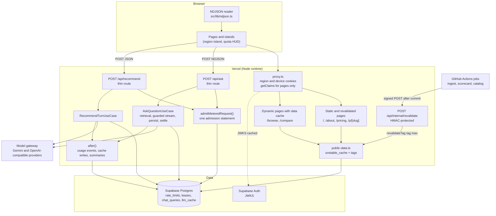
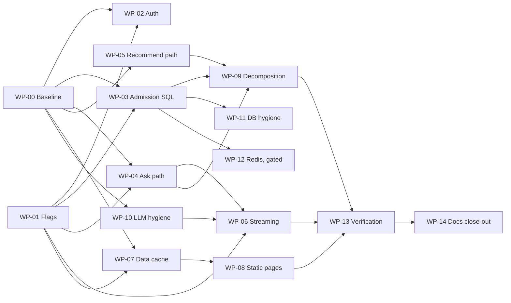

# RECSY Master Plan 26: API Architecture, Latency, Caching and Clean System Design

> **Document control**
>
> | Field                                | Value                                                                                                                                                                                                                                                                            |
> | :----------------------------------- | :------------------------------------------------------------------------------------------------------------------------------------------------------------------------------------------------------------------------------------------------------------------------------- |
> | Plan number                          | 26                                                                                                                                                                                                                                                                               |
> | Version                              | **2.0.0** (supersedes 1.0.0, archived at `docs/ImplementationPlans/archive/26. api-architecture-performance-caching-and-clean-system-design-plan.v1.0.0.md`)                                                                                                                     |
> | Date                                 | 2026-10-24                                                                                                                                                                                                                                                                       |
> | Status                               | Ready for implementation, one work package (WP) per pull request                                                                                                                                                                                                                 |
> | Code baseline                        | `master` at `9f75c08` (PR #71 merged). Baseline gates on that commit: `pnpm test` 166 files / 1,010 tests passing, `pnpm typecheck` clean (both run during this review)                                                                                                          |
> | Stack (verified from `package.json`) | Next.js 16.2.4 (App Router, `proxy.ts`), React 19.2.4, Drizzle ORM 0.45, `postgres` 3.4, `@supabase/ssr` 0.12 + `@supabase/supabase-js` 2.103, `ai` 6 + `@ai-sdk/google` 3, Zod 4, Vitest 4, Playwright 1.59, Supabase Postgres + pgvector, Vercel hosting, GitHub Actions crons |
> | Companion documents                  | `docs/Reports/02_API_ARCHITECTURE_DESIGN_AND_PERFORMANCE_ANALYSIS.md` (v1.1, corrected alongside this plan), `docs/RECSY_V2_PROJECT_CONTEXT.md` (section 29 added), Plan 22 (egress), Plan 23 (model gateway), Plan 24 (command center), Plan 25 (multi-user, metering, billing) |
> | Audience                             | Any implementing agent or engineer. Every WP lists files, steps, tests, verification commands, acceptance criteria and rollback                                                                                                                                                  |

## How to read this plan

1. Read Sections 1 to 6 once. They explain what is actually true in the code today, what changes, and the rules every WP must follow.
2. Pick the next WP from the dependency graph in Section 7.1. Do not start a WP whose dependencies are not merged.
3. Follow the WP literally. Where a WP says **STOP AND ASK**, stop and ask the owner. Where a fact is tagged **[VERIFY]**, check it against the current vendor documentation or dashboard before relying on it, and record the answer in the PR description.
4. Evidence tags used in this document:
   - **[CODE]** verified by reading the repository at `9f75c08`, with a `file:line` reference.
   - **[DOCS]** verified against the Next.js 16.2.4 documentation shipped in `node_modules/next/dist/docs` or against the installed package's type definitions.
   - **[VENDOR 2026-10-24]** verified on the vendor's public pricing or documentation page on 2026-10-24. Vendors change these; re-check before relying on them.
   - **[VERIFY]** not verifiable from here. Must be checked by the implementer.
   - **[ESTIMATE]** a derived number. It is a planning input, never an acceptance criterion. Acceptance criteria in this plan are always relative to the WP-00 measured baseline.

---

## Table of contents

- [1. Executive summary](#1-executive-summary)
- [2. What the v1.0.0 plan and the analysis report got wrong](#2-what-the-v100-plan-and-the-analysis-report-got-wrong)
- [3. Verified current state](#3-verified-current-state)
- [4. Architecture decisions](#4-architecture-decisions)
- [5. Target architecture](#5-target-architecture)
- [6. Rules for implementing agents](#6-rules-for-implementing-agents)
- [7. Work packages](#7-work-packages)
- [8. Risk register, failure modes and recovery](#8-risk-register-failure-modes-and-recovery)
- [9. Test strategy and test inventory](#9-test-strategy-and-test-inventory)
- [10. Rollout, flags and rollback](#10-rollout-flags-and-rollback)
- [11. Cost, free tiers and hosting](#11-cost-free-tiers-and-hosting)
- [12. Consistency with Plans 22, 23, 24 and 25](#12-consistency-with-plans-22-23-24-and-25)
- [13. Staff-engineer review of this plan, findings and fixes](#13-staff-engineer-review-of-this-plan-findings-and-fixes)
- [14. Deferred and rejected options](#14-deferred-and-rejected-options)
- [15. Appendices: contracts, SQL, code sketches](#15-appendices-contracts-sql-code-sketches)
- [16. Change log](#16-change-log)

---

## 1. Executive summary

### 1.1 The honest picture

The v1.0.0 plan and the analysis report correctly identified the shape of the problem: metered routes do too much sequential work, public pages are rendered on every request, rate limiting writes to Postgres, and the two big route handlers are hard to change safely. Reading the code, however, shows that several of their headline claims are wrong and that the biggest latency problems are ones they did not mention. If v1.0.0 had been implemented as written, several WPs would have done nothing (ISR), broken the build (`revalidateTag` signature), broken kill-switches (`z.coerce.boolean`), weakened abuse protection (reserving quota before rate limiting) or broken fair charging (settling a lease in parallel with persisting the answer).

The most important verified findings, in order of user impact:

1. **`/api/ask` does not stream the model's answer.** [CODE] `src/services/chat/answer.ts:157` calls `llm.chat()` (non-streaming). The route waits for retrieval, the full generation, an optional second generation on citation retry, the `chat_queries` insert and the lease commit, and only then writes the answer as 56-character slices in one burst (`src/app/api/ask/route.ts:336-386`). The user's time to first visible word equals the whole request duration. No protocol change (SSE or otherwise) fixes this; true token streaming does (WP-06).
2. **Signed-in users pay for two Supabase Auth network calls per request.** [CODE] `src/proxy.ts:54` calls `supabase.auth.getUser()` on every matched request (every page view and every metered API call), and `src/services/auth/supabase-server.ts:142` calls it again inside `resolveRequestIdentity`. `getUser()` is an HTTP round trip to Supabase Auth. The installed `@supabase/auth-js` 2.103.3 provides `getClaims()`, which verifies the JWT locally against cached signing keys when the project uses asymmetric JWT signing keys, and falls back to `getUser()` otherwise [CODE: `node_modules/@supabase/auth-js/dist/module/GoTrueClient.js` `getClaims`]. WP-02.
3. **Every page is dynamic because the root layout reads cookies.** [CODE] `src/app/layout.tsx:75` renders `AppHeader`, which calls `getActiveRegion()` → `cookies()` (`src/components/AppHeader.tsx:15`, `src/lib/get-active-region.ts:10`). Removing `export const dynamic = 'force-dynamic'` from `/browse` or `/p/[slug]` changes nothing while the layout reads cookies, and `/browse` also reads `searchParams`. v1.0.0's ISR WP would have been a no-op. WP-07 and WP-08 fix this properly.
4. **Telemetry and cache writes sit on the critical path.** [CODE] `recordLlmUsageEvent` is awaited after every model call (`src/services/llm/gateway/index.ts:58,113`, `src/services/llm/gemini.ts:264` and others), and Gemini-served calls are recorded twice (once by `GeminiProvider`, once by `ModelGatewayProvider`). The `llm_cache` write is awaited before returning (`src/services/llm/cache.ts:83,130`). Next 16's `after()` [DOCS] moves this work past the response. WP-04 and WP-10.
5. **Avoidable serialisation inside retrieval and recommendation.** [CODE] Full-text search does not need the query embedding but waits for it (`src/services/retrieval/retriever.ts:89-93`). In `runRecommendationPipeline`, `aspect_definitions` (uncached), the catalog and the query embedding are fetched one after another although they are independent once requirements are extracted (`src/services/recommender/run-recommendation.ts:187-205`). WP-04 and WP-05.
6. **Rate limiting is 2 to 3 sequential upserts with inconsistent failure policy.** [CODE] IP limit (`src/services/rate-limit/consume.ts:27-47`) and user limit (`src/services/metering/rate-limit-user.ts`) fail closed (a database error becomes a 500), the device limit fails open (`src/services/abuse/rate-limit-device.ts:58-60`). Each is a fixed one-minute window keyed `(key, window_start)`, so every minute creates new rows that `scripts/db-prune.ts` and `scripts/metering-maintenance.ts` delete later. One multi-row upsert removes 1 to 2 round trips without any new vendor. WP-03.
7. **Redis is not justified yet, and the free tier is smaller than the report says.** Upstash's free tier is now **500,000 commands per month, 250 MB, 10 GB bandwidth** [VENDOR 2026-10-24], not "10,000 commands per day". A Redis sliding-window limiter costs several commands per limiter per request, so the free tier covers only a few thousand metered requests per day. Plan 25 Section 11.4 already sets the rule: move counters off Postgres only when measurements force it. This plan keeps that rule and ships the Redis adapter only as a gated, optional WP (WP-12).
8. **SSE would add risk and no benefit.** [CODE] The client NDJSON reader in `src/app/p/[slug]/phone-chat.tsx:191-200` already buffers partial lines across network chunks (`buf = lines.pop()`), so the "framing fragmentation" claim is false. `EventSource` cannot send a POST body, automatic reconnection is dangerous for a metered request, and Plan 25 froze the NDJSON event types (Plan 25 Section 8, "NDJSON event types remain untouched except for the additive fields"). This plan keeps NDJSON and adds new event types additively.
9. **The advisory lock is not a bottleneck.** [CODE] `pg_advisory_xact_lock` in `recsy_reserve_query` (`drizzle/migrations/0013_metering_functions.sql:103`) is held only for the duration of that single function call's transaction (milliseconds) and only serialises requests from the **same** subject. It never spans the model call. No change is needed; Plan 25 Section 11.4 already documents it.
10. **Hosting terms, not code, are the hard cost constraint.** Vercel Hobby is restricted to non-commercial, personal use and includes 4 Active-CPU hours, 1,000,000 function invocations, 1,000,000 CDN requests and 10 GB fast origin transfer per month [VENDOR 2026-10-24]. Plan 25 decision D2 already requires moving off Hobby before taking money. This plan adds no paid service, and its page-caching work is the main lever for staying inside Hobby's CPU and invocation allowances until D2 is executed.

### 1.2 What this plan delivers

| #   | Outcome                                                                                                         | How it is measured (never against an invented baseline)                                                                                                                                                                                                                                             |
| :-- | :-------------------------------------------------------------------------------------------------------------- | :-------------------------------------------------------------------------------------------------------------------------------------------------------------------------------------------------------------------------------------------------------------------------------------------------- |
| O1  | First visible answer token on `/api/ask` arrives while the model is still generating                            | `ttfvtMs` (time to first visible token) emitted by WP-00 telemetry; target p50 reduction of at least 50% against the WP-00 baseline on the local benchmark stack with the controlled provider, and positive in production field data                                                                |
| O2  | Fewer sequential network round trips before the model call                                                      | Count of sequential awaited network operations before the model call, all caches cold (Section 3.2 and 5.2): anonymous `/api/ask` from 12 to 6; signed-in from 15 to 6 when the Supabase project uses asymmetric JWT signing keys, to 8 otherwise. Wall-clock effect measured by WP-00 stage timers |
| O3  | Public pages served without a database query on repeat visits                                                   | Data-cache hit ratio from WP-07 logs; `pg_stat_statements` call counts for the phone/scorecard/browse statements before and after                                                                                                                                                                   |
| O4  | Static marketing and phone pages stop rendering on the server for every view (the lightweight proxy still runs) | Vercel Observability: function invocations and Active CPU for `/`, `/about`, `/pricing`, `/p/[slug]` before and after WP-08 [VERIFY dashboard availability on Hobby]                                                                                                                                |
| O5  | Rate-limit writes per metered request drop from 2-3 statements to 1                                             | Unit test asserting one statement; `pg_stat_statements`                                                                                                                                                                                                                                             |
| O6  | Route handlers become testable in parts                                                                         | `ask/route.ts` and `recommend/route.ts` each under 200 lines, with admission, error mapping and use case in separate modules covered by unit tests; no behaviour change proven by characterisation tests                                                                                            |
| O7  | Zero new recurring cost                                                                                         | Section 11                                                                                                                                                                                                                                                                                          |
| O8  | No regression in fairness, abuse protection, citations or retrieval quality                                     | Plan 25 fair-charging audit, retrieval CI gate (`pnpm eval:ci-gate`), hallucination-guard tests, citation-validity rate under streaming (WP-06 gate)                                                                                                                                                |

### 1.3 Work packages at a glance

| WP    | Title                                                                      | Size | Risk       | Depends on                                           | Default state after merge     |
| :---- | :------------------------------------------------------------------------- | :--- | :--------- | :--------------------------------------------------- | :---------------------------- |
| WP-00 | Baseline instrumentation and benchmark harness                             | M    | Low        | none                                                 | on (telemetry only)           |
| WP-01 | Runtime performance flags                                                  | S    | Low        | none                                                 | flags exist, all off          |
| WP-02 | Auth fast path (`getClaims`, no duplicate verification)                    | M    | Medium     | WP-00, WP-01                                         | off, then on after canary     |
| WP-03 | Single-statement admission rate limiting in Postgres                       | M    | Medium     | WP-00, WP-01                                         | on (behaviour-preserving)     |
| WP-04 | `/api/ask` critical-path trimming                                          | M    | Low-Medium | WP-00, WP-01                                         | on                            |
| WP-05 | `/api/recommend` critical-path trimming                                    | S    | Low        | WP-00                                                | on                            |
| WP-06 | True token streaming for `/api/ask` with a streaming citation guard        | L    | High       | WP-00, WP-01, WP-04, WP-10                           | off → shadow → canary → on    |
| WP-07 | Public data cache and protected revalidation                               | M    | Medium     | WP-00, WP-01                                         | on                            |
| WP-08 | Static rendering for layout, marketing and phone pages                     | M    | Medium     | WP-07                                                | on after preview verification |
| WP-09 | Route decomposition (admission, error mapping, use cases)                  | L    | Medium     | WP-03, WP-04, WP-05 (WP-06 may land before or after) | n/a (refactor)                |
| WP-10 | LLM layer hygiene (usage recording, stream failover, cache key, `after()`) | M    | Medium     | WP-00                                                | on                            |
| WP-11 | Database hygiene on the hot path                                           | S    | Low        | WP-03                                                | on                            |
| WP-12 | Optional Redis rate-limit adapter (gated, off)                             | M    | Medium     | WP-03, gate in Section 4 D26-2                       | off unless the gate trips     |
| WP-13 | Verification, load test and benchmark report                               | M    | Low        | all shipped WPs                                      | n/a                           |
| WP-14 | Documentation, ADR-0023 and runbooks                                       | S    | Low        | each WP updates docs; WP-14 closes                   | n/a                           |

Sizes: S is up to 1 day, M is 1 to 3 days, L is 3 to 6 days of focused agent work including tests.

## 2. What the v1.0.0 plan and the analysis report got wrong

Each row was checked against the code or the vendor/framework documentation. "Keep" means the original point stands. The same corrections are recorded in the analysis report's new Section 10 so the two documents agree.

### 2.1 Factual corrections

| ID   | Original claim (report section / v1 section)                                                                                            | Verdict                       | Evidence and consequence                                                                                                                                                                                                                                                                                                                                                                                                                            |
| :--- | :-------------------------------------------------------------------------------------------------------------------------------------- | :---------------------------- | :-------------------------------------------------------------------------------------------------------------------------------------------------------------------------------------------------------------------------------------------------------------------------------------------------------------------------------------------------------------------------------------------------------------------------------------------------- |
| C-01 | `/api/ask` streams LLM tokens; "LLM TTFT 520 ms" (report 5, 9; v1 1.2, 3.2)                                                             | **Wrong**                     | [CODE] `answer.ts:157` uses `llm.chat()`; `route.ts:336-386` persists, settles, then replays the finished text with `chunkTextForStream`. Plan 25 Section 4 table already states this. Time to first visible token equals total request time. All TTFT numbers in both documents are unmeasured and describe a pipeline that does not exist.                                                                                                        |
| C-02 | NDJSON is "prone to framing fragmentation" when proxies split packets; SSE removes 15-25 ms of client parsing (report 4 case 1; v1 4.3) | **Wrong**                     | [CODE] `phone-chat.tsx:193-195` keeps the trailing partial line in `buf` and only parses complete lines, which is the correct way to read NDJSON across arbitrary chunk boundaries. SSE has the same need to buffer partial events. The 15-25 ms figure has no source.                                                                                                                                                                              |
| C-03 | SSE gives "built-in reconnection" (report 4 case 1)                                                                                     | **Harmful for this route**    | `EventSource` supports only GET without a body; POST needs a library such as `@microsoft/fetch-event-source`. Automatic reconnection would re-send a metered request; idempotency via `x-request-id` would turn a reconnect into a `DUPLICATE_REQUEST` while the first lease is still `reserved`. Plan 25 froze the NDJSON event schema.                                                                                                            |
| C-04 | Removing `force-dynamic` and adding `revalidate` makes `/browse` and `/p/[slug]` ISR (report 4 cases 3-4; v1 4.4, WP-07)                | **Wrong**                     | [CODE] Root layout → `AppHeader` → `cookies()` makes every route dynamic; both pages also call `getActiveRegion()` (cookies) and `/browse` reads `searchParams`. [DOCS] Request-time APIs opt a route into dynamic rendering.                                                                                                                                                                                                                       |
| C-05 | `revalidateTag(\`phone-${slug}\`)` (report 8; v1 4.4, WP-07)                                                                            | **Does not compile**          | [DOCS] Next 16.2.4 `revalidate.d.ts:9`: `revalidateTag(tag: string, profile: string \| CacheLifeConfig)`. The single-argument form is deprecated.                                                                                                                                                                                                                                                                                                   |
| C-06 | Call `revalidateTag` from `scripts/ingest-auto.ts` and `scripts/scorecard-auto.ts` (v1 4.4, WP-07)                                      | **Impossible**                | Those scripts run under `tsx` in GitHub Actions, outside the Next.js server. [DOCS] `revalidateTag` works only in Server Functions and Route Handlers. A protected HTTP endpoint is required (WP-07). Plan 22 Phase B item 5 already says this.                                                                                                                                                                                                     |
| C-07 | `unstable_cache` is the tool for tagged page data (v1 WP-07)                                                                            | **Keep, with caveat**         | [DOCS] In Next 16 it is replaced by `use cache` under `cacheComponents`, but remains supported in the "previous model". `cacheComponents` is not enabled in `next.config.ts`. This plan uses `unstable_cache` behind a thin wrapper so a later Cache Components migration changes one file (Section 4 D26-4).                                                                                                                                       |
| C-08 | `REDIS_RATE_LIMIT_ENABLED: z.coerce.boolean().default(true)` (v1 WP-01)                                                                 | **Bug**                       | `z.coerce.boolean()` maps the string `"false"` to `true` (`Boolean("false") === true`), so the kill-switch could never be turned off. The repo convention is `z.string().default('true').transform(v => v.toLowerCase() !== 'false')` (`src/env.ts:74-77`). v1 also omitted the matching `runtimeEnv` entries that `@t3-oss/env-nextjs` needs (`src/env.ts:216+`).                                                                                  |
| C-09 | Env-var kill-switches restore behaviour "in under 60 seconds without code changes" (v1 5.2)                                             | **Wrong on Vercel**           | Changing an environment variable on Vercel applies to new deployments only [VERIFY current Vercel behaviour]; a redeploy takes minutes. Runtime switches belong in `platform_flags`, which `getPlatformState` already reads with a 10-second cache (`src/services/metering/platform.ts:10,80-125`) and which operators can edit through `POST /api/internal/flags`. WP-01.                                                                          |
| C-10 | Upstash free tier is 10,000 commands/day and 256 MB (report 7; v1 1.3)                                                                  | **Outdated**                  | [VENDOR 2026-10-24] 500,000 commands/month, 250 MB data, 10 GB monthly bandwidth, 1 free database, 10,000 commands/second, $0.20 per 100,000 commands pay-as-you-go. How `EVAL` scripts are counted is not stated on the pricing page [VERIFY].                                                                                                                                                                                                     |
| C-11 | "Plan 26 includes a built-in daily quota cap to stay within 10,000 requests" (v1 1.3); RSK-04 "bypass Redis at 9,500/day"               | **Unimplementable as stated** | A per-instance counter cannot know the account-wide command count. Budget control must come from design (one command per request) plus the vendor's spend controls [VERIFY], with Postgres as the fallback store (WP-12).                                                                                                                                                                                                                           |
| C-12 | Advisory lock blocks pooled connections and causes contention (report 5 bottleneck 4)                                                   | **Wrong**                     | [CODE] `pg_advisory_xact_lock` is transaction-scoped inside one function call (`0013_metering_functions.sql:103`), so it is held for milliseconds and only between requests of the same subject. Plan 25 Section 11.4 documents it as safe under transaction pooling.                                                                                                                                                                               |
| C-13 | 11-query waterfall list includes "SELECT FROM user_profiles" for identity (report 5 bottleneck 1)                                       | **Partly wrong**              | [CODE] Identity is a Supabase Auth HTTP call (`getUser`), done twice (proxy and route) for signed-in users, plus an `abuse_blocks` read only on a 30-second cache miss (`src/services/auth/abuse-cache.ts:13`). `getPlatformState` is cached for 10 seconds per instance. The real cold-path list is in Section 3.2 and is longer than the report's in some places (usage-event and cache writes) and shorter in others.                            |
| C-14 | "Three separate SQL upserts" per request (report 5 bottleneck 2)                                                                        | **Partly right**              | Anonymous requests do two (IP, device); signed-in do three (IP, user, device). Updates within a minute window hit the same row, so they are mostly HOT updates (the `count` column is not indexed) [ESTIMATE, confirm with `pg_stat_user_tables.n_tup_hot_upd`]. The DoS claim ("CPU 100% at 500 req/s") is unmeasured; the IP limiter rejects after 30 requests/minute per IP hash but still costs one upsert per rejected request.                |
| C-15 | Pool `max: 2` is a global cap that crawler spikes saturate, causing 500s on chat (report 5 bottleneck 5)                                | **Overstated**                | [CODE] `max: 2` is per server instance (`src/services/db/client.ts:30`). The binding global limit is the Supavisor client-connection limit for the plan [VERIFY, not listed for Free on the pricing page]. Crawlers and chat may or may not share an instance (Vercel Fluid compute multiplexes requests within an instance [VERIFY project setting]). The risk is real but the mechanism is fan-in of instances, as Plan 25 Section 11.2 explains. |
| C-16 | In-memory caches hit "< 40%" on serverless (report 5 bottleneck 3)                                                                      | **Unmeasured**                | No telemetry exists for these caches. With instance reuse the hit rate may be much higher. WP-00 adds hit/miss counters before any distributed cache is justified.                                                                                                                                                                                                                                                                                  |
| C-17 | Every question calls the Gemini embedding API (report 7 gap 3)                                                                          | **Partly wrong**              | [CODE] `HybridRetriever.embedQuery` keeps an in-memory, bounded, single-flight cache of query embeddings (`retriever.ts:297-330`). Misses still cost a Gemini call and an awaited usage-event insert.                                                                                                                                                                                                                                               |
| C-18 | Cache query embeddings keyed by `sha256(phoneId + query)` (report 7 gap 3)                                                              | **Wrong key**                 | The query embedding does not depend on the phone. The correct key is `(embedding model, output dimensions, task type, normalised query)`, as the existing in-memory key already does.                                                                                                                                                                                                                                                               |
| C-19 | Redis catalog cache gives "18-25 ms" cold loads and "0 ms database overhead" (report 7; v1 WP-04)                                       | **Unsupported**               | The cold catalog is about 0.88 MB of JSON, dominated by 768-dimension spec vectors (`catalog-cache.ts` header, Plan 22 Phase B item 7). Fetching and parsing that over HTTPS on every cold instance is not 18-25 ms [ESTIMATE], and would consume Upstash's 10 GB monthly bandwidth at roughly 11,000 cold loads. Plan 22 Phase B item 8 (compute similarity in SQL) removes the payload instead.                                                   |
| C-20 | Stage A of the recommender can stream and cut TTFT by 84% (report 4 case 2)                                                             | **Wrong**                     | [CODE] Requirements extraction is a structured (JSON schema) call with `thinkingBudget: 0` (`gemini.ts:369-373`). A clarifying question is a field inside that JSON; it cannot be shown before the object is complete without a different prompt design. The real wins are parallelism after extraction (WP-05) and perceived-latency UI states.                                                                                                    |
| C-21 | `ScorecardSection` refresh cadence "daily at 04:17 UTC" (report 4 case 4)                                                               | **Outdated**                  | [CODE] `.github/workflows/scorecard-auto.yml:10` runs at 04:17, 10:17, 16:17 and 22:17 UTC.                                                                                                                                                                                                                                                                                                                                                         |
| C-22 | "5 transactional stored procedures" listing 3 (report 2)                                                                                | **Imprecise**                 | [CODE] `0013_metering_functions.sql` defines 6 functions: `recsy_undo_lease_charge`, `recsy_apply_credit_delta`, `recsy_reserve_query`, `recsy_settle_lease`, `recsy_sweep_expired_leases`, `recsy_link_device_to_user`.                                                                                                                                                                                                                            |
| C-23 | Groq, Cerebras, Gemini free quotas (v1 1.3)                                                                                             | **[VERIFY]**                  | Vendor free limits change often and are per model. Treat them as unverified. They are not changed by this plan.                                                                                                                                                                                                                                                                                                                                     |
| C-24 | "Vercel Hobby, unlimited edge/serverless" (v1 1.3)                                                                                      | **Wrong**                     | [VENDOR 2026-10-24] Hobby includes 4 Active-CPU hours, 360 GB-hours provisioned memory, 1,000,000 function invocations, 1,000,000 CDN requests, 100 GB fast data transfer, 10 GB fast origin transfer; runtime logs kept 1 hour; and **non-commercial personal use only**.                                                                                                                                                                          |
| C-25 | Supabase Free "5 GB egress, plenty of headroom; current egress ~1.4 GB/month" (report 9; v1 1.3)                                        | **Contradicted**              | Plan 22 Section 1 records 6.268 GB of 5 GB uncached egress in the September 20 to October 20, 2026 cycle (mostly one load-test day). Plan 22 sets a 2 GB/month target. Supabase Free has no backups and pauses after 1 week of inactivity [VENDOR 2026-10-24].                                                                                                                                                                                      |

### 2.2 Design errors in v1.0.0

| ID   | v1 design                                                                                   | Problem                                                                                                                                                                                                                                                          | Fix in this plan                                                                                                                                                                                         |
| :--- | :------------------------------------------------------------------------------------------ | :--------------------------------------------------------------------------------------------------------------------------------------------------------------------------------------------------------------------------------------------------------------- | :------------------------------------------------------------------------------------------------------------------------------------------------------------------------------------------------------- |
| E-01 | Run rate limits, lease reservation and platform check in parallel (v1 3.2 sequence diagram) | Reserving before rate limiting lets a flood consume `reserved` leases and in-flight slots (`TOO_MANY_INFLIGHT`) for requests that should have been rejected; each then needs a refund round trip. It also changes which error a client sees.                     | Rate limits and platform state run before `reserveQuery`; only read-only lookups run in parallel with them (WP-03, WP-04).                                                                               |
| E-02 | `Promise.all([fetchActivePhoneBySlug, reserveQuery])` (v1 WP-05)                            | Correct in effect but wasteful: a 404 costs a reservation and a refund.                                                                                                                                                                                          | Look the phone up (data-cached) in parallel with the admission statement, before reservation (WP-04).                                                                                                    |
| E-03 | Persist `chat_queries` and settle the lease in parallel, "non-blocking" (v1 3.2)            | Breaks Plan 25's fair-charging SLO and replay: `findReplayQuery` locates the answer by `lease_id` (`src/services/metering/replay.ts:125`). A committed lease without a stored answer is outcome (a) in Plan 25 Section 11.3, target zero.                        | Keep persist-then-settle order; optionally fold both into one atomic statement (WP-04 step 6).                                                                                                           |
| E-04 | Lua sliding window `ZADD key now now` with `EXPIRE key window` (v1 WP-03)                   | Members collide when two requests share a millisecond (undercount), units mix milliseconds and seconds, and it changes the existing fixed-window semantics that tests and `scripts/eval-http.ts:306` rely on.                                                    | Keep fixed windows; the optional Redis adapter uses `INCR` + `PEXPIRE` in one script per request, with the same semantics as Postgres (WP-12).                                                           |
| E-05 | Rate limiting "fails open or falls back" without saying which                               | The current code is inconsistent (Section 1.1 item 6).                                                                                                                                                                                                           | One explicit policy: rate-limit store errors fail open with a log and a counter; quota reservation stays fail-closed; the global platform cap and kill switch bound the cost (Section 6 rule R3).        |
| E-06 | Redis L2 for chunk vectors keyed `chunk_vec:${id}` (v1 WP-04)                               | Each request would move tens of KB of vectors over HTTPS and multiply Upstash commands per request.                                                                                                                                                              | Not done. Plan 22 Phase C keeps vector fetches bounded; optional SQL-side similarity is the next step there.                                                                                             |
| E-07 | `CachedLlmProvider.chatStream` buffers and replays deltas (v1 WP-09)                        | Generic stream caching hides which answers were model-generated, and replaying a cached grounded answer must still go through the citation guard and the same metering.                                                                                          | WP-06 checks `llm_cache` before generation and, on a hit, replays the cached validated answer through the same NDJSON path; on a miss it streams and writes the cache after the response with `after()`. |
| E-08 | Route handlers "< 80 lines" (v1 WP-08)                                                      | An arbitrary line target encourages moving complexity into hidden helpers. The real duplication is the 150-line error mapper and the admission prelude, copied in both routes (`ask/route.ts:462-651`, `recommend/route.ts:369-573`).                            | Measured goals: under 200 lines per route, zero duplicated admission or error-mapping code, characterisation tests before extraction (WP-09).                                                            |
| E-09 | Add a DI container (report 6 DIP)                                                           | New dependency for little gain; the codebase already passes dependencies explicitly (`resolveRequestIdentity(request, { db })`, `runPhoneQna({ retriever, llm, log })`).                                                                                         | Use plain dependency objects with defaults (WP-09).                                                                                                                                                      |
| E-10 | Split `LlmProvider` into four interfaces across all providers (v1 WP-09)                    | High churn for low value. In gateway mode, Groq and NVIDIA traffic goes through OpenAI-compatible adapters (`cascade-executor.ts:187`), not `GroqProvider`/`NvidiaNimProvider`; only `LLM_PROVIDER=groq` or `nvidia` uses those classes, where `embed()` throws. | Add capability-specific types and make `embed` optional at the type level only where it is truly absent (WP-10 step 6).                                                                                  |
| E-11 | Read replicas for read/write splitting (report 8 phase 3)                                   | Not available on Supabase Free; contradicts the zero-cost goal and Plan 25 Section 11.4 ("Pro compute add-ons before read replicas").                                                                                                                            | Deferred (Section 14).                                                                                                                                                                                   |
| E-12 | Benchmark 50 concurrent users with live providers against the hosted database (v1 WP-10)    | Plan 22 finding DB-01: hosted load tests caused the egress breach.                                                                                                                                                                                               | Benchmarks run against a local Postgres + pgvector and the controlled LLM provider; production checks are small and budgeted (WP-13).                                                                    |
| E-13 | "Zero risk to live production services" (v1 9)                                              | Not a claim any plan can make.                                                                                                                                                                                                                                   | Every WP has a flag or a revert path and a canary (Section 10).                                                                                                                                          |

### 2.3 Points from the report that this plan keeps

- REST over GraphQL for this product (report Section 3). GraphQL adds parsing and security surface and breaks HTTP caching; RSC already projects fields server-side.
- Webhooks stay strict REST with signature verification (report case 7).
- The entitlements endpoint is already well designed (report case 5).
- The SRP problem in the two route handlers is real (report Section 6.1).
- Public pages should be cached with tag-based invalidation (report cases 3-4); the mechanism changes (WP-07, WP-08).
- In-process caches are not shared across instances and need hit-rate data (report bottleneck 3); this plan measures first.
- `CachedLlmProvider.chatStream` bypassing the cache is a real trap for a future change from `chat` to `chatStream` (report LSP); WP-06 handles it explicitly.

## 3. Verified current state

### 3.1 Runtime topology

| Concern            | Today [CODE]                                                                                                                                                                                                                                   |
| :----------------- | :--------------------------------------------------------------------------------------------------------------------------------------------------------------------------------------------------------------------------------------------- |
| Hosting            | Vercel (Next.js Node runtime). Docs: `docs/deployment/DEPLOY_EVERYTHING.md`. `DATABASE_URL` must be the Supavisor transaction pooler (port 6543) because Vercel functions need IPv4                                                            |
| Database client    | `postgres` driver, `max: 2` in production / 4 otherwise, `prepare: false`, `idle_timeout: 20`, `connect_timeout: 10` (`src/services/db/client.ts:27-38`)                                                                                       |
| Proxy (middleware) | `src/proxy.ts`: region cookie, Supabase session refresh via `auth.getUser()` when any `sb-*` cookie exists, device cookie minting. Matcher covers all pages and APIs except static assets, `api/billing/webhook`, `api/health`, `api/internal` |
| Background work    | GitHub Actions crons (`.github/workflows/*.yml`): ingest, scorecard (4 times a day), catalog refresh (weekly and monthly), metering maintenance, abuse detection, billing reconcile, ops alerts, keepalive                                     |
| Response headers   | Static security headers and CSP in report-only mode (`next.config.ts`). No nonce CSP, so static rendering is possible (Plan 25 Section 10.3 warns that a nonce CSP would force dynamic rendering)                                              |
| Regions            | Two: `US`, `IN` (`src/lib/regions.ts`). Region comes from the `recsy_region` cookie, set by the proxy from `x-vercel-ip-country`; the cookie is not HttpOnly                                                                                   |
| Caching flags      | `cacheComponents` not enabled; no route uses `revalidate`; `/browse`, `/p/[slug]`, `/compare`, `/recommend` and internal pages export `dynamic = 'force-dynamic'`                                                                              |

### 3.2 `/api/ask` request path, as executed today

Cold means every per-instance cache misses. "Seq" is the position in the chain of sequential awaits; steps sharing a number run in parallel.

| Seq | Step                                                                                      | Network target                   | Code                                           | Notes                                                                                           |
| :-- | :---------------------------------------------------------------------------------------- | :------------------------------- | :--------------------------------------------- | :---------------------------------------------------------------------------------------------- |
| P1  | Proxy session refresh (signed-in only)                                                    | Supabase Auth HTTP               | `proxy.ts:54`                                  | Runs before the route on every matched request                                                  |
| 1   | IP rate limit upsert                                                                      | Postgres                         | `route.ts:139` → `consume.ts:27`               | Fails closed (error → 500)                                                                      |
| 2   | Body read and Zod parse                                                                   | none                             | `route.ts:142-143`                             | 24 KiB cap                                                                                      |
| 3   | `getUser()` (signed-in only)                                                              | Supabase Auth HTTP               | `identity.ts:67-68` → `supabase-server.ts:142` | Timeout `AUTH_VERIFY_TIMEOUT_MS` → 503                                                          |
| 4   | `abuse_blocks` read (30 s cache miss only)                                                | Postgres                         | `identity.ts:88-90`, `abuse-cache.ts`          | Fails open                                                                                      |
| 5   | User rate limit upsert (signed-in only)                                                   | Postgres                         | `route.ts:155`                                 | Fails closed                                                                                    |
| 6   | Device rate limit upsert                                                                  | Postgres                         | `route.ts:157`                                 | Fails open                                                                                      |
| 7   | `usage_counters` read for CAPTCHA risk (anonymous, Turnstile configured)                  | Postgres                         | `route.ts:159`, `85-121`                       | Turnstile HTTP only when risk-flagged                                                           |
| 8   | Platform state (10 s cache miss only)                                                     | Postgres                         | `route.ts:168`, `platform.ts:80-125`           | Counts today's leases; serves stale on error                                                    |
| 9   | `recsy_reserve_query`                                                                     | Postgres                         | `route.ts:176`, `reserve.ts:100-150`           | Plus a `subscriptions` read and a second reserve when a signed-in user hits `TOO_MANY_INFLIGHT` |
| 10  | Phone lookup by slug                                                                      | Postgres                         | `route.ts:244-255`                             | A 404 here costs a refund round trip                                                            |
| 11  | `resolveReasoningMode` (only when Deep was requested and the lease is not a subscription) | Postgres                         | `route.ts:303`, `mode.ts:43`                   |                                                                                                 |
| 12  | Query embedding (in-memory cache miss)                                                    | Gemini HTTP                      | `retriever.ts:89`, `297-330`                   |                                                                                                 |
| 13  | `llm_usage_events` insert for the embedding                                               | Postgres                         | `gemini.ts:505`                                | Awaited                                                                                         |
| 14  | Vector search ‖ FTS                                                                       | Postgres ×2                      | `retriever.ts:93-135`                          | FTS waited for step 12 for no reason                                                            |
| 15  | Batch-fetch MMR prefix embeddings (cache miss)                                            | Postgres                         | `retriever.ts:195-205`, `vector-cache.ts`      |                                                                                                 |
| 16  | `llm_cache` read                                                                          | Postgres                         | `cache.ts:75`, `154-180`                       |                                                                                                 |
| 17  | Model call (full answer)                                                                  | Gemini or OpenAI-compatible HTTP | `answer.ts:157` via gateway                    |                                                                                                 |
| 18  | `llm_usage_events` insert ×2 for Gemini-served calls                                      | Postgres                         | `gemini.ts:264` and `gateway/index.ts:58`      | Double recording                                                                                |
| 19  | `llm_cache` write                                                                         | Postgres                         | `cache.ts:83`                                  | Awaited                                                                                         |
| 20  | Steps 16-19 again on citation retry                                                       |                                  | `answer.ts:313-327`                            | Only when the first answer cites unknown chunks                                                 |
| 21  | `chat_queries` insert                                                                     | Postgres                         | `route.ts:336`                                 |                                                                                                 |
| 22  | Lease settle                                                                              | Postgres                         | `route.ts:364-374`                             |                                                                                                 |
| 23  | First answer byte written                                                                 |                                  | `route.ts:377-386`                             | The user sees nothing before this                                                               |

Counting sequential network waits before the model call with cold caches: **anonymous 12** (steps 1, 4, 6, 7, 8, 9, 10, 12, 13, 14, 15, 16), **signed-in 15** (adds P1, 3 and 5). With warm per-instance caches anonymous drops to about 8. Every one of these waits costs one network round trip; the cost per round trip depends on whether the Vercel function region matches the Supabase region, which is not recorded in the repository [VERIFY in Vercel project settings and Supabase dashboard; Plan 25 Section 11.4 item 6].

### 3.3 `/api/recommend` request path, as executed today

The admission prelude (steps 1 to 9) is the same as `/api/ask`, copied in the route. Then [CODE]:

1. Session lookup by cookie (`route.ts:238`) or insert (`route.ts:244-250`), after the reservation although the lookup is read-only.
2. `resolveReasoningMode` (`route.ts:261`).
3. `runRecommendationPipeline` (`run-recommendation.ts:151-285`): latest requirements ‖ prior pick ids (2 parallel reads); requirements extraction (structured LLM call, `thinkingBudget: 0`); then **sequentially** `aspect_definitions` read (uncached), catalog (per-instance cache, 10 minutes), query embedding (Gemini, not cached); in-memory ranking.
4. Turn insert and lease settle in one transaction (`route.ts:285-326`). This is the correct pattern and is kept.

### 3.4 Rendering of public pages

| Route                                  | What makes it dynamic today [CODE]                          | Database reads per view                                                             |
| :------------------------------------- | :---------------------------------------------------------- | :---------------------------------------------------------------------------------- |
| Every route                            | Root layout `AppHeader` → `getActiveRegion()` → `cookies()` | none from the header itself                                                         |
| `/p/[slug]`                            | `force-dynamic`; `getActiveRegion()`                        | phone + regional price join; `aspects` ⋈ `aspect_definitions` in `ScorecardSection` |
| `/browse`                              | `force-dynamic`; `searchParams`; `getActiveRegion()`        | filtered list (limit 100); brands (per-instance cache, 1 hour)                      |
| `/compare`                             | `force-dynamic`; `searchParams`                             | phone reads                                                                         |
| `/sitemap.xml`                         | runtime DB read with a per-instance 1-hour cache            | active slugs                                                                        |
| `/`, `/about`, `/pricing`, legal pages | only the layout's `cookies()`                               | none                                                                                |

### 3.5 Cache inventory (corrected)

| Cache                                   | Location [CODE]                                | Scope                                       | TTL / bound                               | Notes                                                                                                                                                                                                                                                                                                                                          |
| :-------------------------------------- | :--------------------------------------------- | :------------------------------------------ | :---------------------------------------- | :--------------------------------------------------------------------------------------------------------------------------------------------------------------------------------------------------------------------------------------------------------------------------------------------------------------------------------------------- |
| Recommendation catalog                  | `src/services/recommender/catalog-cache.ts`    | per instance, single-flight                 | 10 min                                    | about 0.88 MB cold read (Plan 22)                                                                                                                                                                                                                                                                                                              |
| Chunk embeddings for MMR prefix         | `src/services/retrieval/vector-cache.ts`       | per instance                                | 15 min, 1,000 entries                     | FIFO eviction                                                                                                                                                                                                                                                                                                                                  |
| Query embeddings                        | `src/services/retrieval/retriever.ts:297-345`  | per instance, per provider, single-flight   | 128 entries (`QUERY_EMBEDDING_CACHE_MAX`) | not mentioned in the report                                                                                                                                                                                                                                                                                                                    |
| Brands                                  | `src/app/browse/page.tsx:49-70`                | per instance                                | 1 h                                       |                                                                                                                                                                                                                                                                                                                                                |
| Sitemap slugs                           | `src/app/sitemap.ts`                           | per instance                                | 1 h                                       |                                                                                                                                                                                                                                                                                                                                                |
| Platform state                          | `src/services/metering/platform.ts`            | per instance, single-flight, stale on error | 10 s                                      |                                                                                                                                                                                                                                                                                                                                                |
| Abuse blocks                            | `src/services/auth/abuse-cache.ts`             | per instance, single-flight                 | 30 s                                      |                                                                                                                                                                                                                                                                                                                                                |
| LLM responses                           | `src/services/llm/cache.ts`, table `llm_cache` | shared (Postgres)                           | 30 days                                   | key is `model` (always `env.LLM_CHAT_MODEL` for grounded answers, not the model the gateway routes to), messages, temperature, max tokens and the optional `cacheKeyExtras` (`cache.ts:38-70`); `userMode`, `taskClass` and BYOK provider travel only in `usageContext` and are not in the key; no caller sets `cacheKeyExtras` (WP-10 step 4) |
| Entitlements                            | `/api/me/entitlements` ETag                    | client                                      | per snapshot                              |                                                                                                                                                                                                                                                                                                                                                |
| Dashboard, pipeline monitor, benchmarks | internal services                              | per instance                                | 5-10 min                                  | internal only                                                                                                                                                                                                                                                                                                                                  |

### 3.6 Facts about the LLM gateway that matter for streaming

- `ModelGatewayProvider.chatStream` (`gateway/index.ts:79-93`) → `CascadeExecutor.executeStream` (`cascade-executor.ts:353-396`). For OpenAI-compatible candidates it **does not call `quotaGovernor.acquire`** (the non-streaming path does at line 197), does not consult circuit breakers, and on an exception after some deltas were already yielded it moves to the next key and yields again, which would duplicate partial text in the client. Gemini streaming has no failover at all.
- Gemini streaming records usage once at the end (`gemini.ts:310`); the gateway stream path records nothing for OpenAI-compatible providers.
- The grounded-answer call passes no `thinkingConfig` for `gemini-3-flash-preview` (`answer.ts:157-177`, `gemini.ts:238-246`), while structured calls set `thinkingBudget: 0`. Whether Gemini 3 models default to extended thinking and which parameter controls it (`thinkingLevel` versus `thinkingBudget`) must be checked [VERIFY against current Gemini API documentation]. This can dominate generation latency and is evaluated in WP-04 step 7.

### 3.7 Baseline quality gates

On `9f75c08`: `pnpm test` passed 166 files and 1,010 tests in 55 s; `pnpm typecheck` passed. CI (`.github/workflows/ci.yml`) runs format check, `pnpm audit --prod --audit-level=high`, gitleaks, lint, typecheck, unit tests and build; a second job runs `pnpm eval:ci-gate` (Dockerised pgvector, Recall@8 ≥ 0.88) and Playwright. Every WP must keep all of these green.

## 4. Architecture decisions

Each decision records the alternatives and why they lost. WP-14 turns D26-1 to D26-8 into `docs/adr/0023-api-latency-and-caching-architecture.md`.

### D26-1 Transport: keep REST + NDJSON, extend the event schema additively

- **Decision.** Keep `POST /api/ask` as `application/x-ndjson`. Add two new event types (`status` and `citation`) and emit the existing `delta` event incrementally during generation, without changing the existing `meta`, `delta`, `done`, `error`, `quota` shapes. The current client already ignores unknown event types (verified: `phone-chat.tsx:196-217` has no `else` branch); WP-06 makes that explicit. This is an additive amendment to Plan 25 Section 8 (Section 12.1).
- **Rejected: SSE.** Same buffering needs, POST requires a third-party client, automatic reconnection conflicts with metering and idempotency, and Plan 25 froze the schema (C-02, C-03).
- **Rejected: GraphQL.** Report Section 3 reasoning stands.
- **Rejected: tRPC for internal routes.** The internal dashboard pages are Server Components that already call services directly; the route handlers under `/api/internal` are few and stable. A router adds a dependency and a second API style for little gain. Revisit only if a client-heavy internal UI appears.

### D26-2 Rate limiting: Postgres first, Redis only behind a measured gate

- **Decision.** Keep fixed one-minute windows in `rate_limits`, but consume all limits of a request in **one** multi-row upsert (WP-03). Put the store behind a `RateLimitStore` interface so an alternative can be plugged in without touching routes.
- **Gate for Redis (WP-12).** Turn on the Redis store only when one of these is measured for 3 consecutive days: `rate_limits` upserts above 50 per second sustained over 5 minutes (Plan 25 Section 11.4 threshold), pooler client connections above 80% of the plan limit, or rate-limit statements above 20% of total database time in `pg_stat_statements`. Before enabling, recompute the Upstash budget with real traffic (Section 11.4).
- **Why not Redis now.** No measurement says Postgres is the bottleneck; the free tier is 500,000 commands per month (C-10), which caps a three-limiter design at a few thousand requests per day; and a second stateful vendor adds an outage mode, a secret to rotate and a data-processing location to disclose.
- **Rejected: in-memory rate limits.** Not shared across instances, so trivially bypassed.
- **Rejected: Vercel WAF rate limiting.** Hobby allows 3 custom rules [VENDOR 2026-10-24]; useful as an extra coarse shield (Section 11.6) but cannot key on device or user.

### D26-3 Streaming: real token streaming with a streaming citation guard, behind a runtime flag

- **Decision.** Generate with `chatStream`, pass deltas through a `CitationStreamGuard` that never emits an unvalidated `[c:...]` tag, and write deltas as NDJSON while the model is generating (WP-06). Settle after the stream ends, following Plan 25 rule R2 (delivered answer is billed; error refunds; abort is `no_charge` within the clarify cap).
- **Behaviour change accepted by this decision.** Today an answer with invalid citations is regenerated once and then rejected with an error. With streaming, text already shown cannot be withdrawn, so an invalid tag is removed from the stream (the claim stays visible without that citation) and counted. This is why WP-06 ships behind `perf_flags.ask_streaming` with `off`, `shadow`, `canary` and `on` states and a measured gate (Section 10.3). **STOP AND ASK** the owner before moving from `canary` to `on` if the invalid-tag rate observed in shadow exceeds 2% of answers [ESTIMATE threshold; owner may change it].
- **Rejected: keep buffering but stream "status" only.** Kept as the `off`-state improvement (status events are cheap and land in WP-06 step 2 regardless), but it does not reduce the time to the first answer word.

### D26-4 Public caching: Next data cache now, static rendering where the layout allows, Cache Components later

- **Decision.** Phase 1 (WP-07): wrap public, non-personal database reads in `unstable_cache` through one module, `src/services/cache/public-data.ts`, with explicit arguments (slug, region) and tags. Phase 2 (WP-08): remove request-time APIs from the root layout and the phone page so they can be statically rendered and revalidated.
- **Why not `cacheComponents` / `use cache` now.** It is the Next 16 direction [DOCS], but enabling it changes the rendering model for every route at once (route segment configs such as `dynamic` interact differently) [VERIFY in `node_modules/next/dist/docs/01-app/02-guides/upgrading/version-16.md` and the Cache Components guide before any migration]. That migration deserves its own plan. The wrapper in WP-07 keeps it to a one-file change later.
- **Invalidation.** A protected route handler, `POST /api/internal/revalidate`, calls `revalidateTag(tag, 'max')`. GitHub Actions jobs call it after successful commits. TTLs remain as a safety net so a missed call only delays freshness.
- **Where the cache lives.** On Vercel the data cache and ISR output are shared across instances [VERIFY that the Vercel Data Cache is available and its limits on Hobby]. When self-hosting, the default cache is per instance and on-demand revalidation only reaches the instance that receives it [DOCS `incremental-static-regeneration.md:578`]; a shared cache handler is then required (Section 11.5).

### D26-5 Runtime switches live in `platform_flags`

- **Decision.** One jsonb row, key `perf_flags`, read by the existing 10-second cached platform query (WP-01). Env vars only provide defaults for local development and tests. Operators flip switches with the existing `POST /api/internal/flags` (`src/app/api/internal/flags/route.ts`), which already accepts arbitrary keys and records `updated_by`.

### D26-6 Clean architecture by extraction, not rewrite

- **Decision.** First pin current behaviour with characterisation tests, then extract shared modules: `admitMeteredRequest()`, `meteredErrorResponse()`, `AskQuestionUseCase`, `RecommendTurnUseCase` (WP-09). Dependencies are passed as plain objects with production defaults, matching existing code (`runPhoneQna({ retriever, llm, log })`). No DI container, no new framework.
- **Why.** The routes carry the Plan 25 money logic. A rewrite risks charging bugs; extraction under tests does not.

### D26-7 Auth verification: local JWT verification when available, once per request

- **Decision.** Replace `getUser()` with `getClaims()` in `resolveRequestIdentity` and in the proxy (WP-02). With asymmetric signing keys this verifies locally using a cached JWKS; with legacy symmetric keys the library itself falls back to `getUser()` [CODE]. The proxy stops verifying for the two metered API routes, because the route verifies anyway and can write refreshed cookies itself.
- **Security trade-off (explicit).** A locally verified JWT stays valid until it expires even if the session was revoked server-side. RECSY already enforces account suspension through `abuse_blocks` (`kind = 'user'`, 30-second cache) and Plan 25 sign-out flows. The access-token lifetime must be confirmed and kept short [VERIFY in Supabase Auth settings; Supabase's default is 3,600 s]. Account deletion and billing-sensitive routes (`/api/account/*`, `/api/billing/*`, `/api/me/billing`) keep `getUser()`.
- **Owner prerequisite.** Asymmetric JWT signing keys must be enabled in the Supabase project for the latency gain [VERIFY in the Supabase dashboard; enabling them is a dashboard action with its own migration notes]. Without it, WP-02 still removes the duplicate proxy call for metered routes.

### D26-8 LLM layer: fix correctness first, segregate interfaces minimally

- **Decision.** Fix double usage recording, make usage writes non-blocking, give streaming the same quota pacing, breaker and "fail over only before the first delta" semantics as non-streaming, and make the LLM cache key reflect everything that changes the output (WP-10). Interface segregation is limited to typing (`embed` optional where it is absent).

## 5. Target architecture

### 5.1 Components



### 5.2 `/api/ask` target sequence

```mermaid
sequenceDiagram
  autonumber
  actor C as Browser
  participant R as /api/ask route
  participant A as admitMeteredRequest
  participant PG as Postgres
  participant G as Model gateway

  C->>R: POST {phoneSlug, query} with x-request-id
  R->>R: same-origin, body parse, cookie identity, getClaims (local)
  par one round trip each, in parallel
    A->>PG: admission statement (IP + device [+ user] limits; CAPTCHA counter only if folded, WP-03)
    R->>PG: phone by slug (data cache, usually no DB)
    A->>PG: abuse blocks and platform state (only on cache miss)
  end
  A->>PG: recsy_reserve_query
  R-->>C: 200, headers, {"type":"status","stage":"retrieving"}
  par
    R->>G: query embedding (cache miss only)
    R->>PG: FTS search
  end
  R->>PG: vector search, then MMR prefix vectors (cache miss only)
  R->>PG: llm_cache read
  R-->>C: {"type":"meta",...} and {"type":"status","stage":"generating"}
  R->>G: chatStream (pacing, breaker, failover only before first delta)
  loop while generating
    G-->>R: text delta
    R->>R: CitationStreamGuard
    R-->>C: {"type":"delta","text":"..."}
  end
  R->>PG: chat_queries insert, then settle (or one atomic statement)
  R-->>C: {"type":"done", citations, quota}
  Note over R,PG: after(): llm_usage_events, llm_cache write, request summary
```

Sequential network waits before the model call, cold caches: admission statement (1), reserve (2), embedding ‖ FTS (3), vector search (4), MMR prefix vectors (5), `llm_cache` read (6). Signed-in users with symmetric JWT keys add one Supabase Auth call and, because the user id is known only after it, a separate user-limit statement (8 total).

### 5.3 `/api/recommend` target sequence

1. Same admission as 5.2 (shared module).
2. `recsy_reserve_query` ‖ session lookup by cookie (read-only). Insert a new session only after the reservation succeeds.
3. Latest requirements ‖ prior pick ids (unchanged).
4. Requirements extraction (structured call, unchanged).
5. `aspect_definitions` (data cache) ‖ catalog (per-instance cache, then optional data cache) ‖ query embedding.
6. In-memory ranking (unchanged).
7. Turn insert + settle in one transaction (unchanged). Usage events and request summary in `after()`.

### 5.4 Public page target

| Route                                  | Rendering after WP-07/WP-08                                                                                              | Data source                                                          | Invalidation                                                                                                      |
| :------------------------------------- | :----------------------------------------------------------------------------------------------------------------------- | :------------------------------------------------------------------- | :---------------------------------------------------------------------------------------------------------------- |
| `/`, `/about`, `/pricing`, legal pages | static                                                                                                                   | none or config                                                       | deploy                                                                                                            |
| `/p/[slug]`                            | static per slug, revalidated (`revalidate = 600`), both regions' prices in the payload, region chosen by a client island | `public-data.ts` (`phone:${slug}`, `scorecard:${phoneId}`, `phones`) | `POST /api/internal/revalidate` after catalog, regional price, scorecard and ingest commits; 600 s TTL safety net |
| `/browse`                              | dynamic (search params), DB result cached per normalised filter and region                                               | `public-data.ts` (`phones`, `browse`)                                | same endpoint; 600 s TTL                                                                                          |
| `/compare`                             | dynamic, phone reads cached per slug and region                                                                          | `public-data.ts`                                                     | same                                                                                                              |
| `/sitemap.xml`                         | `revalidate = 3600`                                                                                                      | `public-data.ts` (`phones`)                                          | same                                                                                                              |

### 5.5 What deliberately stays the same

- `recsy_reserve_query` / `recsy_settle_lease` semantics, error codes, HTTP status codes, `Retry-After` values, quota snapshots and replay behaviour (Plan 25).
- Retrieval ranking (vector, FTS, RRF, MMR, coverage), citation format `[c:<uuid>]`, the empty-corpus short-circuit (`NO_CONTEXT_MODEL`).
- The recommender's request and response shapes.
- Same-origin enforcement, BYOK isolation, `pnpm check:bundle` rules.

## 6. Rules for implementing agents

These are mandatory. A PR that breaks one of them is not mergeable.

- **R1. One WP per PR, flag-guarded where it changes behaviour.** The PR description lists the WP id, the flags it adds, the tests it adds, the commands run with their output summary, and every **[VERIFY]** item it resolved.
- **R2. Metering is fail-closed and its order is fixed.** The order is: same-origin → body validation → identity → suspension check → rate limits → CAPTCHA → platform admission → `reserveQuery` → work → persist → settle. Only read-only lookups (phone by slug, abuse blocks, platform state, session lookup) may run in parallel with earlier steps. Never reserve in parallel with rate limiting. Never settle before the delivered result is persisted (Plan 25 fair-charging SLO, replay by `lease_id`).
- **R3. Rate limits fail open, consistently.** If the rate-limit store errors or times out, log `rate_limit_store_error` at warn level with the store name, increment a counter, and continue. Quota reservation, the global platform cap and the kill switch still bound the cost. This replaces today's mixed behaviour.
- **R4. Caches never decide access.** Nothing cached may grant a query, change a quota, or identify a user (Plan 25 Section 11.4 item 1). Cached public data is non-personal and keyed by every input that changes it (slug, region, schema).
- **R5. No request-time API inside a cached function.** Read `cookies()`, `headers()` and `searchParams` outside `unstable_cache` and pass validated values in [DOCS `unstable_cache.md`]. Reject unknown regions before building a cache key (Plan 22 Phase B item 6).
- **R6. Contracts are additive.** NDJSON event types, JSON error bodies, status codes and `Retry-After` values stay compatible. New fields and new event types are allowed; renames and removals are not.
- **R7. Repository conventions.** Env booleans use the string-and-transform pattern and must be added to both `server` and `runtimeEnv` in `src/env.ts`. Strict TypeScript; no `any` (the repo uses Zod at boundaries). Forward-only Drizzle migrations named `drizzle/migrations/0017_*.sql` onward; DDL never runs under the `recsy_app` role at runtime (`docs/deployment/least-privilege-db-role.md`). `rounded-none` design rule for any UI change. Client code never imports `@supabase/*`, `stripe` or any server-only cache client (`pnpm check:bundle`). Conventional commits (`commitlint.config.mjs`).
- **R8. No hosted load tests.** Benchmarks and load tests run against a local Postgres + pgvector (`pnpm db:setup` against a local `DATABASE_URL`) and the controlled LLM provider (`LLM_PROVIDER=controlled`). Production checks are a handful of requests with a written egress estimate (Plan 22 DB-01 and Phase I item 8).
- **R9. Numbers in PRs are measured.** Any latency or cost claim in a PR cites the WP-00 harness output (before and after on the same machine and dataset). Estimates are labelled as estimates.
- **R10. Tests are part of the WP.** Each WP lists its required tests in Section 9. Existing tests may be updated only where the WP intentionally changes behaviour, and the PR explains each update.
- **R11. Keep `after()` work idempotent and bounded.** Work scheduled with `after()` may run after the response, may fail silently and is not retried. Only telemetry, cache writes and summaries go there; never settlement, charging or anything the user's result depends on.
- **R12. Owner decisions are not made by agents.** **STOP AND ASK** points: enabling asymmetric JWT keys (WP-02), moving `ask_streaming` to `on` (WP-06), enabling Redis (WP-12), any change of hosting plan (Section 11), any change to billing rules.

## 7. Work packages

### 7.1 Dependency graph and order



Recommended order for a single agent: WP-00, WP-01, WP-10, WP-03, WP-04, WP-05, WP-02, WP-07, WP-08, WP-06, WP-09, WP-11, WP-13, WP-14. WP-12 only if its gate trips. Two agents can work in parallel on {WP-03, WP-04, WP-05, WP-09} and {WP-07, WP-08} because they touch different files; WP-06 and WP-09 both touch `ask/route.ts`, so they must not run at the same time.

Every WP uses the same verification block unless it says otherwise:

```bash
pnpm format:check
pnpm lint
pnpm typecheck
pnpm test
pnpm check:bundle
pnpm build
```

And, when the WP touches SQL or retrieval: `pnpm test:db` (needs a local database, see `vitest.db.config.ts`) and `pnpm eval:ci-gate`. When it touches pages or the chat UI: `pnpm e2e`.

---

### WP-00 Baseline instrumentation and benchmark harness

**Goal.** Make every later claim measurable. Nothing user-visible changes.

**Files.**

- `src/lib/stage-timer.ts` (new)
- `src/services/metering/summary.ts` (extend `emitMeteredRequestSummary`)
- `src/app/api/ask/route.ts`, `src/app/api/recommend/route.ts` (add timers only)
- `src/services/retrieval/retriever.ts`, `src/services/recommender/catalog-cache.ts`, `src/services/retrieval/vector-cache.ts`, `src/app/browse/page.tsx`, `src/services/metering/platform.ts`, `src/services/auth/abuse-cache.ts` (hit/miss counters)
- `scripts/benchmark-api-latency.ts` (new), `package.json` script `benchmark:api`, dev dependency `@vitest/coverage-v8@4.1.4` (needed by the existing `test:coverage` script, see Section 9.1)
- `docs/Reports/03_API_LATENCY_BASELINE.md` (new, generated by the agent from harness output)

**Steps.**

1. Create `src/lib/stage-timer.ts`:

   ```ts
   export interface StageTimer {
     /** Runs fn, records its duration under name, rethrows errors unchanged. */
     time<T>(name: string, fn: () => Promise<T>): Promise<T>;
     mark(name: string): void; // records ms since timer creation
     snapshot(): Readonly<Record<string, number>>; // rounded ms
     serverTiming(): string; // "name;dur=12.3, ..." for the Server-Timing header
   }
   export function createStageTimer(now: () => number = () => performance.now()): StageTimer;
   ```

   Names are a closed set: `rl`, `auth`, `abuse`, `captcha`, `platform`, `reserve`, `phone`, `mode`, `embed`, `fts`, `vector`, `mmrVectors`, `llmCacheRead`, `generate`, `firstDelta`, `persist`, `settle`, `session`, `extract`, `aspectDefs`, `catalog`, `rank`. Calling `time` with the same name twice sums the durations (citation retry).

2. In both routes create a timer at the top and wrap each awaited step from Section 3.2/3.3 with `timer.time(...)`. Do not reorder anything in this WP.
3. Extend the summary event with `stages: Record<string, number>`, `ttfbMs` (time until the `Response` object is returned), `ttfvtMs` (time until the first `delta` is enqueued; for today's code that is just before the replay loop), and `cache: { catalog?: 'hit'|'miss', queryEmbedding?: ..., platform?: ..., abuse?: ..., llm?: 'hit'|'miss' }`. Keep the existing fields unchanged.
4. Add `Server-Timing` to `/api/ask` and `/api/recommend` responses **only** when `env.NODE_ENV !== 'production'` or the request carries a valid operator session (reuse `src/services/internal/auth.ts`). Stage timings can reveal cache state, so they must not be public.
5. Add per-cache hit/miss counters as module-level integers exposed through a `getCacheStats()` function in each cache module, logged once a minute at most by the summary emitter (no new DB writes).
6. `scripts/benchmark-api-latency.ts`:
   - Refuses to run unless `DATABASE_URL` host is `localhost`, `127.0.0.1` or a Docker service name, and `LLM_PROVIDER=controlled` (mirror the guard style in `scripts/eval-http-load.ts`). This enforces rule R8.
   - Seeds nothing itself; documents that `pnpm db:setup` and `pnpm ci:retrieval-fixture` prepare the database.
   - Starts no server; targets `BENCH_BASE_URL` (default `http://127.0.0.1:3000`).
   - **The controlled provider today only runs in development mode.** `ControlledProvider` throws unless `NODE_ENV === 'development'`, `DATABASE_SCHEMA` starts with `eval_`, `EVAL_CONTROLLED_PROVIDER_URL` is loopback HTTP and a token is set (`src/services/llm/controlled.ts:17-31`); its server is `scripts/eval-controlled-server.ts`. `next dev` timings are not representative. Add one narrowly scoped escape hatch: allow the controlled provider in a production build only when `EVAL_CONTROLLED_ALLOW_PRODUCTION_BUILD === '1'` **and** the `DATABASE_URL` host is loopback **and** all the existing conditions hold. Add a unit test proving it still throws when any one condition is missing, including a non-loopback database host. Run the benchmark with `pnpm build && pnpm start`.
   - Make streaming measurable: `ControlledProvider.chatStream` currently yields the whole text as one delta (`controlled.ts:62-66`). Add a `stream` operation to `scripts/eval-controlled-server.ts` that returns NDJSON tokens with a configurable inter-token delay (`EVAL_CONTROLLED_STREAM_DELAY_MS`, default 0 keeps today's behaviour) and a configurable time to first token (`EVAL_CONTROLLED_TTFT_MS`, default 0), and consume it in `chatStream`. Defaults must keep every existing eval and test result identical. The provider's `call` uses a fixed 1-second timeout (`controlled.ts:39-41`); the streaming operation needs a timeout derived from the configured delays.
   - Scenarios: anonymous ask (cold and warm), signed-in ask, recommend clarify, recommend results, `/p/[slug]` page, `/browse` with 3 filter combinations.
   - Concurrency levels 1, 5, 20; 100 requests per scenario per level; reports p50/p90/p95/p99 of total time, `ttfvtMs` (time at which the client receives the first `delta` line), and the server `stages` parsed from `Server-Timing`.
   - Signed-in scenarios: `FakeAuthDriver` refuses production builds (`src/services/auth/drivers/fake.ts:23`), so signed-in numbers are collected in a separate `next dev` run with `AUTH_DRIVER=fake` and compared only with other `next dev` runs. Report them in their own table.
   - Writes JSON to `fixtures/benchmarks/api-latency-<git-sha>.json` and a Markdown summary to stdout.
7. Run the harness on `master` and commit `docs/Reports/03_API_LATENCY_BASELINE.md` with the environment description (CPU, Node version, Postgres version, dataset size). This file is the baseline for every acceptance criterion in this plan.
8. Record the production region pair: Vercel function region and Supabase region **[VERIFY]**, in the same report. If they differ, raise it to the owner (Plan 25 Section 11.4 item 6); fixing the region is the cheapest latency win available and costs nothing.

**Tests.** `src/lib/stage-timer.test.ts` (summing, error propagation, header format, closed name set enforced at the type level); summary test updated for the new optional fields; a route test asserting `Server-Timing` is absent in production mode without an operator session.

**Acceptance.** Baseline report committed; summary events carry `stages`, `ttfbMs`, `ttfvtMs`; no behaviour change (all existing tests pass unchanged except the summary snapshot, which only gains fields).

**Rollback.** Revert the PR. No data or schema change.

---

### WP-01 Runtime performance flags

**Goal.** Kill switches that work in seconds without a redeploy.

**Files.** `src/services/metering/platform.ts`, `src/services/perf/flags.ts` (new), `src/env.ts`, `.env.example`, `src/services/perf/flags.test.ts` (new), `src/app/api/internal/flags/route.ts` (validation only).

**Steps.**

1. Define the flag schema in `src/services/perf/flags.ts`:

   ```ts
   import { z } from 'zod';

   export const PERF_FLAGS_KEY = 'perf_flags';

   export const perfFlagsSchema = z
     .object({
       ask_streaming: z.enum(['off', 'shadow', 'canary', 'on']).default('off'),
       ask_streaming_canary_pct: z.number().int().min(0).max(100).default(0),
       auth_local_claims: z.boolean().default(false),
       admission_single_statement: z.boolean().default(true),
       public_data_cache: z.boolean().default(true),
       defer_telemetry: z.boolean().default(true),
       redis_rate_limit: z.boolean().default(false),
       grounded_thinking: z.enum(['default', 'low', 'minimal']).default('default'),
     })
     .strict();

   export type PerfFlags = z.infer<typeof perfFlagsSchema>;
   export const DEFAULT_PERF_FLAGS: PerfFlags = perfFlagsSchema.parse({});

   /** Parses the stored jsonb. Unknown or invalid content falls back to defaults and logs once. */
   export function parsePerfFlags(raw: unknown): PerfFlags;

   /** Deterministic canary bucketing: first 4 bytes of sha256('ask_streaming:' + deviceId) mod 100 < pct (Appendix 15.5). */
   export function inCanary(deviceId: string, pct: number): boolean;
   ```

2. Read the row in the existing platform query (`platform.ts:92-103`) by adding a fourth scalar subquery: `(SELECT value FROM platform_flags WHERE key = 'perf_flags') AS perf_flags`. Expose `platform.perf: PerfFlags` on `PlatformState`. Reusing the cached query means zero extra round trips.
3. Env defaults for local development and tests: `PERF_FLAGS_DEFAULT_JSON` (string, optional). When the DB row is absent, use `parsePerfFlags(JSON.parse(env.PERF_FLAGS_DEFAULT_JSON ?? '{}'))`. Add it to both `server` and `runtimeEnv` in `src/env.ts`, and to `.env.example` with a comment.
4. In `POST /api/internal/flags`, when `key === 'perf_flags'`, validate `value` with `perfFlagsSchema` and return 400 on failure, so an operator cannot store a malformed flag object.
5. Export a helper for routes that do not otherwise need platform state (pages): `getPerfFlags(db)` that calls `getPlatformState(db)` and returns `.perf`.

**Tests.** Parsing defaults, strict rejection of unknown keys at the API, fallback on malformed stored jsonb, `inCanary` determinism and distribution (10,000 synthetic ids within ±2% of the target), platform state includes `perf` without an extra query (assert one `db.execute` call in the existing platform test).

**Acceptance.** Changing `perf_flags` through the internal API changes behaviour within 10 seconds per instance (platform cache TTL); no extra DB round trip per request.

**Rollback.** Delete the `perf_flags` row; defaults apply.

---

### WP-02 Auth fast path

**Goal.** Remove the duplicate Supabase Auth call and use local JWT verification where the project supports it.

**Prerequisite (owner).** **STOP AND ASK** whether the Supabase project uses asymmetric JWT signing keys (dashboard: Project Settings → JWT Keys) [VERIFY path]. The code is correct either way; only the size of the gain differs.

**Files.** `src/services/auth/supabase-server.ts`, `src/services/auth/identity.ts`, `src/proxy.ts`, tests beside each.

**Steps.**

1. Add `getVerifiedClaimsWithTimeout(client, timeoutMs)` next to `getVerifiedUserWithTimeout`. It calls `client.auth.getClaims()` and maps the result to `{ id: claims.sub, emailVerified } | null`. `RequestIdentity.emailVerified` is not read anywhere outside `identity.ts` today [CODE: `grep -rn emailVerified src` at `9f75c08`], so on the claims path derive it from `claims.user_metadata?.email_verified === true` when present and otherwise `false`, and add a JSDoc note on the field that it is advisory on the claims path. If a later feature needs a trustworthy value, it must call `getUser()`. Same timeout and error mapping as the existing function (timeout → `AUTH_TIMEOUT`, invalid or expired → `null`).
2. In `resolveRequestIdentity`, use claims verification when `platform.perf.auth_local_claims` is true. Because identity runs before platform state today, pass the flag in through `options` (`resolveRequestIdentity(request, { db, localClaims: boolean })`) and read the cached platform state first; the platform read is cached and read-only, so this keeps rule R2.
3. In `src/proxy.ts`, skip the Supabase refresh block for `POST /api/ask` and `POST /api/recommend` (`request.nextUrl.pathname` check). The route verifies and, through `createSupabaseServerClient`'s cookie store, writes any refreshed cookies on its own response. For all other matched paths, switch the proxy call from `getUser()` to `getClaims()`, which still triggers a session refresh when the access token is expired [VERIFY `@supabase/ssr` 0.12 guidance for proxies; the library comment in `GoTrueClient.js` getClaims states it refreshes via `getSession` first].
4. Keep `getUser()` (server round trip) for `/api/account/*`, `/api/billing/*`, `/api/me/billing`, `/api/me/profile` PATCH and every `/auth/*` handler. Add a short comment at each call site saying why.
5. Do not cache the JWKS manually. `auth-js` 2.103.3 keeps it in a module-level map keyed by storage key (`GLOBAL_JWKS` in `GoTrueClient.js:39-57`, TTL `JWKS_TTL`), so creating a Supabase client per request does not defeat the cache. A cold instance makes one JWKS fetch, which Supabase serves from its edge cache [CODE: `getClaims` doc comment].

6. **Security hardening found during this review.** `resolveRequestIdentity` accepts the `recsy_fake_uid` cookie whenever `env.AUTH_DRIVER === 'fake'` (`identity.ts:53-58`) without the production guard that `FakeAuthDriver` applies (`drivers/fake.ts:21-24`). A misconfigured production environment would let any client choose its user id. Make `identity.ts` call the same guard (extract it to `assertFakeAuthAllowed()` in `drivers/fake.ts` and use it in both places), and add an env-level refinement that rejects `AUTH_DRIVER=fake` when `NODE_ENV=production`. This is independent of the flag and ships on. Before merging, confirm no build or deploy environment sets `AUTH_DRIVER=fake` with `NODE_ENV=production` (CI e2e jobs use `NODE_ENV: development` and `AUTH_DRIVER: 'supabase'`, `.github/workflows/ci.yml:92-97`; check the Vercel project env [VERIFY]).

**Tests.**

- Identity: `AUTH_DRIVER=fake` with `NODE_ENV=production` throws before reading cookies.
- Identity: valid claims → user id; expired token → anonymous; timeout → 503 `AUTH_UNAVAILABLE`; `auth_local_claims=false` → `getUser` path; suspension via `abuse_blocks` still applies with claims.
- Proxy: for `/api/ask` and `/api/recommend` no Supabase client is created; for `/` and `/p/x` with `sb-*` cookies `getClaims` is called once; device and region cookie behaviour unchanged (extend `src/proxy.test.ts`).
- E2E in CI: unchanged anonymous suites stay green. CI's e2e job runs `AUTH_DRIVER=supabase` against a placeholder Supabase URL (`.github/workflows/ci.yml:88-97`), so it cannot exercise real token verification, and the fake driver bypasses Supabase entirely. Real coverage of claims verification and cookie refresh therefore comes from the unit tests above plus a **manual check on a Vercel preview** connected to the real Supabase project: sign in, wait past the access-token lifetime (or shorten it in a non-production Supabase project [VERIFY that this setting exists]), ask a question, and confirm the request is still signed in and the response sets refreshed `sb-*` cookies. Record the result in the PR.

**Acceptance.** WP-00 harness: signed-in ask shows one Auth call (fallback) or zero (asymmetric) in `stages.auth`; no change in anonymous paths; security tests (`test/security/**`) pass.

**Rollback.** Set `perf_flags.auth_local_claims=false` (seconds). The proxy path change is a code revert.

**Risks.** RSK-03, RSK-04 (Section 8).

---

### WP-03 Single-statement admission rate limiting in Postgres

**Goal.** One database round trip for all rate limits of a request, one failure policy, same limits and windows as today.

**Files.**

- `src/services/rate-limit/store.ts` (new: `RateLimitStore` interface and `PostgresRateLimitStore`)
- `src/services/rate-limit/admission.ts` (new: `consumeAdmissionLimits`)
- `src/services/rate-limit/consume.ts`, `src/services/metering/rate-limit-user.ts`, `src/services/abuse/rate-limit-device.ts` (keep exports and key formats; delegate to the store)
- `src/app/api/ask/route.ts`, `src/app/api/recommend/route.ts` (call the new function)
- `drizzle/migrations/0017_rate_limits_hot_path.sql` (new) and `drizzle/migrations/meta/_journal.json` entry
- Tests beside each new file; `test/db/rate-limits.sql.test.ts` (new, runs under `pnpm test:db`)

**Design.**

```ts
export interface RateLimitCheck {
  readonly key: string; // existing key formats, unchanged
  readonly windowMs: number; // 60_000 for all current admission limits
  readonly max: number;
  readonly subject: 'ip' | 'user' | 'device';
}

export interface RateLimitOutcome {
  readonly key: string;
  readonly count: number;
  readonly limited: boolean;
}

export interface RateLimitStore {
  readonly name: 'postgres' | 'redis';
  /** Increments every key atomically in one round trip and returns counts after increment. */
  consume(checks: readonly RateLimitCheck[], nowMs: number): Promise<RateLimitOutcome[]>;
}
```

`PostgresRateLimitStore.consume` issues exactly one statement. Window starts are computed in TypeScript (`Math.floor(nowMs / windowMs) * windowMs`) exactly as `consume.ts` does today, so keys and windows stay identical. The device limiter today uses `date_trunc('minute', now())` on the database clock; switching it to the application clock is an intentional, documented change (both are one-minute fixed windows; a clock skew of a few seconds between app and DB only shifts window boundaries) [ESTIMATE impact negligible; covered by a test that both produce the same `window_start` for a fixed time].

```sql
INSERT INTO rate_limits (key, window_start, count)
SELECT t.k, t.w, 1
  FROM jsonb_to_recordset($1::jsonb) AS t(k text, w timestamptz)
ON CONFLICT (key, window_start)
DO UPDATE SET count = rate_limits.count + 1
RETURNING key, count;
```

Pass the rows as one JSON parameter, not as JS arrays: Drizzle's `sql` template spreads arrays into separate parameters (exact code in Appendix 15.2).

Keys within one call are always distinct (different prefixes), so the multi-row upsert never hits "ON CONFLICT DO UPDATE command cannot affect row a second time". Add an assertion in TypeScript that rejects duplicate keys before sending. Sort the checks by key before building the arrays, so that concurrent statements touching overlapping keys (for example the same device from two tabs) lock rows in the same order and cannot deadlock each other; map results back by key, not by position.

`consumeAdmissionLimits({ db, ip, identity, route, store })`:

1. Builds checks for IP (`ask:v1:<ipHash>` / `recommend:v1:<ipHash>`, max 30 / 24), device (`dev_rl:ask:<deviceId>` / `dev_rl:rec:<deviceId>`, max 25 / 15) and, if `identity.userId` is known, user (`ask:user:v1:<userId>` / `recommend:user:v1:<userId>`, max 20 / 12). The constants stay where they are and are imported.
2. Calls `store.consume` once.
3. On any store error: log `rate_limit_store_error`, increment the counter from WP-00, return "not limited" (rule R3).
4. If any outcome is limited, throws the same `RateLimitError` the old function would have thrown for that subject, with the same context fields (so `route.ts` error mapping and response bodies are unchanged). If several are limited, report the first in the order IP, user, device (matches today's evaluation order).

Optionally fold the CAPTCHA counter read into the same round trip with a CTE that returns `queries_used` for `ip_prefix` when the caller asks for it (anonymous with Turnstile configured). Implement it as a second statement first, measure, and fold only if WP-00 shows the extra round trip matters; the fold makes the SQL harder to read.

**Route changes.** Replace lines `route.ts:136-165` (ask) and the equivalent in recommend with:

1. `assertSameOrigin(request)`; read and validate the body (moves before rate limiting; see Section 6 R2 and RSK-07).
2. `resolveRequestIdentity(...)` → suspension check.
3. `await consumeAdmissionLimits(...)` (one round trip).
4. CAPTCHA check (unchanged logic, uses the identity).
5. Platform state, BYOK, admission (unchanged).

When the user id is only known after a network auth call (symmetric keys), the user check is still part of the same single statement because identity resolution completes before step 3. The extra Auth call itself is WP-02's concern.

**Migration `0017_rate_limits_hot_path.sql`.** Lower the table fill factor so in-window increments stay HOT updates and the table stays compact under churn:

```sql
ALTER TABLE rate_limits SET (fillfactor = 70);
```

Do **not** make the table `UNLOGGED` in this WP. It would cut WAL further, but on Supabase it interacts with backups and replicas and needs an `ACCESS EXCLUSIVE` rewrite [VERIFY Supabase guidance]; it is listed as an option in WP-11 with its own gate. Register the migration in `_journal.json` following the pattern of `0013`-`0016`, and apply it in production only through the manual `db-migrate.yml` workflow.

**Tests.**

- Unit (`admission.test.ts`, mocked store): anonymous builds 2 checks, signed-in 3; order of limited subjects; error → allowed + log; duplicate-key guard; exact key strings equal to the old helpers (`askRateLimitKey`, `userRateLimitKey`, `deviceRateLimitKey`).
- Unit: `PostgresRateLimitStore` sends one statement (spy on `db.execute`).
- DB (`pnpm test:db`): 3 keys incremented in one statement; 40 concurrent calls for one key give counts 1..40 with no gaps; window boundary at `hh:mm:59.999` vs `hh:(mm+1):00.000`; returned counts match `SELECT`.
- Route tests: existing 429 tests still pass unchanged (same body, `Retry-After: 60`); a store error no longer produces a 500.
- `scripts/eval-http.ts` (reads `rate_limits` by key and window) still works: run it locally once and note it in the PR.

**Acceptance.** One rate-limit statement per metered request (asserted); identical 429 behaviour; no 500 on rate-limit store errors; `pnpm test:db` green.

**Rollback.** `perf_flags.admission_single_statement=false` routes back to the old per-limit functions, which remain in the code until WP-13 confirms stability. The migration is harmless to keep.

**Risks.** RSK-05, RSK-06, RSK-07.

---

### WP-04 `/api/ask` critical-path trimming

**Goal.** Remove avoidable sequential waits without changing answers or charging.

**Files.** `src/app/api/ask/route.ts`, `src/services/retrieval/retriever.ts`, `src/services/chat/phone-target.ts` (new), `src/lib/defer.ts` (new), tests.

**Steps.**

1. **Phone lookup before reservation, in parallel with admission.** Move the phone query (`route.ts:244-255`) into `src/services/chat/phone-target.ts` as `getAskPhoneTarget(db, slug)`, returning the same columns. In the route, start it right after body validation and await it together with the admission statement:

   ```ts
   const phonePromise = getAskPhoneTarget(db, body.phoneSlug);
   phonePromise.catch(() => undefined); // avoid an unhandled rejection if admission throws first
   await consumeAdmissionLimits({ db, ip, identity, route: 'ask', store });
   // CAPTCHA, platform, BYOK unchanged
   const phone = await phonePromise;
   if (!phone || phone.status !== 'active') return notFoundResponse(...); // no lease exists yet
   lease = await reserveQuery(...);
   ```

   Behaviour change (intended): a request for an unknown or inactive phone returns 404 **without** creating and refunding a lease. The summary event's `outcome` becomes `denied` with `denial: 'NOT_FOUND'` instead of `refunded`. Update the route test and note it in the PR. When WP-07 has landed, `getAskPhoneTarget` reads through `public-data.ts` (tag `phone:${slug}`), which removes the query on most requests.

2. **FTS in parallel with the query embedding.** In `HybridRetriever.search` (`retriever.ts:86-135`), start the FTS promise before awaiting `embedQuery`, then await the embedding and run vector search; finally `await` both. Keep the per-stage error handling and the `debug` timings exactly (FTS `ms` is measured from its own start). Do not change result merging. Add a test with a fake embedder that resolves after FTS to prove both start before either finishes.
3. **`src/lib/defer.ts`.** A single helper used by every "after the response" side effect:

   ```ts
   import { after } from 'next/server';
   /** Runs task after the response when inside a Next.js request; otherwise awaits it. Never throws. */
   export async function deferOrRun(label: string, task: () => Promise<void>): Promise<void> {
     try {
       after(async () => {
         await task().catch((err) => logDeferredFailure(label, err));
       });
     } catch {
       // Outside a request scope (scripts, tests, build): run inline so nothing is lost.
       await task().catch((err) => logDeferredFailure(label, err));
     }
   }
   ```

   Confirm that `after()` throws outside a request scope in Next 16.2.4 [VERIFY by a unit test that calls it without a request context, or read `node_modules/next/dist/server/after/after.js`]. If it does not throw but silently drops the callback, detect the request scope explicitly instead (for example with `workUnitAsyncStorage` [VERIFY internal API stability]; prefer an explicit `{ inRequest: boolean }` argument passed by callers if no public API exists). Scripts (ingest, scorecard, eval) must keep writing usage events.

4. **Request summary after the response.** `emitMeteredRequestSummary` is a log call; keep it synchronous. Only database writes move to `deferOrRun` (WP-10 does this for usage events and cache writes).
5. **`resolveReasoningMode` short-circuit.** It already returns early unless Deep is requested (`mode.ts:26`). Add one more early return: if `lease.chargeSource === 'subscription'` it already returns `deep` before the query; nothing else to change. Record in the PR that this step was checked and needs no code.
6. **Optional: persist and settle in one statement.** Only if WP-06 is not going to be enabled, or WP-00 shows `persist + settle` above 20 ms p50 in production [ESTIMATE threshold]. With WP-06 on, these two writes happen after the last visible token and only delay the `done` event, so the gain is small. If done: add `QueryLease.commitWithChatQuery(row)` issuing `WITH q AS (INSERT INTO chat_queries ... RETURNING id) SELECT recsy_settle_lease($1, 'commit', ...) FROM q`, using the exact argument list of `recsy_settle_lease(uuid,text,text,text,integer,integer,integer,boolean,integer,integer)` (`0013_metering_functions.sql:382`) that `QueryLease.commit` sends today. A `pnpm test:db` test must prove atomicity (forced failure in the settle leaves no `chat_queries` row).
7. **Grounded-answer thinking budget (measured, flag-guarded).** Use `perf_flags.grounded_thinking` (defined in WP-01; `default` keeps today's behaviour). Map it to the Gemini provider options for the `GROUNDED_SYNTHESIS` task class only. Plumbing: add an optional `thinking?: 'default' | 'low' | 'minimal'` field to `ChatInput` (`src/services/llm/types.ts`); the route resolves it from `platform.perf` and passes it through `runPhoneQna`; `GeminiProvider.chat`/`chatStream` translate it into `providerOptions.google.thinkingConfig`; OpenAI-compatible adapters ignore it; include it in the LLM cache key (WP-10 step 4). Use whatever parameter the current Gemini 3 API documents (`thinkingLevel` or `thinkingBudget`) [VERIFY]. Before turning it on, run the existing quality evaluations on a frozen corpus (`pnpm eval:quality` and the hallucination-guard runner, `src/services/eval/runners/hallucination-guard-runner.ts`) for each setting and record answer quality, citation validity and latency in the PR. **STOP AND ASK** the owner with that table before changing the default.

**Tests.** Route: 404 without lease (assert `reserveQuery` not called); rate-limited request with an unknown slug returns 429 (admission precedes the 404); parallel phone lookup rejection does not produce an unhandled rejection. Retriever: concurrency test from step 2; existing `retriever.test.ts` and `retrieval-latency.test.ts` unchanged. `defer.test.ts`: inside a mocked request scope the task runs after; outside, inline; failures are logged, never thrown.

**Acceptance.** WP-00 harness shows the `phone` stage off the critical path and `fts` overlapping `embed`; retrieval CI gate unchanged (`pnpm eval:ci-gate` Recall@8 ≥ 0.88 and identical selected chunk ids on the frozen fixture).

**Rollback.** Revert the PR (no data change). `grounded_thinking` back to `default` through the flag.

---

### WP-05 `/api/recommend` critical-path trimming

**Files.** `src/app/api/recommend/route.ts`, `src/services/recommender/run-recommendation.ts`, `src/services/scorecard/definitions.ts` or a new `src/services/recommender/aspect-definitions-cache.ts`, tests.

**Steps.**

1. **Session lookup in parallel with reservation.** `findSessionByCookie` is read-only. Start it before `reserveQuery` and await both. Insert a new session (`insertRecommendationSession`, a write) only after the reservation succeeds, as today. If the reservation throws, swallow the lookup promise's rejection.
2. **Parallel independent loads after extraction.** In `runRecommendationPipeline` after `requirements` are final (`run-recommendation.ts:186`):

   ```ts
   const embedPromise = shouldEmbed() ? embedRecommenderQuery(...) : Promise.resolve(undefined);
   embedPromise.catch(() => undefined);
   const [defRows, fullCatalog] = await Promise.all([
     getCachedAspectDefinitions(input.db),
     getCachedRecommendationCatalog(input.db, input.regionCode ?? 'US'),
   ]);
   const hasSpecEmb = fullCatalog.some((c) => c.specEmbedding && c.specEmbedding.length > 0);
   const queryEmbedding = hasSpecEmb ? await embedPromise : undefined;
   ```

   `shouldEmbed()` returns the last observed `hasSpecEmb` for this region from the catalog cache (store it next to the cached entries), defaulting to `true` on a cold instance. If the catalog turns out to have no spec embeddings the embedding is discarded; that costs one embedding call on a fresh or unbackfilled database only. Log `recommender_embed_discarded` when it happens. Keep `buildRecommenderQueryText(requirements)` and the usage context identical.

3. **Cache `aspect_definitions`.** Per-instance cache with single-flight and a 10-minute TTL (same policy as the catalog), When WP-07 lands, replace this per-instance cache with a `public-data.ts` reader tagged `aspect-definitions` (a per-instance cache cannot be reached by `revalidateTag`, so keeping both would let a revalidation miss the in-process copy for up to 10 minutes). The table changes only when scoring methodology changes.
4. **Clarify path stays fast.** No change: clarify returns before steps 2-3 already (`run-recommendation.ts:166-181`).

**Tests.** Pipeline tests: same picks and same `rankCandidates` inputs for existing fixtures; embedding discarded when the catalog has no vectors; the clarify path never calls catalog, definitions or embedding (spy). Route: reservation failure with a pending session lookup produces the same error response and no unhandled rejection.

**Acceptance.** Identical recommendation outputs on existing tests and fixtures; harness shows `aspectDefs`, `catalog` and `embed` overlapping.

**Rollback.** Revert the PR.

---

### WP-06 True token streaming for `/api/ask`

**Goal.** Show the first answer words while the model is still generating, without ever showing an invalid citation, and without changing the charging rules.

**Depends on.** WP-01 (flag), WP-04 (route shape), WP-10 (streaming failover and pacing in the gateway).

**Files.**

- `src/services/chat/citation-stream-guard.ts` (new) and test
- `src/services/chat/answer-stream.ts` (new): `runPhoneQnaStream`
- `src/services/chat/answer.ts` (share retrieval, prompt and no-context code; no behaviour change for `runPhoneQna`)
- `src/services/llm/cache.ts` (add `lookupChat` and `storeChat`)
- `src/app/api/ask/route.ts`
- `src/lib/ndjson.ts` (new, client-safe) and test
- `src/app/p/[slug]/phone-chat.tsx`, plus a component test
- `e2e/chat-panel-mocked-ask.spec.ts` (extend)

**Event contract (additive, see Appendix 15.1).**

| Event      | When                                                       | Payload                                                              | Exists today                      |
| :--------- | :--------------------------------------------------------- | :------------------------------------------------------------------- | :-------------------------------- |
| `status`   | as soon as the stream opens; again when generation starts  | `{ stage: 'retrieving' \| 'generating' }`                            | no (new, all modes)               |
| `meta`     | after retrieval                                            | `{ phoneId, retrievedChunkIds }`                                     | yes (today sent after generation) |
| `citation` | when the guard emits a valid tag for a chunk not yet cited | `{ citation: ResolvedCitation }`                                     | no (new)                          |
| `delta`    | per guarded text piece                                     | `{ text }`                                                           | yes                               |
| `done`     | after persist and settle                                   | unchanged fields plus `streamed: boolean`, `citationRepairs: number` | yes                               |
| `error`    | on failure after the stream opened                         | unchanged                                                            | yes                               |

**Step 1. `CitationStreamGuard`.**

```ts
export interface CitationGuardStats {
  readonly emittedTags: number;
  readonly strippedTags: number;
}

export class CitationStreamGuard {
  constructor(allowedChunkIds: ReadonlySet<string>); // lower-case ids
  /** Accepts a raw model delta, returns text safe to emit now (may be ''). */
  push(delta: string): { text: string; newlyCited: string[] };
  /** Ends the stream; returns any held-back text that is not a tag. */
  flush(): { text: string; newlyCited: string[] };
  get stats(): CitationGuardStats;
  /** Full guarded text emitted so far (what will be persisted). */
  get emitted(): string;
}
```

Rules:

- Text outside a possible tag is emitted immediately.
- On `[`, hold back. A held-back buffer is a possible tag while it is a prefix of `[c:` (case-insensitive `c`, matching `CITATION_TAG_RE` in `citations.ts:16-17`) followed by up to 36 characters of `[0-9a-fA-F-]` and a closing `]`. The maximum held length is 40 characters.
- When the buffer can no longer be a tag (for example `[1]`, `[see`, or 41 characters), emit it as plain text and continue scanning from the character after `[` (a later `[` inside the buffer may start a real tag).
- When the buffer is a complete tag: if the lower-cased id is in `allowedChunkIds`, emit it unchanged and report the id in `newlyCited` the first time; otherwise drop the tag, increment `strippedTags`, and collapse a doubled space left behind.
- `flush()` emits a pending non-tag buffer and drops a pending partial tag (counts as stripped if it began with `[c:`).
- Invariant tested by property tests: `validateCitationTags(guard.emitted, allowed).ok === true` for any input split into any chunk sizes; and for inputs that contain only valid tags, `guard.emitted === input`.

**Step 2. Status events in every mode.** Emit `{"type":"status","stage":"retrieving"}` immediately when the stream opens, and `{"type":"status","stage":"generating"}` right before the model call (in `off` mode, right before `runPhoneQna`'s generation; pass an `onStage` callback into `runPhoneQna`). The client shows "Searching reviews..." and "Writing answer..." (copy in `phone-chat.tsx`, `rounded-none` styles). This ships even if streaming stays off.

**Step 3. `runPhoneQnaStream`.**

```ts
export type QnaStreamEvent =
  | { type: 'status'; stage: 'retrieving' | 'generating' }
  | { type: 'meta'; phoneId: string; retrievedChunkIds: string[] }
  | { type: 'citation'; citation: ResolvedCitation }
  | { type: 'delta'; text: string }
  | { type: 'final'; result: PhoneQnaResult & { streamed: true; citationRepairs: number } };

export function runPhoneQnaStream(input: PhoneQnaInput): AsyncGenerator<QnaStreamEvent>;
```

1. Same input validation and retrieval call as `runPhoneQna` (extract shared helpers; do not copy code). Same `IntegrationError` when both retrievers failed. Same no-context short-circuit: emit the message through `chunkTextForStream` as deltas and finish with `model: NO_CONTEXT_MODEL`.
2. Build messages with the same `buildMessages(query, retrieval, undefined)`.
3. **Cache first.** `llm.lookupChat?.(chatInput)` on `CachedLlmProvider` returns a cached `ChatResult` or `null` using exactly the same key function as `chat()`. On a hit, run the cached text through a fresh guard (it should pass unchanged), emit it as deltas of about 56 characters (reuse `chunkTextForStream`), and finish with `generationAccounting.cacheHits = 1`. No model call.
4. **Miss.** Iterate `llm.chatStream(chatInput)` with the request `signal`. For every `text-delta`, `guard.push`, emit `citation` events for `newlyCited` (resolve each with `resolveCitations` on a one-tag string, or a new `resolveCitation(id, chunks)` helper), then `delta` if text is non-empty. On `finish`, `guard.flush()`, read usage.
5. Compute `citations = resolveCitations(guard.emitted, retrieval.chunks)` (identical function to today) and emit `final`.
6. No retry on invalid citations (text already shown). Instead: `citationRepairs = guard.stats.strippedTags`; log `citation_stream_repair` at warn with the count; increment a counter.
7. Store the answer in `llm_cache` only when `strippedTags === 0`, through `llm.storeChat?.(chatInput, result)` inside `deferOrRun` (rule R11). A cache entry must never contain a repaired answer, so a later replay never needs repair.
8. Abort: when `signal.aborted`, stop iterating (the Gemini provider already passes `abortSignal` to `streamText`, `gemini.ts:290`; OpenAI-compatible adapters must do the same, checked in WP-10) and return without `final`.
9. **Deadlines.** Today every model attempt has one 45-second deadline (`GeminiProvider` `timeoutMs` default `45_000` shared by the AI SDK's internal retries, `maxRetries` default 2, `gemini.ts:124-125,529-531`; `adapters/openai-compatible.ts:47`), and the route has `maxDuration = 60` (`route.ts:68`). A stream needs two more bounds, composed with the request signal through `AbortSignal.any`: a **first-delta deadline** per attempt of 15 seconds for `fast` and 30 seconds for `deep` (thinking models such as `gemini-2.5-pro` can spend many seconds before the first visible token; after the deadline the attempt fails and WP-10 may fail over, because nothing was shown yet), and an **idle deadline** of 15 seconds between deltas (after it, the stream fails with an `error` event and a refund). The overall deadline for the whole generation is `min(45 s, 60 s − elapsed − 5 s)`, so persist and settle always have 5 seconds left before Vercel kills the function [ESTIMATE values; tune from WP-00 data, and keep them in one exported constant object]. Plan 23 proposed 10 s (fast) and 25 s (deep) total timeouts; those are not in the code today and this plan does not lower the non-streaming deadline.

**Step 4. Route integration.**

- Mode selection after reservation: `const mode = platform.perf.ask_streaming; const stream = mode === 'on' || (mode === 'canary' && inCanary(identity.deviceId, platform.perf.ask_streaming_canary_pct));`. BYOK requests follow the same rule (their key is used by the gateway as today).
- `shadow`: keep today's buffered path, then run a `CitationStreamGuard` over the final text off the critical path (`deferOrRun`) and log what streaming would have stripped. This measures the invalid-tag rate with zero user impact. Note that the buffered path's retry already fixed most invalid answers, so shadow measures **first-attempt** validity: also run the guard on the first attempt's text when a retry happened (expose it from `runPhoneQna` as `firstAttemptText` in debug only).
- Streaming path:

  ```ts
  for await (const ev of runPhoneQnaStream({...})) {
    if (ev.type === 'final') { final = ev.result; break; }
    write(ev);            // NDJSON line; status, meta, citation, delta
    if (ev.type === 'delta' && !firstDeltaAt) firstDeltaAt = timer.mark('firstDelta');
  }
  ```

- **Settlement rules (Plan 25 R2 applied to streaming):**
  - Generation finished (`final` received) and persisted → `commit`, **even if the client disconnects after the last delta**. The answer was delivered; this closes the "read it, then abort before `done`" loophole. Today's code checks `cancelled || request.signal.aborted` before commit; that check moves to "before `final`".
  - Client aborted before `final` → `noCharge('client_abort')` (capped as today by the clarify cap in SQL).
  - `final.result.model === NO_CONTEXT_MODEL` → `noCharge('no_context')`.
  - Error after the stream opened → `refund(app.code)` then `error` event with `quota` (unchanged).
- Persist with the guarded text (`final.result.text`), then settle, then `done` with `streamed: true` and `citationRepairs`. Order identical to today (rule R2).
- Every write must check `cancelled || request.signal.aborted` as today, and `controller.close()` must run exactly once.
- **Duplicate-request replay is unchanged.** `findReplayQuery` (`src/services/metering/replay.ts`) finds a committed answer by `lease_id` and the route replays it as `meta`, one `delta` and `done` with `replayed: true` (`route.ts:188-235`). The streaming path persists through the same `persistChatQuery` with the lease id, so replay keeps working. A retry that arrives while the original is still generating gets today's `DUPLICATE_REQUEST` response (HTTP 409 with `Retry-After: 2`, `reserve.ts:86`, client copy `COPY.deny.inflight`); add a test for both cases.
- **Headers.** Keep `Content-Type: application/x-ndjson; charset=utf-8` and `Cache-Control: no-store`; add `X-Accel-Buffering: no` (harmless on Vercel, prevents buffering behind nginx-style proxies if the app is ever self-hosted). Do not set `Content-Length`.
- **Old browser tabs.** A tab loaded before the deploy runs the old client, which ignores unknown event types (the `if`/`else if` chain in `phone-chat.tsx:196-217` has no `else`), so `status` and `citation` events are safe. Deltas containing `[c:<uuid>]` tags render in the old client exactly as today's replayed deltas do.

**Step 5. Client.**

1. `src/lib/ndjson.ts`: `export async function* readNdjson<T>(body: ReadableStream<Uint8Array>, onMalformed?: (line: string) => void): AsyncGenerator<T>`. Buffers across chunks, flushes the trailing line at end of stream, skips (and reports once) malformed lines instead of aborting the whole answer. No dependencies; safe for the client bundle.
2. `phone-chat.tsx`: use `readNdjson`; handle `status` (stage label), `citation` (append to `citations` state so chips render with numbers before `done`), keep `done` as the authoritative citation list (replace state), keep current `delta`, `quota`, `error` handling. On `error` after deltas, keep the partial answer visible with the error message below it (today `setError` is set and `answer` is kept; add a test so this stays true).
3. Unknown event types are ignored (explicit `default` branch with a comment).

**Step 6. Gates for each mode change.** See Section 10.3. Summary: `shadow` for at least 3 days and at least 300 answers; `canary` 10% for at least 3 days with p50 `ttfvtMs` improvement ≥ 50% against `off` in the same period, invalid-tag rate ≤ 2% of answers, fair-charging audit (`pnpm metering:audit`) unchanged; then owner approval for `on`.

**Tests.** Section 9.2 lists them; the essential ones:

- Guard: unit tables (valid tag, invalid tag, tag split across 1-character deltas, `[1]`, nested `[[c:...]`, uppercase `C`, 40/41-character boundary, tag at end of stream, pending partial at flush) plus a property test (fast random splitting of 1,000 generated answers) asserting the invariants above. No new dependency: write a small seeded generator in the test instead of adding `fast-check`.
- `runPhoneQnaStream`: cache hit (no model call, deltas equal cached text), miss (deltas concatenate to guarded text), no-context, abort mid-stream (no `final`), provider error after first delta (error propagates; WP-10 guarantees no failover after first delta), repaired answer not cached, first-delta deadline (fake timers; failover allowed), idle deadline (error, no failover), overall deadline leaves the settle margin.
- Route replay: a committed streamed answer is replayed on a duplicate request; a duplicate during generation returns 409 `DUPLICATE_REQUEST` with `Retry-After: 2`.
- Route: each mode (`off`, `shadow`, `canary` in and out of bucket, `on`); settlement matrix (finish+abort-after → commit; abort-before-finish → no_charge; error → refund; no-context → no_charge); event order; NDJSON lines parse; `Content-Type` unchanged; JSON denials before the stream unchanged.
- Client: `readNdjson` chunk-boundary tests (split inside a UTF-8 multi-byte character, inside JSON, no trailing newline, malformed line); component test for progressive rendering and citation chips before `done`.
- E2E: extend `chat-panel-mocked-ask.spec.ts` with a mocked streaming response that delays between deltas; assert the first words are visible before `done` arrives and the quota HUD updates on `done`.
- Evaluation: run the hallucination-guard benchmark and `pnpm eval:quality` in streaming mode with the controlled provider; zero invalid tags may reach persisted `chat_queries.answer`.

**Acceptance.** All tests above; `ttfvtMs` p50 improves by at least 50% against the WP-00 baseline in the local harness with `EVAL_CONTROLLED_TTFT_MS=300` and `EVAL_CONTROLLED_STREAM_DELAY_MS=20` [ESTIMATE profile chosen to resemble a hosted model; record the numbers]; no change in charged outcomes in `pnpm metering:audit` on the test database.

**Rollback.** `perf_flags.ask_streaming='off'` (≤ 10 s per instance). Code stays.

**Risks.** RSK-01, RSK-02, RSK-08, RSK-09, RSK-10.

---

### WP-07 Public data cache and protected revalidation

**Goal.** Public pages and the ask phone lookup stop querying Postgres on repeat requests; content updates within seconds of a pipeline commit, and within 10 minutes in the worst case.

**Files.**

- `src/services/cache/public-data.ts` (new): the only module that calls `unstable_cache`
- `src/services/cache/tags.ts` (new): tag builders
- `src/app/api/internal/revalidate/route.ts` (new)
- `src/lib/hmac.ts` (new or reuse an existing helper if one exists; check `src/services/internal/auth.ts` for the operator HMAC code first)
- `scripts/lib/revalidate-client.ts` (new) and calls from `scripts/catalog-auto.ts`, `scripts/catalog-refresh.ts`, `scripts/catalog-promote.ts`, `scripts/scorecard-auto.ts`, `scripts/ingest-auto.ts`, `scripts/backfill-spec-embeddings.ts` (each after its last successful commit)
- `.github/workflows/{catalog-refresh,scorecard-auto,ingest-tiered,ingest,ingest-on-new-phone,ingest-resume,catalog-images}.yml`: add `REVALIDATE_URL` and `REVALIDATE_SECRET` to the job env
- `src/env.ts`, `.env.example`
- Page and component call sites: `src/app/p/[slug]/page.tsx`, `src/components/phone/ScorecardSection.tsx`, `src/app/browse/page.tsx`, `src/app/compare/page.tsx`, `src/app/sitemap.ts`, `src/services/chat/phone-target.ts`

**Step 1. Tags.**

```ts
export const TAGS = {
  phones: 'phones', // any active-set change
  phone: (slug: string) => `phone:${slug}`, // one phone's row, prices, media
  scorecard: (phoneId: string) => `scorecard:${phoneId}`,
  browse: 'browse',
  aspectDefinitions: 'aspect-definitions',
} as const;
```

Tags must be at most 256 characters [DOCS `revalidateTag.md`]; slugs are capped at 200 by the ask schema; validate slugs with the same rule before building tags.

**Step 2. Cached readers.** In `public-data.ts`, each reader takes only plain, validated arguments and returns plain serialisable data (no `Date` surprises: convert dates to ISO strings, because cached values are serialised [VERIFY serialisation of `Date` in `unstable_cache` on Next 16.2.4 with a unit test against the real function in a Next test harness, or convert explicitly to be safe — convert explicitly]).

| Reader                                | Key parts                               | Tags                      | `revalidate` |
| :------------------------------------ | :-------------------------------------- | :------------------------ | :----------- |
| `getPhonePageData(slug, region)`      | `['phone-page', schema, slug, region]`  | `phones`, `phone:${slug}` | 600          |
| `getScorecard(phoneId)`               | `['scorecard', schema, phoneId]`        | `scorecard:${phoneId}`    | 600          |
| `getBrowseResults(filterKey, region)` | `['browse', schema, filterKey, region]` | `phones`, `browse`        | 600          |
| `getActiveBrands()`                   | `['brands', schema]`                    | `phones`                  | 3600         |
| `getActivePhoneSlugs()`               | `['slugs', schema]`                     | `phones`                  | 3600         |
| `getAskPhoneTarget(slug)`             | `['ask-target', schema, slug]`          | `phones`, `phone:${slug}` | 600          |
| `getAspectDefinitions()`              | `['aspect-defs', schema]`               | `aspect-definitions`      | 3600         |

`schema` is `env.DATABASE_SCHEMA`, so eval schemas never share entries with production (Plan 22 Phase B item 6). `filterKey` is the canonical serialisation of the parsed browse state from `parseBrowseSearchParams` (sorted keys, normalised values) so that equivalent URLs share an entry. Reject regions not in `SUPPORTED_REGION_CODES` before calling any reader (rule R5).

Wrap each reader so that, when `perf_flags.public_data_cache` is false, it calls the uncached function directly. Keep the in-process caches that exist today (brands, sitemap) only until the reader replaces them, then delete them.

Bound the browse key space: the filter state has a finite set of brands, price buckets, form factors and sorts, but free combinations multiply. Cap cached browse entries by only caching when the filter has at most 3 active dimensions; otherwise query directly [ESTIMATE; record the actual combinatorics in the PR].

**Step 3. Revalidation endpoint.** `POST /api/internal/revalidate`:

- Not under the proxy (the matcher already excludes `api/internal`).
- Body: `{ "tags": string[] (1..50), "reason": string (≤ 200) }`.
- Headers: `x-recsy-timestamp` (Unix ms) and `x-recsy-signature` = hex HMAC-SHA256 over `${timestamp}.${rawBody}` with `REVALIDATE_SECRET` (≥ 32 bytes, new env var, server-only).
- Reject when the timestamp is more than 5 minutes from now, when the signature does not match (`crypto.timingSafeEqual` on equal-length buffers), or when any tag does not match the `TAGS` patterns. Rate-limit by a fixed key through the WP-03 store (60 per minute).
- For each tag: `revalidateTag(tag, 'max')` [DOCS]. Respond `{ revalidated: tags }`. Log tag list and reason.
- `revalidateTag(tag, 'max')` marks entries stale and refreshes them on the next visit (stale-while-revalidate) [DOCS]. That is the right trade-off for a catalog (first visitor after a change may see the previous version once). If an immediate refresh is ever required, use `{ expire: 0 }` as the profile [DOCS]; do not use the deprecated one-argument form.

**Step 4. Script client.** `scripts/lib/revalidate-client.ts` exports `revalidatePublicTags(tags, reason)`: no-op with an info log when `REVALIDATE_URL` or `REVALIDATE_SECRET` is unset (local runs), otherwise signs and POSTs with a 5-second timeout and 2 retries with jitter. **Never** throws: a failed revalidation must not fail a pipeline run, because TTLs bound staleness. Each script calls it after its final commit with the precise tags it changed (for example `scorecard-auto` sends `scorecard:${phoneId}` for each phone it rescored; `catalog-promote` sends `phones` and `phone:${slug}` for each promoted or archived phone; regional price updates send `phone:${slug}` and `browse`).

**Step 5. Call sites.** Replace direct queries in the listed pages with the readers. Pages still read the region cookie outside the cached function and pass it in. Pages stay dynamic in this WP (WP-08 makes some static).

**Tests.**

- Readers: arguments outside the allow-list are rejected; flag off calls through; key parts include schema and region; dates are strings.
- Endpoint: valid signature → `revalidateTag` called with `'max'` for each tag (mock `next/cache`); bad signature, stale timestamp, unknown tag pattern, oversized body → 401/400 without calling `revalidateTag`; constant-time compare used (unit test on the helper).
- Script client: unset env → no network; server 500 → logged, not thrown; signature format matches the endpoint (shared helper test vector).
- E2E: `/p/[slug]` and `/browse` render identically before and after (snapshot of key text).
- Manual on a Vercel preview: change a test phone's tagline in a non-production schema, call the endpoint, confirm the page shows the change after one reload [requires a preview with its own database schema; never against production data].

**Acceptance.** `pg_stat_statements.calls` for the phone page, scorecard and browse statements grows by at most one per tag per TTL window under repeated page loads on a preview [VERIFY that Vercel's data cache is shared across instances on the current plan; if it is per instance, the bound is per instance and the acceptance is "per instance"].

**Rollback.** `perf_flags.public_data_cache=false`.

**Risks.** RSK-11, RSK-12, RSK-13.

---

### WP-08 Static rendering for layout, marketing and phone pages

**Goal.** Pages that do not depend on the visitor stop running server code per view.

**Files.** `src/components/AppHeader.tsx`, `src/components/HeaderRightCluster.tsx` and `src/components/RegionSelector.tsx` (both client components that today receive `activeRegion` from the server header), `src/components/region/RegionPrice.tsx` (new client island), `src/lib/region-client.ts` (new), `src/app/p/[slug]/page.tsx`, `src/components/phone/PhoneHeader.tsx`, `src/components/phone/PhoneSpecSummary.tsx`, `src/app/sitemap.ts`, tests and e2e.

**Steps.**

1. **Layout without request-time APIs.** Make `AppHeader` synchronous and stop calling `getActiveRegion()`. Move region display into a client component that reads `document.cookie` (`recsy_region` is not HttpOnly, `proxy.ts:39`) in an effect and falls back to `DEFAULT_REGION_CODE` until mounted. Reserve the element's width to avoid layout shift (CLS budget < 0.05, Plan 25 Section 11.3). The region switcher keeps posting to `/api/set-region` and then reloads the page as today (`RegionSelector.tsx:37-45` calls `window.location.reload()`); with static pages the reload is served from cache and the island re-reads the cookie, so prices switch correctly.
2. **Phone page payload for every region.** There are 2 regions. Change the page query to return the regional price rows for all supported regions (`phone_regional_details` where `country_code IN (...)`) and render `<RegionPrice prices={...} msrpUsd={...} />`, a client island that picks the visitor's region from the cookie. The server-rendered HTML shows the default region's price (what crawlers see, which matches today's behaviour for cookieless crawlers).
3. **Make `/p/[slug]` static.** Remove `export const dynamic = 'force-dynamic'`; add `export const revalidate = 600;` and `export async function generateStaticParams() { return []; }` with the default `dynamicParams = true`, so pages are generated on first visit and cached [DOCS `incremental-static-regeneration.md`]. Use the WP-07 readers (their tags make `revalidateTag` refresh the page). `notFound()` for inactive phones remains; confirm in the build output that `/p/[slug]` is reported as ISR (`●` or the revalidate column in `next build` output).
4. **Marketing pages.** After step 1, `/`, `/about`, `/pricing`, legal pages become static automatically unless they use request-time APIs themselves. Check `next build` output for each and fix any remaining dynamic reasons (none expected per Section 3.4). `/pricing` must not embed per-user state in HTML; the quota HUD and entitlements stay client-fetched.
5. **Sitemap.** `export const revalidate = 3600;` and read slugs via `getActivePhoneSlugs()`.
6. **`/browse` and `/compare` stay dynamic** (search parameters) and benefit from WP-07 only.
7. **Proxy and static pages.** The proxy still runs before cached pages and may set cookies on the response. Confirm on a preview that a static page served from the cache still receives the proxy's `Set-Cookie` for first-time visitors (region, device) and that responses carrying `Set-Cookie` are not cached by the CDN for other users [VERIFY on Vercel; this is a correctness requirement, test with two browsers and `curl -I`].
8. **The proxy still runs for every matched page view.** Static rendering removes the page render, not the proxy invocation: `src/proxy.ts` runs before the cache for every path in its matcher (region cookie, device cookie, Supabase refresh for signed-in visitors). After WP-02 the signed-in part is a local `getClaims()` in most cases, so the remaining cost is small but not zero, and it counts towards invocations and Active CPU on Vercel [VENDOR; VERIFY how Vercel bills proxy/middleware invocations on Hobby]. Measure proxy duration in WP-00/WP-13 separately from page renders, and report O4 as "page renders avoided" plus "proxy cost per view". An optional follow-up, only if WP-13 shows the proxy as a material share of Active CPU: return early from the proxy for static public paths when the region and device cookies are already present and no `sb-*` cookie is near expiry. Session refresh still happens on the next API call (the quota HUD fetches `/api/me/entitlements` on load), which keeps Supabase's cookie-refresh requirement satisfied. That follow-up needs its own tests and is not part of this WP.

**Tests.** Component tests for the region island (cookie present, absent, unsupported value); e2e: first visit as a new visitor from IN (set `x-vercel-ip-country` is not possible locally; instead set the cookie and assert INR formatting), switching region updates the price after the existing reload; `next build` output check added to the PR description; Lighthouse CLS check on `/p/[slug]` locally.

**Acceptance.** Build output shows static or ISR for `/`, `/about`, `/pricing`, legal pages and `/p/[slug]`; prices correct for both regions; no CLS regression; Vercel function invocations for these routes fall on the preview [VERIFY dashboard].

**Rollback.** Revert the PR (rendering mode is code). Data cache stays.

**Risks.** RSK-13, RSK-14, RSK-15.

---

### WP-09 Route decomposition: admission, error mapping, use cases

**Goal.** Remove the duplicated admission prelude and error mapper from the two metered routes and make each part unit-testable, with zero behaviour change.

**Files.**

- `src/services/metering/admission.ts` (new): `admitMeteredRequest`
- `src/services/metering/http-errors.ts` (new): `meteredErrorResponse`
- `src/services/chat/ask-use-case.ts` (new): `AskQuestionUseCase`
- `src/services/recommender/recommend-use-case.ts` (new): `RecommendTurnUseCase`
- `src/app/api/ask/route.ts`, `src/app/api/recommend/route.ts` (become thin)
- Characterisation tests: `src/app/api/ask/route.characterization.test.ts`, `src/app/api/recommend/route.characterization.test.ts` (new, written **before** any extraction)

**Step 1. Characterisation tests first.** For each route, table-driven tests that record, for every branch, the HTTP status, JSON body or NDJSON line sequence, headers (`X-Trace-Id`, `Retry-After`, `Content-Type`, cookies set) and the lease calls (`commit`, `noCharge(reason)`, `refund(code)`). Branches: validation error, same-origin rejection, IP/user/device rate limits, suspended account, CAPTCHA required and failed, platform paused/shed, BYOK errors (`BYOK_RATE_LIMITED`, invalid key), every `QuotaDeniedError` code with its `Retry-After`, `DUPLICATE_REQUEST` replay hit and miss, phone not found, no-context answer, success, client abort, mid-stream error, `METERING_UNAVAILABLE`, `AUTH_UNAVAILABLE`, `CAPACITY_BUSY`. Use the existing mocking style in `route.test.ts`. These tests must pass on the unmodified routes before step 2 starts, and unchanged afterwards.

**Step 2. `admitMeteredRequest`.**

```ts
export interface AdmissionDeps {
  readonly db: AppQueryDb;
  readonly rateLimits: RateLimitStore; // WP-03
  readonly now?: () => number;
  readonly verifyTurnstile?: typeof verifyTurnstileToken;
}

export interface AdmittedRequest {
  readonly identity: RequestIdentity;
  readonly ip: string;
  readonly requestId: string;
  readonly byok: UserByokConfig | null;
  readonly platform: PlatformState;
  readonly config: MeteringConfig;
}

export async function admitMeteredRequest(
  request: NextRequest,
  route: 'POST /api/ask' | 'POST /api/recommend',
  deps: AdmissionDeps,
  timer: StageTimer,
): Promise<AdmittedRequest>; // throws the same typed errors as today
```

It performs, in rule R2 order: same-origin, identity, suspension, `consumeAdmissionLimits`, CAPTCHA (the duplicated `assertCaptchaIfRiskFlagged` moves here, once), platform state, BYOK extraction and `assertPlatformAcceptsRequest`. Body parsing stays in each route because the schemas differ; the route parses before calling admission.

**Step 3. `meteredErrorResponse(err, ctx)`.** One function that maps `ZodError`, `QuotaDeniedError`, `RateLimitError`, `AccountRestrictedError`, `ByokError` and generic `AppError` to the exact responses and summary events both routes produce today (`ask/route.ts:462-651`, `recommend/route.ts:369-573`). It also refunds an unsettled lease, as both routes do now. Differences between the two routes' current mappers, if any, are preserved through a `route` parameter and listed in the PR.

**Step 4. Use cases.** `AskQuestionUseCase.execute(input, deps): AsyncGenerator<AskEvent>` wraps WP-06's streaming or the buffered path and owns persist-then-settle. `RecommendTurnUseCase.execute(input, deps): Promise<RecommendTurnResult>` owns session lookup/insert, the pipeline call and the turn-plus-settle transaction. Dependencies (`db`, `llm`, `retriever`, `log`, `timer`, `defer`) are plain objects with production defaults.

**Step 5. Thin routes.** Each route: create trace id, logger and timer; parse body; `admitMeteredRequest`; reserve (with the replay branch); call the use case; serialise; catch → `meteredErrorResponse`. Target under 200 lines each.

**Tests.** Characterisation suites (unchanged results), plus unit tests for `admitMeteredRequest` (order of checks asserted with a recording fake; parallel read-only lookups do not change the error a client sees) and `meteredErrorResponse` (every error class, header values).

**Acceptance.** Characterisation tests green before and after; no duplicated admission or error-mapping code (`grep -n "assertCaptchaIfRiskFlagged" src/app` returns nothing); each route under 200 lines.

**Rollback.** Revert the PR.

---

### WP-10 LLM layer hygiene

**Goal.** Correct accounting, safe streaming failover, a correct cache key and no telemetry on the critical path.

**Files.** `src/services/llm/gateway/index.ts`, `src/services/llm/gateway/cascade-executor.ts`, `src/services/llm/gemini.ts`, `src/services/llm/usage.ts`, `src/services/llm/cache.ts`, `src/services/llm/types.ts`, `src/services/llm/adapters/openai-compatible.ts`, tests beside each.

**Steps.**

1. **Record each provider call once.** Today a Gemini-served gateway call is recorded by `GeminiProvider` (`gemini.ts:264`, `386`) and again by `ModelGatewayProvider` (`gateway/index.ts:58`, `113`). Make the gateway the single recorder for calls it routes: pass `recordUsage: false` (new internal option) to `GeminiProvider` calls made by `CascadeExecutor`, and keep `GeminiProvider` recording when it is used directly (`LLM_PROVIDER=gemini` with the router disabled, and embeddings). The gateway record must include the provider and model actually used. Add a test that a Gemini-served gateway chat writes exactly one usage row. Check every consumer of `llm_usage_events` for logic that compensated for double counting: `src/services/internal/llm-usage-monitor.ts`, `src/services/internal/pipeline-snapshot.ts`, `scripts/catalog-audit.ts` [CODE: grep at `9f75c08`]; adjust them in the same PR if needed and say so.
2. **Usage writes after the response.** `recordLlmUsageEvent` keeps its signature but schedules the insert through `deferOrRun` (WP-04 step 3) when `perf_flags.defer_telemetry` is true (pass the flag through `LlmUsageContext.metadata` or read a module-level setter updated by the platform state read, to avoid a new DB read). The quota governor's in-memory accounting (`recordMeasured`) stays synchronous because routing decisions depend on it.
3. **`llm_cache` write after the response.** In `CachedLlmProvider.chat` and `.structured`, return the result first and write the cache in `deferOrRun`. Keep in-flight de-duplication. Add `lookupChat(input)` and `storeChat(input, result)` for WP-06, sharing the key function with `chat`.
4. **Cache key correctness.** Include in the key every input that changes the output and is not already in `messages`: `taskClass`, `preferredTier`, `usageContext.userMode` (`fast`/`deep`), `thinking` (WP-04 step 7) and, for BYOK calls, the BYOK provider name (never the key). Derive these inside `CachedLlmProvider` from `input.usageContext` and `input.thinking`, merged with the existing but unused `cacheKeyExtras` field (`cache.ts:69,107`, `types.ts:40`), so every caller is covered without call-site changes. The key keeps `model: input.model`; for gateway-routed calls that is the configured default model (`env.LLM_CHAT_MODEL`), not the model actually used, which is why `userMode` and `preferredTier` (which drive routing) must be in the key. Bump a key version constant (`v2`) so old entries are not read with new semantics; old rows expire through the existing 30-day prune. This fixes a real defect: today a `deep` answer can be served to a `fast` request for the same prompt and vice versa (`answer.ts:157-176` passes `userMode` only in `usageContext`, which is not in the key).
5. **Streaming failover semantics.** In `CascadeExecutor.executeStream` (`cascade-executor.ts:353-396`):
   - Acquire pacing with `quotaGovernor.acquire` before opening an OpenAI-compatible stream, as the non-streaming path does (line 197); record measured tokens at the end.
   - Respect circuit breakers (`breaker.canAttempt()`, `recordSuccess`, `recordFailure`) for streams.
   - Track `yieldedAny`. If an error happens **before** the first delta, fail over to the next key or candidate. If it happens **after**, rethrow immediately; never start a second stream that would duplicate text.
   - Add failover for Gemini streaming within the same rule (today Gemini stream errors are not caught here).
   - Record one usage event per stream at the end (gateway level), including partial usage on error if the provider reports it.
   - Ensure OpenAI-compatible streaming passes the abort signal (`src/services/llm/adapters/openai-compatible.ts:235` already passes `input.signal`; add the timeout composition used by the non-streaming path at lines 48-49).
6. **Minimal interface segregation.** In `types.ts`, add `export type ChatCapable = Pick<LlmProvider, 'name' | 'chat' | 'chatStream' | 'structured'>` and `export type EmbedCapable = Pick<LlmProvider, 'name' | 'embed'>`. Change function parameters that only need one capability (`HybridRetriever` deps need `EmbedCapable`; `runPhoneQna` needs `ChatCapable`) without changing `LlmProvider` itself. `GroqProvider.embed` and `NvidiaNimProvider.embed` stay (they throw with a clear message and are only reachable with `LLM_PROVIDER=groq|nvidia`); document this in their JSDoc. This removes the LSP/ISP concern where it matters (call sites) at near-zero churn.

**Tests.** One usage row per Gemini-served gateway call; deferred writes run after the response and inline in scripts; cache key changes with `userMode`, `taskClass`, `thinking`; old-version keys ignored; stream failover before first delta succeeds on the next key; error after first delta rethrows and no second stream opens (assert adapter called once); pacing acquired for streams; breaker opens after repeated stream failures; abort cancels the provider request.

**Acceptance.** Tests above; `pnpm eval:ci-gate` unchanged; LLM usage dashboards show no double counting (compare row counts per request id on a local run).

**Rollback.** Steps 2-3 via `perf_flags.defer_telemetry=false`; others by revert.

---

### WP-11 Database hygiene on the hot path

**Goal.** Small, measurable database improvements that support WP-03 and Plan 22.

**Steps.**

1. **Platform state `used_today`.** `getPlatformState` counts today's leases (`platform.ts:96-99`) every 10 seconds per instance. The index `query_leases_reserved_at_idx` exists (`0012_multi_user_tables.sql:128`). Confirm with `EXPLAIN (ANALYZE, BUFFERS)` on a realistic local dataset (for example 50,000 leases for one day) that the count uses it and stays under 5 ms [ESTIMATE target]. If it does not at Plan 25's "Success" scale, maintain a per-day platform counter row updated inside `recsy_reserve_query`/`recsy_settle_lease` in a separate migration (that touches the metering SQL, so it needs `pnpm test:db` metering suites and a Plan 25 owner review). Otherwise leave it.
2. **`rate_limits` retention.** Verify `scripts/db-prune.ts` and `scripts/metering-maintenance.ts` both delete old windows and that only one of them is scheduled; keep a single owner for that delete. Record table size before and after in the PR.
3. **`UNLOGGED rate_limits` (gated option).** Only if WP-00/`pg_stat_statements` shows WAL or I/O pressure from `rate_limits`: an unlogged table is truncated after a crash, excluded from physical backups and not replicated [VERIFY Supabase support and backup behaviour]. Losing one minute of rate-limit counters is acceptable; quota and ledger tables must never be unlogged. Requires owner approval because it changes backup contents.
4. **Statement timeout for public reads.** Public cached readers (WP-07) run with `SET LOCAL statement_timeout = '3s'` inside a short transaction, or the equivalent per-query option, so a slow catalog query cannot hold an instance's two connections for long [ESTIMATE value; tune from WP-00 data]. The transaction adds a `BEGIN`/`COMMIT` pair, which only matters on a cache miss. Never use a session-level `SET statement_timeout`: behind the Supavisor transaction pooler (port 6543) a session setting can leak to other clients' transactions on the same server connection.

**Tests.** Migration tests under `pnpm test:db`; `db-smoke` still passes (`scripts/db-smoke.ts` checks `rate_limits_key_window_uniq`).

---

### WP-12 Optional Redis rate-limit adapter (gated, off by default)

**Enter this WP only when the D26-2 gate has tripped and the owner approved (rule R12).**

**Files.** `src/services/rate-limit/redis-store.ts` (new), `src/services/rate-limit/store-factory.ts` (new), `src/env.ts`, `.env.example`, `package.json` (`@upstash/redis`, exact version pinned, at least two weeks old), tests.

**Design.**

- `RedisRateLimitStore implements RateLimitStore` using `@upstash/redis` (HTTP, no connection pool). One `EVAL` per request for all keys of that request:

  ```lua
  -- KEYS: rate-limit keys (already include the window start); ARGV[1]: window length in ms
  local out = {}
  for i, k in ipairs(KEYS) do
    local c = redis.call('INCR', k)
    if c == 1 then redis.call('PEXPIRE', k, ARGV[1]) end
    out[i] = c
  end
  return out
  ```

  Keys embed the window start (`rl:{key}:{windowStartMs}`), giving the same fixed-window semantics as Postgres, so switching stores never changes who is limited. Use `EVALSHA` with a fallback to `EVAL` on `NOSCRIPT`.

- **Budget.** If Upstash bills an `EVAL` as one command, the cost is 1 command per metered request; if it bills each inner command, it is up to 2 per key, so about 6 per request [VERIFY with Upstash support or a measured test on a scratch database]. With the free 500,000 commands per month that is roughly 16,000 or 2,700 metered requests per day respectively [ESTIMATE]. Choose the store only after this is known.
- **Timeouts and fallback.** 150 ms client timeout. On error or timeout, fall back to `PostgresRateLimitStore` for that request (not fail-open), and trip a per-instance breaker for 30 seconds after 3 consecutive failures. Log and count every fallback.
- **Secrets.** `UPSTASH_REDIS_REST_URL`, `UPSTASH_REDIS_REST_TOKEN` server-only, in both `server` and `runtimeEnv` of `src/env.ts`, never `NEXT_PUBLIC_`. Add to secrets rotation runbook `docs/runbooks/06-secrets-rotation.md`.
- **Switch.** `perf_flags.redis_rate_limit` plus the presence of both env vars.
- **Bundle.** `check-bundle-budget.ts`: add `@upstash/*` to `DISALLOWED_CLIENT_PATTERNS`.
- **Privacy.** Keys contain hashed IPs, hashed device ids and user UUIDs. Add Upstash as a sub-processor in the privacy page if required [VERIFY with the owner's legal review; Plan 25 legal pages].

**Tests.** Script semantics with an in-memory fake implementing `INCR`/`PEXPIRE`; one `EVAL` per request; fallback on timeout; breaker; same 429 decisions as the Postgres store for a recorded sequence of requests (differential test running both stores).

---

### WP-13 Verification, load test and benchmark report

**Steps.**

1. Re-run the WP-00 harness on the final `master` with the same machine, dataset and provider profile. Produce `docs/Reports/04_API_LATENCY_AFTER_PLAN_26.md` with before/after tables per scenario and per stage, cache hit ratios, rate-limit statements per request, and the streaming `ttfvtMs` distribution.
2. Concurrency check on the local stack: 20 concurrent anonymous asks for the same device must produce exactly the Plan 25 in-flight behaviour (`TOO_MANY_INFLIGHT` beyond `MAX_INFLIGHT_FREE`), and 40 concurrent requests from one IP must be limited exactly at 30 per window.
3. Fair-charging audit: run `pnpm metering:audit` against the local database after the load run; outcome (a) must be 0 and (b) below 0.1% (Plan 25 Section 11.3).
4. Production smoke after each risky WP (WP-02, WP-06 canary, WP-08): at most 20 requests, written egress estimate beforehand (Plan 22 Phase I item 8), and the Supabase usage page checked the next day.
5. Field data: compare Vercel Speed Insights (already installed) LCP/INP/CLS on `/p/[slug]` and `/recommend` for 7 days before and after WP-08 [VERIFY Speed Insights event allowance on Hobby: 10,000 events per 30 days, VENDOR 2026-10-24].

**Acceptance.** Every O1-O8 outcome in Section 1.2 has a measured number in the report, or an explicit "not achieved" with the reason.

---

### WP-14 Documentation, ADR and runbooks

**Steps.**

1. `docs/adr/0023-api-latency-and-caching-architecture.md` from Section 4 (context, decision, alternatives, consequences); add it to `docs/adr/README.md`.
2. `docs/RECSY_V2_PROJECT_CONTEXT.md`: update section 29 status per WP, the change log (section 22) and pending tasks (section 25), following section 24's rules. The file is CRLF with some mis-encoded characters in places; edit it as bytes and do not re-save it through a tool that normalises line endings or encodings.
3. Runbooks in `docs/runbooks/`: `13-streaming-rollback.md` (flip `ask_streaming` to `off`, verify with a test question, check `citation_stream_repair` logs), `14-stale-public-pages.md` (call the revalidate endpoint with a signed request, how to sign with a one-line Node command, TTL fallback), `15-rate-limit-store.md` (store errors, fail-open behaviour, Redis fallback if WP-12 shipped). Add each to `docs/runbooks/README.md`.
4. Update `docs/deployment/DEPLOY_EVERYTHING.md` with `REVALIDATE_SECRET` and `REVALIDATE_URL` (Vercel env and GitHub Actions secrets) and the `perf_flags` row.
5. Mark the analysis report (`docs/Reports/02_...`) as superseded where WP-13 measured different numbers.

## 8. Risk register, failure modes and recovery

Probability (P) and impact (I): L, M, H. "Detect" says how the problem becomes visible; "Recover" is what to do when it happens.

| ID     | Risk                                                                                                                      | WP           | P   | I   | Prevention                                                                                                                                                                       | Detect                                                                                  | Recover                                                                                                      |
| :----- | :------------------------------------------------------------------------------------------------------------------------ | :----------- | :-- | :-- | :------------------------------------------------------------------------------------------------------------------------------------------------------------------------------- | :-------------------------------------------------------------------------------------- | :----------------------------------------------------------------------------------------------------------- |
| RSK-01 | Streaming shows a claim whose citation was stripped, so the visible answer is less grounded than today's retried answer   | WP-06        | M   | M   | Guard never emits invalid tags; shadow mode measures first-attempt invalid rate; owner gate at 2%                                                                                | `citation_stream_repair` logs and counter; `done.citationRepairs`                       | Flag to `off`; tune the prompt; consider a provider with better instruction following for grounded synthesis |
| RSK-02 | Mid-stream provider failure leaves a partial answer                                                                       | WP-06, WP-10 | M   | L   | Failover only before the first delta; abort signal propagated                                                                                                                    | `error` events after deltas in logs; refund outcomes                                    | User sees partial text plus the error; lease refunded (Plan 25 rule). Persist nothing for failed streams     |
| RSK-03 | Local JWT verification accepts a revoked session until the token expires                                                  | WP-02        | M   | M   | Short access-token lifetime [VERIFY setting]; `abuse_blocks` for suspension; `getUser()` kept for account and billing routes                                                     | Security tests; manual sign-out test on a preview                                       | `auth_local_claims=false`                                                                                    |
| RSK-04 | Proxy no longer refreshes cookies for metered API routes, so a near-expiry session fails there                            | WP-02        | L   | M   | Route-level client writes refreshed cookies through the cookie store; e2e with short-lived tokens [VERIFY a way to shorten token lifetime in a test project]                     | 401/anonymous downgrade rate for signed-in users in summaries                           | Revert the proxy path change                                                                                 |
| RSK-05 | Multi-row upsert deadlocks under concurrency                                                                              | WP-03        | L   | M   | Keys sorted before insert so all transactions lock rows in the same order; single statement                                                                                      | Postgres `40P01` in logs                                                                | Store error → fail open (rule R3); fix ordering                                                              |
| RSK-06 | Rate limiting fails open during a database incident and lets a flood through                                              | WP-03        | L   | M   | Reservation (fail-closed), platform cap, kill switch, IP-prefix daily cap still apply; DB incident also stops reservations                                                       | `rate_limit_store_error` counter                                                        | Kill switch (`platform_flags.kill_switch`) if cost risk                                                      |
| RSK-07 | Moving body validation before rate limiting lets floods of invalid bodies skip rate limiting                              | WP-03        | M   | L   | Body read is bounded (24 KiB / 16 KiB) and costs no I/O; invalid requests return 400 without DB work                                                                             | 400 rate in summaries                                                                   | Vercel WAF rule on 400 bursts (Section 11.6)                                                                 |
| RSK-08 | Clients that do not ignore unknown NDJSON event types break                                                               | WP-06        | L   | M   | The only client is `phone-chat.tsx` (and tests/scripts in this repo); explicit default branch; `status` and `citation` tested                                                    | Client error rate; e2e                                                                  | Flag `off` stops new events except `status`; `status` can be disabled with a one-line revert                 |
| RSK-09 | "Commit after final even if client disconnects" charges a user who closed the tab at the last moment                      | WP-06        | M   | L   | Matches Plan 25's "delivered result" rule; documented in `done` semantics                                                                                                        | Support tickets; `client_abort` vs commit ratios                                        | Owner may choose `no_charge` instead; it is one condition in the route                                       |
| RSK-10 | Streaming increases function duration (and Hobby provisioned-memory hours) because instances hold open connections longer | WP-06        | L   | L   | Generation time is the same either way; only the buffering changes                                                                                                               | Vercel usage page                                                                       | None needed; monitor                                                                                         |
| RSK-11 | Stale public data after a missed revalidation call                                                                        | WP-07        | M   | L   | TTL safety net (600 s); script client retries; revalidation logged                                                                                                               | Pipeline logs show `revalidate_failed`                                                  | Run the signed call manually (runbook 14)                                                                    |
| RSK-12 | Revalidation endpoint abused to purge caches repeatedly (cost amplification)                                              | WP-07        | L   | M   | HMAC with timestamp window, tag allow-list, rate limit 60/min, not under the proxy                                                                                               | 401 rate and revalidation counts in logs                                                | Rotate `REVALIDATE_SECRET`                                                                                   |
| RSK-13 | Data cache not shared across instances (self-hosting or plan limits), so the DB saving is smaller than expected           | WP-07, WP-08 | M   | L   | Acceptance measured per instance if needed                                                                                                                                       | `pg_stat_statements` calls                                                              | Configure a shared cache handler (Section 11.5) or accept                                                    |
| RSK-14 | Static pages leak one visitor's `Set-Cookie` or region to another                                                         | WP-08        | L   | H   | No visitor data in static HTML; region chosen client-side; preview test with two browsers and `curl -I`                                                                          | Manual test before merge                                                                | Revert WP-08 immediately                                                                                     |
| RSK-15 | Price flicker or layout shift from the region island                                                                      | WP-08        | M   | L   | Server renders the default region; fixed-width slot; CLS check                                                                                                                   | Speed Insights CLS                                                                      | Render both prices hidden and toggle with CSS on mount                                                       |
| RSK-16 | `after()` work silently dropped (platform limit or crash), losing usage rows                                              | WP-04, WP-10 | M   | L   | Only telemetry and cache writes are deferred (rule R11); quota governor accounting stays synchronous                                                                             | Usage rows per request id in a nightly comparison with `query_leases`                   | `defer_telemetry=false`                                                                                      |
| RSK-17 | Characterisation tests miss a branch and the refactor changes a charge                                                    | WP-09        | M   | H   | Branch list in WP-09 step 1 derived from both routes; fair-charging audit after the PR on a local run                                                                            | `pnpm metering:audit`                                                                   | Revert the PR                                                                                                |
| RSK-18 | Cache key version bump causes a temporary drop in `llm_cache` hits                                                        | WP-10        | H   | L   | Expected and bounded (30 days)                                                                                                                                                   | Cache hit counter                                                                       | None; it repopulates                                                                                         |
| RSK-19 | Lower thinking budget reduces answer quality                                                                              | WP-04        | M   | M   | Eval table and owner approval before changing default                                                                                                                            | Eval reports; user feedback                                                             | Flag back to `default`                                                                                       |
| RSK-20 | Redis outage or budget exhaustion if WP-12 is enabled                                                                     | WP-12        | L   | L   | Fallback to Postgres store per request; breaker                                                                                                                                  | Fallback counter                                                                        | Flag off                                                                                                     |
| RSK-21 | Hidden dependency on removed in-process caches (brands, sitemap)                                                          | WP-07        | L   | L   | Readers replace them in the same PR; tests                                                                                                                                       | Build and e2e                                                                           | Revert                                                                                                       |
| RSK-22 | Controlled-provider production escape hatch misused                                                                       | WP-00        | L   | H   | Requires loopback DB host, eval schema, loopback provider URL, token, and an explicit env flag; unit test for each condition                                                     | Code review                                                                             | Remove the hatch after WP-13 if no longer needed                                                             |
| RSK-23 | Agents implement WPs out of order or in parallel on the same file                                                         | all          | M   | M   | Section 7.1 graph and file ownership; one WP per PR                                                                                                                              | PR review                                                                               | Rebase; re-run characterisation tests                                                                        |
| RSK-24 | Stream deadlines cut off slow but healthy generations (thinking models, provider latency spikes)                          | WP-06        | M   | M   | Per-mode first-delta deadline (15 s fast, 30 s deep), idle deadline 15 s, values in one constant object; shadow mode logs what the deadlines would have done on buffered answers | `stream_deadline_exceeded` counter by kind (`first_delta`, `idle`, `overall`) and model | Raise the constants; the error path already refunds                                                          |
| RSK-25 | Proxy still runs per page view, so O4's saving is smaller than expected                                                   | WP-08        | M   | L   | Measure proxy cost separately (WP-08 step 8)                                                                                                                                     | WP-13 Active CPU report                                                                 | Optional proxy early-exit follow-up                                                                          |

**Failure-mode walk-throughs (what the user sees).**

| Failure                  | Before this plan                                                                       | After this plan                                                                                                                                             |
| :----------------------- | :------------------------------------------------------------------------------------- | :---------------------------------------------------------------------------------------------------------------------------------------------------------- |
| Database unreachable     | Rate limit throws → 500 for every metered request                                      | Rate limits fail open, reservation fails closed → 503 `METERING_UNAVAILABLE` with `Retry-After: 10` (Plan 25 rung 5); public pages keep serving cached data |
| Supabase Auth slow       | Every signed-in page view and metered call waits up to `AUTH_VERIFY_TIMEOUT_MS`, twice | Local verification (asymmetric keys) does not call Auth; with symmetric keys, metered calls wait once                                                       |
| Model provider slow      | User stares at an empty panel for the whole generation                                 | "Searching reviews..." then "Writing answer..." then words as they arrive                                                                                   |
| Pipeline updated a phone | Page fresh on next request (dynamic)                                                   | Fresh after the revalidation call, or within 600 s if the call failed                                                                                       |
| Revalidate secret leaked | n/a                                                                                    | Attacker can only mark known tags stale (rate-limited); rotate secret                                                                                       |

## 9. Test strategy and test inventory

### 9.1 Layers and gates

| Layer             | Runner                                                      | Where                              | Gate                                                     |
| :---------------- | :---------------------------------------------------------- | :--------------------------------- | :------------------------------------------------------- |
| Unit              | Vitest (`pnpm test`)                                        | beside the code, `*.test.ts(x)`    | every PR; must stay at 100% pass; new code paths covered |
| Database          | Vitest with `vitest.db.config.ts` (`pnpm test:db`)          | `test/db/**/*.test.ts`             | WP-03, WP-04 step 6, WP-11; local Postgres + pgvector    |
| Security          | Vitest                                                      | `test/security/**/*.test.ts`       | every PR touching auth, routes or proxy                  |
| Retrieval quality | `pnpm eval:ci-gate` (CI job, Dockerised pgvector)           | `scripts/ci-retrieval-gate.ts`     | WP-04, WP-06, WP-10                                      |
| Answer quality    | `pnpm eval:quality`, hallucination-guard runner             | `src/services/eval/**`             | WP-04 step 7, WP-06                                      |
| E2E               | Playwright (`pnpm e2e`)                                     | `e2e/*.spec.ts`                    | WP-02, WP-06, WP-07, WP-08                               |
| Bundle            | `pnpm check:bundle`                                         | `scripts/check-bundle-budget.ts`   | every PR                                                 |
| Performance       | `pnpm benchmark:api` (WP-00)                                | `scripts/benchmark-api-latency.ts` | WP-02 to WP-08, WP-13; results attached to the PR        |
| Fair charging     | `pnpm metering:audit` on the local DB after a benchmark run | `scripts/metering-audit.ts`        | WP-03, WP-06, WP-09, WP-13                               |

Coverage rule: for every new module, branch coverage of at least 90% as reported by `pnpm test:coverage` on that file (the repo has no global threshold; do not add one in this plan). For changed modules, no reduction in branch coverage. Note: `vitest.config.ts` selects the `v8` coverage provider but `@vitest/coverage-v8` is not in `devDependencies` at `9f75c08`, so `pnpm test:coverage` cannot run today. WP-00 adds it as a dev dependency pinned to the same version as `vitest` (4.1.4). Dev-only, no runtime or cost impact.

### 9.2 Test inventory by WP

| WP    | Test file                                                                                          | Cases (minimum)                                                                                                                                                       |
| :---- | :------------------------------------------------------------------------------------------------- | :-------------------------------------------------------------------------------------------------------------------------------------------------------------------- |
| WP-00 | `src/lib/stage-timer.test.ts`                                                                      | durations summed for repeated names; errors rethrown with duration recorded; `serverTiming()` format; snapshot rounding                                               |
| WP-00 | `src/services/metering/summary.test.ts` (extend)                                                   | new optional fields present; old fields unchanged                                                                                                                     |
| WP-00 | `src/app/api/ask/route.test.ts` (extend)                                                           | `Server-Timing` absent in production without operator session; present with it                                                                                        |
| WP-00 | `src/services/llm/controlled.test.ts` (new)                                                        | production-build hatch requires every condition; streaming op yields multiple deltas with delays; defaults unchanged                                                  |
| WP-01 | `src/services/perf/flags.test.ts`                                                                  | defaults; strict schema; malformed stored jsonb → defaults + one log; `inCanary` determinism and ±2% distribution                                                     |
| WP-01 | `src/services/metering/platform.test.ts` (extend)                                                  | `perf` parsed from the same single query                                                                                                                              |
| WP-01 | `src/app/api/internal/flags/flags.test.ts` (extend)                                                | `perf_flags` validated; invalid → 400                                                                                                                                 |
| WP-02 | `src/services/auth/identity.test.ts` (extend)                                                      | fake driver blocked in production; claims path; fallback path; timeout 503; suspension honoured                                                                       |
| WP-02 | `src/proxy.test.ts` (extend)                                                                       | no Supabase client for metered API paths; `getClaims` once for pages; cookies unchanged                                                                               |
| WP-02 | `test/security/*`                                                                                  | existing suites green                                                                                                                                                 |
| WP-03 | `src/services/rate-limit/admission.test.ts`                                                        | check list per identity; key strings equal old helpers; first-limited order; store error → allowed + log; duplicate-key guard; sorted keys                            |
| WP-03 | `src/services/rate-limit/store.test.ts`                                                            | exactly one statement; result mapping by key                                                                                                                          |
| WP-03 | `test/db/rate-limits.sql.test.ts`                                                                  | multi-key upsert; 40-way concurrency counts 1..40; window boundary; deadlock-free with overlapping keys from 2 concurrent callers in opposite order                   |
| WP-03 | route tests (extend)                                                                               | 429 bodies and headers unchanged; store error → no 500                                                                                                                |
| WP-04 | `src/services/retrieval/retriever.test.ts` (extend)                                                | FTS starts before the embedding resolves; results identical                                                                                                           |
| WP-04 | `src/lib/defer.test.ts`                                                                            | in-request deferral; out-of-request inline; failures logged                                                                                                           |
| WP-04 | route tests (extend)                                                                               | 404 without lease; 429 precedes 404; no unhandled rejection                                                                                                           |
| WP-04 | `test/db/ask-settle.sql.test.ts` (only if step 6 done)                                             | atomic persist+settle; failure leaves nothing                                                                                                                         |
| WP-05 | `src/services/recommender/run-recommendation.test.ts` (extend)                                     | parallel loads; embedding discarded when no vectors; clarify path skips loads; identical picks                                                                        |
| WP-05 | `src/app/api/recommend/route.test.ts` (extend)                                                     | reservation failure with pending lookup                                                                                                                               |
| WP-06 | `src/services/chat/citation-stream-guard.test.ts`                                                  | table cases in WP-06 step 1; seeded property test (1,000 answers × random splits)                                                                                     |
| WP-06 | `src/services/chat/answer-stream.test.ts`                                                          | cache hit; miss; no-context; abort; error after first delta; repaired answer not cached; citation events order; first-delta, idle and overall deadlines (fake timers) |
| WP-06 | `src/app/api/ask/route.test.ts` (extend)                                                           | four modes; settlement matrix; event order; content type; JSON denials; replay of a streamed answer; 409 duplicate during generation                                  |
| WP-06 | `src/lib/ndjson.test.ts`                                                                           | split UTF-8, split JSON, no trailing newline, malformed line skipped, empty lines                                                                                     |
| WP-06 | `src/app/p/[slug]/phone-chat.test.tsx` (new, `// @vitest-environment jsdom`)                       | progressive deltas; citation chips before `done`; partial answer kept on error; unknown event ignored                                                                 |
| WP-06 | `e2e/chat-panel-mocked-ask.spec.ts` (extend)                                                       | first words visible before `done`; HUD updates on `done`                                                                                                              |
| WP-07 | `src/services/cache/public-data.test.ts`                                                           | allow-list; flag off; key parts; ISO dates; browse dimension cap                                                                                                      |
| WP-07 | `src/app/api/internal/revalidate/route.test.ts`                                                    | valid; bad signature; stale timestamp; unknown tag; oversized body; rate limit; `revalidateTag(tag, 'max')` called                                                    |
| WP-07 | `scripts/lib/revalidate-client.test.ts`                                                            | unset env no-op; failure not thrown; signature test vector shared with the route                                                                                      |
| WP-08 | `src/components/region/RegionPrice.test.tsx`                                                       | cookie present/absent/unsupported; default on server render                                                                                                           |
| WP-08 | `e2e/phone-page.spec.ts` (extend)                                                                  | INR formatting with IN cookie; switch region; no CLS-causing shift (bounding box stable)                                                                              |
| WP-09 | `route.characterization.test.ts` (both routes)                                                     | full branch list in WP-09 step 1                                                                                                                                      |
| WP-09 | `src/services/metering/admission.test.ts`, `http-errors.test.ts`                                   | order of checks; every error mapping                                                                                                                                  |
| WP-10 | `src/services/llm/gateway/gateway.test.ts`, `cascade-executor.*.test.ts`, `cache.test.ts` (extend) | single usage row; deferred writes; key components and version; failover before first delta; no second stream after first delta; pacing; breaker; abort                |
| WP-11 | `test/db/*`                                                                                        | index used (EXPLAIN contains index name); migration idempotent                                                                                                        |
| WP-12 | `src/services/rate-limit/redis-store.test.ts`                                                      | script semantics; one EVAL; fallback; breaker; differential decisions vs Postgres                                                                                     |

### 9.3 Non-functional test scenarios (WP-13)

| Scenario                            | Setup                                                                                | Pass criterion                                                                  |
| :---------------------------------- | :----------------------------------------------------------------------------------- | :------------------------------------------------------------------------------ |
| Steady anonymous asks               | 5 concurrent, 500 requests, controlled provider with TTFT 300 ms and 20 ms per token | p50 `ttfvtMs` ≥ 50% lower than baseline; zero 5xx                               |
| Burst from one IP                   | 40 requests in 2 s                                                                   | exactly 30 admitted in the window, rest 429 with `Retry-After: 60`              |
| Same device concurrency             | 20 concurrent                                                                        | Plan 25 in-flight limits respected; no double charge                            |
| DB outage during load               | stop Postgres for 10 s                                                               | 503 `METERING_UNAVAILABLE`, no 500 from rate limiting; recovery without restart |
| Provider failure before first token | controlled server returns 500 for the first key                                      | failover to next key; one answer; one usage row                                 |
| Provider failure after first token  | controlled server drops the stream after 5 tokens                                    | `error` event; refund; no duplicated text                                       |
| Client abort mid-generation         | abort after first delta                                                              | `no_charge('client_abort')`; nothing persisted                                  |
| Client abort after last delta       | abort after final delta before `done`                                                | commit; answer persisted                                                        |
| Revalidation                        | update a phone in the eval schema, call endpoint                                     | page shows the change on the second request (stale-while-revalidate)            |

## 10. Rollout, flags and rollback

### 10.1 Merge order

One WP per pull request, merged in this order. A later WP may start on a branch before an earlier one merges only where Section 7.1 shows no shared files.

| Wave  | WPs                        | Why this order                                                                                                        |
| :---- | :------------------------- | :-------------------------------------------------------------------------------------------------------------------- |
| 0     | WP-00, WP-01               | Nothing can be judged without the baseline, and nothing risky ships without a runtime switch                          |
| 1     | WP-03, WP-04, WP-05, WP-10 | Behaviour-preserving latency wins on the server; WP-10 is a prerequisite for WP-06 (stream failover, usage recording) |
| 2     | WP-02                      | Auth change, flag-guarded, needs the owner's key decision (rule R12)                                                  |
| 3     | WP-07, then WP-08          | Data cache first, static rendering second; WP-08 depends on readers existing                                          |
| 4     | WP-06                      | The highest-risk change, landed on a stable base with the baseline measured                                           |
| 5     | WP-09, WP-11               | Refactor after behaviour has settled, so characterisation tests capture the final behaviour                           |
| 6     | WP-13, WP-14               | Verification and documentation close the plan                                                                         |
| gated | WP-12                      | Only when the D26-2 gate trips and the owner approves                                                                 |

Production migrations (WP-03 `0017`, WP-11 if it adds one) run through the manual `db-migrate.yml` workflow **before** the code that needs them is deployed (Plan 25 rule: migrations are additive and deploy first). Every migration in this plan is additive and safe to leave in place after a code revert.

### 10.2 Flag inventory and default states

All runtime switches live in the `platform_flags` row with key `perf_flags` (WP-01), changed with `POST /api/internal/flags`. Changes take effect within 10 seconds per instance (platform cache TTL).

| Flag                         | Default at merge | Owner of the switch                                  | Effect when `off`/`false`               |
| :--------------------------- | :--------------- | :--------------------------------------------------- | :-------------------------------------- |
| `ask_streaming`              | `off`            | Owner for `on`; operator for `off`/`shadow`/`canary` | Today's buffered answer path            |
| `ask_streaming_canary_pct`   | `0`              | Operator                                             | No device in canary                     |
| `auth_local_claims`          | `false`          | Owner (after the asymmetric-key decision)            | `getUser()` path as today               |
| `admission_single_statement` | `true`           | Operator                                             | Old per-limit helpers                   |
| `public_data_cache`          | `true`           | Operator                                             | Readers call the database directly      |
| `defer_telemetry`            | `true`           | Operator                                             | Usage and cache writes awaited as today |
| `redis_rate_limit`           | `false`          | Owner                                                | Postgres store                          |
| `grounded_thinking`          | `default`        | Owner                                                | Provider default thinking behaviour     |

WP-08's static rendering has no runtime flag, because rendering mode is a build-time property. Its rollback is a revert-and-redeploy (Vercel "Instant Rollback" to the previous deployment takes about a minute [VENDOR, available on Hobby per Vercel docs; VERIFY in the dashboard]).

### 10.3 Streaming gates (WP-06)

| Step                | Entry condition                                                              | Duration                                           | Exit condition                                                                                                                                                                                                               | Who decides          |
| :------------------ | :--------------------------------------------------------------------------- | :------------------------------------------------- | :--------------------------------------------------------------------------------------------------------------------------------------------------------------------------------------------------------------------------- | :------------------- |
| `off` → `shadow`    | WP-06 merged; all tests green; benchmark shows `ttfvtMs` improvement locally | at least 3 days **and** at least 300 answers       | Shadow invalid-tag rate (first-attempt answers whose stream guard would strip a tag) measured and recorded                                                                                                                   | Operator             |
| `shadow` → `canary` | Shadow invalid-tag rate ≤ 2%                                                 | at least 3 days at `ask_streaming_canary_pct = 10` | Canary p50 `ttfvtMs` at least 50% lower than non-canary in the same period; invalid-tag rate ≤ 2%; error-event rate not higher than non-canary error rate + 0.5 percentage points; `pnpm metering:audit` (a) = 0, (b) < 0.1% | Operator             |
| `canary` → `on`     | All canary exit conditions met                                               | n/a                                                | n/a                                                                                                                                                                                                                          | **Owner** (rule R12) |
| any → `off`         | Any exit condition breached, or any fair-charging defect                     | immediate                                          | n/a                                                                                                                                                                                                                          | Anyone on call       |

In shadow mode the user still receives the buffered answer; the route additionally runs the stream guard over the final text (no second model call) and logs what streaming would have shown. This costs no extra provider tokens.

**Low-traffic caveat.** At today's traffic, 300 answers may take longer than 3 days. The gate is the answer count, not the calendar. If after 14 days fewer than 300 answers exist, the owner may approve on the available sample (recorded with its size in the ADR).

### 10.4 Rollback matrix

| Problem                                         | Fastest action                                       | Time to effect      | Follow-up                                                      |
| :---------------------------------------------- | :--------------------------------------------------- | :------------------ | :------------------------------------------------------------- |
| Streaming answers look wrong or charge wrongly  | `ask_streaming='off'`                                | ≤ 10 s per instance | Runbook 13                                                     |
| Signed-in users downgraded to anonymous or 401s | `auth_local_claims=false`                            | ≤ 10 s              | Revert the proxy matcher change if it persists                 |
| Unexpected 429s or missed limits                | `admission_single_statement=false`                   | ≤ 10 s              | Runbook 15                                                     |
| Stale or wrong public data                      | Signed revalidate call; or `public_data_cache=false` | seconds             | Runbook 14                                                     |
| Static page shows wrong region or leaks headers | Vercel Instant Rollback to the previous deployment   | about 1 min         | Revert WP-08                                                   |
| Usage rows missing                              | `defer_telemetry=false`                              | ≤ 10 s              | Compare usage rows with leases (RSK-16)                        |
| Redis errors (WP-12 only)                       | `redis_rate_limit=false`                             | ≤ 10 s              | Runbook 15                                                     |
| A migration misbehaves                          | Leave it in place (additive); revert code            | deploy time         | Write a forward fix migration; never edit an applied migration |

### 10.5 Flag removal

Flags are temporary. Thirty days after a flag has been at its final value without an incident, a follow-up PR removes the flag and the old code path (WP-14 records the dates). `ask_streaming` and `redis_rate_limit` are exceptions: they stay as operational kill switches.

## 11. Cost, free tiers and hosting

### 11.1 Answer first

- **Plan 26 adds no new recurring cost and needs no new hosting or deployment target.** Every required WP runs inside the existing Next.js app on Vercel, the existing Supabase Postgres database and the existing GitHub Actions workflows. The revalidation endpoint is a route in the same app. No new vendor is required.
- **The only optional new vendor is Upstash Redis (WP-12)**, which stays off unless the D26-2 gate trips and the owner approves. If enabled, it starts on the free tier and the budget in Section 11.4 decides whether the free tier is enough.
- **Plan 26 makes staying on free tiers easier, not harder.** Static and cached public pages cut function invocations, Active CPU and database egress, which are the allowances closest to their limits today (Plan 22 recorded an egress breach of 6.268 GB against the 5 GB Supabase Free allowance).
- **One cost exists regardless of this plan.** Vercel Hobby is for non-commercial personal use only [VENDOR 2026-10-24]. Taking payments (Plan 25) needs Vercel Pro at $20 per user per month [VENDOR 2026-10-24] or another host. That is Plan 25 decision D2, not a consequence of Plan 26, and this plan does not change its timing. Do not take money while on Hobby.

### 11.2 Per-service impact

| Service and tier                               | Relevant free allowance [VENDOR 2026-10-24 unless tagged]                                                                                                                                                  | What Plan 26 changes                                                                                                                                                                                               | Net effect                                                                                                                                                                                                            | New cost                                                                                                                                                                                                                                                     |
| :--------------------------------------------- | :--------------------------------------------------------------------------------------------------------------------------------------------------------------------------------------------------------- | :----------------------------------------------------------------------------------------------------------------------------------------------------------------------------------------------------------------- | :-------------------------------------------------------------------------------------------------------------------------------------------------------------------------------------------------------------------- | :----------------------------------------------------------------------------------------------------------------------------------------------------------------------------------------------------------------------------------------------------------- |
| Vercel Hobby                                   | 4 h Active CPU, 360 GB-hrs provisioned memory, 1M function invocations, 1M CDN requests, 100 GB fast data transfer, 10 GB fast origin transfer per month; 1-hour runtime logs; max function duration 300 s | WP-08 serves `/`, `/about`, `/pricing` and `/p/[slug]` from cache instead of a function per view; WP-07 removes repeat DB reads; WP-02 removes one Auth round trip per request; WP-06 streams instead of buffering | Fewer invocations and less Active CPU (Active CPU does not count time spent waiting on I/O [VENDOR]); provisioned-memory hours roughly unchanged because generation time is the same                                  | $0                                                                                                                                                                                                                                                           |
| Vercel ISR / data cache                        | Hobby includes ISR reads and writes and a data cache with limits **[VERIFY current Hobby ISR read/write and cache-size limits in the Vercel usage page before WP-07/WP-08]**                               | New: ISR writes on each revalidation and on first render per slug; reads on each cached view                                                                                                                       | Bounded by catalog size × revalidations per day; with about 100-300 phones and a few pipeline runs per day this is in the low thousands of writes per month [ESTIMATE]                                                | $0 if inside the limit; if a limit is lower than expected, raise `revalidate` from 600 s and keep tags precise                                                                                                                                               |
| Supabase Free                                  | 500 MB database, 5 GB egress + 5 GB cached egress, 50K MAU, no backups, pauses after 1 week of inactivity                                                                                                  | WP-07/WP-08 cut repeated catalog, scorecard and browse reads; WP-03 cuts rate-limit statements; WP-10 cache key v2 temporarily stores old and new `llm_cache` rows                                                 | Egress down (the main lever towards Plan 22's 2 GB per month target). Database size up by at most the current `llm_cache` size for up to 30 days, because `scripts/db-prune.ts:47-54` deletes rows older than 30 days | $0. Check the current `llm_cache` size before WP-10 (`SELECT pg_total_relation_size('llm_cache')`); if it exceeds 50 MB, run a one-off delete of v1 rows after the deploy                                                                                    |
| Supabase Auth                                  | Included                                                                                                                                                                                                   | WP-02 replaces most `getUser()` calls with local verification                                                                                                                                                      | Fewer Auth requests                                                                                                                                                                                                   | $0. Asymmetric signing keys are a free project setting [VENDOR; VERIFY in the dashboard]                                                                                                                                                                     |
| Model providers (Gemini, Groq, Cerebras, BYOK) | Per-model free quotas [VERIFY: they change often]                                                                                                                                                          | WP-06 streams the same generation; WP-10 removes duplicate usage rows (accounting only); shadow mode makes no extra call; `grounded_thinking` may lower thinking tokens                                            | Same or fewer tokens                                                                                                                                                                                                  | $0                                                                                                                                                                                                                                                           |
| GitHub Actions                                 | Unlimited minutes for public repositories; 2,000 minutes per month for private repositories on GitHub Free [VENDOR; VERIFY repository visibility]                                                          | Seven existing pipeline workflows gain one signed HTTPS call (5 s timeout, 2 retries) at the end                                                                                                                   | At most about 15 seconds per run worst case; no new workflow and no new schedule                                                                                                                                      | $0. Note: existing schedules already run every 5, 15 and 30 minutes (`ops-alerts.yml`, `metering-maintenance.yml`, `billing-reconcile.yml`); if the repository is private, those already exceed 2,000 minutes and are a pre-existing issue outside this plan |
| Vercel Speed Insights                          | 10,000 events per 30 days on Hobby [VENDOR 2026-10-24]                                                                                                                                                     | WP-13 reads it; no new events                                                                                                                                                                                      | None                                                                                                                                                                                                                  | $0                                                                                                                                                                                                                                                           |
| Upstash Redis (WP-12, optional)                | 500K commands per month, 250 MB, 10 GB bandwidth, 1 database; pay-as-you-go $0.20 per 100K commands beyond                                                                                                 | Only if enabled                                                                                                                                                                                                    | See Section 11.4                                                                                                                                                                                                      | $0 on the free tier; set a monthly budget cap in the Upstash console before enabling [VENDOR feature; VERIFY]                                                                                                                                                |
| Vercel WAF                                     | 3 custom rules on Hobby                                                                                                                                                                                    | Optional coarse rules (Section 11.6)                                                                                                                                                                               | Blocks floods before they invoke a function                                                                                                                                                                           | $0                                                                                                                                                                                                                                                           |

### 11.3 Vercel Active CPU estimate

Active CPU is the allowance most likely to run out first on Hobby, because every dynamic page view and every metered request runs a function.

- Today: every page view of `/p/[slug]` and `/browse` renders on the server (Section 3.4). If one render uses about 50-150 ms of CPU [ESTIMATE, measure with WP-00], 4 hours (14,400 s) cover roughly 96,000 to 288,000 dynamic page views per month before any API traffic.
- After WP-08: cached views of static pages no longer render on the server. Only revalidation renders and the first render per slug cost render CPU. The proxy (`src/proxy.ts`) still runs for each matched view, which after WP-02 is cookie handling and, for signed-in visitors, a local JWT check, typically a few milliseconds [ESTIMATE; WP-08 step 8 measures it].
- Metered API calls spend most of their wall time waiting on the model and the database, which does not count as Active CPU [VENDOR]. Streaming does not change that.
- WP-13 records Active CPU per day from the Vercel usage page for 7 days before and after WP-08, so the estimate is replaced by a measurement.

### 11.4 Redis budget (only for WP-12)

Inputs: metered requests per day `R`, rate-limit keys per request `k` (2 for anonymous, 3 for signed-in), and the Upstash billing rule for `EVAL` [VERIFY].

| Billing rule                           | Commands per request | Free tier covers (500,000 / 30 / commands) |
| :------------------------------------- | :------------------- | :----------------------------------------- |
| `EVAL` counts as 1 command             | 1                    | about 16,600 metered requests per day      |
| Each inner `INCR` and `PEXPIRE` counts | up to 2k (≤ 6)       | about 2,700 metered requests per day       |

Add the revalidation endpoint's own limiter (at most 60 per minute, in practice a few per day) and health checks if any are added (none in this plan). If the measured `R` is above the covered number, pay-as-you-go costs `(monthly commands − 500,000) / 100,000 × $0.20`; for example 10,000 requests per day at 6 commands is 1.8M commands per month, about $2.60 per month [ESTIMATE]. The owner decides (rule R12). Postgres remains the default and the fallback, so turning Redis off never needs a migration.

### 11.5 If the app ever leaves Vercel

When self-hosting (for example as a result of Plan 25 D2), the Next.js data cache and ISR output are stored per instance by default, and `revalidateTag` only reaches the instance that receives the call [DOCS `incremental-static-regeneration.md`]. Options, in order of cost:

1. Run a single instance (free on most hosts; acceptable at current traffic).
2. Configure a shared `cacheHandler` backed by Redis [DOCS `cacheHandler`]; this adds Redis commands for every cache read and write, so redo Section 11.4 with page views included.
3. Put a CDN in front with `Cache-Control` from the static routes and purge by path from the revalidation endpoint.

This plan's code works unchanged in all three; only the deployment changes.

### 11.6 Vercel WAF rules (optional, free)

Three custom rules are available on Hobby [VENDOR 2026-10-24]. Suggested, in priority order, each tested on a preview first:

1. Rate-limit `POST /api/ask` and `POST /api/recommend` per IP at a coarse ceiling well above the app limits (for example 120 per minute), so floods are dropped before invoking a function [VERIFY that rate-limit actions are available on Hobby; if not, use a challenge action].
2. Rate-limit `/api/internal/*` per IP at 30 per minute. An IP allow-list is not practical here because GitHub-hosted runner IPs change; the HMAC check in the route remains the real protection.
3. Leave the third rule free for incident response.

### 11.7 What would add cost later (not in this plan)

- Moving to Vercel Pro (Plan 25 D2): $20 per user per month [VENDOR 2026-10-24].
- Supabase Pro if the database grows beyond 500 MB or egress beyond 5 GB despite this plan: $25 per month, 250 GB egress [VENDOR 2026-10-24].
- Upstash beyond the free tier (Section 11.4).
- A paid observability product; this plan uses logs, `pg_stat_statements`, Speed Insights and the Vercel usage page only.

## 12. Consistency with Plans 22, 23, 24 and 25

Each row names the earlier plan's rule, how this plan honours it, and any intentional amendment. An amendment is never silent: it is listed here and in ADR-0023.

### 12.1 Plan 25 (multi-user platform, quotas, billing)

| Plan 25 rule or decision                                                                                                  | How Plan 26 treats it                                                                                                                                                                                                                                                                                                                                                                                                                                                                                                          |
| :------------------------------------------------------------------------------------------------------------------------ | :----------------------------------------------------------------------------------------------------------------------------------------------------------------------------------------------------------------------------------------------------------------------------------------------------------------------------------------------------------------------------------------------------------------------------------------------------------------------------------------------------------------------------- |
| R2: only a delivered result is billable; clarify, empty, no-evidence, errors, upstream failures and client aborts are not | Kept. WP-06 applies it to streaming: `final` received and persisted → commit; abort before `final` → `no_charge('client_abort')`; error → refund; no-context → `no_charge`. A cache hit stays a delivered, billable answer (Plan 25 line "a cache hit ... is a delivered answer"). The one sharpening: an abort **after** the last delta but before `done` now commits, because the user received the whole answer. This closes a loophole rather than changing the rule; the owner may reverse it with one condition (RSK-09) |
| Fair-charging SLO: outcome (a) = 0, (b) < 0.1%                                                                            | Verified by `pnpm metering:audit` in WP-03, WP-06, WP-09 and WP-13                                                                                                                                                                                                                                                                                                                                                                                                                                                             |
| Fixed metering order (reserve → work → persist → settle)                                                                  | Kept as rule R2 (Section 6). v1.0.0's parallel persist-and-settle was rejected (E-03)                                                                                                                                                                                                                                                                                                                                                                                                                                          |
| NDJSON event types "remain untouched except for the additive fields" (Plan 25 Section 8)                                  | **Amended additively.** WP-06 adds two new event types (`status`, `citation`) and two new optional fields on `done` (`streamed`, `citationRepairs`). No existing event or field changes meaning. The current client ignores unknown types (verified, `phone-chat.tsx:196-217`). Recorded in ADR-0023                                                                                                                                                                                                                           |
| Section 11.4: move counters to Redis only when measured upserts exceed 50 per second                                      | Kept as the D26-2 gate, extended with two more measurable triggers. WP-12 is off by default                                                                                                                                                                                                                                                                                                                                                                                                                                    |
| Section 11.4: advisory lock in `recsy_reserve_query` is fine                                                              | Confirmed (Section 1.1 item 9); unchanged                                                                                                                                                                                                                                                                                                                                                                                                                                                                                      |
| D2: move off Vercel Hobby before taking money                                                                             | Unchanged and restated in Section 11.1. Plan 26 does not depend on D2 and does not delay it                                                                                                                                                                                                                                                                                                                                                                                                                                    |
| Abuse controls (`abuse_blocks`, device limits, CAPTCHA, IP-prefix caps)                                                   | Kept. WP-03 unifies their failure policy for **rate limits only** (fail open, rule R3); reservation, suspension and CAPTCHA keep failing closed                                                                                                                                                                                                                                                                                                                                                                                |
| Duplicate-request replay by `lease_id`                                                                                    | Kept; WP-06 adds tests for streamed answers                                                                                                                                                                                                                                                                                                                                                                                                                                                                                    |
| Quota HUD updates from `done.quota`                                                                                       | Kept; the client still treats `done` as authoritative                                                                                                                                                                                                                                                                                                                                                                                                                                                                          |

### 12.2 Plan 22 (Supabase free-tier egress)

| Plan 22 item                                                          | How Plan 26 treats it                                                                                                                                                                                                                                    |
| :-------------------------------------------------------------------- | :------------------------------------------------------------------------------------------------------------------------------------------------------------------------------------------------------------------------------------------------------- |
| Egress breach (6.268 GB against 5 GB) and the 2 GB per month target   | WP-07 and WP-08 remove repeated catalog, scorecard and browse reads, the largest page-driven egress. WP-13 reports egress before and after                                                                                                               |
| DB-01: no hosted load tests                                           | Kept. All load and benchmark runs use the local stack (WP-00, WP-13). Production smoke tests are capped at 20 requests with a written egress estimate                                                                                                    |
| Phase B: catalog vectors once per phone; move similarity into SQL     | Not duplicated. WP-05 only parallelises the existing loads. If Plan 22 Phase B lands first, WP-05's parallel block wraps the new call instead; if WP-05 lands first, Phase B replaces the catalog call inside the same `Promise.all`. Either order works |
| Protected invalidation endpoint; cache keys include schema and region | Implemented by WP-07 (HMAC-signed `/api/internal/revalidate`; reader keys include schema and region)                                                                                                                                                     |

### 12.3 Plan 23 (model gateway and router)

| Plan 23 item                                                                        | How Plan 26 treats it                                                                                                                                                                                               |
| :---------------------------------------------------------------------------------- | :------------------------------------------------------------------------------------------------------------------------------------------------------------------------------------------------------------------ |
| Adapter interface with `chatStream(input, model, apiKey): AsyncIterable<ChatDelta>` | Used as is by WP-06. WP-10 makes `CascadeExecutor.executeStream` honour the quota governor, the breaker and "no failover after the first delta"                                                                     |
| Circuit breaker (3 consecutive failures, 60 s open)                                 | Applied to streaming attempts by WP-10 using the existing breaker                                                                                                                                                   |
| Bounded timeouts (10 s fast tier, 25 s deep tier)                                   | Not present in the code today (45 s per attempt). WP-06 adds stream-specific first-delta and idle deadlines and a route-budget deadline without lowering the non-streaming deadline. Lowering it is left to Plan 23 |
| Double usage recording                                                              | Plan 23 did not address it; WP-10 fixes it (one usage row per provider call)                                                                                                                                        |

### 12.4 Plan 24 (command center quota, performance and UX)

| Plan 24 item                                                                                                       | How Plan 26 treats it                                                                                                                                                                                                           |
| :----------------------------------------------------------------------------------------------------------------- | :------------------------------------------------------------------------------------------------------------------------------------------------------------------------------------------------------------------------------ |
| In-memory stale-while-revalidate for Google quota (5 minutes) and `Cache-Control: private` on internal eval routes | Untouched. Plan 26 changes no `/internal` page or `/api/internal/eval/*` route. The new `/api/internal/revalidate` route is separate and sends `Cache-Control: no-store`                                                        |
| Force-refresh mechanism for the command center                                                                     | Independent. If Plan 24 later wants to bust Plan 26's public-data tags from the command center, it calls the same signed endpoint through a server action that holds the secret; it must never expose the secret to the browser |

### 12.5 Conflicts found and how they are resolved

1. **New NDJSON event types versus Plan 25's freeze.** Resolved as an additive amendment (12.1), justified by the verified client behaviour and recorded in ADR-0023.
2. **Plan 23's timeouts versus the code's 45 s.** Plan 26 follows the code and adds stream-only deadlines (12.3).
3. **Plan 22 Phase B and WP-05 touch the same function.** Either order works; the later PR rebases (12.2).
4. **WP-09 refactor versus any in-flight Plan 25 WP that edits the same routes.** WP-09 starts only after the routes have had no merged change for 3 days, and its characterisation tests are written against the latest `master` (RSK-23).

## 13. Staff-engineer review of this plan, findings and fixes

After drafting, the whole plan was reviewed against the questions a strict staff-level review would ask: is every claim checked against the code, is every step executable by an agent without guessing, does every risky change have a switch and a measured gate, can anything charge a user wrongly, does anything cost money, and does it stay consistent with the earlier plans. The findings below were fixed in this version; they are listed so a reviewer can check the fixes.

### 13.1 Findings fixed during review

| #     | Finding                                                                                                                                                                                                                                   | Severity        | Fix applied                                                                                                                                                                                                                                                          |
| :---- | :---------------------------------------------------------------------------------------------------------------------------------------------------------------------------------------------------------------------------------------- | :-------------- | :------------------------------------------------------------------------------------------------------------------------------------------------------------------------------------------------------------------------------------------------------------------- |
| RV-01 | The benchmark harness relied on running the controlled provider and the fake auth driver under `pnpm start`, but both refuse to run in production builds (`controlled.ts` is development-only; `drivers/fake.ts:21-24` blocks production) | High            | WP-00 adds a narrow, multi-condition escape hatch for the controlled provider (`EVAL_CONTROLLED_ALLOW_PRODUCTION_BUILD` plus loopback DB, `eval_` schema, loopback provider URL and token) and runs signed-in scenarios in a separate development-mode pass (RSK-22) |
| RV-02 | `pnpm test:coverage` cannot run: `@vitest/coverage-v8` is not installed although `vitest.config.ts` selects it                                                                                                                            | Medium          | WP-00 adds it as a pinned dev dependency (Section 9.1)                                                                                                                                                                                                               |
| RV-03 | `identity.ts` honours the `recsy_fake_uid` cookie when `AUTH_DRIVER=fake` without the production guard used in `drivers/fake.ts`                                                                                                          | High (security) | WP-02 adds `assertFakeAuthAllowed()` to every fake-identity path, with tests                                                                                                                                                                                         |
| RV-04 | Streaming had no first-delta or idle deadline; a stalled provider could hold the request until the 45 s attempt deadline and leave too little of `maxDuration = 60` for a failover or for persist and settle                              | High            | WP-06 step 3 item 9: first-delta 15 s (fast) or 30 s (deep), 15 s idle, overall `min(45 s, 60 s − elapsed − 5 s)`                                                                                                                                                    |
| RV-05 | Duplicate-request replay was not covered for streamed answers, and the draft stated the wrong HTTP status for `DUPLICATE_REQUEST`                                                                                                         | Medium          | WP-06 step 4 documents replay and the real status (409, `reserve.ts:86`), with tests                                                                                                                                                                                 |
| RV-06 | Shadow-mode gate said "3 days **or** 300 answers" in one place and "and" in another                                                                                                                                                       | Low             | Unified to "at least 3 days and at least 300 answers", with a low-traffic rule (Section 10.3)                                                                                                                                                                        |
| RV-07 | Several line references were off by a few lines after the code moved (`route.ts` error mappers, citation retry, `gateway/index.ts` stream, `gemini.ts` abort signal, the OpenAI-compatible adapter's path)                                | Low             | Re-checked against commit `9f75c08` and corrected                                                                                                                                                                                                                    |
| RV-08 | `revalidateTag` called from scripts (v1.0.0) is impossible; a first draft still let pipeline failures propagate from the revalidation call                                                                                                | Medium          | Script client never throws; TTLs bound staleness (WP-07 step 4, RSK-11)                                                                                                                                                                                              |
| RV-09 | The cost section of v1.0.0 assumed Upstash limits that are no longer current and ignored Hobby's non-commercial term                                                                                                                      | High            | Section 11 rewritten from vendor pages checked on 2026-10-24, with [VERIFY] tags where a number could not be confirmed                                                                                                                                               |
| RV-10 | Moving body validation before rate limiting could look like it weakens abuse protection                                                                                                                                                   | Medium          | Justified (bounded body read, no I/O) and covered by RSK-07 with a WAF fallback                                                                                                                                                                                      |
| RV-11 | `llm_cache` key v2 could double the table for a while on a 500 MB database                                                                                                                                                                | Medium          | Section 11.2: measure the table first; `db-prune.ts` removes rows older than 30 days; one-off delete if above 50 MB                                                                                                                                                  |
| RV-12 | Old browser tabs running the previous client might break on new events                                                                                                                                                                    | Medium          | Verified that the current client ignores unknown types; noted in WP-06 and Section 12.1                                                                                                                                                                              |
| RV-13 | The first draft of the admission statement passed JavaScript arrays into `unnest($1::text[], ...)`; Drizzle's `sql` template spreads arrays into separate parameters, so the statement would fail at runtime                              | High            | WP-03 and Appendix 15.2 pass one JSON parameter through `jsonb_to_recordset`                                                                                                                                                                                         |
| RV-14 | The NDJSON appendix listed `done` fields from memory                                                                                                                                                                                      | Low             | Rebuilt from `route.ts:385-395` and `425-430`                                                                                                                                                                                                                        |
| RV-15 | Canary bucketing was specified differently in WP-01 and the appendix                                                                                                                                                                      | Low             | One definition (Appendix 15.5) referenced from WP-01                                                                                                                                                                                                                 |
| RV-16 | Static rendering was described as removing all function work per view, but the proxy still runs for every matched path                                                                                                                    | Medium          | WP-08 step 8, O4 wording, Section 11.3 and RSK-25 now say so and measure it                                                                                                                                                                                          |
| RV-17 | WP-02 relied on an e2e test with the fake auth driver, which bypasses Supabase and is not what CI runs                                                                                                                                    | Medium          | Replaced by unit tests plus a recorded manual check on a Vercel preview                                                                                                                                                                                              |
| RV-18 | WP-05 proposed tagging a per-instance cache, which `revalidateTag` cannot reach                                                                                                                                                           | Low             | WP-05 step 3 replaces it with a `public-data.ts` reader once WP-07 lands                                                                                                                                                                                             |
| RV-19 | The statement timeout step did not warn that a session-level `SET` leaks across clients behind the transaction pooler                                                                                                                     | Medium          | WP-11 step 4 requires `SET LOCAL` inside a transaction                                                                                                                                                                                                               |
| RV-20 | A single 15 s first-delta deadline would break Deep answers from thinking models                                                                                                                                                          | High            | Per-mode deadlines (15 s fast, 30 s deep) and RSK-24                                                                                                                                                                                                                 |
| RV-21 | The cache inventory named a `serverMode` key field that does not exist and did not say the key uses the configured, not the routed, model                                                                                                 | Medium          | Section 3.5 and WP-10 step 4 corrected; key fields derived inside `CachedLlmProvider` through the existing `cacheKeyExtras`                                                                                                                                          |

### 13.2 Review checklist (all items pass in this version)

| Check                                                                                                          | Result                                                              |
| :------------------------------------------------------------------------------------------------------------- | :------------------------------------------------------------------ |
| Every claim about current behaviour cites a file and line or is tagged [VERIFY] / [ESTIMATE]                   | Pass                                                                |
| Every WP lists files, steps, tests, acceptance, rollback and risks                                             | Pass                                                                |
| Every user-visible or charging change has a runtime flag or an instant rollback                                | Pass (WP-08 uses deployment rollback; Section 10.2)                 |
| Metering order and Plan 25 R2 are preserved                                                                    | Pass (rule R2, Section 12.1)                                        |
| No WP needs a new paid service                                                                                 | Pass (Section 11); WP-12 is optional and gated                      |
| No load test touches the hosted database                                                                       | Pass (Plan 22 DB-01)                                                |
| Secrets are server-only and listed in `src/env.ts` `server` and `runtimeEnv`                                   | Pass (`REVALIDATE_SECRET`, `REVALIDATE_URL`, optional Upstash vars) |
| Owner decisions are explicit STOP AND ASK points                                                               | Pass (rule R12)                                                     |
| Tests cover every new module and every changed branch, including concurrency, abort, timeout and failure paths | Pass (Section 9)                                                    |
| Plan is consistent with Plans 22 to 25, and every amendment is listed                                          | Pass (Section 12)                                                   |

### 13.3 Residual risks the owner should know about

1. **Answer quality under streaming.** Streaming cannot retry an answer whose citations are invalid; it strips the bad tag instead. The shadow and canary gates measure how often that happens before anyone sees it (RSK-01).
2. **Local JWT verification and revocation.** With asymmetric keys, a revoked session stays valid until its access token expires. Suspension still works through `abuse_blocks`. The owner decides whether to enable asymmetric keys (rule R12, RSK-03).
3. **Vendor numbers move.** Every [VERIFY] item in Section 11 must be checked on the day the related WP ships.
4. **Hosting terms.** Hobby is non-commercial. This plan does not change that, but its work makes the later move cheaper to run.

## 14. Deferred and rejected options

| Option                                                            | Status              | Reason                                                                                                                                                                                                                | Revisit when                                                                            |
| :---------------------------------------------------------------- | :------------------ | :-------------------------------------------------------------------------------------------------------------------------------------------------------------------------------------------------------------------- | :-------------------------------------------------------------------------------------- |
| SSE instead of NDJSON                                             | Rejected            | No benefit over NDJSON with a buffering reader; `EventSource` cannot POST; automatic reconnection conflicts with metering and replay; Plan 25 contract (C-02, C-03)                                                   | Never for metered routes                                                                |
| GraphQL or tRPC layer                                             | Rejected            | Two metered endpoints and a handful of pages; adds a dependency and a schema layer without removing a round trip                                                                                                      | A public API with many clients is planned                                               |
| DI container (report Section 6)                                   | Rejected            | Constructor and parameter injection already exist; a container hides wiring and adds runtime cost (E-09)                                                                                                              | Never at this size                                                                      |
| Splitting `LlmProvider` into four interfaces                      | Rejected            | High churn; capability types only where needed (E-10, WP-10 step 6)                                                                                                                                                   | A provider that lacks streaming is added                                                |
| Read replicas                                                     | Rejected            | Not available on Supabase Free; the bottleneck is round-trip count, not read capacity (E-11)                                                                                                                          | Supabase Pro and measured read saturation                                               |
| Redis catalog and chunk-vector caches                             | Rejected            | Moves tens of KB per request over HTTP; Plan 22 Phase B addresses the payload at its source (E-06, C-19)                                                                                                              | Plan 22 Phase B is done and WP-13 still shows catalog load as a top stage               |
| Generic stream replay cache (`CachedLlmProvider.chatStream`)      | Rejected            | Hides which answers came from the model and bypasses the citation guard (E-07); WP-06 uses explicit `lookupChat` and `storeChat`                                                                                      | Never                                                                                   |
| Edge runtime for metered routes                                   | Rejected            | `postgres` driver and Node crypto are required; the edge would add a region hop to the database                                                                                                                       | The database is reachable over HTTP from the edge with measured gains                   |
| `cacheComponents` and `use cache` migration                       | Deferred            | Changes rendering semantics for the whole app; `unstable_cache` is still supported in the previous model [DOCS]. WP-07 isolates every cached reader in one module, so the later migration touches one file per reader | Next.js marks `unstable_cache` for removal, or a later plan adopts Partial Prerendering |
| Partial Prerendering for `/browse`                                | Deferred            | Depends on `cacheComponents`; `/browse` reads `searchParams`, so it stays dynamic with cached data in this plan                                                                                                       | With the `cacheComponents` migration                                                    |
| Streaming Stage A of the recommender                              | Rejected            | Stage A returns structured requirements needed before ranking; nothing useful can be shown early (C-20). Status events are a cheaper improvement and can be added later with the same `status` event type             | A UX need for progressive recommendation output appears                                 |
| `UNLOGGED` `rate_limits`                                          | Deferred            | Needs an `ACCESS EXCLUSIVE` rewrite and Supabase guidance [VERIFY]; WP-11 keeps it behind a gate                                                                                                                      | WP-13 shows rate-limit WAL as a measurable share of database load                       |
| Lowering the non-streaming model deadline (Plan 23's 10 s / 25 s) | Deferred to Plan 23 | Changes failure rates on the buffered path; not a latency improvement for successful requests                                                                                                                         | Plan 23 implementation                                                                  |
| Moving region selection to a path segment (`/in/p/[slug]`)        | Deferred            | Would make region-specific prices fully static and indexable, but changes URLs, sitemap and SEO; WP-08's client island is enough today                                                                                | A third region is added or SEO needs region-specific pages                              |
| Vercel WAF as the main rate limiter                               | Rejected            | 3 rules on Hobby, cannot key on device or user (D26-2)                                                                                                                                                                | Never as the main limiter; kept as a coarse shield (Section 11.6)                       |

## 15. Appendices: contracts, SQL, code sketches

### 15.1 `/api/ask` NDJSON contract after WP-06

One JSON object per line, UTF-8, `\n` separated, `Content-Type: application/x-ndjson; charset=utf-8`. Denials that happen before the stream opens (400, 401, 402, 403, 404, 409, 429, 503) stay JSON responses with today's bodies. Clients must ignore unknown `type` values and unknown fields.

```ts
type AskStreamEvent =
  | { type: 'status'; stage: 'retrieving' | 'generating' } // new, all modes
  | { type: 'meta'; phoneId: string; retrievedChunkIds: string[] } // existing
  | { type: 'citation'; citation: ResolvedCitation } // new, streaming only
  | { type: 'delta'; text: string } // existing
  | { type: 'quota'; quota: QuotaLite } // existing
  | {
      type: 'done'; // existing (route.ts:385-395)
      citations: ResolvedCitation[]; // authoritative list; replaces anything built from `citation` events
      usage: unknown; // existing fields, unchanged
      generationAccounting: unknown;
      model: string;
      persistenceMs: number;
      retrievalMs: number;
      retrievalTrace: unknown;
      quota: QuotaLite;
      replayed?: true; // existing, duplicate-request replay only (route.ts:216-222)
      streamed?: boolean; // new
      citationRepairs?: number; // new: tags stripped by the stream guard
    }
  | { type: 'error'; code: string; message: string; quota: QuotaLite }; // existing (route.ts:425-430)
```

Order guarantees:

| Mode                             | Sequence                                                                                |
| :------------------------------- | :-------------------------------------------------------------------------------------- |
| `off` / `shadow` / out of canary | `status(retrieving)` → `status(generating)` → `meta` → `delta`+ → `done`                |
| streaming                        | `status(retrieving)` → `meta` → `status(generating)` → (`citation`\* `delta`)+ → `done` |
| no context (any mode)            | `status(retrieving)` → `meta` → `delta`+ → `done` (`model: NO_CONTEXT_MODEL`)           |
| replay                           | `meta` → `delta` → `done` (`replayed: true`); unchanged                                 |
| failure after open               | any prefix of the above → `error`                                                       |

A `citation` event for a chunk always precedes the first `delta` that contains its tag. Field types marked `unknown` keep their current TypeScript types; copy them from the route when implementing.

### 15.2 Admission rate-limit statement (WP-03)

Drizzle's `sql` template expands a JavaScript array into a list of separate parameters, so `${keys}::text[]` would not produce one array parameter. Pass the rows as one JSON text parameter instead; this works with `prepare: false` and the Supavisor pooler and needs no driver-specific helper:

```ts
const sorted = [...checks].sort((a, b) => (a.key < b.key ? -1 : a.key > b.key ? 1 : 0));
const rows = sorted.map((c) => ({
  k: c.key,
  w: new Date(Math.floor(nowMs / c.windowMs) * c.windowMs).toISOString(),
}));
const result = await db.execute<{ key: string; count: number }>(sql`
  INSERT INTO rate_limits (key, window_start, count)
  SELECT t.k, t.w, 1
    FROM jsonb_to_recordset(${JSON.stringify(rows)}::jsonb) AS t(k text, w timestamptz)
  ON CONFLICT (key, window_start)
  DO UPDATE SET count = rate_limits.count + 1
  RETURNING key, count`);
```

Sorting uses plain code-unit comparison (not `localeCompare`) so the order is identical on every runtime. The order of rows in the `INSERT ... SELECT` follows the input order in practice but is not guaranteed by SQL; deadlock freedom therefore rests on the DB test with two opposite-order callers (Section 9.2), and on rule R3 (a `40P01` fails open for that request). The `id` column keeps its `defaultRandom()` default. Map results back by `key`.

### 15.3 Revalidation request signing (WP-07)

```ts
import { createHmac, timingSafeEqual } from 'node:crypto';

export function signRevalidate(secret: string, timestampMs: number, rawBody: string): string {
  return createHmac('sha256', secret).update(`${timestampMs}.${rawBody}`).digest('hex');
}

export function verifyRevalidate(
  secret: string,
  timestampHeader: string | null,
  signatureHeader: string | null,
  rawBody: string,
  nowMs: number,
): boolean {
  if (!timestampHeader || !signatureHeader || !/^[0-9a-f]{64}$/.test(signatureHeader)) return false;
  const ts = Number(timestampHeader);
  if (!Number.isSafeInteger(ts) || Math.abs(nowMs - ts) > 5 * 60_000) return false;
  const expected = Buffer.from(signRevalidate(secret, ts, rawBody), 'hex');
  const given = Buffer.from(signatureHeader, 'hex');
  return expected.length === given.length && timingSafeEqual(expected, given);
}
```

Test vector shared by the route and the script client tests: secret `'x'.repeat(32)`, timestamp `1700000000000`, body `{"tags":["phones"],"reason":"test"}`; compute once, commit the expected hex string in the test.

A replay of a captured request inside the 5-minute window only marks the same tags stale again; it is idempotent and rate-limited, so no nonce store is needed.

Manual call for runbook 14 (run from a trusted machine with the secret in the environment):

```bash
node -e 'const c=require("crypto");const b=JSON.stringify({tags:process.argv[1].split(","),reason:"manual"});const t=Date.now();const s=c.createHmac("sha256",process.env.REVALIDATE_SECRET).update(t+"."+b).digest("hex");fetch(process.env.REVALIDATE_URL,{method:"POST",headers:{"content-type":"application/json","x-recsy-timestamp":String(t),"x-recsy-signature":s},body:b}).then(r=>r.text()).then(console.log)' 'phones'
```

### 15.4 `perf_flags` row examples

Default (no row, or this row):

```json
{
  "ask_streaming": "off",
  "ask_streaming_canary_pct": 0,
  "auth_local_claims": false,
  "admission_single_statement": true,
  "public_data_cache": true,
  "defer_telemetry": true,
  "redis_rate_limit": false,
  "grounded_thinking": "default"
}
```

Canary at 10%:

```json
{ "ask_streaming": "canary", "ask_streaming_canary_pct": 10 }
```

Missing keys take their defaults; unknown keys are rejected with 400 by `POST /api/internal/flags` and ignored with one warning log if found in the stored row.

### 15.5 Canary bucketing

```ts
import { createHash } from 'node:crypto';

export function inCanary(deviceId: string, pct: number): boolean {
  if (pct <= 0) return false;
  if (pct >= 100) return true;
  const h = createHash('sha256').update(`ask_streaming:${deviceId}`).digest();
  return h.readUInt32BE(0) % 100 < pct;
}
```

Bucketing by device id keeps one browser in one mode across requests, so a user does not see the experience flip between questions.

### 15.6 New and changed environment variables

| Variable                                             | Where                                   | Required                 | Purpose                                              |
| :--------------------------------------------------- | :-------------------------------------- | :----------------------- | :--------------------------------------------------- |
| `REVALIDATE_SECRET`                                  | Vercel (server), GitHub Actions secrets | Yes from WP-07           | HMAC key, at least 32 bytes                          |
| `REVALIDATE_URL`                                     | GitHub Actions secrets                  | Yes from WP-07           | Full URL of `/api/internal/revalidate` on production |
| `EVAL_CONTROLLED_ALLOW_PRODUCTION_BUILD`             | Local benchmark only                    | No                       | WP-00 escape hatch; never set on Vercel              |
| `UPSTASH_REDIS_REST_URL`, `UPSTASH_REDIS_REST_TOKEN` | Vercel (server)                         | Only if WP-12 is enabled | Redis rate-limit store                               |

Each server variable must appear in both `server` and `runtimeEnv` in `src/env.ts`, and in `.env.example` with a comment.

## 16. Change log

| Version | Date              | Author                                                               | Summary                                                                                                                                                                                                                                                                                                                                                                                                                                                                                                                                                                                                                                                                                                                                                                                                                       |
| :------ | :---------------- | :------------------------------------------------------------------- | :---------------------------------------------------------------------------------------------------------------------------------------------------------------------------------------------------------------------------------------------------------------------------------------------------------------------------------------------------------------------------------------------------------------------------------------------------------------------------------------------------------------------------------------------------------------------------------------------------------------------------------------------------------------------------------------------------------------------------------------------------------------------------------------------------------------------------- |
| 1.0.0   | before 2026-10-24 | Plan author                                                          | First version: Redis caching and rate limiting, SSE, ISR with tagged invalidation, SOLID refactor, LLM interface segregation. Archived unchanged at `docs/ImplementationPlans/archive/26. api-architecture-performance-caching-and-clean-system-design-plan.v1.0.0.md`                                                                                                                                                                                                                                                                                                                                                                                                                                                                                                                                                        |
| 2.0.0   | 2026-10-24        | Architecture review (Claude, verified against `master` at `9f75c08`) | Rewritten from the code. Corrected 25 factual claims (C-01 to C-25) and 13 design errors (E-01 to E-13). Added the findings v1.0.0 missed: fake streaming on `/api/ask`, duplicate Supabase Auth calls, cookie-reading root layout, double usage recording, unsafe stream failover, cache key missing mode, FTS waiting on the embedding, fake-auth guard gap. Replaced env-var switches with a runtime `perf_flags` row; kept NDJSON and added events additively; kept Postgres rate limiting with a single statement and a gated Redis option; specified streaming with a citation guard, deadlines and measured gates; corrected Next 16 caching APIs; rewrote costs from vendor pages; added consistency checks with Plans 22 to 25, a full test inventory, rollout gates, runbooks and a staff-level review (Section 13) |
