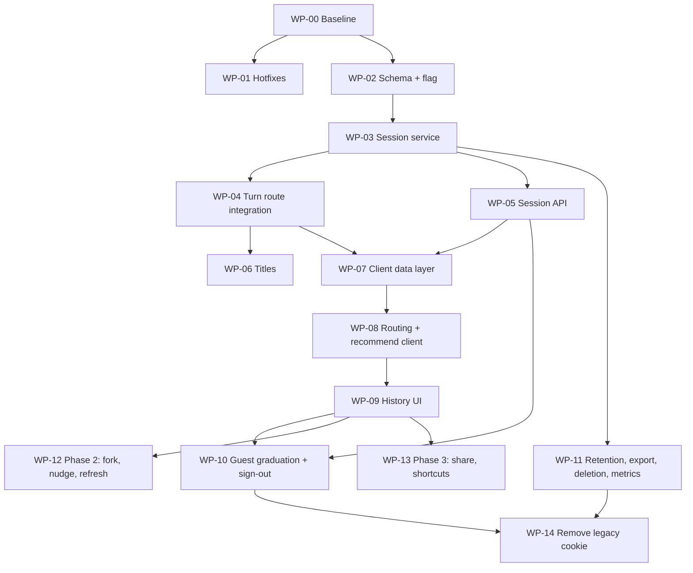

# RECSY Master Plan 27: Recommendation Sessions and Prompt History

> **Document control**
>
> | Field                                | Value                                                                                                                                                                                                                                                                                                                                                                   |
> | :----------------------------------- | :---------------------------------------------------------------------------------------------------------------------------------------------------------------------------------------------------------------------------------------------------------------------------------------------------------------------------------------------------------------------- |
> | Plan number                          | 27                                                                                                                                                                                                                                                                                                                                                                      |
> | Version                              | **2.0.0** (supersedes 1.0.0, archived at `docs/ImplementationPlans/archive/27. user-recommendation-sessions-and-prompt-history-architecture-and-implementation-plan.v1.0.0.md`)                                                                                                                                                                                         |
> | Date                                 | 2026-10-27                                                                                                                                                                                                                                                                                                                                                              |
> | Status                               | Ready for implementation, one work package (WP) per pull request. Owner decisions in Section 4 gate some WPs                                                                                                                                                                                                                                                            |
> | Code baseline                        | `master` at `9348a04` (PR #74 merged, abuse-salt fix on top). Every **[CODE]** reference below was read at that commit                                                                                                                                                                                                                                                  |
> | Stack (verified from `package.json`) | Next.js 16.2.4 (App Router, `src/proxy.ts`), React 19.2.4, Drizzle ORM 0.45 + drizzle-kit 0.31, `postgres` 3.4, `@supabase/ssr` 0.12, `ai` 6 + `@ai-sdk/google`, Zod 4, `@tanstack/react-query` 5.99 (installed, not yet mounted anywhere), Vitest 4 (+ `vitest.db.config.ts` for real-Postgres tests), Playwright 1.59. **SWR is not a dependency**, v1 assumed it was |
> | Companion documents                  | Plan 22 (Supabase free-tier and egress), Plan 23 (model gateway), Plan 25 v2 (multi-user, metering, quotas), Plan 26 v2 (API architecture, latency, flags), `docs/RECSY_V2_PROJECT_CONTEXT.md`                                                                                                                                                                          |
> | Audience                             | Any implementing agent or engineer. Every WP lists files, steps, tests, verification and rollback                                                                                                                                                                                                                                                                       |

## How to read this plan

1. Read Sections 1 to 6 once. They say what is true in the code today, what the feature must do for every kind of user, and the rules every WP follows.
2. Section 3 lists what was wrong in v1.0.0. If you saw v1, read it so you do not implement a corrected mistake.
3. Pick the next WP from the dependency graph in Section 12. Do not start a WP whose dependencies are not merged.
4. Where a WP says **STOP AND ASK**, stop and ask the owner. Where a fact is tagged **[VERIFY]**, check it and record the answer in the PR description.
5. Evidence tags:
   - **[CODE]** verified by reading the repository at `9348a04`, with a file reference.
   - **[DOCS]** documented framework behaviour. Re-check in the installed version before relying on it.
   - **[VERIFY]** not verifiable from here. The implementer must check.
   - **[ESTIMATE]** a derived planning number, never an acceptance criterion. Acceptance criteria are relative to the WP-00 measured baseline.

---

## Table of contents

- [1. Summary](#1-summary)
- [2. What the code does today](#2-what-the-code-does-today)
- [3. Review of v1.0.0: what was wrong or missing](#3-review-of-v100-what-was-wrong-or-missing)
- [4. Owner decisions](#4-owner-decisions)
- [5. Product requirements: every way a user can use this](#5-product-requirements-every-way-a-user-can-use-this)
- [6. Rules every WP follows](#6-rules-every-wp-follows)
- [7. Target architecture](#7-target-architecture)
- [8. Data model and migration](#8-data-model-and-migration)
- [9. API contracts](#9-api-contracts)
- [10. Session titles](#10-session-titles)
- [11. Frontend architecture and UX](#11-frontend-architecture-and-ux)
- [12. Work packages](#12-work-packages)
- [13. Failure modes and edge cases](#13-failure-modes-and-edge-cases)
- [14. Security and privacy](#14-security-and-privacy)
- [15. Performance budgets](#15-performance-budgets)
- [16. Cost model](#16-cost-model)
- [17. Test strategy](#17-test-strategy)
- [18. Observability](#18-observability)
- [19. Rollout and rollback](#19-rollout-and-rollback)
- [20. Risk register](#20-risk-register)
- [21. Future work (explicitly out of scope)](#21-future-work-explicitly-out-of-scope)
- [22. Change log](#22-change-log)

---

## 1. Summary

**The problem.** A signed-in user who opens Recommend sees an old conversation and has no way to start a new one. Worse, even when the screen looks fresh, the server silently keeps adding the new prompt to the old conversation and merges the old requirements into the new search. There is no list of past conversations on the Recommend page, and the one place that lists them (`/account/history`) links to a URL the Recommend page ignores.

**The fix, in one paragraph.** Make the conversation (a "session") a first-class object with an explicit id. The browser generates the id for a new session, puts it in the URL (`/recommend/<id>`) and sends it with every turn. The server creates the session row lazily on the first turn, checks ownership on every turn, and assigns turn numbers under a row lock. A history list (in the existing side navigation on desktop, in a drawer on mobile) shows past sessions with deterministic, zero-cost titles. "New recommendation" becomes a real action that always gives a clean context. Anonymous users get device-scoped history that can be carried into their account at sign-in, safely. Retention, deletion, export and the prune job are fixed so history is not silently destroyed.

**What it costs.** No new LLM calls in the default design (titles are built from the requirements the pipeline already extracts). A handful of indexed queries per page view. Storage of a few KB per session, which matters on the Supabase free tier and is covered in Section 16.

**Phasing.**

| Phase        | Scope                                                                                                                                                                                        | WPs            |
| :----------- | :------------------------------------------------------------------------------------------------------------------------------------------------------------------------------------------- | :------------- |
| 0            | Baseline measurements and three bug fixes that are wrong today regardless of this feature (prune deletes signed-in history, replay response breaks the client, account history link is dead) | WP-00, WP-01   |
| 1 (the core) | Session identity, schema, ownership, turn settlement, session API, titles, routing, history UI, new-session flow, anonymous graduation, sign-out hygiene, retention                          | WP-02 to WP-11 |
| 2            | Fork from a turn, "this looks like a new search" nudge, refresh stale results                                                                                                                | WP-12          |
| 3            | Public share links, keyboard shortcuts and command palette                                                                                                                                   | WP-13          |
| Cleanup      | Remove the legacy session cookie path                                                                                                                                                        | WP-14          |

---

## 2. What the code does today

All facts in this section are **[CODE]** at `9348a04`.

### 2.1 Data model

| Table                        | Relevant columns                                                                                                                                                                                                                      | Notes                                                                                                                                                                                                                                                                          |
| :--------------------------- | :------------------------------------------------------------------------------------------------------------------------------------------------------------------------------------------------------------------------------------ | :----------------------------------------------------------------------------------------------------------------------------------------------------------------------------------------------------------------------------------------------------------------------------- |
| `recommendation_clients`     | `id`, `client_token` (unique), `ip_hash`, `user_agent`, `user_id` (nullable, no FK), `last_seen_at`                                                                                                                                   | Despite the name this is **not a device**. `insertRecommendationSession` creates one client per session, using the session cookie as `client_token` (`src/services/recommender/session.ts:46-71`). So `client_id` cannot be used as a device or ownership key across sessions. |
| `recommendation_sessions`    | `id`, `client_id` (FK, cascade), `title` default `'New Recommendation'`, `primary_intent`, `is_pinned`, `status` (`active`, `closed`, `archived`, `deleted`), `metadata` jsonb, `session_cookie` (unique), `created_at`, `updated_at` | Pin, title and soft-delete statuses already exist (migration `0009_multi_session_chat_history.sql`). **`updated_at` is never updated after insert**, so "sort by recent activity" today is really "sort by creation".                                                          |
| `recommendation_turns`       | `session_id`, `turn_index` (unique with session), `user_message`, `intent`, `extracted_requirements`, `candidate_phone_ids`, `picks`, `clarifying_question`, `latency_ms`, `lease_id`                                                 | Does **not** store `relaxed`, `refined`, `scoresTied`, `scorecardMissing`, `topAspects`, or the assistant text. Those exist only in the browser. A session reloaded from the server cannot be rendered the way the user saw it.                                                |
| `recommendation_shares`      | `session_id`, `share_token` (unique), `frozen_state`, `views_count`, `expires_at`                                                                                                                                                     | Exists, unused.                                                                                                                                                                                                                                                                |
| Indexes                      | `idx_recommendation_sessions_client_status_updated (client_id, status, updated_at)`, `idx_recommendation_sessions_updated_at (updated_at DESC)` (migration 0014), `idx_recommendation_turns_session_idx (session_id, turn_index)`     | Last migration is `0017_rate_limits_hot_path.sql`. **The next free number is 0018**, v1 used 0014 which is taken.                                                                                                                                                              |
| Foreign keys to `auth.users` | None anywhere in `drizzle/migrations`                                                                                                                                                                                                 | Plan 25 kept `user_id` columns FK-free and deletes explicitly in `src/services/account/deletion.ts`. The runtime role `recsy_app` (migration 0015) has no access to the `auth` schema.                                                                                         |

### 2.2 Request path for a turn

`POST /api/recommend` (`src/app/api/recommend/route.ts`):

1. Body is `{ message }` only. No session id.
2. `admitMeteredRequest` resolves identity (`userId`, hashed `deviceId`, or `nocookie:<ip>` when there is no device cookie, `src/services/auth/identity.ts:48-55`).
3. Session lookup by the `recsy_rec_session` cookie (`RECOMMEND_SESSION_COOKIE`, `src/lib/constants.ts:34`), in parallel with quota reservation. `findSessionByCookie` also silently claims an unowned session for a signed-in caller (`session.ts:110-118`).
4. `RecommendTurnUseCase` (`src/services/recommender/recommend-use-case.ts`): if no session, mints a new cookie token and inserts client + session. Runs the pipeline, which loads the **latest requirements and latest picks of that session** (`run-recommendation.ts:153-155`) and merges the new message into them.
5. Settle transaction: `nextTurnIndex` reads `MAX(turn_index)+1` with no lock, inserts the turn, commits or releases the lease.
6. Response body has no `sessionId`. The session cookie lives 14 days (`sessionCookieOptions`, `maxAge 60*60*24*14`). The device cookie is minted on the **response** if missing (`attachDeviceCookieIfNeeded`).
7. Replay path (duplicate `x-request-id`): returns `{ message, intent, requirements, picks, clarifyingQuestion, quota, sessionId, replayed }` with **no `kind` field** and a fabricated quota (`remaining: 0`, `src/services/metering/replay.ts:100-108`). The client throws `Invalid response` on it (`recommend-client.tsx`, the `!('kind' in data)` check).

### 2.3 Client

- `src/app/recommend/page.tsx` renders `RecommendClient`. It ignores search params.
- `src/lib/recommend-session.ts` stores one snapshot in `sessionStorage` under `recsy:session:recommend:v1`, tab-scoped, 24 h TTL. `clearRecommendSession()` is never called.
- `RecommendClientLoaded` hydrates from that snapshot. Inside one session the UI keeps up to 8 "answers" (`RecommendationSnapshot`), which the user can flip between.
- The assistant lines ("Recommendations are ready. Returning top 3.", tie message, no-scorecard message) are **built in the client** from response flags.
- `SideNav` "New recommendation" is a plain `<Link href="/recommend">` (`src/components/ui/side-nav.tsx:55`).
- `/account/history` lists sessions via `GET /api/account/sessions` and links each to `/recommend?session=<id>` (`src/app/account/history/page.tsx:195`). That parameter is ignored, so the link opens whatever the tab had.
- `@tanstack/react-query` is installed but no `QueryClientProvider` exists. Sign-out (`AccountMenu`) does not clear any client storage.

### 2.4 What the user actually experiences

| Situation                                   | What happens                                                                                                                         | Why                                                                                       |
| :------------------------------------------ | :----------------------------------------------------------------------------------------------------------------------------------- | :---------------------------------------------------------------------------------------- |
| Same tab, come back to Recommend            | Old conversation shown                                                                                                               | `sessionStorage` snapshot                                                                 |
| New tab or next day, Recommend              | Screen looks empty, **but the next prompt is appended to the old server session and merged with its requirements** for up to 14 days | Session cookie still valid. This is the most harmful bug: invisible context contamination |
| Click "New recommendation"                  | Nothing changes                                                                                                                      | Plain link to the same page                                                               |
| Two tabs, two different searches            | Both write into the same session, interleaving requirements                                                                          | One cookie per browser                                                                    |
| Signed in on phone and laptop               | Each device has its own cookie, history only visible in `/account/history`, links do nothing                                         | No session routing                                                                        |
| Anonymous user signs in                     | Only the session in the current cookie is claimed                                                                                    | `claimAnonymousState` claims by cookie token                                              |
| Two quick submits in one session (two tabs) | Possible unique-violation 500 after the LLM work is already paid                                                                     | `nextTurnIndex` has no lock                                                               |
| 90 days later                               | **All sessions older than 90 days are deleted, signed-in users included**                                                            | `scripts/db-prune.ts` step 7 filters only on `created_at`                                 |

### 2.5 Other code that touches these tables

Any change to `insertRecommendationSession`, `nextTurnIndex` or the session columns must update: `src/services/eval/runners/multi-turn-runner.ts`, `src/services/internal/pipeline-snapshot.ts`, `src/services/ops/metering-audit.ts`, `src/services/account/{sessions,history,export,deletion}.ts`, `src/services/metering/replay.ts`, `scripts/db-prune.ts`, the seven `claimAnonymousState` call sites under `src/app/auth/**`.

---

## 3. Review of v1.0.0: what was wrong or missing

Severity: **H** would cause a bug, data loss, security hole or failed migration; **M** would cause rework or a poor experience; **L** cosmetic or unproven claim.

| #   | Sev | v1 said                                                                                                | Reality / problem                                                                                                                                                                                                       | v2 fix                                                                                                                             |
| :-- | :-- | :----------------------------------------------------------------------------------------------------- | :---------------------------------------------------------------------------------------------------------------------------------------------------------------------------------------------------------------------- | :--------------------------------------------------------------------------------------------------------------------------------- |
| 1   | H   | Migration `0014_recommendation_sessions_v2.sql`                                                        | `0014_history_sync_indexes.sql` exists. Last is 0017                                                                                                                                                                    | `0018_recommendation_sessions_v2.sql` plus journal entry                                                                           |
| 2   | H   | IDOR check `s.client_id = :deviceId`                                                                   | `client_id` is a per-session row id, not a device. The check would either deny every anonymous user or, if wired to a guessable value, leak                                                                             | New `device_id` column holding the hashed device id. Ownership predicate in Section 7.3                                            |
| 3   | H   | FK `user_id REFERENCES auth.users ON DELETE CASCADE`                                                   | No other table does this. Existing dev rows created with the fake uid path would fail validation. Cross-schema FK couples migrations to Supabase internals                                                              | No FK, same as Plan 25. Deletion paths updated explicitly (WP-11)                                                                  |
| 4   | H   | Not mentioned                                                                                          | `db-prune.ts` deletes every session older than 90 days, including signed-in history                                                                                                                                     | WP-01 hotfix, WP-11 full retention policy                                                                                          |
| 5   | H   | Turn order "serialized by an advisory lock" (no detail)                                                | `nextTurnIndex` reads MAX without a lock. Concurrent turns hit the unique constraint after paying for the LLM                                                                                                           | Row lock via `UPDATE ... SET turn_count = turn_count + 1 RETURNING`, which also yields the index                                   |
| 6   | H   | Anonymous claim `UPDATE ... WHERE client_id IN (...)` by device                                        | Clients are not devices. Claiming everything on a device also imports a previous person's prompts on a shared computer                                                                                                  | Claim explicit session ids presented by the client that also match the device, plus an opt-in import (Section 7.6)                 |
| 7   | H   | Not mentioned                                                                                          | First anonymous request has `deviceId = nocookie:<ip>` and the device cookie is only minted on the response. A session owned by that id would be orphaned on turn 2, and many users behind one IP would share ownership | Mint the device cookie before the session is created. Never use `nocookie:*` as an owner                                           |
| 8   | H   | Not mentioned                                                                                          | Turns do not store `relaxed`, `refined`, `scoresTied`, `scorecardMissing`, `topAspects` or assistant text, so a reopened session cannot render as it looked                                                             | `result_meta` jsonb on turns. Assistant lines built by one pure shared function                                                    |
| 9   | H   | Not mentioned                                                                                          | Replay response lacks `kind`, client throws. Retrying after a network drop shows an error although the turn was saved and charged                                                                                       | WP-01 fix: replay returns the same shape as a live response                                                                        |
| 10  | H   | `sessionId` null or omitted creates a new session                                                      | During a deploy, cached old JS sends no `sessionId`. Treating "absent" as "new" changes behaviour mid-conversation for those users                                                                                      | Absent means legacy cookie path for one release. Explicit id means session mode                                                    |
| 11  | M   | SWR for caching                                                                                        | SWR is not installed. TanStack Query is installed                                                                                                                                                                       | Use TanStack Query v5                                                                                                              |
| 12  | M   | Server `after()` worker "broadcasts title via BroadcastChannel"                                        | The server cannot post to a browser BroadcastChannel                                                                                                                                                                    | Client refetches the list after the first turn. BroadcastChannel only relays client-side mutations between tabs                    |
| 13  | M   | LLM titling in `after()` on every new session                                                          | Shares the free-tier Gemini request-per-minute budget with real recommendations, adds cost and a prompt-injection surface, for a cosmetic gain. The requirements are already extracted as structured data               | Deterministic title from extracted requirements by default (zero cost). LLM polish optional, behind a flag, off by default (D27-4) |
| 14  | M   | Title regex `^[A-Za-z0-9\s\$\-\/]{3,40}$`                                                              | Rejects `₹`, `€`, accents, non-Latin scripts. India is a supported region                                                                                                                                               | Unicode-aware sanitiser (Section 10.3)                                                                                             |
| 15  | M   | Sort and cursor by `updated_at`, index `(user_id, status, is_pinned, updated_at)`                      | `updated_at` never changes today. Renaming or pinning would bump a session to the top. A timestamp-only cursor skips rows with equal timestamps. Pinned-first ordering breaks keyset pagination                         | New `last_turn_at`. Pinned fetched separately. Cursor is `(last_turn_at, id)`                                                      |
| 16  | M   | "Index-only scan, < 2.5 ms on 500k rows"                                                               | Selecting `last_picks_summary` jsonb and `title` cannot be index-only. Number was not measured                                                                                                                          | Indexes in Section 8.3. Budgets relative to the WP-00 baseline                                                                     |
| 17  | M   | Backfill `turn_count = COUNT(*)`                                                                       | Turn indexes can have gaps (failed settles), so COUNT can collide with an existing index on the next turn                                                                                                               | Backfill `next_turn_index = MAX(turn_index)+1`, keep display `turn_count` separately                                               |
| 18  | M   | `POST /api/recommend/sessions` to pre-create sessions, and also "no empty rows until the first prompt" | Contradictory. Pre-creation lets anyone fill the table with empty rows                                                                                                                                                  | No create endpoint. Session row is created by the first turn, using a client-generated id                                          |
| 19  | M   | Session list endpoints use `admitMeteredRequest`                                                       | That reserves quota semantics for metered routes. Listing is not metered                                                                                                                                                | Use `resolveRequestIdentity` plus the existing rate limiter                                                                        |
| 20  | M   | Two sidebars (new `SessionSidebar` plus existing `SideNav`)                                            | Two vertical rails on desktop crowd a page that already has a 12-column layout                                                                                                                                          | History lives inside `SideNav` on Recommend routes. Drawer on mobile                                                               |
| 21  | M   | Feature flag in `src/lib/flags.ts` read from env, "instant propagation without rebuilding"             | That file does not exist. Vercel env changes need a redeploy. The repo has runtime flags in `platform_flags` with a 10 s cache (`src/services/perf/flags.ts`)                                                           | Add a key to the runtime flags (WP-02). Kill switch in seconds without deploy                                                      |
| 22  | M   | Canary 10% then 50%                                                                                    | Not meaningful at current traffic and there is no percentage-bucketing for this flag                                                                                                                                    | `off` then `internal` (allow-listed user ids) then `on`                                                                            |
| 23  | M   | Not mentioned                                                                                          | Sign-out leaves the previous user's history in client caches on a shared browser                                                                                                                                        | Sign-out purges caches and notifies other tabs (WP-10)                                                                             |
| 24  | M   | Not mentioned                                                                                          | Existing `/api/account/sessions` and `src/services/account/sessions.ts` would duplicate the new API                                                                                                                     | One session service. Account endpoints become thin wrappers                                                                        |
| 25  | M   | Not mentioned                                                                                          | Navigating between `/recommend` and `/recommend/[id]` with `router.replace` remounts the page and drops in-flight state                                                                                                 | Client-generated id, URL updated with `history.replaceState` at send time, state keyed by session id                               |
| 26  | M   | Not mentioned                                                                                          | A reply that arrives after the user clicked "New" would be painted into the new, empty session                                                                                                                          | All results are written to the cache entry of the session that sent them, never "the current view"                                 |
| 27  | M   | Hotkeys `Ctrl+Shift+O`, `Ctrl+B`, `Ctrl+K`                                                             | On Windows Chrome `Ctrl+Shift+O` opens the bookmark manager, Firefox `Ctrl+B` opens the bookmarks sidebar, `Ctrl+K` focuses the search bar in Firefox. Whether `preventDefault` wins is browser-specific **[VERIFY]**   | Shortcuts moved to Phase 3 with a verification matrix                                                                              |
| 28  | M   | Share link with `expiresAt: null`, no revoke                                                           | No way to revoke. Prompts can contain personal details. Deleted sessions would still be shared                                                                                                                          | Phase 3: revoke endpoint, prompts excluded by default, shares die with the session, `noindex`                                      |
| 29  | L   | Delete is soft, but existing `deleteUserSession` hard-deletes                                          | Two semantics                                                                                                                                                                                                           | One rule (Section 7.7)                                                                                                             |
| 30  | L   | Tests listed by file name only, no concurrency, migration, security matrix or real-database tests      | `vitest.db.config.ts` exists for real Postgres                                                                                                                                                                          | Section 17                                                                                                                         |
| 31  | L   | No cost section                                                                                        |                                                                                                                                                                                                                         | Section 16                                                                                                                         |
| 32  | L   | Usage modes limited to signed-in desktop                                                               |                                                                                                                                                                                                                         | Section 5 covers 16 modes                                                                                                          |

---

## 4. Owner decisions

Implementers must not guess these. Each has a recommendation that the WPs assume; if the owner chooses otherwise, only the WPs named change.

| ID    | Decision                                                 | Recommendation                                                                                                                                                                                                                   | Affects                           |
| :---- | :------------------------------------------------------- | :------------------------------------------------------------------------------------------------------------------------------------------------------------------------------------------------------------------------------- | :-------------------------------- |
| D27-1 | How long signed-in history is kept                       | Keep while the account exists. Revisit if database size passes 70% of the plan limit (Section 16)                                                                                                                                | WP-11                             |
| D27-2 | What "delete conversation" means                         | Hidden immediately, undo for 10 seconds in the UI, hard-purged by the nightly job after 30 days. Privacy page must say so. Alternative: hard delete immediately and keep only the 10-second client undo (delayed request)        | WP-03, WP-05, WP-11, privacy copy |
| D27-3 | Do anonymous users get a history list                    | Yes, scoped to the browser's device cookie, last 30 days, max 20 shown, purged after 30 days idle                                                                                                                                | WP-03, WP-09, WP-11               |
| D27-4 | LLM-written titles                                       | Off. Deterministic titles only. Re-evaluate after 2 weeks of real titles                                                                                                                                                         | WP-06                             |
| D27-5 | Public share links in this plan                          | Defer to Phase 3                                                                                                                                                                                                                 | WP-13                             |
| D27-6 | Is "refresh results" for an old session a billable query | It re-runs ranking with stored requirements and no extraction LLM call, so recommend **not billable** but rate-limited (10 per hour). **[VERIFY]** that ranking itself makes no LLM call in the current pipeline before deciding | WP-12                             |
| D27-7 | Turn cap per session                                     | 50 turns. After that the UI suggests a new session (the pipeline only reads the last 10 turns anyway)                                                                                                                            | WP-04, WP-09                      |

---

## 5. Product requirements: every way a user can use this

### 5.1 Core user stories

1. **Start fresh.** From anywhere, one action gives an empty conversation whose next prompt shares no requirements, picks or clarifications with any earlier one. Works on desktop, mobile, signed in and anonymous.
2. **Continue.** Opening Recommend without choosing anything shows a new conversation (decision: fresh by default, like ChatGPT and Claude). The most recent conversation is one click away at the top of the history list. A deep link `/recommend/<id>` always reopens that exact conversation.
3. **Browse and switch.** See past conversations grouped by recency, with a title, relative time, turn count and the top pick. Switching is instant for recently viewed ones.
4. **Manage.** Rename, pin, archive, delete (with undo). Search titles and first prompts.
5. **Carry over.** Conversations started as a guest can follow the user into their account when they sign in, without importing other people's conversations from a shared computer.
6. **Across devices.** A conversation started on the phone appears on the laptop, and continuing it on either device keeps a single ordered thread.

### 5.2 Usage modes and how each is handled

| #   | Mode                                                       | Behaviour required                                                                                                    | Where handled                   |
| :-- | :--------------------------------------------------------- | :-------------------------------------------------------------------------------------------------------------------- | :------------------------------ |
| 1   | Anonymous, first visit, no cookies                         | First send mints the device cookie before the session is created; session owned by the device                         | WP-04                           |
| 2   | Anonymous, returning                                       | History list of this browser's sessions (D27-3)                                                                       | WP-03, WP-09                    |
| 3   | Signed in, one device                                      | Full history, ordered by last activity                                                                                | WP-03, WP-09                    |
| 4   | Signed in, several devices                                 | Same list everywhere; refresh on window focus; turns from both devices serialized by the row lock                     | WP-04, WP-07                    |
| 5   | Several tabs, different conversations                      | Each tab has its own URL and id; no shared cookie state                                                               | WP-04, WP-08                    |
| 6   | Several tabs, same conversation                            | Both may send; server orders turns; the other tab shows the new turn on focus or on the broadcast                     | WP-04, WP-07                    |
| 7   | Shared or public computer                                  | Sign-out purges client caches; guest sessions are not auto-imported into the next account                             | WP-10                           |
| 8   | Guest signs in mid-conversation                            | The open conversation becomes the user's and stays on screen; other guest conversations are offered for import        | WP-10                           |
| 9   | Signs out mid-conversation                                 | Conversation disappears from view (it belongs to the account); fresh guest conversation shown                         | WP-10                           |
| 10  | Quota exhausted mid-conversation                           | Prompt stays in the input, quota sheet opens, conversation unchanged; after upgrade, send continues the same session  | WP-08 (keeps current behaviour) |
| 11  | Auth required mid-send (pending intent)                    | Pending intent stores `sessionId` too, so after login the user lands back on `/recommend/<id>` with the text restored | WP-10                           |
| 12  | BYOK user, deep-mode subscriber                            | No difference in session behaviour; mode is per request                                                               | none                            |
| 13  | Mobile, slow or flaky network                              | Optimistic user line, retry with same `x-request-id` replays the saved turn; history in a drawer                      | WP-01, WP-08, WP-09             |
| 14  | Keyboard and screen-reader users                           | History is a labelled navigation landmark, roving focus, live region announces new results and session switches       | WP-09                           |
| 15  | Heavy user with hundreds of sessions                       | Keyset pagination, search, archive                                                                                    | WP-03, WP-09                    |
| 16  | Opens a deleted, foreign or malformed session URL          | Same 404 page for all three ("not found or no longer available"), with "Start new"                                    | WP-05, WP-08                    |
| 17  | Account history page, export, delete-all, account deletion | All use the same session service and see the new columns                                                              | WP-03, WP-11                    |
| 18  | Eval runner and internal dashboards                        | Keep working through the updated helpers                                                                              | WP-04                           |

### 5.3 Non-goals for Phase 1

Real-time push of other devices' turns (focus refetch is enough), sharing, forking, shortcuts, editing a previous prompt in place, folders or tags, full-text search over assistant output.

---

## 6. Rules every WP follows

1. **One WP per PR**, with the WP id in the title. Conventional commit scopes already used in the repo (`feat(recommend)`, `fix(recommend)`, `feat(db)`).
2. **The server is the source of truth** for sessions and turns. Browser storage is a cache that may be stale or missing at any time.
3. **Ownership is checked in SQL**, in the same statement that reads or writes, never by a separate "check then act". Foreign or missing ids return 404 with the same body.
4. **No new LLM calls on the request path.** Any optional LLM work goes through `deferOrRun` (`src/lib/defer.ts`) and a runtime flag.
5. **No prompt text in logs or metrics.** Log session ids, counts and timings only (matches Plan 25 logging rules).
6. **Migrations are additive and idempotent** (`IF NOT EXISTS`, guarded `DO $$` blocks, as in 0009 and 0012). No destructive change until WP-14.
7. **Backward compatible for one release.** Old clients (no `sessionId` in the body) keep the cookie behaviour until WP-14.
8. **Gates before merge:** `pnpm typecheck`, `pnpm lint`, `pnpm test`, `pnpm format:check`, plus `pnpm test:db` (real Postgres, `vitest.db.config.ts`) for WPs touching SQL, plus the WP's own verification.

---

## 7. Target architecture

### 7.1 Overview

```
Browser tab                                      Server (Node runtime)                     Postgres
──────────────────────────────────────           ───────────────────────────────           ─────────────────────────
/recommend           (new, id minted on send)
/recommend/<uuid>    (existing session)

send(message, sessionId=uuid) ──POST /api/recommend──► admit + reserve quota (unchanged)
  history.replaceState('/recommend/<uuid>')            resolveOrCreateSession(id, owner) ──► INSERT ... ON CONFLICT (id) DO NOTHING
  optimistic user line in cache[uuid]                                                         SELECT ... WHERE id AND owner predicate
                                                       runRecommendationPipeline (unchanged, reads last 10 turns)
                                                       settle tx:
                                                         UPDATE sessions SET next_turn_index+1, turn_count+1,
                                                                last_turn_at, title (if heuristic), picks summary
                                                                WHERE id AND owner RETURNING index   ◄── row lock
                                                         INSERT turn (with result_meta)
                                                         lease commit / no-charge
  ◄── { kind, ..., sessionId, turnIndex, session: { title, titleSource } }
  cache[uuid] updated, list invalidated, BroadcastChannel 'session-changed'

History list ──GET /api/recommend/sessions──► owner predicate, keyset page ──────────────────► partial index scan
Open session ──GET /api/recommend/sessions/<id>── (server component on hard load, Query on client nav)
Rename/pin/archive/delete ──PATCH/DELETE──► single UPDATE with owner predicate
```

### 7.2 Session identity

- The browser creates the id with `crypto.randomUUID()` when the user sends the first prompt of a new conversation. The id is in the URL from that moment, so a reload during the first request reopens the right conversation and the request is idempotent.
- Server rule for `POST /api/recommend`:

| Body                                                                       | Meaning                                                               |
| :------------------------------------------------------------------------- | :-------------------------------------------------------------------- |
| no `sessionId` key                                                         | Legacy client. Use the cookie path exactly as today. Removed in WP-14 |
| `sessionId: <uuid>` that does not exist                                    | Create it for the caller (lazy creation)                              |
| `sessionId: <uuid>` that exists and the caller owns                        | Append                                                                |
| `sessionId: <uuid>` that exists and the caller does not own, or is deleted | 404 `SESSION_NOT_FOUND`, lease released as no-charge, no LLM call     |

- A random v4 UUID has 122 random bits, so a stranger "pre-claiming" someone else's future id is not a practical risk. The `ON CONFLICT DO NOTHING` + owner check also makes it harmless: the second party gets 404, never the first party's data.
- The legacy cookie is no longer set for requests in session mode.

### 7.3 Ownership

Owner key stored on each session:

- `user_id` when created by a signed-in user (or claimed).
- `device_id` = the hashed device id from `resolveRequestIdentity` (`hashDeviceId`), always stored when available, also for signed-in users (used for the device marker and the guest-import query).

Owner predicate (one SQL fragment, one helper, used everywhere):

```sql
-- signed-in caller
s.user_id = $userId
-- anonymous caller with a real device cookie
s.user_id IS NULL AND s.device_id = $deviceId
-- anonymous caller without a device cookie ('nocookie:*'): owns nothing; the turn handler mints a cookie first (7.4)
FALSE
```

Plus `s.status IN ('active','archived')` for reads and writes, and `s.status = 'deleted'` only for the restore action.

A signed-in user never sees guest sessions by default, and a guest never sees account sessions, even on the same browser.

### 7.4 Device cookie before creation

In session mode, if the request has no device cookie, the turn handler mints the cookie value first, derives `deviceId = hashDeviceId(value)`, uses it as the owner, and sets the cookie on the response (same options as `getDeviceCookieOptions`). Metering for that first request still uses the identity resolved during admission (`nocookie:<ip>`), which is what happens today, so quota behaviour does not change. **[VERIFY]** in WP-04 that `recsy_link_device_to_user` and the device daily counters are unaffected by the cookie appearing one request earlier for the session owner only.

### 7.5 Turn settlement

Inside the existing settle transaction, replace `nextTurnIndex`:

```sql
UPDATE recommendation_sessions s
   SET next_turn_index   = s.next_turn_index + 1,
       turn_count        = s.turn_count + 1,
       last_turn_at      = now(),
       updated_at        = now(),
       first_message     = COALESCE(s.first_message, left($message, 160)),
       last_picks_summary= CASE WHEN $hasPicks THEN $summary ELSE s.last_picks_summary END,
       title             = CASE WHEN s.title_source = 'heuristic' AND $title IS NOT NULL THEN $title ELSE s.title END,
       primary_intent    = COALESCE(s.primary_intent, $intent)
 WHERE s.id = $sessionId
   AND <owner predicate>
   AND s.status = 'active'
RETURNING s.next_turn_index - 1 AS turn_index;
```

- Zero rows means the session was deleted or archived between the start of the request and settlement (another tab). Release the lease as no-charge and return 404 **[VERIFY]** whether `noCharge` needs a new reason value (today: `clarify | no_results | no_context | client_abort`, `src/services/metering/lease.ts:125`). Add `session_gone` if so.
- The row lock serializes turns in the same session across tabs and devices. Different sessions never contend.
- Then insert the turn with `turn_index` from `RETURNING` and the new `result_meta`.
- Archived sessions: sending a prompt in an archived session un-archives it first (one extra `UPDATE ... SET status='active'` before the pipeline, owner-checked).

### 7.6 Guest to account

At sign-in, all seven call sites already call `claimAnonymousState(db, userId, deviceId, sessionToken)`.

1. **Automatic, narrow.** Claim (a) the legacy cookie session as today and (b) the session ids the client presents in the pending intent or the `returnTo` URL (`/recommend/<id>`), each only if `user_id IS NULL AND device_id = $deviceId`. This keeps the conversation the user was in when they signed in.
2. **Opt-in, broader.** After sign-in, if `SELECT count(*) FROM recommendation_sessions WHERE user_id IS NULL AND device_id = $deviceId AND status='active' AND last_turn_at > now() - interval '30 days'` is greater than zero, the history panel shows "Import N guest conversations from this browser" with Import and Dismiss. Import calls `POST /api/recommend/sessions/claim`. Dismiss is remembered in `localStorage` for that user.
3. Claiming sets `user_id` on the session and, for consistency with existing code, on its `recommendation_clients` row.
4. Fix the existing `clientClaimed = Boolean(updateRes.length ?? true)` bug (always true) by using `RETURNING` and counting rows.

### 7.7 Lifecycle and statuses

| Status     | Listed                                              | Can send          | Reachable by URL | Transition                                                  |
| :--------- | :-------------------------------------------------- | :---------------- | :--------------- | :---------------------------------------------------------- |
| `active`   | Main list                                           | Yes               | Yes              | archive, delete                                             |
| `archived` | "Archived" section only                             | Yes (un-archives) | Yes              | unarchive, delete                                           |
| `deleted`  | No                                                  | No                | 404              | restore within the undo window (D27-2); purged by WP-11 job |
| `closed`   | Unused. Treated as `archived` by reads. Not written |                   |                  |                                                             |

"Delete all history" on `/account/history` stays an immediate hard delete (explicit erasure request), now also matching `recommendation_sessions.user_id`.

### 7.8 Context isolation

A session's pipeline context is exactly its own turns (already true: `getLatestRequirementsForSession` and `getLatestRecommendPickIds` filter by `session_id`). Starting a new session therefore guarantees a clean context once the id comes from the client instead of a long-lived cookie. No cross-session "memory" of the user is introduced in this plan. If personal memory is ever wanted, it is a separate, user-visible, user-editable feature (Section 21).

---

## 8. Data model and migration

### 8.1 Columns added

`recommendation_sessions`:

| Column               | Type                                                                   | Default     | Purpose                                                                                                                      |
| :------------------- | :--------------------------------------------------------------------- | :---------- | :--------------------------------------------------------------------------------------------------------------------------- |
| `user_id`            | `uuid` null                                                            |             | Owner when signed in. No FK (Section 2.1)                                                                                    |
| `device_id`          | `text` null                                                            |             | Hashed device id. Never `nocookie:*`                                                                                         |
| `title_source`       | `text` not null, check in (`'default'`,`'heuristic'`,`'llm'`,`'user'`) | `'default'` | Who wrote the title. Only `user` blocks automatic updates. Only `default` or `heuristic` can be overwritten by the heuristic |
| `first_message`      | `text` null                                                            |             | First prompt, max 160 chars, for list preview and search                                                                     |
| `turn_count`         | `integer` not null                                                     | `0`         | Display count                                                                                                                |
| `next_turn_index`    | `integer` not null                                                     | `0`         | Allocator for `turn_index`                                                                                                   |
| `last_turn_at`       | `timestamptz` not null                                                 | `now()`     | Sort key, set by settlement only                                                                                             |
| `last_picks_summary` | `jsonb` null                                                           |             | Up to 3 `{ brand, model, slug }`. No scores, no prices, to keep list payloads small                                          |
| `deleted_at`         | `timestamptz` null                                                     |             | Set with status `deleted`                                                                                                    |
| `archived_at`        | `timestamptz` null                                                     |             | Set with status `archived`                                                                                                   |

`recommendation_turns`:

| Column        | Type         | Purpose                                                                                                                                                                                        |
| :------------ | :----------- | :--------------------------------------------------------------------------------------------------------------------------------------------------------------------------------------------- |
| `result_meta` | `jsonb` null | `{ v: 1, relaxed: string[], refined: boolean, scoresTied: boolean, scorecardMissing: boolean, topAspects: string[], regionCode: string, currency: string }`. Versioned so the shape can evolve |

`session_cookie` stays `NOT NULL UNIQUE` until WP-14. Sessions created in session mode store `'sid:' || id` in it to satisfy the constraint without a second random token.

### 8.2 Migration `drizzle/migrations/0018_recommendation_sessions_v2.sql`

Hand-written in the repo's style, plus an entry in `drizzle/migrations/meta/_journal.json` (idx 18). Update `src/services/db/schema.ts` to match so `drizzle-kit generate` reports no drift.

```sql
-- 0018: Recommendation sessions v2 (Plan 27 WP-02). Additive and idempotent.
ALTER TABLE "recommendation_sessions" ADD COLUMN IF NOT EXISTS "user_id" uuid;
--> statement-breakpoint
ALTER TABLE "recommendation_sessions" ADD COLUMN IF NOT EXISTS "device_id" text;
--> statement-breakpoint
ALTER TABLE "recommendation_sessions" ADD COLUMN IF NOT EXISTS "title_source" text NOT NULL DEFAULT 'default';
--> statement-breakpoint
ALTER TABLE "recommendation_sessions" ADD COLUMN IF NOT EXISTS "first_message" text;
--> statement-breakpoint
ALTER TABLE "recommendation_sessions" ADD COLUMN IF NOT EXISTS "turn_count" integer NOT NULL DEFAULT 0;
--> statement-breakpoint
ALTER TABLE "recommendation_sessions" ADD COLUMN IF NOT EXISTS "next_turn_index" integer NOT NULL DEFAULT 0;
--> statement-breakpoint
ALTER TABLE "recommendation_sessions" ADD COLUMN IF NOT EXISTS "last_turn_at" timestamptz NOT NULL DEFAULT now();
--> statement-breakpoint
ALTER TABLE "recommendation_sessions" ADD COLUMN IF NOT EXISTS "last_picks_summary" jsonb;
--> statement-breakpoint
ALTER TABLE "recommendation_sessions" ADD COLUMN IF NOT EXISTS "deleted_at" timestamptz;
--> statement-breakpoint
ALTER TABLE "recommendation_sessions" ADD COLUMN IF NOT EXISTS "archived_at" timestamptz;
--> statement-breakpoint
ALTER TABLE "recommendation_turns" ADD COLUMN IF NOT EXISTS "result_meta" jsonb;
--> statement-breakpoint
DO $$ BEGIN
  IF NOT EXISTS (SELECT 1 FROM pg_constraint WHERE conname = 'recommendation_sessions_title_source_chk') THEN
    ALTER TABLE "recommendation_sessions"
      ADD CONSTRAINT "recommendation_sessions_title_source_chk"
      CHECK ("title_source" IN ('default','heuristic','llm','user'));
  END IF;
END $$;
--> statement-breakpoint

-- Backfill ownership from the per-session client row.
UPDATE "recommendation_sessions" s
   SET "user_id" = c."user_id"
  FROM "recommendation_clients" c
 WHERE s."client_id" = c."id" AND s."user_id" IS NULL AND c."user_id" IS NOT NULL;
--> statement-breakpoint

-- Backfill counters and activity from turns. next_turn_index uses MAX+1, not COUNT, because indexes can have gaps.
UPDATE "recommendation_sessions" s
   SET "turn_count"      = t.cnt,
       "next_turn_index" = t.max_idx + 1,
       "last_turn_at"    = t.last_at,
       "first_message"   = left(t.first_msg, 160)
  FROM (
    SELECT session_id,
           count(*)::int                                   AS cnt,
           max(turn_index)                                 AS max_idx,
           max(created_at)                                 AS last_at,
           (array_agg(user_message ORDER BY turn_index))[1] AS first_msg
      FROM "recommendation_turns"
     GROUP BY session_id
  ) t
 WHERE s."id" = t.session_id;
--> statement-breakpoint
UPDATE "recommendation_sessions" SET "last_turn_at" = "created_at" WHERE "turn_count" = 0;
--> statement-breakpoint
UPDATE "recommendation_sessions" SET "deleted_at" = "updated_at" WHERE "status" = 'deleted' AND "deleted_at" IS NULL;
--> statement-breakpoint

-- Indexes (see 8.3).
CREATE INDEX IF NOT EXISTS "rs_user_recent_idx"
  ON "recommendation_sessions" ("user_id", "last_turn_at" DESC, "id" DESC)
  WHERE "user_id" IS NOT NULL AND "status" IN ('active','archived');
--> statement-breakpoint
CREATE INDEX IF NOT EXISTS "rs_device_recent_idx"
  ON "recommendation_sessions" ("device_id", "last_turn_at" DESC, "id" DESC)
  WHERE "user_id" IS NULL AND "device_id" IS NOT NULL AND "status" IN ('active','archived');
--> statement-breakpoint
CREATE INDEX IF NOT EXISTS "rs_deleted_purge_idx"
  ON "recommendation_sessions" ("deleted_at")
  WHERE "status" = 'deleted';
```

Notes:

- Titles are not backfilled. Existing rows keep `'New Recommendation'` with `title_source='default'`; WP-06 ships a one-off script `scripts/backfill-session-titles.ts` (dry-run by default) that derives heuristic titles from each session's latest `extracted_requirements`, in batches of 500.
- `device_id` cannot be backfilled (old rows never stored it). Old anonymous sessions are therefore reachable only through the legacy cookie until they age out. This is acceptable and documented.
- Row counts: run `SELECT count(*) FROM recommendation_sessions; SELECT count(*) FROM recommendation_turns;` first and record them in the PR **[VERIFY]**. The backfill is a single statement per table. Below roughly 100k turns it is seconds **[ESTIMATE]**. Above that, run the backfill as a batched script instead and keep only the DDL in the migration.
- Plain `CREATE INDEX` (not `CONCURRENTLY`) because drizzle-kit runs each migration in a transaction **[VERIFY for drizzle-kit 0.31]**. At current table sizes the lock is brief. If the table is large, create the indexes manually with `CONCURRENTLY` before deploying and let `IF NOT EXISTS` skip them.
- Drop nothing. The existing `idx_recommendation_sessions_client_status_updated` and `idx_recommendation_sessions_updated_at` stay until WP-14 confirms nothing uses them (`pg_stat_user_indexes.idx_scan`).
- RLS is already enabled on these tables (0011) and the app connects as `recsy_app`, which has table privileges through default privileges (0015). New columns need no grants.

### 8.3 Query plans

| Query                   | Index                                                                   | Expected plan                                                                                                        |
| :---------------------- | :---------------------------------------------------------------------- | :------------------------------------------------------------------------------------------------------------------- |
| List, signed in, page 1 | `rs_user_recent_idx`                                                    | Index scan, `LIMIT 21`, heap fetch for title, summary (not index-only, and that is fine: at most 21 rows)            |
| List, next page         | same, with `(last_turn_at, id) < ($t, $id)`                             | Index scan from the cursor                                                                                           |
| Pinned group            | `rs_user_recent_idx` + filter `is_pinned`                               | A user has few pins. Cap pins at 50 in the PATCH handler                                                             |
| List, guest             | `rs_device_recent_idx`                                                  | Same shape                                                                                                           |
| Detail                  | PK + `idx_recommendation_turns_session_idx`                             | Two index lookups                                                                                                    |
| Search                  | `rs_user_recent_idx` then filter `title ILIKE` or `first_message ILIKE` | Bounded by the user's own rows. No trigram index needed while a user has fewer than about 5k sessions **[ESTIMATE]** |
| Purge                   | `rs_deleted_purge_idx`                                                  | Range scan                                                                                                           |

Each must be checked with `EXPLAIN (ANALYZE, BUFFERS)` on a seeded database in WP-02 and the plans pasted into the PR.

### 8.4 Size of a row

`last_picks_summary` is three short objects (about 150 bytes). `first_message` at most 160 chars. A turn with picks is about 2 to 6 KB today, mostly the `picks` jsonb **[ESTIMATE, VERIFY with `pg_column_size` in WP-00]**. See Section 16 for what that means on the free tier.

---

## 9. API contracts

All session endpoints: `runtime = 'nodejs'`, `dynamic = 'force-dynamic'`, `Cache-Control: private, no-store`, `X-Trace-Id`, `assertSameOrigin` on mutations (as `/api/account/sessions` does), identity via `resolveRequestIdentity` (cookie-only, no quota), rate limits through `src/services/rate-limit` with route keys `sessions:list`, `sessions:detail`, `sessions:mutate`. Error body is the repo's standard `{ code, message, traceId }`.

### 9.1 `POST /api/recommend` (changed)

Request:

```ts
const bodySchema = z.object({
  message: z.string().trim().min(1).refine(/* existing byte limit */),
  sessionId: z.string().uuid().optional(), // absent = legacy cookie path
});
```

Response (live and replay identical in shape):

```jsonc
{
  "kind": "results", // or "clarify"
  "picks": [
    /* unchanged */
  ],
  "relaxed": [],
  "refined": false,
  "scoresTied": false,
  "scorecardMissing": false,
  "topAspects": [],
  "clarifyingQuestion": null,
  "quota": {
    /* unchanged */
  },
  "sessionId": "5b0c…",
  "turnIndex": 3,
  "session": {
    "title": "Camera phone under $700",
    "titleSource": "heuristic",
    "turnCount": 4,
    "created": false,
  },
  "topicShift": false, // Phase 2 (WP-12); always false until then
  "replayed": false,
}
```

New errors: `404 SESSION_NOT_FOUND`, `409 SESSION_TURN_LIMIT` (D27-7). Both release the lease without charge and are checked **before** the pipeline runs.

Ordering inside the route: parse body, admit, then in parallel `reserveQuery` and `resolveOrCreateSession`. If the session step fails, release the lease and return the error. This keeps the existing parallelism (Plan 26) and adds no serial round trip.

### 9.2 `GET /api/recommend/sessions`

Query: `cursor` (opaque base64url of `last_turn_at|id`), `limit` 1 to 50 (default 20), `q` (search, 1 to 80 chars, `%` and `_` escaped), `status` `active` (default) or `archived`, `includePinned` boolean (default true on the first page only).

```jsonc
{
  "pinned": [
    /* SessionSummary[], first page only, max 50 */
  ],
  "sessions": [
    {
      "id": "5b0c…",
      "title": "Camera phone under $700",
      "titleSource": "heuristic",
      "firstMessage": "need a phone with a great camera under 700…",
      "isPinned": false,
      "status": "active",
      "turnCount": 4,
      "topPick": { "brand": "Google", "model": "Pixel 9", "slug": "google-pixel-9" },
      "createdAt": "…",
      "lastTurnAt": "…",
      "deviceMarker": "Chrome on Windows", // signed-in only
    },
  ],
  "nextCursor": "…", // null when done
  "guestImportAvailable": 2, // signed-in only, 0 when none or dismissed server-side
}
```

Target payload: under 8 KB for a 20-row page **[ESTIMATE]** (Plan 22 egress).

### 9.3 `GET /api/recommend/sessions/:id`

Returns the session summary plus turns ordered by `turn_index`, newest 50 by default, with `before=<turnIndex>` for older ones. Each turn: `turnIndex`, `userMessage`, `intent`, `clarifyingQuestion`, `picks`, `resultMeta`, `createdAt`. No `extracted_requirements` (internal, and can be large); add later only if the UI needs it.

404 for missing, foreign, deleted or malformed id (Zod uuid failure maps to 404, not 400, so ids cannot be probed).

### 9.4 `PATCH /api/recommend/sessions/:id`

Body (at least one field): `title` (1 to 80 chars after sanitising, sets `title_source='user'`; empty string resets to heuristic), `isPinned`, `status` in `active` or `archived`. One `UPDATE ... WHERE id AND owner RETURNING`. Does not touch `last_turn_at`, so renaming never reorders the list.

### 9.5 `DELETE /api/recommend/sessions/:id` and `POST /api/recommend/sessions/:id/restore`

Delete sets `status='deleted', deleted_at=now()` and deletes the session's `recommendation_shares` rows in the same statement (CTE). Restore is allowed while `deleted_at > now() - interval '30 days'` (D27-2) and the owner matches. Both idempotent.

### 9.6 `POST /api/recommend/sessions/claim`

Signed-in only. Body `{ sessionIds?: uuid[] (max 20) }`. Without ids, claims all guest sessions of this device from the last 30 days (the opt-in import). With ids, claims only those that match the device. Returns `{ claimed: number }`. Also records a dismiss/import marker so `guestImportAvailable` stops showing.

### 9.7 Account endpoints

`GET/DELETE /api/account/sessions` keep their URLs and response shapes (the account page and its tests depend on them) but call the new service. DELETE becomes the soft delete. `/account/history` links change to `/recommend/<id>`.

---

## 10. Session titles

### 10.1 Rules

1. A new session shows "New recommendation" until the first turn settles.
2. On every settled turn, if `title_source` is `default` or `heuristic`, recompute the heuristic title from that turn's extracted requirements. It sharpens as the user answers clarifying questions, and stops changing once the user renames.
3. Optional LLM polish (D27-4, off by default) runs once, after the first `results` turn, through `deferOrRun`, only when the platform is not shedding free traffic, and writes only if `title_source` is still `heuristic` (compare-and-set in SQL).

### 10.2 Heuristic title

`src/services/recommender/session-title.ts`, a pure function `buildSessionTitle(requirements, message, region)`:

- Pieces, in priority order: the top one or two priorities as plain words ("Camera", "Battery", "Gaming", "Compact"), a brand or platform constraint ("iPhone", "Android", "Samsung"), a budget formatted with the region currency (`formatLocalPrice` helpers), e.g. "under ₹60,000".
- Examples: "Camera phone under $700", "Compact Android with long battery", "Gaming phone under ₹40,000", "Samsung foldable".
- Fallback when requirements are empty or low confidence: the first prompt, trimmed to whole words within 48 characters, first letter upper-cased.
- Deterministic, so it is unit-testable with table tests and costs nothing.

### 10.3 Sanitising (all title sources, including user renames)

Normalise to NFC, strip control and bidi-override characters (`\p{Cc}`, `U+202A–U+202E`, `U+2066–U+2069`), collapse whitespace, strip surrounding quotes and markdown characters, limit to 80 characters on a grapheme boundary (`Intl.Segmenter`). Allow any letters, digits, currency symbols and ordinary punctuation. Titles are rendered as text, never HTML.

### 10.4 Optional LLM polish (behind flag `recommend_session_llm_titles`)

- Uses the model gateway's cheapest chat model (Plan 23) with `maxOutputTokens: 16`, timeout 4 s, no retries.
- Input is the heuristic title plus the requirement fields, **not** the raw prompt, which removes most of the prompt-injection surface and personal details.
- Output passes 10.3 and a 2-to-8-word check, else discarded.
- Usage recorded in `llm_usage_events` with route `recommend:title`, never charged to the user's quota.
- Kill switch: the flag.

---

## 11. Frontend architecture and UX

### 11.1 Routes

| Route                          | Renders                                                                                                                                                                                        |
| :----------------------------- | :--------------------------------------------------------------------------------------------------------------------------------------------------------------------------------------------- |
| `/recommend`                   | New conversation. Greeting, input autofocused on desktop (not on mobile, to avoid the keyboard jumping up)                                                                                     |
| `/recommend/[id]`              | Server component loads the session through the service (owner-checked) and passes it as initial data. `notFound()` on 404, with a custom `not-found.tsx` offering "Start a new recommendation" |
| `/recommend?session=<id>`      | Redirects to `/recommend/<id>` (old account-history links, bookmarks)                                                                                                                          |
| `src/app/recommend/layout.tsx` | Holds the query client provider, the history panel and the shared client component, so moving between `/recommend` and `/recommend/[id]` keeps the shell mounted                               |

On send in a new conversation: generate the id, write the optimistic entry to the cache, then `window.history.replaceState(null, '', '/recommend/' + id)`. Next.js App Router syncs `usePathname` with native `pushState`/`replaceState` since 14.1 **[DOCS, VERIFY on 16.2.4]**, and this does not remount the page, so the in-flight request and animation continue.

### 11.2 Client data layer

- Mount one `QueryClientProvider` (TanStack Query v5, already a dependency) in `src/app/recommend/layout.tsx` (and in `/account/history` if it moves to Query).
- Keys: `['rec-sessions', ownerKey, status, q]` (infinite query), `['rec-session', id]`.
- `ownerKey` is `user:<id>` or `guest`, so a sign-in or sign-out switches caches instead of mixing them.
- `staleTime` 30 s for the list, 5 min for a session detail, `refetchOnWindowFocus` on (multi-device freshness at near zero cost).
- Sending a turn: `onMutate` appends the optimistic user line to `['rec-session', id]`; on success, merge the turn into **that id's** cache entry (never "the current view"), update the summary in the list cache, and broadcast. If the user has moved to another session meanwhile, nothing on screen changes except the list entry.
- Optimistic rename, pin, archive, delete with rollback on error.
- Hover or focus on a list item prefetches its detail (cheap, private, small).
- `sessionStorage` cache `recsy:rec:v2:<id>` (last 10 viewed, LRU) gives an instant paint after a hard reload before the server data arrives. Delete the old `recsy:session:recommend:v1` key on first load.
- Drafts: `recsy:draft:v1:<id or "new">` in `sessionStorage`, saved on input (debounced 300 ms), restored on return, cleared on send.

### 11.3 Cross-tab sync

`BroadcastChannel('recsy:rec-sessions')` with messages `{ type: 'changed' | 'deleted' | 'signed-out', id? , ownerKey }` (ids only, never content). Receivers invalidate the matching query keys. Fallback for browsers without BroadcastChannel: the `storage` event on a `recsy:rec:ping` key. A tab showing a session that another tab deleted shows "This conversation was deleted" with Undo (while in the window) and Start new.

### 11.4 Sign-out and account switch

On sign-out (`AccountMenu`) and when the server reports a different user than the cached `ownerKey`: `queryClient.clear()`, remove every `recsy:rec:v2:*` and `recsy:draft:v1:*` key, broadcast `signed-out`, navigate to `/recommend`. This is what keeps a shared computer private.

### 11.5 Layout

Desktop (≥ 1024 px, `lg`):

- `SideNav` on Recommend routes gets a "Recent" section under the navigation: the "New recommendation" button on top (now a button that navigates to `/recommend` and resets state), a search field, then groups. It scrolls independently. Width stays `w-64` and the panel is hidden below `lg`, exactly as `SideNav` is today [CODE `side-nav.tsx:17`].
- Other pages keep the current SideNav without the history section, and their "New recommendation" goes to `/recommend` (which is always fresh now).

Mobile and tablet (< 1024 px):

- A "History" icon button and a "New" icon button in the Recommend page header.
- History opens a left drawer (dialog semantics, focus trap, Escape closes, backdrop click closes). Use the existing `src/components/ui/sheet.tsx` primitive; do not add a new dialog library.
- Selecting a session closes the drawer.

Groups: Pinned, Today, Yesterday, Previous 7 days, Previous 30 days, then by month. Computed in the user's local time zone.

Item: title (one line, ellipsis), relative time, turn count, top pick model as a small label. Actions in a "more" menu (button, keyboard reachable, not hover-only so it works on touch): Rename (inline input, Enter saves, Escape cancels), Pin/Unpin, Archive/Unarchive, Delete (immediate, with an Undo toast for 10 s via `sonner`, which the app already uses).

Empty states: no sessions ("Your recommendations will appear here"), no search results, guest prompt ("Sign in to keep your history across devices", shown once, dismissible), error with retry.

Turn limit (D27-7): at 45 turns show a hint; at 50 the input is replaced by "This conversation is full. Start a new one with the same requirements" (Phase 2 makes that a fork; in Phase 1 it starts a new session).

Accessibility: history is a `<nav aria-label="Recommendation history">`, list items are links (`/recommend/<id>`) so middle-click and open-in-new-tab work, the active one has `aria-current="page"`, the conversation has a polite live region that announces "Loaded <title>" on switch and "New recommendations ready" on results.

### 11.6 Rendering a reopened session

A single pure function `buildAssistantLines(turn)` in `src/lib/recommend-lines.ts` produces the assistant text (results intro, relaxed adjustments, tie message, no-scorecard message, no-matches message, clarifying question) from a turn's stored fields. The live path and the reopen path both use it, so a reopened conversation reads exactly as it did. The existing per-session "answers" switcher becomes "results turns in this session" (each `results` turn is one answer).

Picks in old sessions show the stored price with "as of <date>" when older than 7 days. Picks whose phone is now archived or missing still render from the stored snapshot, without a link if the slug no longer resolves **[VERIFY how the phone page handles archived slugs]**.

---

## 12. Work packages

### 12.1 Dependency graph



WP-01, WP-02 can run in parallel. WP-05 and WP-04 can run in parallel. WP-06 and WP-11 can run in parallel with the frontend WPs.

---

### WP-00: Baseline and characterization

- **Goal:** numbers and tests to compare against.
- **Steps:**
  1. Record `pnpm test` and `pnpm typecheck` results on the base commit.
  2. Measure p50/p95 of `POST /api/recommend` server time with `Server-Timing` (Plan 26 harness), stages `session` and `settle` specifically, 30 requests with the mock LLM.
  3. Record row counts and `pg_column_size` averages for `recommendation_sessions`, `recommendation_turns` (`picks`, `extracted_requirements`), and current database size.
  4. Add characterization tests that pin today's behaviour that later WPs intentionally change: cookie reuse appends to the old session; replay response lacks `kind`; prune deletes signed-in sessions older than 90 days (on the db test config).
- **Acceptance:** numbers in the PR description; tests pass on the base commit.

### WP-01: Hotfixes (independent of the feature)

- **Files:** `scripts/db-prune.ts`, `src/app/api/recommend/route.ts`, `src/services/metering/replay.ts`, `src/app/recommend/page.tsx`, `src/services/auth/claim-anonymous.ts`, tests.
- **Steps:**
  1. Prune: limit step 7 to sessions with no owner (`client.user_id IS NULL`) and use activity (`max(turn.created_at)` or `updated_at`), not `created_at`. Loop batches until done instead of one batch per run.
  2. Replay: return the same body shape as a live response (`kind` derived from `intent`, `picks`, `relaxed` etc. empty until WP-04 stores `result_meta`, `sessionId`), and the real quota snapshot from the lease instead of zeros **[VERIFY a helper exists to project quota from a settled lease; otherwise return `quota: null` and let the client keep its last known quota]**.
  3. `/recommend?session=<id>`: read `searchParams`; if it is a uuid, clear the `sessionStorage` snapshot client-side and show a notice "Opening past conversations arrives soon" (temporary), or simply hide the broken link in `/account/history` until WP-08. Pick the second, it is smaller.
  4. `claimAnonymousState`: count claimed rows with `RETURNING` (today always `true`).
- **Tests:** flip the WP-00 characterization tests for prune and replay; client test that a replayed response renders.
- **Acceptance:** signed-in sessions survive `pnpm db:prune -- --dry-run` output; replayed request renders results.
- **Rollback:** revert the PR.

### WP-02: Schema, migration and runtime flag

- **Files:** `drizzle/migrations/0018_recommendation_sessions_v2.sql`, `drizzle/migrations/meta/_journal.json`, `src/services/db/schema.ts`, `src/services/perf/flags.ts` (+ test).
- **Steps:**
  1. Migration as in 8.2. Schema columns, check constraint and partial indexes in Drizzle (`.where(sql\`...\`)`as`recommendation_clients_user_idx` does).
  2. Add to `perfFlagsSchema` (it is `.strict()`, so the key must be declared): `recommend_sessions: z.enum(['off','internal','on']).default('off')`, `recommend_sessions_internal_user_ids: z.array(z.string().uuid()).default([])`, `recommend_session_llm_titles: z.boolean().default(false)`. Naming note: these are product flags living in the perf flag blob to reuse its 10 s cache and admin route; acceptable, and noted in the file header.
  3. Run `pnpm db:generate` and confirm no drift (no new generated migration).
  4. Apply to a local or branch database seeded with WP-00-like data; record the backfill time and the `EXPLAIN` plans of Section 8.3.
- **Tests:** db test that the migration is idempotent (run twice); backfill correctness on a fixture with gaps in `turn_index`; schema test for column defaults.
- **Acceptance:** migration applies cleanly twice; `next_turn_index > max(turn_index)` for every session with turns; plans use the new indexes.
- **Rollback:** columns are unused until WP-03; leave them. If necessary, a down script drops the new columns and indexes (provided in the PR, not run automatically).

### WP-03: Session domain service

- **Files:** `src/services/recommender/sessions/` (new folder): `owner.ts` (owner type + SQL predicate builder), `repository.ts` (all SQL), `service.ts` (list, detail, update, softDelete, restore, claim, resolveOrCreate, settleTurn), `cursor.ts`, tests. Refactor `src/services/account/sessions.ts` to delegate.
- **Steps:**
  1. `type SessionOwner = { kind: 'user', userId } | { kind: 'device', deviceId } | { kind: 'none' }`, built by `ownerFromIdentity(identity)` which returns `none` for `nocookie:*`.
  2. `resolveOrCreateSession(db, { id, owner, ipHash, userAgent, regionCode })`: `INSERT client` + `INSERT session ... ON CONFLICT (id) DO NOTHING` in one transaction, then `SELECT ... WHERE id AND owner AND status IN ('active','archived')`. Returns `{ session, created }` or `null`. Un-archive on send.
  3. `settleTurn(tx, {...})` implements Section 7.5 and inserts the turn. Returns the turn index or `null` when the session is gone.
  4. `listSessions` with keyset cursor and separate pinned query; `getSessionDetail` with turn paging; `updateSession` (pin cap 50); `softDeleteSession` (also deletes shares); `restoreSession`; `claimGuestSessions`.
  5. Keep `findSessionByCookie` and `insertRecommendationSession` for the legacy path; make `insertRecommendationSession` also write `user_id`, `device_id`, `last_turn_at`, so legacy sessions appear in the new list.
- **Tests (db config, real Postgres):** the security matrix in 17.3; keyset pagination with equal timestamps; pinned not duplicated in pages; search escaping (`%`, `_`, `\`); concurrent `settleTurn` on one session from 10 parallel transactions gives indexes 0 to 9 with no error; `settleTurn` after delete returns `null`; claim only touches matching device and null user.
- **Acceptance:** all tests pass; no SQL string concatenation; every query has the owner predicate (grep check in the test).

### WP-04: Turn route integration

- **Files:** `src/app/api/recommend/route.ts`, `src/services/recommender/recommend-use-case.ts`, `src/services/recommender/session.ts`, `src/services/metering/lease.ts` (reason value if needed), `src/services/eval/runners/multi-turn-runner.ts`, `src/services/internal/pipeline-snapshot.ts`, `src/services/ops/metering-audit.ts` (only if they break), tests.
- **Steps:**
  1. Body schema per 9.1. Branch on presence of `sessionId`.
  2. Session mode: compute owner (mint device cookie first, 7.4); run `resolveOrCreateSession` in parallel with `reserveQuery`; on null, release the lease (`noCharge('session_gone')` or the closest existing reason) and return 404 before the pipeline. Check turn limit (D27-7) the same way.
  3. Gate session mode behind the flag: when `recommend_sessions` is `off` (or `internal` and the user is not listed), ignore `sessionId` and use the legacy path, so the server can be deployed before the client.
  4. Replace `nextTurnIndex` with `settleTurn` in both modes. Store `result_meta`. Compute `buildSessionTitle` (WP-06 provides it; until then pass `null`).
  5. Response per 9.1, including on replay. Do not set the legacy cookie in session mode.
  6. Update the eval runner to the new helpers so eval output is unchanged.
- **Tests:** route tests for each body case in 7.2; 404 does not call the pipeline or charge (assert lease state); turn limit; legacy path unchanged; device-cookie minting on first anonymous request; replay returns `sessionId` and the same shape; eval runner test still green.
- **Verification:** Server-Timing `session` and `settle` stages within +5 ms p50 of the WP-00 baseline **[target, measured]**.
- **Rollback:** flag `off` restores legacy behaviour for all clients; schema stays.

### WP-05: Session REST API

- **Files:** `src/app/api/recommend/sessions/route.ts` (GET), `src/app/api/recommend/sessions/[id]/route.ts` (GET, PATCH, DELETE), `.../[id]/restore/route.ts`, `.../claim/route.ts`, `src/app/api/account/sessions/route.ts` (delegate), tests.
- **Steps:** handlers per Section 9; Zod schemas; uuid failure maps to 404; rate limits; when the flag is off, return 404 for all new endpoints except for internal users.
- **Tests:** status code matrix (200, 400 for bad body, 404 for foreign or missing, 429); same-origin rejection on mutations; account endpoints' existing tests still pass unchanged.
- **Acceptance:** `/account/history` works unchanged through the delegated service.

### WP-06: Titles

- **Files:** `src/services/recommender/session-title.ts` (+ table tests), `src/services/recommender/session-title-llm.ts` (flagged), `scripts/backfill-session-titles.ts`.
- **Steps:** Section 10. Wire `buildSessionTitle` into WP-04's settle call. LLM polish via `deferOrRun`, compare-and-set on `title_source='heuristic'`.
- **Tests:** at least 30 table cases across US and IN regions, empty and low-confidence requirements, non-Latin prompts, injection-looking prompts ("ignore previous instructions…" becomes a plain trimmed title), length and grapheme limits; LLM path with a mocked provider including timeout and garbage output; compare-and-set does not overwrite a user rename that happened during the LLM call.
- **Acceptance:** no LLM call when the flag is off (asserted); backfill script dry-run prints a sample of 20 titles for owner review.

### WP-07: Client data layer

- **Files:** `src/lib/recommend-sessions/` (new): `query-client.tsx` (provider), `keys.ts`, `api.ts` (typed fetchers, reuse `createMeteredRequestInit` for the turn call), `use-session-list.ts`, `use-session.ts`, `use-send-turn.ts`, `local-cache.ts` (LRU `sessionStorage`), `drafts.ts`, `broadcast.ts`, `purge.ts`, tests. Remove `src/lib/recommend-session.ts` usage (keep the file until WP-14 for the legacy key cleanup).
- **Steps:** Section 11.2 to 11.4.
- **Tests (Vitest + jsdom):** optimistic send and rollback on error; a late response for session A while viewing session B updates only A's cache; broadcast invalidates the right keys; purge removes every prefixed key; LRU eviction; drafts per id.

### WP-08: Routing and recommend client refactor

- **Files:** `src/app/recommend/layout.tsx`, `src/app/recommend/page.tsx`, `src/app/recommend/[id]/page.tsx`, `src/app/recommend/[id]/not-found.tsx`, `src/app/recommend/recommend-client.tsx` (split into `Conversation`, `Composer`, `ResultsPanel`), `src/lib/recommend-lines.ts`, `src/app/account/history/page.tsx` (links), tests.
- **Steps:**
  1. Layout with provider; `[id]` server component fetching through the service with the caller's identity; redirect for `?session=`.
  2. Client keyed by session id (`key={sessionId ?? 'new'}` on the conversation subtree so state cannot leak between sessions).
  3. Send in a new conversation generates the id and calls `history.replaceState`.
  4. `buildAssistantLines` extracted and used for live and reopened turns.
  5. Behind the flag: when off, the page behaves as today except that "New recommendation" clears the `sessionStorage` snapshot and the client always sends a fresh `sessionId`, which the server ignores while off (so this is safe to ship early).
- **Tests:** component tests for new, reopen, 404, quota error keeps the draft, auth redirect stores `sessionId` in pending intent; snapshot test that a reopened session renders the same lines as the live one did.

### WP-09: History UI

- **Files:** `src/components/recommend/history/` (new): `HistoryPanel.tsx`, `HistoryDrawer.tsx`, `HistoryList.tsx`, `HistoryItem.tsx`, `HistorySearch.tsx`, `NewRecommendationButton.tsx`, `group-by-recency.ts` (+ test); `src/components/ui/side-nav.tsx` (slot for the panel, button).
- **Steps:** Section 11.5. Use existing tokens (hex tokens, forced dark theme, per Plan 25 notes) and existing typography classes (`meta-label`, mono labels).
- **Tests:** grouping across midnight and DST boundaries with a fixed clock and time zone; rename keyboard flow; delete then undo; infinite scroll loads the next page once; axe check in Playwright for the drawer and panel.
- **Acceptance:** Section 15 client budgets; works at 360 px width without horizontal scroll.

### WP-10: Guest graduation, pending intent, sign-out

- **Files:** `src/services/auth/claim-anonymous.ts`, the seven auth routes (pass presented session ids from `returnTo`), `src/lib/pending-intent.ts` (add optional `sessionId`), `src/components/auth/AuthForm.tsx`, `src/components/auth/AccountMenu.tsx` (purge on sign-out), `HistoryPanel` import banner, tests.
- **Steps:** Section 7.6 and 11.4.
- **Tests:** guest session in progress survives sign-in and is now listed under the account; another guest session on the same device is not claimed until Import; a different device's guest session is never claimed; sign-out purges caches and the next guest sees an empty list; Playwright test of the full flow.

### WP-11: Retention, export, deletion, metrics

- **Files:** `scripts/db-prune.ts`, `src/services/account/{history,export,deletion}.ts`, `src/app/account/privacy/page.tsx` copy, metrics emitters.
- **Steps:**
  1. Prune: purge `status='deleted' AND deleted_at < now() - 30 days`; purge guest sessions (`user_id IS NULL`) with `last_turn_at < now() - 30 days` (D27-3); never purge signed-in active or archived sessions (D27-1). Batched loop with a per-run cap and a summary log. Also delete orphaned `recommendation_clients` with no sessions.
  2. Delete-all and account deletion: match `recommendation_sessions.user_id` as well as `recommendation_clients.user_id`.
  3. Export: include `title`, `title_source`, `status`, `is_pinned`, `created_at`, `last_turn_at`, and per turn `result_meta`.
  4. Privacy copy reflects D27-1/2/3.
  5. Metrics in Section 18.
- **Tests:** db tests for each prune rule including "signed-in session from 2 years ago survives"; export includes new fields; delete-all leaves no session with that `user_id`.

### WP-12 (Phase 2): Fork, new-search nudge, refresh results

- **Fork:** `POST /api/recommend/sessions/:id/fork { upToTurnIndex }` copies turns `0..N` (with `INSERT ... SELECT`, max 50) into a new session owned by the caller with title "<title> (copy)", `title_source='heuristic'`. No charge. UI: "Start from here" on any turn.
- **New-search nudge:** after a `results` turn in a session with prior requirements, compute `topicShift` server-side without an LLM: budget changed by more than 50%, or platform/brand constraint flipped, or a new "for my <person>" phrase **[ESTIMATE, tune on eval data]**. UI shows "Looks like a different search. Move it to a new conversation?" Accept forks just this turn into a new session (no new charge) and removes it from the old one (soft: marks the turn `moved_to` in `result_meta`) **[design detail to confirm in the WP]**.
- **Refresh results:** re-run ranking with the session's latest requirements (D27-6), stored as a new turn with `intent='recommend'` and `user_message = '(refreshed)'` (localised in the UI).
- **Tests:** fork isolation (source unchanged, new session context equals copied turns), nudge precision on a labelled set of 50 prompt pairs from the eval fixtures, refresh rate limit.

### WP-13 (Phase 3): Sharing and shortcuts

- **Share:** `POST/DELETE /api/recommend/sessions/:id/share`; 128-bit token (`randomBytes(16).toString('base64url')`); `frozen_state` holds picks and assistant lines, and the prompts only if the user ticks "Include my messages" (off by default); `/share/[token]` page with `robots: noindex`, no auth, `Cache-Control: private, no-store` **[or short public cache, decide in WP]**; `views_count` increment deferred; share rows deleted with the session; rate limit 20 shares per hour per user.
- **Shortcuts:** new conversation, focus history search, toggle history. Choose final keys after a matrix test on Chrome, Edge, Firefox, Safari on Windows and macOS **[VERIFY]**; candidates `Ctrl/⌘+Shift+O` (known conflict with Chrome's bookmark manager on Windows), `Alt+N`, `/` to focus search. Shortcuts never fire while an IME composition is active, and are listed in a help dialog.

### WP-14: Remove the legacy cookie path

- **Precondition:** flag `on` for 14 days (one full cookie lifetime) and the metric "legacy path requests" at zero for 7 days.
- **Steps:** remove the cookie branch, `findSessionByCookie`, the `recsy_rec_session` cookie (expire it on next response), make `session_cookie` nullable (migration 0019), drop unused old indexes after checking `idx_scan`, delete `src/lib/recommend-session.ts`.

---

## 13. Failure modes and edge cases

| #   | Scenario                                                      | Handling                                                                                                                                                                                                                                                            |
| :-- | :------------------------------------------------------------ | :------------------------------------------------------------------------------------------------------------------------------------------------------------------------------------------------------------------------------------------------------------------ |
| 1   | Network drops after send                                      | Client retries with the same `x-request-id`; server replays the saved turn (WP-01 fixes the shape). If the first request never reached the server, the retry runs normally. The URL already has the id                                                              |
| 2   | User reloads during the first request                         | URL is `/recommend/<id>`; the server component returns 404 until the turn settles. The client shows "Finishing your first request…" for ids it created in this tab (marker in `sessionStorage`) and polls the detail once after 3 s and 8 s, then falls back to 404 |
| 3   | User clicks New while a turn is in flight                     | The in-flight result lands in its own session's cache and the list; the new conversation is untouched                                                                                                                                                               |
| 4   | Two tabs send to the same session at once                     | Row lock orders them; both succeed; each tab sees the other's turn on focus or broadcast                                                                                                                                                                            |
| 5   | Session deleted in another tab or device while a turn runs    | `settleTurn` returns null; lease released without charge; UI shows "This conversation was deleted"                                                                                                                                                                  |
| 6   | Quota exhausted mid-session                                   | As today: draft kept, quota sheet, same session continues after upgrade                                                                                                                                                                                             |
| 7   | Sign-in redirect mid-send                                     | Pending intent carries text and `sessionId`; the session is claimed (7.6) and the text restored                                                                                                                                                                     |
| 8   | Device cookie cleared (guest)                                 | Guest history for that browser is gone from view (rows purge after 30 days). Expected; the guest banner explains signing in keeps history                                                                                                                           |
| 9   | Malformed id in URL                                           | 404 page, same as missing                                                                                                                                                                                                                                           |
| 10  | Clock skew between devices                                    | Ordering uses server `now()` only                                                                                                                                                                                                                                   |
| 11  | Old sessions with stale prices or archived phones             | Rendered from snapshot, labelled "as of", link omitted when the slug is gone; Phase 2 refresh                                                                                                                                                                       |
| 12  | Very long conversations                                       | Detail pages 50 turns at a time; cap at 50 (D27-7)                                                                                                                                                                                                                  |
| 13  | `sessionStorage` disabled or full (private mode)              | All storage calls wrapped; app works from server data only                                                                                                                                                                                                          |
| 14  | BroadcastChannel unsupported                                  | `storage` event fallback; focus refetch covers the rest                                                                                                                                                                                                             |
| 15  | Deploy with old JS cached                                     | No `sessionId` sent; legacy path (rule 6.7)                                                                                                                                                                                                                         |
| 16  | Flag turned off with sessions already created in session mode | Those sessions remain reachable by URL only for internal users; for others the client stops sending ids and the history UI hides. No data lost                                                                                                                      |
| 17  | Database slow or down                                         | List shows cached data with a retry banner; sending a turn fails as today with the draft preserved                                                                                                                                                                  |
| 18  | User renames while the LLM polish runs                        | Compare-and-set keeps the user's title                                                                                                                                                                                                                              |
| 19  | Region changes between turns                                  | Each turn stores its `regionCode` in `result_meta`; the title's currency follows the turn that produced it                                                                                                                                                          |
| 20  | Clarify-only sessions (no results yet)                        | Listed with the heuristic title from partial requirements or the first prompt; turn count shown; no top pick                                                                                                                                                        |

---

## 14. Security and privacy

1. **IDOR.** Every read and write includes the owner predicate (7.3) in the same SQL statement. Foreign and missing return the same 404 body and similar timing (no early return before the query). Ids are v4 UUIDs.
2. **Shared IP and missing cookies.** `nocookie:*` never owns anything.
3. **Guest import on shared computers.** Automatic claim is limited to the conversation the user is in; the rest needs an explicit Import.
4. **Sign-out hygiene.** Section 11.4.
5. **CSRF.** Mutating endpoints use `assertSameOrigin` like the account endpoints; cookies are `SameSite=Lax`.
6. **Logs and metrics.** Session ids, counts, timings only; no prompt text, no titles (titles are derived from prompts).
7. **Titles.** Sanitised (10.3), rendered as text. LLM polish never sees the raw prompt.
8. **Retention and erasure.** D27-1/2/3 documented on the privacy page; purge job; delete-all and account deletion cover the new `user_id` column; export covers the new fields.
9. **Rate limits.** List 120/min, detail 120/min, mutations 60/min, claim 10/hour, per user or device **[ESTIMATE, tune from metrics]**.
10. **RLS.** Unchanged: tables have RLS enabled and the app role accesses them server-side only. No client-side Supabase queries to these tables.

---

## 15. Performance budgets

Server targets are relative to the WP-00 baseline and measured with `Server-Timing` on the deployed preview (same region as the database).

| Path                                | Budget                                                                                                                                                            |
| :---------------------------------- | :---------------------------------------------------------------------------------------------------------------------------------------------------------------- |
| `POST /api/recommend` session stage | ≤ baseline `session` stage + 5 ms p50 (it stays parallel with reservation)                                                                                        |
| `POST /api/recommend` settle stage  | ≤ baseline `settle` + 5 ms p50 (one UPDATE replaces one SELECT)                                                                                                   |
| `GET /api/recommend/sessions`       | p95 ≤ 60 ms server time, DB ≤ 10 ms, payload ≤ 8 KB for 20 rows                                                                                                   |
| `GET /api/recommend/sessions/:id`   | p95 ≤ 80 ms server time for ≤ 50 turns                                                                                                                            |
| Switch to a recently viewed session | First content from cache ≤ 100 ms after click (no network)                                                                                                        |
| Switch to an unviewed session       | p75 ≤ 400 ms on a "Fast 4G" Playwright profile, with prefetch on hover making most switches cached                                                                |
| `/recommend/[id]` hard load         | No client waterfall: data comes with the server render                                                                                                            |
| New conversation                    | Clean screen ≤ 100 ms after click, no network required                                                                                                            |
| History panel bundle                | ≤ 15 KB gzip added to the Recommend route **[ESTIMATE]**; TanStack Query adds about 13 KB gzip if not already in the bundle **[VERIFY with `next build` output]** |

Load test: 50 concurrent list requests and 10 concurrent turns on one session (row lock) on the preview, recording p95 and error rate.

---

## 16. Cost model

**LLM.** Default design adds zero calls. With D27-4 turned on: one call per session after the first results turn, about 120 input and 10 output tokens on the cheapest model **[ESTIMATE]**. At Gemini 2.5 Flash-Lite list prices this is well under $0.01 per thousand sessions **[VERIFY current pricing]**. The real cost on free tiers is the shared requests-per-minute budget, which is why it is off by default and skipped while the platform sheds free traffic.

**Database storage (the real constraint on the free tier).** Supabase Free includes 500 MB of database space **[VERIFY current limit]**. With roughly 4 KB per turn and 3 turns per session, a session is about 12 KB plus index overhead **[ESTIMATE, replace with WP-00 measurements]**, so about 30k to 40k sessions fill 400 MB. Mitigations, in order: the guest purge (WP-11), the soft-delete purge, the turn cap, and, if needed, trimming the stored `picks` jsonb to the fields the UI renders (an additional WP if WP-00 shows `picks` dominates). Add an alert at 70% of the database size limit to the existing ops alert rules (`src/services/ops/alert-rules.ts`).

**Egress.** List pages are small by design (no picks, no requirements). Detail fetches are paid once per session per 5 minutes per tab thanks to caching. Prefetch-on-hover is limited to one request per item per minute.

**Compute.** One extra indexed query per list or detail view; one UPDATE per turn replacing one SELECT. Negligible against the LLM call already in the turn.

---

## 17. Test strategy

### 17.1 Unit (Vitest)

`session-title` table tests; title sanitiser; cursor encode/decode; `group-by-recency` with fixed clock and zones; `buildAssistantLines` for every result flag combination; owner builder (`nocookie` yields `none`); local cache LRU; drafts; broadcast handler.

### 17.2 Database tests (real Postgres via `vitest.db.config.ts`)

Migration idempotency and backfill; every repository function; concurrency test with 10 parallel `settleTurn` calls; settle after delete; keyset pagination with equal timestamps; search escaping; prune rules; claim rules; `EXPLAIN` assertions that list queries use the partial indexes (assert on plan text containing the index name).

### 17.3 Security matrix (database tests and route tests)

For each endpoint (`POST /api/recommend` with id, list, detail, PATCH, DELETE, restore, claim, fork, share) and each caller (owner user, other user, guest same device, guest other device, `nocookie`, signed-out with a user's session id): expected status and that no row changed for non-owners. Generated as a table-driven test so new endpoints must be added to it.

### 17.4 Route tests

Body cases of 7.2; no pipeline call and no charge on 404; replay shape; flag `off`, `internal`, `on`; legacy path unchanged; device cookie minting.

### 17.5 Component tests

Recommend client: new, reopen, late response for another session, quota error keeps draft, 404 page. History: rename, pin, archive, delete+undo, search, empty and error states, keyboard navigation.

### 17.6 End-to-end (Playwright, mocked LLM like `e2e/chat-panel-mocked-ask.spec.ts`)

1. Guest: send, URL becomes `/recommend/<id>`, click New, screen is clean, send a different request, verify the second request's requirements do not contain the first one's budget (assert on the mocked extractor input), switch back, first conversation renders identically.
2. Reload mid-request (id in URL, pending state, then results).
3. Two tabs on two sessions send concurrently; each keeps its own context.
4. Guest signs in mid-conversation; conversation stays; Import banner for another guest session.
5. Sign out; list empty; back button does not show the account's conversation.
6. Delete in tab A; tab B shows the deleted notice.
7. Mobile viewport: drawer open, select, closes, focus returns to the trigger.
8. Old `/recommend?session=<id>` link redirects.

### 17.7 Regression

Existing `route.test.ts`, `route.characterization.test.ts`, account session tests, eval multi-turn runner test, `fk-chain.test.ts` all pass. Run the multi-turn eval once before and after WP-04 and compare scores (they must be equal, since context loading is unchanged).

---

## 18. Observability

Structured log events and counters (no prompt text):

| Metric                                                                | Why                                      |
| :-------------------------------------------------------------------- | :--------------------------------------- |
| `rec_session.created` (by owner kind)                                 | Adoption                                 |
| `rec_session.new_clicked`                                             | Did the button get used                  |
| `rec_session.turns_per_session` histogram                             | Cap tuning, cost                         |
| `rec_session.not_found` with reason (`missing`, `foreign`, `deleted`) | A spike in `foreign` is a probing signal |
| `rec_session.settle_gone`                                             | Delete-during-turn races                 |
| `rec_session.legacy_path`                                             | WP-14 precondition                       |
| `rec_session.title_source` distribution, `title_llm.failed`           | D27-4 review                             |
| `rec_session.claimed` (auto, import)                                  | Graduation health                        |
| `rec_session.list_ms`, `detail_ms` (from Server-Timing)               | Budgets                                  |
| Database size gauge vs limit                                          | Section 16 alert                         |

Add a "Sessions" tile to the internal usage dashboard (`src/services/internal/usage-dashboard.ts`) with created per day, active users with history, average turns, legacy share.

---

## 19. Rollout and rollback

1. Deploy WP-01 (hotfixes) as soon as it is ready. Independent.
2. Deploy WP-02 to WP-06 with `recommend_sessions = 'off'`. Behaviour unchanged for everyone; columns start filling for legacy sessions too.
3. WP-07 to WP-10 deploy with the flag `off`. With the flag off the client still sends ids (ignored by the server) and "New recommendation" clears local state, which is already an improvement.
4. Set `internal` with the owner's user id. Run the E2E checklist on production. Watch metrics for 2 days.
5. Set `on`. Watch for 7 days: error rates on `/api/recommend`, `not_found` reasons, settle stage timings, database size.
6. After 14 days at `on` and 7 days of zero legacy traffic, WP-14.

Rollback: set the flag to `off` in `platform_flags` (takes effect within the 10 s cache TTL, no deploy). The server returns to the cookie path; the client hides history; data stays. Migrations are additive and never rolled back automatically.

---

## 20. Risk register

| Risk                                                       | Likelihood            | Impact | Mitigation                                                                      |
| :--------------------------------------------------------- | :-------------------- | :----- | :------------------------------------------------------------------------------ |
| Ownership bug exposes another user's conversation          | Low                   | Severe | Single predicate helper, security matrix test, 404 metrics, internal phase      |
| Free-tier database fills with history                      | Medium                | High   | Purges, turn cap, size alert, picks trimming WP if needed                       |
| Migration backfill locks the table at a bad time           | Low                   | Medium | Row counts first, batch script above threshold, deploy off-peak                 |
| Version skew during deploy breaks conversations            | Medium                | Medium | Absent `sessionId` means legacy path; server deploys before client relies on it |
| Guest import pulls someone else's prompts                  | Low                   | High   | Narrow automatic claim; explicit Import with count                              |
| Turn latency regresses                                     | Low                   | Medium | Session resolution stays parallel; budgets measured per WP                      |
| Heuristic titles read poorly                               | Medium                | Low    | Table tests; owner reviews backfill sample; LLM polish available behind a flag  |
| History UI crowds the Recommend layout on mid-size screens | Medium                | Low    | Drawer below `lg`; review at 1024, 1280, 1440 px                                |
| Hotkey conflicts with browsers                             | High if shipped blind | Low    | Phase 3 with verification matrix                                                |
| Old sessions show outdated prices                          | High                  | Low    | "As of" label; Phase 2 refresh                                                  |

---

## 21. Future work (explicitly out of scope)

- Personal memory across sessions (preferences remembered between conversations). Needs its own design: user-visible, editable, deletable, opt-in.
- Real-time sync between devices (Supabase Realtime or SSE). Focus refetch is enough at current scale.
- Folders, tags, bulk actions, full-text search over results.
- Editing an earlier prompt and branching in place (fork covers the core need).
- Comparing picks across two sessions side by side.

---

## 22. Change log

| Version | Date       | Changes                                                                                                                                                                                                                                                                                                                                                                                                                                                                                                                                                                                                                                                                                                                                                                                                           |
| :------ | :--------- | :---------------------------------------------------------------------------------------------------------------------------------------------------------------------------------------------------------------------------------------------------------------------------------------------------------------------------------------------------------------------------------------------------------------------------------------------------------------------------------------------------------------------------------------------------------------------------------------------------------------------------------------------------------------------------------------------------------------------------------------------------------------------------------------------------------------- |
| 1.0.0   | 2026-10-26 | Initial plan (archived)                                                                                                                                                                                                                                                                                                                                                                                                                                                                                                                                                                                                                                                                                                                                                                                           |
| 2.0.0   | 2026-10-27 | Full review against code at `9348a04`. Corrected migration number, ownership model (`client_id` is not a device), removed FK to `auth.users`, replaced SWR with TanStack Query, removed server-to-BroadcastChannel claim, deterministic titles by default, client-generated session ids with lazy creation, row-locked turn allocation, `result_meta` for faithful reopen, legacy compatibility rule, guest import safety, sign-out hygiene, runtime flag instead of env flag. Added: current-state bugs (silent context reuse via 14-day cookie, prune deleting signed-in history, broken replay shape, dead account-history link, always-true claim flag), owner decisions, 18 usage modes, failure-mode table, budgets, cost model, security matrix, observability, risk register, phased WPs (WP-00 to WP-14) |
