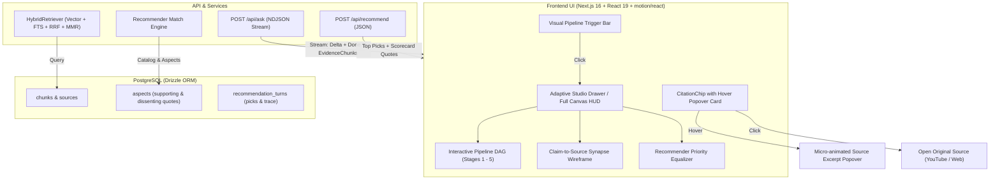

# RECSY Master Plan 28: Visual Retrieval Pipeline, Citation Hover Popovers & Artful Provenance System

> **Document control**
>
> | Field             | Value                                                                                                                                                     |
> | :---------------- | :-------------------------------------------------------------------------------------------------------------------------------------------------------- |
> | Plan number       | **28**                                                                                                                                                    |
> | Version           | **2.0.0** (Elevated with Visual Pipeline DAG & Hover Popover Cards)                                                                                       |
> | Date              | 2026-11-03                                                                                                                                                |
> | Status            | Ready for implementation, one work package (WP) per pull request                                                                                          |
> | Code baseline     | `master` (Plan 26 & Plan 27 merged)                                                                                                                       |
> | Stack             | Next.js 16.2.4 (App Router), React 19.2.4, Tailwind CSS v4, Motion (`motion/react` 12.38), Drizzle ORM 0.45, PostgreSQL, Zod 4, Vitest 4, Playwright 1.59 |
> | Design Influences | Garden Eight, Active Theory, Locomotive, Linear, teenage engineering (Cybernetic Editorial Brutalism)                                                     |
> | Target Audience   | Any implementing engineer or autonomous agent                                                                                                             |

---

## 1. Executive Summary & Core Motivation

### 1.1 The High-Stakes Purchase Problem

Buying a modern flagship smartphone requires spending between **\$800 and \$2,000**. Consumers are skeptical of generic AI advice because traditional LLMs hallucinate specifications, blur release years, and fail to distinguish actual hands-on testing from promotional marketing copy.

The entire thesis of **RECSY** is **unshakeable, citation-grounded trust**:

> _"People should be able to trace every recommendation and every answer back to the exact passage from trusted reviewers, so they feel completely confident making a \$1,000+ purchase."_

### 1.2 The User Experience Vision

1. **Interactive Hover Popover on Citation Chips (`[1]`, `[2]`)**:
   - When hovering over citation chip `[1]`, an ultra-sleek, micro-animated card smoothly pops up:
     - Source platform badge (`[YOUTUBE]`, `[REDDIT]`, `[ARTICLE]`) with channel name / publication (e.g. _Marques Brownlee_, _GSMArena_).
     - Exact timestamp / anchor badge (`[4:21]` with YouTube playback indicator).
     - The **exact verbatim review excerpt** that grounded this claim with highlighted key phrases.
     - Match relevance indicator (`94% relevance`).
     - Micro-hint: _"Click to open source ↗"_.
   - When the user **clicks** `[1]`, the original source URL directly opens in a new tab (`target="_blank"` with sanitized protocol).
2. **Visual Step-by-Step Retrieval & Synthesis Pipeline**:
   - Instead of a plain list of numbers or static milliseconds, the user can open a breathtaking, visual **Synthesis Observatory**:
     - **Stage 1 (Query Embedding)**: User question vectorized into 768-D dense representation.
     - **Stage 2 (Dual-Engine Retrieval Wave)**: Parallel search waves in Vector Cosine Space (30 chunks) and PostgreSQL Full-Text Search (30 chunks).
     - **Stage 3 (Reciprocal Rank Fusion)**: Rank fusion combining lexical and semantic signals.
     - **Stage 4 (MMR Source Diversification)**: Deduplication ensuring distinct sources (e.g. MKBHD + GSMArena + Reddit) rather than single-source domination.
     - **Stage 5 (Grounded Synthesis & Synapse Wireframe)**:
       - Displays the 3 reference sources side-by-side.
       - Clear explanation of **"Why these sources were referenced"** (e.g., MKBHD for low-light camera motion, GSMArena for lab lux benchmarks, Reddit for daily battery life).
       - **Interactive Synapse Wireframe**: Hovering a source card illuminates the exact sentences in the answer that were generated from it!
3. **Adaptive Studio Drawer with Dual View Modes**:
   - **Split Studio Drawer** (680px wide on desktop): Slides in smoothly from the right, keeping the phone page or recommendations side-by-side while examining the trace.
   - **Cinematic Full-Canvas Mode**: A toggle button `[ ⛶ FULL CANVAS / SPLIT ]` expands the pipeline across the entire screen for an immersive, widescreen visual walkthrough.
   - **Mobile Bottom-Sheet**: Morphs into a touch-friendly bottom sheet on screens < 768px.
4. **Recommender Decision Engine ("Why Galaxy S26 Ultra Landed on Top")**:
   - **Priority Equalizer**: Interactive graphic showing user's priority weights (Camera 40%, Battery 30%, Value 20%, etc.).
   - **Catalog Funnel Elimination**: Visual waterfall chart showing phones eliminated step-by-step (52 in catalog → 24 under budget → 8 matching specs → #1 pick).
   - **Aspect Reviewer Consensus & Dissent**: Verbatim quotes from tech journalists supporting and dissenting each scored aspect.
   - **Head-to-Head Competitive Delta**: Direct comparison vs runner-up (e.g., Galaxy S26 Ultra vs Pixel 9 Pro XL).

---

## 2. Architecture & Data Flow Diagram



---

## 3. Visual & Artistic Design Specification (Garden Eight / Linear Standard)

### 3.1 Design Tokens & Aesthetic Identity

- **Canvas & Surfaces**:
  - Base: `#000000` (deep pitch black).
  - Panels: `#0e0e0e` (frosted dark steel).
  - Container: `#1f1f1f` (technical slate).
  - Backdrop Blur: `backdrop-blur-md` with `rgba(0, 0, 0, 0.85)`.
- **Borders & Structure**:
  - Precision 1px hairlines: `#444748` (subtle structural border), `#8e9192` (active outline).
  - Absolute sharp corners: `border-radius: 0 !important;` (pure brutalist precision).
- **Typography & Scale**:
  - Display: `Hanken Grotesk` uppercase, bold tracking (`tracking-tight`).
  - Telemetry & Labels: `JetBrains Mono` uppercase, wide tracking (`tracking-[0.16em]`, `text-[10px]` - `text-[12px]`).
  - Excerpt Body: Inter / System Sans, high-readability leading (`leading-relaxed`, `text-xs` - `text-sm`).
- **Signal Accents**:
  - Primary Accent: Solar Amber `#d86b38` (glowing active nodes, beam indicators).
  - Secondary Accent: Hyper Orange `#ff4d00` (highlighted claim tags).
  - Neutral Signal: Steel White `#ffffff` (headers and values).

---

### 3.2 The Citation Hover Card Popover Specification

```
┌─────────────────────────────────────────────────────────────┐
│ [YOUTUBE]  Marques Brownlee              [t=4:21 ▶]  94% FIT │
├─────────────────────────────────────────────────────────────┤
│ Galaxy S25 Ultra: The Honest Review                         │
│                                                             │
│ "Night shots keep strong exposure and color, while moving    │
│  subjects still need steadier hands compared to the Pixel." │
├─────────────────────────────────────────────────────────────┤
│ ↗ CLICK TO WATCH AT 4:21       ⬡ VIEW IN PIPELINE TRACE     │
└─────────────────────────────────────────────────────────────┘
```

- **Trigger**: Hovering over `[1]`, `[2]` citation chips in the answer.
- **Micro-Animation**:
  - Entry: `opacity: 0 -> 1`, `scale: 0.96 -> 1.0`, `y: 4 -> 0` via `motion/react` spring (`stiffness: 400, damping: 28`).
  - Delay: 120ms debounce on enter, 180ms grace period on exit to prevent flickering.
- **Card Content**:
  1. Header: Platform badge (`[YOUTUBE]` red pip, `[REDDIT]` orange pip, `[ARTICLE]` blue pip), Creator/Author name, YouTube timestamp button `[t=4:21 ▶]`, and semantic match score (`94% FIT`).
  2. Source Title: One-line truncated title of the video or article.
  3. Verbatim Excerpt: The exact 200–300 character passage retrieved from the review, with key terms highlighted in amber.
  4. Footer Actions:
     - Left: `↗ OPEN ORIGINAL SOURCE` (navigates to video/article at timestamp).
     - Right: `⬡ PIPELINE TRACE` (opens the full Observatory HUD).
- **Click Behavior on `[1]`**:
  - Primary click on the chip opens the external source directly in a new tab, as specified.

---

### 3.3 The 5-Stage Visual Retrieval Pipeline DAG

When the user clicks the trigger bar below the answer, the Observatory opens to the **Visual Pipeline DAG**:

```
[STAGE 01] User Query Embedding
   │   Query: "How is the camera in low light?"
   │   Telemetry: 768-D dense vector · Latency: 42ms
   ▼
[STAGE 02] Dual-Stream Retrieval Wave
   ├─── Stream A: Vector Cosine Search (30 chunks candidate pool)
   └─── Stream B: PostgreSQL Full-Text Search (30 chunks candidate pool)
   ▼
[STAGE 03] Reciprocal Rank Fusion (RRF k=60)
   │   Fused Pool: 42 unique candidate chunks
   │   Formula: Score = Σ (1 / (60 + rank))
   ▼
[STAGE 04] MMR Source Diversity Filter (λ=0.6)
   │   Eliminated: 34 redundant/duplicate chunks
   │   Selected: Top 8 chunks across 3 distinct sources (MKBHD, GSMArena, Reddit)
   ▼
[STAGE 05] Grounded Multi-Source Synthesis & Synapse Wireframe
   │   Source 1 (MKBHD)    ────────┐
   │   Source 2 (GSMArena) ────────┼───► Synthesized Answer with Claim Mapping
   │   Source 3 (Reddit)   ────────┘
```

#### Detailed Stage Visuals:

1. **Stage 01: Vector Embedding**:
   - Visual: Oscilloscope / spectral wave graphic representing the 768-dimensional embedding.
   - Metrics: Duration (ms), Token count, Vector model (`text-embedding-004`).
2. **Stage 02: Dual Retrieval Branches**:
   - Split columns showing candidates streaming from Vector (semantic similarity) and FTS (lexical keyword match).
   - Interactive: Hovering either branch shows top 3 matches with their similarity scores.
3. **Stage 03: RRF Fusion Chamber**:
   - Visual intersection graphic showing candidates that appeared in _both_ vector and keyword search receiving a boosted priority rank.
4. **Stage 04: MMR Diversity Filter**:
   - Shows why certain chunks were discarded (near-duplicate coverage) to ensure **source diversity** (at least 3 independent reviewers).
   - "Why these sources were referenced" badges:
     - _MKBHD (YouTube)_: Real-world low-light video autofocus and lens flare evaluation.
     - _GSMArena (Article)_: Lab sensor noise measurements across ISO levels.
     - _Reddit (r/Android)_: Community reports on shutter lag indoors.
5. **Stage 05: The Synapse Claim-to-Source Wireframe**:
   - The user sees the 3 source cards on the left, and the synthesized answer broken down into interactive sentence blocks on the right.
   - **Interactive Synapse**: Hovering a source card draws glowing SVG laser connection lines to the exact sentences that cited it!
   - Hovering a sentence lights up the supporting source card in amber and spotlights the exact quote!

---

### 3.4 Recommender Decision Pipeline ("Why It Won")

For `/recommend`, the Inspector reveals the decision intelligence:

1. **The Priority Equalizer**:
   - Visual audio-mixing style sliders showing user priority weights:
     - Camera: `45% [█████████░]` (User emphasized "best camera")
     - Battery: `30% [██████░░░░]` (User mentioned "all-day battery")
     - Value: `15% [███░░░░░░░]`
     - Software: `10% [██░░░░░░░░]`
2. **Catalog Elimination Funnel (Waterfall)**:
   - Step 1: Active Catalog: `52 phones`
   - Step 2: Budget Filter (≤ $1,000): `24 phones remaining` (28 eliminated)
   - Step 3: Hard Spec Filter (Periscope Zoom + 5G): `8 phones remaining` (16 eliminated)
   - Step 4: Weighted Aspect Score Ranking: `Top 3 diverse picks selected`
3. **Reviewer Consensus & Dissent Grid**:
   - For the winning phone (e.g. Galaxy S26 Ultra):
     - **Camera Aspect (9.4/10)**:
       - Supporting Quote (MKBHD): _"The 5x periscope delivers unprecedented sharpness at night."_
       - Supporting Quote (GSMArena): _"Dynamic range in low light is top tier in our lab suite."_
       - Dissenting Quote (Reddit): _"Noticeable lens flare when shooting directly into streetlights."_
     - **Battery Aspect (9.0/10)**:
       - Supporting Quote: _"Easily lasts 1.5 days of heavy media use."_
4. **Head-to-Head Delta vs Runner-Up**:
   - Explains the margin of victory:
     - _"Galaxy S26 Ultra (Score 9.18) vs Pixel 9 Pro XL (Score 8.94)"_
     - _"Galaxy's superior periscope zoom (+0.6 on camera) and battery endurance (+0.5) outweighed Pixel's cleaner software score for your stated camera-first priority."_

---

## 4. Technical Data Models & Contracts

### 4.1 Enriched Q&A Trace Types (`src/lib/ask-retrieval-trace.ts`)

```typescript
export interface EvidenceChunkTrace {
  readonly chunkId: string;
  readonly sourceTitle: string;
  readonly sourceType: 'youtube' | 'reddit' | 'article' | 'gsmarena';
  readonly sourceUrl: string;
  readonly author?: string | null;
  readonly channel?: string | null;
  readonly publishedAt?: string | null;
  readonly text: string;
  readonly score: number;
  readonly startTs?: number | null;
  readonly anchor?: string | null;
  readonly isCited: boolean;
  readonly citationIndices: readonly number[];
  readonly whyReferenced?: string;
}

export interface AskRetrievalTrace {
  readonly chunkCount: number;
  readonly distinctSourceCount: number;
  readonly coverageRelaxed: boolean;
  readonly totalMs: number;
  readonly degradedStages: readonly string[];
  readonly stages: readonly {
    readonly id: string;
    readonly name: string;
    readonly ms: number;
    readonly count?: number;
    readonly detail?: string;
  }[];
  readonly sources: readonly {
    readonly id: string;
    readonly title: string;
    readonly type: string;
    readonly url: string;
    readonly author?: string | null;
    readonly whyReferenced?: string;
  }[];
  readonly evidenceChunks: readonly EvidenceChunkTrace[];
}
```

### 4.2 Enriched Citation Resolution (`src/services/chat/citations.ts`)

```typescript
export interface ResolvedCitation {
  readonly chunkId: string;
  readonly sourceUrl: string;
  readonly title: string;
  readonly type: RetrievedChunk['source']['type'];
  readonly anchor: string | null;
  readonly startTs: number | null;
  /** Verbatim excerpt snippet for hover popovers */
  readonly excerpt: string;
  readonly author: string | null;
  readonly channel: string | null;
  readonly score: number;
}
```

### 4.3 Recommender Trace Data Model (`src/services/recommender/run-recommendation.ts`)

```typescript
export interface AspectScoreTrace {
  readonly aspect: AspectName;
  readonly score: number;
  readonly weight: number;
  readonly contribution: number;
  readonly confidence: number;
  readonly summary: string;
  readonly supportingQuotes: readonly {
    readonly excerpt: string;
    readonly sourceTitle?: string;
  }[];
  readonly dissentingQuotes: readonly {
    readonly excerpt: string;
    readonly sourceTitle?: string;
  }[];
}

export interface RecommendPickTrace {
  readonly overallScore: number;
  readonly rank: number;
  readonly formula: {
    readonly baseAspectScore: number;
    readonly specSemanticBonus: number;
    readonly brandBonus: number;
    readonly totalScore: number;
  };
  readonly funnel: {
    readonly catalogCount: number;
    readonly budgetEligibleCount: number;
    readonly specEligibleCount: number;
    readonly finalPicksCount: number;
  };
  readonly aspectBreakdown: readonly AspectScoreTrace[];
  readonly matchedMustHaves: readonly string[];
  readonly tradeoffs: readonly string[];
  readonly vsRunnerUp?: {
    readonly runnerUpName: string;
    readonly scoreDelta: number;
    readonly keyDifferentiator: string;
  };
}
```

---

## 5. Work Packages (Execution Plan)

### WP-01: Q&A Evidence Serialization & Hover Payload Support

- **Files**:
  - `src/services/chat/citations.ts`
  - `src/lib/ask-retrieval-trace.ts`
  - `src/services/chat/ask-use-case.ts`
  - `src/lib/ask-retrieval-trace.test.ts`
- **Changes**:
  1. Update `resolveCitations` in `citations.ts` to include `excerpt`, `author`, `channel`, and `score` directly from `RetrievedChunk`.
  2. Update `buildAskRetrievalTrace` in `ask-retrieval-trace.ts` to construct `evidenceChunks` with `whyReferenced` synthesized annotations and citation indices.
  3. Ensure stream `done` event emits this complete payload.
- **Verification**: `pnpm test src/lib/ask-retrieval-trace.test.ts`

---

### WP-02: CitationChip Hover Card Popover

- **Files (New/Modify)**:
  - `src/components/phone/CitationPopover.tsx` [NEW]
  - `src/components/phone/CitationChip.tsx` [MODIFY]
- **Changes**:
  1. Build `CitationPopover.tsx` using `motion/react` with spring animation and bounds-aware positioning.
  2. Render platform icon badge (`[YOUTUBE]` / `[REDDIT]` / `[ARTICLE]`), author/channel, video timestamp `[4:21 ▶]`, verbatim quote, and relevance tag.
  3. Clicking the chip executes standard external navigation (`target="_blank"`); hovering displays the card.
  4. On touch devices, a subtle tap shows the popover with an explicit "Open Source ↗" button.
- **Verification**: Visual verification in `/p/[slug]`.

---

### WP-03: The Visual Retrieval Pipeline DAG & Synapse Wireframe

- **Files (New)**:
  - `src/components/trace/VisualPipelineDag.tsx` [NEW]
  - `src/components/trace/SynapseWireframe.tsx` [NEW]
  - `src/components/trace/EvidenceCard.tsx` [NEW]
- **Changes**:
  1. Build the 5-stage interactive pipeline flow with animated SVG connecting beams and live node pulses.
  2. Implement `SynapseWireframe`: Sentence-to-source interactive linking with glowing amber laser highlights on hover.
  3. Implement `EvidenceCard`: Expandable verbatim quote cards with deep-link timestamp buttons.
- **Verification**: Unit test component renders with mock trace fixture.

---

### WP-04: Recommender Decision Engine & Equalizer

- **Files (New/Modify)**:
  - `src/components/trace/RecommenderDecisionPipeline.tsx` [NEW]
  - `src/components/trace/AspectEqualizer.tsx` [NEW]
  - `src/components/trace/FunnelWaterfall.tsx` [NEW]
  - `src/services/recommender/run-recommendation.ts` [MODIFY]
  - `src/services/recommender/match.ts` [MODIFY]
- **Changes**:
  1. In `run-recommendation.ts`, fetch aspect scorecard quotes for Top 3 picks and attach `RecommendPickTrace`.
  2. Build `AspectEqualizer`: Visual graphic mixing board displaying user aspect weights × review scores.
  3. Build `FunnelWaterfall`: Catalog elimination waterfall visualizer.
  4. Build head-to-head delta card comparing #1 vs #2 pick.
- **Verification**: `pnpm test src/services/recommender/run-recommendation.test.ts`.

---

### WP-05: Adaptive Studio Drawer & UI Integration

- **Files (New/Modify)**:
  - `src/components/trace/ProvenanceInspectorSheet.tsx` [NEW]
  - `src/app/p/[slug]/phone-chat.tsx` [MODIFY]
  - `src/app/recommend/recommend-client.tsx` [MODIFY]
- **Changes**:
  1. Build `ProvenanceInspectorSheet`: Slide-over Studio Drawer (680px desktop) with `[ ⛶ FULL CANVAS / SPLIT ]` toggle and mobile bottom-sheet fallback.
  2. In `phone-chat.tsx`: Replace old `<details>` trace with the high-craft cybernetic trigger bar.
  3. In `recommend-client.tsx`: Add `[ ⬡ WHY RANK #1? // DECISION PIPELINE ]` button on recommendation cards.
- **Verification**: Test drawer opening, canvas toggling, and close gestures across both surfaces.

---

### WP-06: Motion, Micro-Interactions & Styling Polish

- **Files**:
  - `src/app/globals.css`
  - `src/styles/theme.css`
- **Changes**:
  1. Add glowing laser line SVG animations and scanline sweep effects.
  2. Enforce 60–120 FPS GPU-accelerated CSS transforms.
  3. Ensure WCAG AAA contrast and keyboard focus trapping (`Tab`, `Escape`).
- **Verification**: Lighthouse performance and accessibility audit.

---

### WP-07: Automated End-to-End Test Suite

- **Files (New)**:
  - `e2e/provenance-pipeline.spec.ts` [NEW]
  - `src/components/phone/CitationPopover.test.tsx` [NEW]
- **Changes**:
  1. Playwright tests verifying:
     - Hovering citation chip `[1]` renders popover with excerpt and timestamp.
     - Clicking citation chip opens external source in new tab.
     - Clicking "Visual Retrieval Pipeline" opens Studio Drawer.
     - Clicking "Full Canvas" expands to full screen.
     - Hovering a source highlights connected sentences in the answer.
     - Recommender cards open Decision Pipeline showing Equalizer and quotes.
- **Verification**: `pnpm e2e` and `pnpm test`.

---

## 6. Failure Modes & Edge Case Matrix

| Edge Case                                | Risk                                                           | Mitigation                                                                                                                      |
| :--------------------------------------- | :------------------------------------------------------------- | :------------------------------------------------------------------------------------------------------------------------------ |
| **Touch / Mobile Viewport**              | Hover state does not exist on smartphones.                     | Citation chips detect touch events; a tap opens the popover with explicit buttons (`[OPEN SOURCE ↗]` and `[VIEW IN PIPELINE]`). |
| **Missing Timestamps (YouTube)**         | Video has no second offset (`startTs: null`).                  | Fallback cleanly to standard video URL; popover displays video duration or channel name instead of `t=NaN`.                     |
| **Missing Reviewer Quotes (New Device)** | Unreleased phone has no scorecard rows.                        | Pipeline displays honest hardware notice: _"Manufacturer specifications only: Reviewer scorecard consensus pending ingestion."_ |
| **Rapid Hover Movement**                 | User quickly brushes across multiple citations.                | 120ms debounce on popover trigger prevents visual seizure and layout thrashing.                                                 |
| **Screen Edge Boundary Overflow**        | Citation chip near right screen margin causes popover to clip. | Bounds-checking clamps popover position within viewport margins (`left: clamp(16px, ..., 100vw - 340px)`).                      |
| **Large Answer Text**                    | Long multi-paragraph answer.                                   | The Synapse wireframe uses virtualized/sticky split scroll, keeping source cards anchored while scrolling through claims.       |

---

## 7. Performance Budgets

| Metric                         | Budget                 | Verification Method                                           |
| :----------------------------- | :--------------------- | :------------------------------------------------------------ |
| **Added TTFB Latency**         | **0 ms**               | Zero extra network hops before first streaming chunk          |
| **Hover Popover Mount Time**   | **< 16 ms** (1 frame)  | Pre-computed in citation prop, 0ms network fetch              |
| **Stream Overhead**            | **< 1.0 KB** (gzipped) | Network tab measurement on NDJSON `done` event                |
| **Recommender Trace Overhead** | **< 3.5 KB** (gzipped) | Network tab measurement on `/api/recommend` JSON              |
| **Animation Framerate**        | **60 - 120 FPS**       | Chrome DevTools Performance panel (GPU composited transforms) |
| **Bundle Overhead**            | **< 14 KB** (gzipped)  | Next.js bundle analyzer check                                 |

---

## 8. Verification Commands

```bash
# 1. Run unit test suite
pnpm test

# 2. Run TypeScript strict typecheck
pnpm typecheck

# 3. Run Playwright end-to-end tests
pnpm e2e

# 4. Check production build
pnpm build
```
