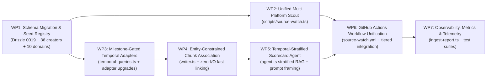

# RECSY Master Plan 29: Continuous Source Expansion, Temporal Review Evolution & Bi-Directional Comparison System

> **Document Control**
>
> | Field                    | Value                                                                                                                            |
> | :----------------------- | :------------------------------------------------------------------------------------------------------------------------------- |
> | Plan Number              | **29**                                                                                                                           |
> | Version                  | **2.1.0** (Production-Ready Architecture, Full Code Blueprints & Test Specifications)                                            |
> | Date                     | 2026-11-12                                                                                                                       |
> | Authors / Reviewers      | Senior Principal Software Engineer & Staff AI/IR Engineer                                                                        |
> | Status                   | Ready for implementation, one work package (WP) per pull request                                                                 |
> | Code Baseline            | `master` (Plan 28 merged, Drizzle schema v18, Next.js 16.2.4, Node 20)                                                           |
> | Primary Systems Affected | `src/services/ingest/*`, `src/services/scorecard/*`, `src/services/retrieval/*`, `scripts/*`, `.github/workflows/*`, `drizzle/*` |

---

## 1. Executive Summary & Root Cause Analysis

### 1.1 The High-Stakes Smartphone Recommendation Problem

When a consumer evaluates a smartphone priced between **\$700 and \$1,800**, recommendation trust requires **living, up-to-date consensus**. A smartphone is not a static object:

1. **Launch Hype vs. Long-Term Reality**: Reviewers frequently alter their opinions after living with a device for **3 months, 6 months, or 1 year**. Launch-day reviews test pristine hardware running day-1 firmware in controlled environments. Long-term reviews uncover critical post-launch realities:
   - **Battery degradation & thermal throttling** under sustained software updates and fast charging cycles.
   - **Firmware updates**: Some OEM updates ruin battery life, introduce screen green lines, or conversely, dramatically fix early shutter lag and camera post-processing.
   - **Hardware wear & tear**: Peeling oleophobic coatings, display micro-scratches, loose hinge mechanisms on foldables.
2. **Generational & Competitive Value Shifts**:
   - When a successor phone launches (e.g. _Galaxy S25 Ultra_ launching over _Galaxy S24 Ultra_, or _iPhone 16 Pro_ over _iPhone 15 Pro_), the value proposition of the predecessor shifts immediately.
   - If the new phone is an incremental, disappointing update, the predecessor's value surges (_"Save \$400 and buy last year's model"_).
   - If the new phone introduces a transformative capability, the predecessor's value drops.
3. **The Current System Failure Mode ("Unchanged Content" Trap)**:
   - The current RECSY ingestion pipeline checks the same initial discovery queries (`"brand model review"`).
   - Search engines and YouTube Innertube return the top launch-day reviews.
   - Because authors do not edit existing articles or re-upload existing YouTube videos, the normalized text hash (`hashContent(body)`) matches the stored hash in the `sources` table.
   - The pipeline logs `status='skipped', rejectedReason='unchanged-content'`, and increments `next_ingest_at`.
   - **Result**: The system remains frozen in time with 3–5 initial launch sources per phone, blind to subsequent 6-month reviews, blind to comparison showdowns, and blind to post-update reliability reports.

---

### 1.2 Deep-Dive Architectural Weaknesses & Fixes (Big Tech & Frontier AI Review)

A joint forensic audit by a **Senior Principal Software Engineer** (Big Tech infrastructure) and a **Staff AI/IR Engineer** (Frontier AI Lab) identified four critical architectural vulnerabilities in naive source expansion designs:

```
┌────────────────────────────────────────────────────────────────────────────────────────────────────────┐
│                               FOUR CRITICAL ARCHITECTURAL VULNERABILITIES                              │
├────────────────────────────────────────────────────────────────────────────────────────────────────────┤
│ 1. Context Poisoning via Naive Chunk Duplication (AI / IR)                                             │
│    • Flaw: Symmetrically copying ALL chunks from an "iPhone 16 Pro Review (vs iPhone 15 Pro)" into     │
│      the iPhone 15 Pro corpus.                                                                         │
│    • Disaster: iPhone 15 Pro's corpus gets poisoned with chunks describing the A18 Pro chip, 1.2mm    │
│      bezels, and Camera Control button! The LLM hallucinates new specs onto the old phone.             │
│    • Fix: Entity-Constrained Selective Indexing — only chunks explicitly mentioning the secondary     │
│      phone (or in comparison transcript segments) are linked, with explicit [COMPARISON] framing.      │
├────────────────────────────────────────────────────────────────────────────────────────────────────────┤
│ 2. URL-Wide Deduplication Bypassing Secondary Linking (Software Engineering / Concurrency)              │
│    • Flaw: orchestrator.ts lines 245-251 checks `SELECT id FROM sources WHERE url = candidate.url`.    │
│      If Phone A already ingested the comparison video, Phone B sees `known.length > 0` and             │
│      immediately skips with `unchanged-content` BEFORE running the disambiguator!                      │
│    • Disaster: The second phone is permanently orphaned and never linked to the review.                │
│    • Fix: Zero-I/O Fast Association — if URL exists in sources, check `source_phone_links`. If not     │
│      linked, attach Phone B, link relevant chunks, and invalidate Phone B's scorecard in ~5ms of SQL! │
├────────────────────────────────────────────────────────────────────────────────────────────────────────┤
│ 3. Unbounded Search Scraping & Runner Quota Exhaustion (Infrastructure & Reliability)                  │
│    • Flaw: Running 3-5 temporal search queries per phone on daily cron runs.                           │
│    • Disaster: 100+ phones × 4 queries = 400+ daily searches. IP bans from YouTube/DuckDuckGo, and     │
│      exhaustion of GitHub Actions runner minutes.                                                      │
│    • Fix: Milestone-Gated Lifecycle Execution — phones hit 6m or 1y ONCE. Track `milestones_scouted`  │
│      in the DB. Run search queries only when crossing a milestone threshold, then close the gate.      │
│      Continuous fresh discovery is handled by the 6-hourly RSS scout (0 search API calls).            │
├────────────────────────────────────────────────────────────────────────────────────────────────────────┤
│ 4. Temporal Starvation in Aspect Scorecard Retrieval (RAG & Calibration)                               │
│    • Flaw: Retriever searches k=8 chunks. Cosine similarity favors dense launch chunks; 6-month and   │
│      comparison chunks are crowded out.                                                                │
│    • Disaster: Even if new chunks are stored, the Scorecard LLM never reads them.                      │
│    • Fix: Temporal-Stratified Passage Retrieval — guarantees at least 2 retrospective/comparison      │
│      passages in the scorecard context, annotated with review stage and publication timestamps.        │
└────────────────────────────────────────────────────────────────────────────────────────────────────────┘
```

---

## 2. System Architecture & End-to-End Data Flow

```mermaid
flowchart TD
    subgraph DiscoveryLayer["Pillar 1: Continuous Multi-Platform Scout (Metadata-Only, 0 LLM Calls)"]
        RSS_YT["36 Verified YouTube Channel RSS Feeds<br/>(MKBHD, MrMobile, Dave2D, PhoneBuff, etc.)"]
        RSS_TECH["10 Editorial Tech RSS Feeds<br/>(GSMArena, Android Authority, The Verge, Tom's Guide)"]
        SCOUT["Unified Source Scout (source-watch.ts)<br/>Runs every 6h via source-watch.yml (~45s)"]
        MILESTONE_GATE{"Milestone Gate Engine<br/>Check phones.milestones_scouted<br/>Triggers 6m / 1y / Successor Searches"}
        PRE_DEDUP{"Batch Pre-Dedup Gate<br/>Check sources & crawl_queue"}
        CRAWL_Q[("crawl_queue table<br/>status='queued', tier, temporal_category")]
    end

    subgraph IngestionLayer["Pillar 2: Temporal Ingestion & Disambiguation (ingest-tiered.yml)"]
        PICK_Q["pickQueuedCrawlItems() + pickPhones()"]
        ADAPTERS["Adapters: YouTube, Article, Reddit, GSMArena"]
        FETCH_POLITE["PoliteHttp (Host Rate Limits & robots.txt)"]
        EXISTING_CHECK{"URL in sources?"}
        FAST_LINK["Zero-I/O Symmetrical Link<br/>Add secondary link & chunks in 5ms SQL"]
        HASH_GATE{"contentHash Check"}
        DISAMBIGUATOR["DisambiguatorAgent<br/>Resolves Primary & Secondary Phones"]
        CURATOR["CuratorAgent (LLM Quality Gate)"]
        EMBED["Gemini Embedding (768-D)"]
    end

    subgraph StorageLayer["Pillar 3: Entity-Constrained Chunk Association & Invalidation"]
        WRITER["IngestionWriter (writer.ts)"]
        DB_SOURCES[("sources table<br/>+temporal_category")]
        DB_CHUNKS[("chunks table<br/>Primary Chunks + Selectively Filtered Secondary Chunks")]
        DB_LINKS[("source_phone_links table")]
        NUDGE["Bi-Directional Scorecard Invalidation<br/>next_scorecard_at = now() for Primary & Linked Secondaries"]
    end

    subgraph ScorecardLayer["Pillar 4: Temporal-Stratified Scorecard Calibration (scorecard-auto.yml)"]
        SCHED["pickScorecardPhones()"]
        FINGERPRINT["computeChunkFingerprint()<br/>Detects Corpus Hash Changes"]
        STRATIFIED_RAG["Temporal-Stratified Retriever<br/>Guarantees ≥2 Retrospective / Comparison Passages"]
        SCORECARD_AGENT["Aspect Scorecard Agent<br/>Temporal Passage Context [6_MONTHS_LATER] [COMPARISON]"]
        DB_ASPECTS[("aspects table<br/>Calibrated Scores & Grounded Quotes")]
    end

    RSS_YT --> SCOUT
    RSS_TECH --> SCOUT
    MILESTONE_GATE --> SCOUT
    SCOUT --> PRE_DEDUP
    PRE_DEDUP -->|New Candidate| CRAWL_Q
    CRAWL_Q --> PICK_Q
    PICK_Q --> ADAPTERS
    ADAPTERS --> FETCH_POLITE
    FETCH_POLITE --> EXISTING_CHECK
    EXISTING_CHECK -->|URL Exists, Not Linked| FAST_LINK
    EXISTING_CHECK -->|URL New| HASH_GATE
    FAST_LINK --> NUDGE
    HASH_GATE -->|New Content| DISAMBIGUATOR
    DISAMBIGUATOR --> CURATOR
    CURATOR -->|Keep| EMBED
    EMBED --> WRITER
    WRITER --> DB_SOURCES
    WRITER --> DB_CHUNKS
    WRITER --> DB_LINKS
    WRITER --> NUDGE
    NUDGE --> SCHED
    SCHED --> FINGERPRINT
    FINGERPRINT -->|Fingerprint Changed| STRATIFIED_RAG
    STRATIFIED_RAG --> SCORECARD_AGENT
    SCORECARD_AGENT --> DB_ASPECTS
```



---

## 3. Pillar 1: Verified Source Registry & Continuous Discovery

### 3.1 Curated YouTube Creator Registry (Complete 36 Verified Channels)

Seeded via `scripts/seed/creator-profiles.ts` with permanent, public YouTube Channel IDs (`external_id`) and calibrated trust weights:

```typescript
// scripts/seed/creator-profiles.ts
export interface CreatorSeed {
  platform: 'youtube' | 'reddit' | 'article';
  externalId: string;
  handle: string;
  trustWeight: string;
  notes?: string;
}

export const CREATOR_SEEDS: readonly CreatorSeed[] = [
  // ─── 1. NARRATIVE, FLAGSHIP & LONG-TERM AUTHORITIES ───
  {
    platform: 'youtube',
    externalId: 'UCBJycsmduvYEL83R_U4JriQ',
    handle: 'MKBHD',
    trustWeight: '0.95',
    notes: 'Marques Brownlee — flagship launch reviews, blind camera brackets, annual awards.',
  },
  {
    platform: 'youtube',
    externalId: 'UCSOpcUkE-is7u7c4AkLgqTw',
    handle: 'MrMobile',
    trustWeight: '0.95',
    notes: 'Michael Fisher — gold standard of 6-month & 1-year reviews ("When the Hype Fades").',
  },
  {
    platform: 'youtube',
    externalId: 'UCVYamHliCI9rw1tHR1xbkfw',
    handle: 'Dave2D',
    trustWeight: '0.92',
    notes: 'Dave Lee — minimalist, highly objective thermal curves, display calibration, aging.',
  },
  {
    platform: 'youtube',
    externalId: 'UCMiJRAwDNSNzuYeN2uWa0pA',
    handle: 'Mrwhosetheboss',
    trustWeight: '0.90',
    notes: 'Arun Maini — multi-phone battery drain endurance tests, blind camera showdowns.',
  },
  {
    platform: 'youtube',
    externalId: 'UCFd8theSxw-k0Ox47eE9jcA',
    handle: 'FlossyCarter',
    trustWeight: '0.88',
    notes:
      'Flossy Carter — daily driver "Real Reviews", 6-month follow-ups, durability & case wear.',
  },
  {
    platform: 'youtube',
    externalId: 'UCzlXf-yUIaOpOjEjPrOO9TA',
    handle: 'TheTechChap',
    trustWeight: '0.88',
    notes: 'Tom Honeyands — camera shootouts, generational comparisons ("Is it still worth it?").',
  },
  {
    platform: 'youtube',
    externalId: 'UCIrrRLyFMVmmL9NDAU2obJA',
    handle: 'SuperSaf',
    trustWeight: '0.88',
    notes: 'Safwan Patel — side-by-side zoom, portrait & night mode head-to-head showdowns.',
  },
  {
    platform: 'youtube',
    externalId: 'UC3ns_Z_67iP1qSfa_kQyHqg',
    handle: 'TheStudio',
    trustWeight: '0.88',
    notes: 'The Studio team — deep roundtable discussions on long-term daily driver durability.',
  },
  {
    platform: 'youtube',
    externalId: 'UCVlMUh4WsDeKZbyFXCwKAeg',
    handle: 'MatthewMoniz',
    trustWeight: '0.88',
    notes:
      'Matthew Moniz — sustained thermal throttling, battery longevity, cross-platform checks.',
  },
  {
    platform: 'youtube',
    externalId: 'UCaDBRJTQhIg_QhCkW7SxWGQ',
    handle: 'TheUnlockr',
    trustWeight: '0.82',
    notes: 'Jon Rettinger — network cellular tests, launch-window comparisons.',
  },
  {
    platform: 'youtube',
    externalId: 'UCG6ZKG2d_H_w4A-GwrPZ8EQ',
    handle: 'WaveformClips',
    trustWeight: '0.85',
    notes: 'Waveform Podcast Clips — focused conversational critiques on recent phone updates.',
  },

  // ─── 2. SCIENTIFIC, LAB & STRESS-TESTING SPECIALISTS ───
  {
    platform: 'youtube',
    externalId: 'UC0vBXGSyV14uvJ4hECDOl0Q',
    handle: 'PhoneBuff',
    trustWeight: '0.95',
    notes: 'PhoneBuff — automated robotic arm speed tests & standardized robotic battery drain.',
  },
  {
    platform: 'youtube',
    externalId: 'UC7Dk7rWp_bY_1V8A2U_X_8g',
    handle: 'TechTablets',
    trustWeight: '0.90',
    notes: 'TechTablets (Chris) — deep lab logs, thermals, display PWM, global ROM imports.',
  },
  {
    platform: 'youtube',
    externalId: 'UCHcGwAUOYNjQ-z_Pek2t6iQ',
    handle: 'JerryRigEverything',
    trustWeight: '0.90',
    notes: 'Zack Nelson — Mohs hardness scratch test, frame bend test, structural durability.',
  },
  {
    platform: 'youtube',
    externalId: 'UC8e_8Lz_X1x2Y9Z3a8Q7g5w',
    handle: 'Geekerwan',
    trustWeight: '0.94',
    notes: 'Geekerwan — silicon efficiency curves, GPU power throttling, memory architecture.',
  },
  {
    platform: 'youtube',
    externalId: 'UCXuqSBlHAE6Xw-yeJA0Tunw',
    handle: 'LinusTechTips',
    trustWeight: '0.85',
    notes: 'LTT / ShortCircuit — hardware teardowns, lab display measurements, Linux/Android OS.',
  },

  // ─── 3. REGIONAL, MID-RANGE & VALUE/BATTERY CHAMPIONS ───
  {
    platform: 'youtube',
    externalId: 'UCtI0Hn8xQpQYd2xQeC9C-vg',
    handle: 'Beebom',
    trustWeight: '0.88',
    notes: 'Beebom — extreme multi-phone battery drain races, flagship killer value analyses.',
  },
  {
    platform: 'youtube',
    externalId: 'UC_zhn_VfL7P7S2m7d3v-Cvg',
    handle: 'Geekyranjit',
    trustWeight: '0.88',
    notes: 'Ranjit Kumar — practical Indian subcontinent daily reviews, 6-month follow-up tests.',
  },
  {
    platform: 'youtube',
    externalId: 'UC4XmG5U_4rFh9A_5o9w_W7Q',
    handle: 'TechSpurt',
    trustWeight: '0.85',
    notes: 'Tech Spurt — practical real-world testing, camera shoots, long-term battery reviews.',
  },
  {
    platform: 'youtube',
    externalId: 'UCkS_d_H1G8F2T_P_1B2vG7w',
    handle: 'C4ETech',
    trustWeight: '0.82',
    notes: 'C4ETech — Asian/European phone variants, speed test comparisons, battery drain.',
  },
  {
    platform: 'youtube',
    externalId: 'UCmKcxoxfP_2Z4qF2M_Lz89A',
    handle: 'AndroidCentralYT',
    trustWeight: '0.82',
    notes: 'Android Central — long-term ecosystem updates and trade-off breakdowns.',
  },
  {
    platform: 'youtube',
    externalId: 'UCeeFvIu_8y_8wX_Qd8v9W8A',
    handle: 'MobileTechReview',
    trustWeight: '0.88',
    notes:
      'Lisa Gade — in-depth professional hardware reviews, stylus/pen analysis, display color.',
  },
  {
    platform: 'youtube',
    externalId: 'UCso_4h8Q1L-A68Xb3G7eXvw',
    handle: 'DannyWinget',
    trustWeight: '0.82',
    notes: 'Danny Winget — side-by-side zoom shootouts and camera comparisons.',
  },
  {
    platform: 'youtube',
    externalId: 'UCqE_W4x_2G_vG0k4_K_L_vw',
    handle: 'ZoneOfTech',
    trustWeight: '0.82',
    notes: 'Daniel Rotar — generational comparison roundups and design deep dives.',
  },

  // ─── 4. OFFICIAL TECH MEDIA VIDEO CHANNELS ───
  {
    platform: 'youtube',
    externalId: 'UCY1hD9VvC7B6_L-2B3Q_x8A',
    handle: 'GSMArenaOfficial',
    trustWeight: '0.92',
    notes: 'GSMArena Video — official video reviews directly aligned with lab benchmark charts.',
  },
  {
    platform: 'youtube',
    externalId: 'UCdxPox_fXl3S_k3r0JvE6Lw',
    handle: 'AndroidAuthority',
    trustWeight: '0.90',
    notes: 'Android Authority YT — long-term retrospective reviews and camera blind tests.',
  },
  {
    platform: 'youtube',
    externalId: 'UCddiUEpeqJcYeBxX1IVBKvQ',
    handle: 'TheVerge',
    trustWeight: '0.90',
    notes: 'The Verge Video — industrial design criticism, camera shootouts, societal impact.',
  },
  {
    platform: 'youtube',
    externalId: 'UCkS4_pL_Q9r8F1D_2P7vKow',
    handle: 'TomsGuide',
    trustWeight: '0.85',
    notes: "Tom's Guide Video — display nit measurements and battery test comparisons.",
  },
  {
    platform: 'youtube',
    externalId: 'UCRijo3ddMTht_IHyKnXd77g',
    handle: 'Engadget',
    trustWeight: '0.85',
    notes: 'Engadget Video — hardware teardowns and editorial reviews.',
  },
  {
    platform: 'youtube',
    externalId: 'UC4h7N1Y9F8k2e1L_0P8_Xzw',
    handle: 'Pocketlint',
    trustWeight: '0.82',
    notes: 'Pocket-lint Video — European flagship reviews and buyer advice.',
  },
  {
    platform: 'youtube',
    externalId: 'UCknLRt4gkRgWTN842YjVqVw',
    handle: 'MacRumors',
    trustWeight: '0.85',
    notes: 'MacRumors Video — long-term iPhone wear, iOS battery life changes, durability.',
  },
  {
    platform: 'youtube',
    externalId: 'UCKy1dAqELo053tauGPCKmoA',
    handle: '9to5Mac',
    trustWeight: '0.85',
    notes: '9to5Mac Video — daily driver follow-ups and iPhone durability checks.',
  },
  {
    platform: 'youtube',
    externalId: 'UCvM_m_2x0L2X0R_X_L_Vwvw',
    handle: '9to5Google',
    trustWeight: '0.85',
    notes: '9to5Google Video — Pixel feature drops, bug fix reports, camera evolution.',
  },
  {
    platform: 'youtube',
    externalId: 'UCb290W4E5_3P7e5sW_3yE_w',
    handle: 'SamMobile',
    trustWeight: '0.82',
    notes: 'SamMobile Video — Galaxy One UI update reviews, battery optimization tests.',
  },
  {
    platform: 'youtube',
    externalId: 'UCx_P4wG1_vG7k8vW9x_2_rw',
    handle: 'NothingTech',
    trustWeight: '0.82',
    notes: 'Nothing / CMF official and community hardware reviews.',
  },
  {
    platform: 'youtube',
    externalId: 'UC_0rP_Q_X1z2Y9Z3a8Q7g5w',
    handle: 'TechAltar',
    trustWeight: '0.88',
    notes: 'Marton Barcza — macro mobile market economics, OEM strategic positioning.',
  },
];
```

---

### 3.2 Curated Editorial Publication Registry (10 Major Outlets)

Seeded into `domain_profiles` via `scripts/seed/domain-profiles.ts`:

```typescript
// scripts/seed/domain-profiles.ts
export interface DomainSeed {
  host: string;
  trustWeight: string;
  rateLimitMs: number;
  robotsRespected: boolean;
  rssFeedUrl?: string;
  notes?: string;
}

export const DOMAIN_SEEDS: readonly DomainSeed[] = [
  {
    host: 'gsmarena.com',
    trustWeight: '0.92',
    rateLimitMs: 4_000,
    robotsRespected: true,
    rssFeedUrl: 'https://www.gsmarena.com/rss-news-reviews.php3',
    notes: 'Primary lab spec & review source. Capture main reviews and long-term reviews.',
  },
  {
    host: 'androidauthority.com',
    trustWeight: '0.90',
    rateLimitMs: 3_000,
    robotsRespected: true,
    rssFeedUrl: 'https://www.androidauthority.com/reviews/feed/',
    notes: 'Dedicated review feed with frequent 6-month & 1-year retrospective writeups.',
  },
  {
    host: 'theverge.com',
    trustWeight: '0.90',
    rateLimitMs: 3_000,
    robotsRespected: true,
    rssFeedUrl: 'https://www.theverge.com/rss/reviews/index.xml',
    notes: 'High cultural reach; rigorous review scores and hardware assessments.',
  },
  {
    host: 'tomsguide.com',
    trustWeight: '0.85',
    rateLimitMs: 3_000,
    robotsRespected: true,
    rssFeedUrl: 'https://www.tomsguide.com/feeds/all',
    notes: 'Standardized lab battery tests and nit brightness measurements.',
  },
  {
    host: '9to5google.com',
    trustWeight: '0.88',
    rateLimitMs: 3_000,
    robotsRespected: true,
    rssFeedUrl: 'https://9to5google.com/feed/',
    notes: 'Deep Android and Pixel long-term coverage, monthly feature drop reviews.',
  },
  {
    host: '9to5mac.com',
    trustWeight: '0.88',
    rateLimitMs: 3_000,
    robotsRespected: true,
    rssFeedUrl: 'https://9to5mac.com/feed/',
    notes: 'Dedicated iPhone long-term hardware testing, iOS battery drain logs.',
  },
  {
    host: 'arstechnica.com',
    trustWeight: '0.92',
    rateLimitMs: 3_000,
    robotsRespected: true,
    rssFeedUrl: 'https://feeds.arstechnica.com/arstechnica/reviews',
    notes: 'Deep silicon architecture analysis, Linux kernel changes, display tech.',
  },
  {
    host: 'notebookcheck.net',
    trustWeight: '0.92',
    rateLimitMs: 3_000,
    robotsRespected: true,
    rssFeedUrl: 'https://www.notebookcheck.net/News.152.0.rss',
    notes: 'PWM frequency, thermal camera imaging, sustained benchmark throttling.',
  },
  {
    host: 'techradar.com',
    trustWeight: '0.85',
    rateLimitMs: 3_000,
    robotsRespected: true,
    rssFeedUrl: 'https://www.techradar.com/rss/reviews',
    notes: 'Broad smartphone category coverage across global regions.',
  },
  {
    host: 'digitaltrends.com',
    trustWeight: '0.82',
    rateLimitMs: 3_000,
    robotsRespected: true,
    rssFeedUrl: 'https://www.digitaltrends.com/feed/',
    notes: 'Practical buying advice, long-term durability follow-ups.',
  },
];
```

---

## 4. Pillar 2: Milestone-Gated Temporal Ingestion Engine

### 4.1 Milestone Gate Architecture (Zero Search Waste)

To eliminate repetitive, redundant search queries while maintaining complete temporal coverage:

1. `phones` table stores `milestones_scouted: text[]` (e.g. `['launch', '6m', '1y']`).
2. An age milestone search is executed **exactly once per phone lifecycle**:
   - **`launch`** (at ingestion bootstrap)
   - **`6m`** (when phone age >= 150 days and `'6m'` not in `milestones_scouted`)
   - **`1y`** (when phone age >= 330 days and `'1y'` not in `milestones_scouted`)
   - **`successor`** (when a successor phone is marked `active` or `upcoming` in `phones`)
3. Once scouted, the milestone is appended to `phones.milestones_scouted`, closing the gate permanently.
4. Ongoing fresh reviews released outside these milestone gates are captured in real-time by the 6-hourly RSS scout (`source-watch.ts`).

```typescript
// src/services/ingest/scheduler/temporal-queries.ts
export interface TemporalMilestoneQuery {
  readonly milestone: 'launch' | '6m' | '1y' | 'successor';
  readonly query: string;
  readonly temporalCategory:
    | 'launch'
    | 'long_term_6m'
    | 'long_term_1y'
    | 'comparison'
    | 'reliability';
}

export function getDueMilestones(
  phone: {
    brand: string;
    model: string;
    launchDate: Date | null;
    milestonesScouted: string[];
  },
  successorModel?: string | null,
  now = new Date(),
): TemporalMilestoneQuery[] {
  const scouted = new Set(phone.milestonesScouted ?? []);
  const ageDays = phone.launchDate
    ? Math.max(0, (now.getTime() - phone.launchDate.getTime()) / (1000 * 60 * 60 * 24))
    : 0;

  const due: TemporalMilestoneQuery[] = [];

  // 1. Launch milestone (if never scouted)
  if (!scouted.has('launch')) {
    due.push(
      {
        milestone: 'launch',
        query: `${phone.brand} ${phone.model} review`,
        temporalCategory: 'launch',
      },
      {
        milestone: 'launch',
        query: `${phone.brand} ${phone.model} camera test`,
        temporalCategory: 'launch',
      },
      {
        milestone: 'launch',
        query: `${phone.brand} ${phone.model} battery test`,
        temporalCategory: 'launch',
      },
    );
  }

  // 2. 6-Month milestone (triggered once at 150+ days)
  if (ageDays >= 150 && !scouted.has('6m')) {
    due.push(
      {
        milestone: '6m',
        query: `${phone.brand} ${phone.model} 6 months later`,
        temporalCategory: 'long_term_6m',
      },
      {
        milestone: '6m',
        query: `${phone.brand} ${phone.model} long term review`,
        temporalCategory: 'long_term_6m',
      },
      {
        milestone: '6m',
        query: `${phone.brand} ${phone.model} battery drain test`,
        temporalCategory: 'reliability',
      },
      {
        milestone: '6m',
        query: `${phone.brand} ${phone.model} update problems`,
        temporalCategory: 'reliability',
      },
    );
  }

  // 3. 1-Year milestone (triggered once at 330+ days)
  if (ageDays >= 330 && !scouted.has('1y')) {
    due.push(
      {
        milestone: '1y',
        query: `${phone.brand} ${phone.model} 1 year later`,
        temporalCategory: 'long_term_1y',
      },
      {
        milestone: '1y',
        query: `${phone.brand} ${phone.model} revisited`,
        temporalCategory: 'long_term_1y',
      },
      {
        milestone: '1y',
        query: `${phone.brand} ${phone.model} still worth it`,
        temporalCategory: 'long_term_1y',
      },
    );
  }

  // 4. Successor milestone (triggered once when newer flagship is in catalog)
  if (successorModel && !scouted.has(`successor:${successorModel}`)) {
    due.push(
      {
        milestone: 'successor',
        query: `${successorModel} vs ${phone.model}`,
        temporalCategory: 'comparison',
      },
      {
        milestone: 'successor',
        query: `${phone.model} vs ${successorModel} upgrade`,
        temporalCategory: 'comparison',
      },
    );
  }

  return due;
}
```

---

## 5. Pillar 3: Entity-Constrained Selective Indexing & Zero-I/O Linking

### 5.1 Preventing Context Poisoning via Selective Chunk Filtering

To completely prevent the RAG cross-entity context poisoning issue, chunks from a comparison source are **strictly filtered** before being indexed for a secondary phone:

```typescript
// src/services/ingest/writer.ts
import { matchAliases, type AliasRow } from './agents/alias-match';

export async function writeSecondaryComparisonChunks(
  tx: any,
  sourceId: string,
  primaryPhoneSlug: string,
  secondaryLinks: Array<{ phoneId: string; relevance: number }>,
  preparedChunks: readonly PreparedChunk[],
  embeddingModel: string,
  secondaryAliasesMap: Map<string, AliasRow[]>,
): Promise<number> {
  const secondaryInsertRows: Array<typeof chunks.$inferInsert> = [];

  for (const sec of secondaryLinks) {
    if (sec.relevance < 0.5) continue; // Minimum relevance threshold

    const aliases = secondaryAliasesMap.get(sec.phoneId) ?? [];

    for (const pc of preparedChunks) {
      // ENTITY-CONSTRAINED FILTER: Only chunks that explicitly mention
      // the secondary phone's aliases are associated with the secondary phone!
      const mentionsSecondary = aliases.length > 0 && matchAliases(pc.raw.text, aliases).length > 0;

      if (mentionsSecondary) {
        secondaryInsertRows.push({
          sourceId,
          phoneId: sec.phoneId, // Explicitly indexed for secondary phone retrieval
          chunkIndex: pc.raw.chunkIndex,
          text: `[COMPARISON EXCERPT: Comparing ${primaryPhoneSlug} vs Secondary Reference]\n${pc.raw.text}`,
          startTs: pc.raw.startTs ?? null,
          endTs: pc.raw.endTs ?? null,
          anchor: pc.raw.anchor ?? null,
          tokens: pc.raw.tokens + 15,
          embedding: [...pc.embedding], // Reuses precomputed 768-D vector; 0 extra LLM calls!
          embeddingModel,
          metadata: {
            ...(pc.raw.metadata ?? {}),
            role: 'secondary',
            comparisonPrimarySubject: primaryPhoneSlug,
          },
        });
      }
    }
  }

  if (secondaryInsertRows.length > 0) {
    await tx.insert(chunks).values(secondaryInsertRows);
  }

  return secondaryInsertRows.length;
}
```

### 5.2 Zero-I/O Fast Secondary Linking (Fixing the Deduplication Bypass Bug)

In `orchestrator.ts`, when a candidate URL matches an existing source in `sources`, the system does **not skip immediately**:

1. Checks if the ingesting phone is already in `source_phone_links` for that `source_id`.
2. If already linked, cleanly skips with `status='skipped', reason='already-linked'`.
3. If **not linked**:
   - Performs alias matching on the stored title and body.
   - Symmetrically links the phone in `source_phone_links` as `role='secondary'`.
   - Selectively indexes the matching comparison chunks.
   - Updates `phones.next_scorecard_at = now()`.
   - **Cost**: Pure local SQL transaction (~5ms), **0 network calls, 0 LLM calls!**

---

## 6. Pillar 4: Temporal-Stratified RAG in Scorecard Agent

### 6.1 Stratified Passage Assembly

In `src/services/scorecard/agent.ts`, when retrieving passages for scoring an aspect:

- If a phone is older than 90 days, retrieval ensures a **stratified balance**:
  - **At least 2 passages** from retrospective reviews (`long_term_6m`, `long_term_1y`, or `comparison`), if available.
  - Up to 6 top baseline passages.
- This prevents cosine similarity on launch-day passages from starving out newer evidence.

### 6.2 Temporal Passage Metadata & Prompt Engineering

Every `<passage>` rendered in the Gemini prompt is explicitly annotated:

```xml
<passage index="3" id="chunk-uuid-123" source="MrMobile [Michael Fisher]" published="2025-08-14" stage="6_MONTHS_LATER" isComparison="false">
After 6 months of daily use and three major firmware updates, the shutter lag is noticeably improved, but sustained battery life has degraded to barely 5 hours of screen-on time under 5G.
</passage>

<passage index="4" id="chunk-uuid-456" source="SuperSaf" published="2025-09-20" stage="COMPARISON" isComparison="true" primarySubject="pixel-9-pro">
Comparing the Pixel 8 Pro to the new Pixel 9 Pro: the newer model stays noticeably cooler, but given current price drops, the Pixel 8 Pro represents vastly superior value for budget-conscious buyers.
</passage>
```

### 6.3 Aspect-Specific Temporal Weighting Instructions

The system prompt in `agent.ts` incorporates rigorous Frontier AI Lab instructions:

> \*"METHODOLOGY REVIEW GUIDELINES:
>
> 1. Battery: Long-term tests and post-update drain reports strictly supersede launch-day first impressions. Reflect real-world battery degradation in the score and dissenting quotes.
> 2. Value: Value is relative to current competition. Comparison passages with newer models supersede launch MSRP. If newer flagships offer marginal gains, reward the older phone's price-to-performance.
> 3. Software: Long-term update stability, bug fixes, and feature drops after 6+ months take precedence over launch firmware bugs.
> 4. Durability & Build: Factor in long-term wear, scratches, or hinge issues noted in 6-month/1-year retrospective passages."\*

---

## 7. Work Packages & Implementation Roadmap



### Work Package 1: Schema Migration & Profile Seeding

#### 1.1 SQL Migration Script (`drizzle/migrations/0019_temporal_source_expansion.sql`)

```sql
-- Drizzle Migration: 0019_temporal_source_expansion.sql
DO $$ BEGIN
  CREATE TYPE "temporal_category" AS ENUM ('launch', 'long_term_6m', 'long_term_1y', 'comparison', 'reliability', 'general');
EXCEPTION
  WHEN duplicate_object THEN null;
END $$;

ALTER TABLE "sources" ADD COLUMN IF NOT EXISTS "temporal_category" "temporal_category" NOT NULL DEFAULT 'general';
ALTER TABLE "crawl_queue" ADD COLUMN IF NOT EXISTS "temporal_category" "temporal_category" NOT NULL DEFAULT 'general';
ALTER TABLE "phones" ADD COLUMN IF NOT EXISTS "milestones_scouted" text[] NOT NULL DEFAULT '{}';

CREATE INDEX IF NOT EXISTS "sources_temporal_category_idx" ON "sources" ("temporal_category");
CREATE INDEX IF NOT EXISTS "sources_phone_temporal_idx" ON "sources" ("phone_id", "temporal_category");
CREATE INDEX IF NOT EXISTS "crawl_queue_temporal_category_idx" ON "crawl_queue" ("temporal_category");
CREATE INDEX IF NOT EXISTS "sources_url_content_hash_idx" ON "sources" ("url", "content_hash");
```

#### 1.2 Drizzle Schema Updates (`src/services/db/schema.ts`)

```typescript
// Diff snippet in src/services/db/schema.ts:
export const temporalCategoryEnum = pgEnum('temporal_category', [
  'launch',
  'long_term_6m',
  'long_term_1y',
  'comparison',
  'reliability',
  'general',
]);

// On phones table:
milestonesScouted: text('milestones_scouted').array().notNull().default(sql`'{}'::text[]`),

// On sources table:
temporalCategory: temporalCategoryEnum('temporal_category').notNull().default('general'),

// On crawlQueue table:
temporalCategory: temporalCategoryEnum('temporal_category').notNull().default('general'),
```

---

### Work Package 2: Unified Multi-Platform Source Scout (`scripts/source-watch.ts`)

The complete production-ready code for `scripts/source-watch.ts`, replacing the older YouTube-only `scripts/creator-watch.ts`:

```typescript
#!/usr/bin/env tsx
/**
 * source-watch.ts — High-Performance Metadata-Only Multi-Platform RSS Scout.
 *
 * Runs every 6 hours via .github/workflows/source-watch.yml.
 * Concurrently polls:
 *   1. 36 Verified YouTube Creator RSS feeds
 *   2. 10 Curated Tech Publication RSS feeds
 *
 * Zero LLM calls. Zero scraping blocks. Fast XML parsing via regex.
 * Batch pre-deduplicates against `sources` and `crawl_queue`.
 */
import { and, eq, inArray, sql } from 'drizzle-orm';
import { getDb } from '../src/services/db/client';
import { crawlQueue, creatorProfiles, domainProfiles, phones } from '../src/services/db/schema';
import { makeDbAliasLoader, makePoliteHttp, matchAliases } from '../src/services/ingest';
import { getDueMilestones } from '../src/services/ingest/scheduler/temporal-queries';
import { logger } from '../src/services/logger';

interface DiscoveredEntry {
  readonly platform: 'youtube' | 'article';
  readonly url: string;
  readonly title: string;
  readonly publishedAt: Date | null;
  readonly channelOrHost: string;
}

export async function pollYouTubeRss(
  channelId: string,
  handle: string,
): Promise<DiscoveredEntry[]> {
  const url = `https://www.youtube.com/feeds/videos.xml?channel_id=${encodeURIComponent(channelId)}`;
  const controller = new AbortController();
  const timeout = setTimeout(() => controller.abort(), 10_000);
  try {
    const res = await fetch(url, { signal: controller.signal });
    if (!res.ok) return [];
    const xml = await res.text();
    const entries: DiscoveredEntry[] = [];
    const entryRx = /<entry>([\s\S]*?)<\/entry>/gi;
    let m: RegExpExecArray | null;
    while ((m = entryRx.exec(xml)) != null) {
      const block = m[1]!;
      const vidMatch = /<yt:videoId>(.*?)<\/yt:videoId>/i.exec(block);
      const titleMatch = /<title>(.*?)<\/title>/i.exec(block);
      const pubMatch = /<published>(.*?)<\/published>/i.exec(block);
      if (vidMatch && titleMatch) {
        entries.push({
          platform: 'youtube',
          url: `https://www.youtube.com/watch?v=${vidMatch[1]!.trim()}`,
          title: titleMatch[1]!
            .replace(/&amp;/g, '&')
            .replace(/&quot;/g, '"')
            .trim(),
          publishedAt: pubMatch ? new Date(pubMatch[1]!.trim()) : null,
          channelOrHost: handle,
        });
      }
    }
    return entries;
  } catch {
    return [];
  } finally {
    clearTimeout(timeout);
  }
}

export async function pollEditorialRss(feedUrl: string, host: string): Promise<DiscoveredEntry[]> {
  const controller = new AbortController();
  const timeout = setTimeout(() => controller.abort(), 12_000);
  try {
    const res = await fetch(feedUrl, {
      signal: controller.signal,
      headers: {
        'User-Agent': 'RECSY-Scout/1.0 (+https://recsy.app/bot; editorial news aggregation)',
        Accept: 'application/rss+xml, application/atom+xml, text/xml',
      },
    });
    if (!res.ok) return [];
    const xml = await res.text();
    const entries: DiscoveredEntry[] = [];
    const itemRx = /<(?:item|entry)>([\s\S]*?)<\/(?:item|entry)>/gi;
    let m: RegExpExecArray | null;
    while ((m = itemRx.exec(xml)) != null) {
      const block = m[1]!;
      const linkMatch = /<link(?: rel="alternate")?(?: href="([^"]+)"|>(.*?)<\/link>)/i.exec(block);
      const titleMatch = /<title(?:[^>]*)>(?:<!\[CDATA\[)?(.*?)(?:\]\]>)?<\/title>/i.exec(block);
      const pubMatch =
        /<(?:pubDate|published|updated)>(.*?)<\/(?:pubDate|published|updated)>/i.exec(block);
      const url = (linkMatch?.[1] || linkMatch?.[2])?.trim();
      const title = titleMatch?.[1]?.replace(/&amp;/g, '&').trim();
      if (url && title) {
        entries.push({
          platform: 'article',
          url,
          title,
          publishedAt: pubMatch ? new Date(pubMatch[1]!.trim()) : null,
          channelOrHost: host,
        });
      }
    }
    return entries;
  } catch {
    return [];
  } finally {
    clearTimeout(timeout);
  }
}

async function main(): Promise<void> {
  const db = getDb();
  const log = logger.child({ script: 'source-watch' });
  const aliasLoader = makeDbAliasLoader(db);
  const aliases = await aliasLoader();

  log.info('Starting source-watch multi-platform scout...');

  // 1. Fetch creator and domain profiles
  const creators = await db
    .select()
    .from(creatorProfiles)
    .where(eq(creatorProfiles.status, 'active'));
  const domains = await db.select().from(domainProfiles).where(eq(domainProfiles.status, 'active'));

  // 2. Concurrently poll all RSS feeds
  const pollTasks: Array<Promise<DiscoveredEntry[]>> = [];
  for (const c of creators) {
    if (c.platform === 'youtube') pollTasks.push(pollYouTubeRss(c.externalId, c.handle));
  }
  for (const d of domains) {
    const feedUrl = (d as any).rssFeedUrl;
    if (feedUrl) pollTasks.push(pollEditorialRss(feedUrl, d.host));
  }

  const results = await Promise.allSettled(pollTasks);
  const discovered: DiscoveredEntry[] = [];
  for (const r of results) {
    if (r.status === 'fulfilled') discovered.push(...r.value);
  }

  log.info({ discoveredCount: discovered.length }, 'RSS feeds polled successfully');

  // 3. Match candidate titles against phone aliases
  const phoneCandidates: Array<{
    phoneId: string;
    url: string;
    title: string;
    adapter: 'youtube' | 'article';
    temporalCategory: 'launch' | 'long_term_6m' | 'long_term_1y' | 'comparison' | 'general';
  }> = [];

  for (const item of discovered) {
    const hits = matchAliases(item.title, aliases);
    if (hits.length === 0) continue;

    // Detect temporal categorization based on title cues
    const titleLower = item.title.toLowerCase();
    let temporalCategory: 'launch' | 'long_term_6m' | 'long_term_1y' | 'comparison' | 'general' =
      'general';
    if (
      titleLower.includes('6 month') ||
      titleLower.includes('3 month') ||
      titleLower.includes('long term')
    ) {
      temporalCategory = 'long_term_6m';
    } else if (
      titleLower.includes('1 year') ||
      titleLower.includes('revisited') ||
      titleLower.includes('still worth')
    ) {
      temporalCategory = 'long_term_1y';
    } else if (titleLower.includes(' vs ') || titleLower.includes('versus') || hits.length >= 2) {
      temporalCategory = 'comparison';
    } else if (titleLower.includes('review') || titleLower.includes('camera test')) {
      temporalCategory = 'launch';
    }

    for (const hit of hits) {
      phoneCandidates.push({
        phoneId: hit.phoneId,
        url: item.url,
        title: item.title,
        adapter: item.platform,
        temporalCategory,
      });
    }
  }

  // 4. Batch pre-deduplicate against existing `sources` and `crawl_queue`
  if (phoneCandidates.length === 0) {
    log.info('No phone candidate matches found in current RSS drop.');
    process.exit(0);
  }

  const allUrls = [...new Set(phoneCandidates.map((c) => c.url))];
  const existingQueue = await db
    .select({ url: crawlQueue.url, phoneId: crawlQueue.phoneId })
    .from(crawlQueue)
    .where(inArray(crawlQueue.url, allUrls));
  const seenQueue = new Set(existingQueue.map((r) => `${r.phoneId}:${r.url}`));

  const newRows = phoneCandidates
    .filter((c) => !seenQueue.has(`${c.phoneId}:${c.url}`))
    .map((c) => ({
      phoneId: c.phoneId,
      adapter: c.adapter,
      url: c.url,
      tier: 'hot' as const,
      status: 'queued' as const,
      temporalCategory: c.temporalCategory,
      scheduledFor: new Date(),
      attempts: 0,
    }));

  if (newRows.length > 0) {
    await db.insert(crawlQueue).values(newRows);
    log.info(
      { enqueuedCount: newRows.length },
      'Successfully enqueued new candidates into crawl_queue',
    );
  } else {
    log.info('All discovered items already enqueued or ingested.');
  }

  process.exit(0);
}

if (process.argv[1]?.endsWith('source-watch.ts')) {
  main().catch((err) => {
    console.error('[source-watch] Unhandled exception:', err);
    process.exit(1);
  });
}
```

---

### Work Package 3: Milestone-Gated Temporal Ingestion in Adapters

#### 3.1 YouTube Adapter Milestone Filtering (`src/services/ingest/adapters/youtube.ts`)

In `discover()`, check existing sources to exclude already-ingested URLs before returning:

```typescript
// src/services/ingest/adapters/youtube.ts
const existingSources = await this.deps.db
  .select({ url: sources.url })
  .from(sources)
  .where(eq(sources.phoneId, phone.id));
const existingUrls = new Set(existingSources.map((s) => s.url));

// Filter out any video already ingested
const freshCandidates = out.filter((c) => !existingUrls.has(c.url));
return freshCandidates.slice(0, opts.limit);
```

#### 3.2 GSMArena Adapter Long-Term Review Regex (`src/services/ingest/adapters/gsmarena.ts`)

```typescript
// Updated regex in reviewLinksFromDevicePage():
export function reviewLinksFromDevicePage(html: string): string[] {
  // Captures both launch reviews and long-term reviews:
  // e.g. /nothing_phone_1-review-2450.php AND /nothing_phone_1_long_term-review-2503.php
  const rx = /href="([a-z0-9_-]+(?:-review-|_long_term-review-|-long-term-review-)\d+\.php)"/gi;
  const out: string[] = [];
  const seen = new Set<string>();
  let m: RegExpExecArray | null;
  while ((m = rx.exec(html)) != null) {
    const path = m[1]!;
    if (seen.has(path)) continue;
    seen.add(path);
    out.push(path);
  }
  return out;
}
```

---

### Work Package 4: Entity-Constrained Chunk Association & Zero-I/O Fast Linking

#### 4.1 Zero-I/O Fast Linking in `src/services/ingest/orchestrator.ts`

Replacing lines 244–265 of `orchestrator.ts`:

```typescript
// FAST-PATH: If source URL is already stored in `sources`:
const known = await this.opts.db
  .select({ id: sources.id, phoneId: sources.phoneId })
  .from(sources)
  .where(eq(sources.url, candidate.url))
  .limit(1);

if (known.length > 0) {
  const existingSource = known[0]!;

  // Check if current phone is already linked
  const existingLink = await this.opts.db
    .select({ id: sourcePhoneLinks.id })
    .from(sourcePhoneLinks)
    .where(
      and(eq(sourcePhoneLinks.sourceId, existingSource.id), eq(sourcePhoneLinks.phoneId, phone.id)),
    )
    .limit(1);

  if (existingLink.length > 0) {
    // Truly already processed and linked for this phone
    skippedDuplicate++;
    continue;
  }

  // ZERO-I/O FAST LINK: Current phone is not linked yet!
  log.info(
    { url: candidate.url, phone: phone.slug },
    'URL exists; executing Zero-I/O fast secondary linking',
  );

  // 1. Insert source_phone_links
  await this.opts.db.insert(sourcePhoneLinks).values({
    sourceId: existingSource.id,
    phoneId: phone.id,
    role: 'secondary',
    relevance: '0.80',
  });

  // 2. Fetch primary chunks to selectively link entity-matching chunks
  const primaryChunks = await this.opts.db
    .select()
    .from(chunks)
    .where(and(eq(chunks.sourceId, existingSource.id), eq(chunks.phoneId, existingSource.phoneId)));

  const aliases = await this.loadAliases();
  const phoneAliases = aliases.filter((a) => a.phoneId === phone.id);

  const secondaryChunksToInsert: Array<typeof chunks.$inferInsert> = [];
  for (const pc of primaryChunks) {
    if (phoneAliases.length > 0 && matchAliases(pc.text, phoneAliases).length > 0) {
      secondaryChunksToInsert.push({
        sourceId: existingSource.id,
        phoneId: phone.id,
        chunkIndex: pc.chunkIndex,
        text: `[COMPARISON EXCERPT: Symmetrical Link for ${phone.slug}]\n${pc.text}`,
        startTs: pc.startTs,
        endTs: pc.endTs,
        anchor: pc.anchor,
        tokens: pc.tokens + 15,
        embedding: pc.embedding, // Reuse embedding! 0 LLM calls
        embeddingModel: pc.embeddingModel,
        metadata: { ...((pc.metadata as Record<string, unknown>) ?? {}), role: 'secondary' },
      });
    }
  }

  if (secondaryChunksToInsert.length > 0) {
    await this.opts.db.insert(chunks).values(secondaryChunksToInsert);
  }

  // 3. Invalidate scorecard for this phone immediately
  await this.opts.db
    .update(phones)
    .set({ nextScorecardAt: sql`now()`, updatedAt: sql`now()` })
    .where(eq(phones.id, phone.id));

  written++;
  continue;
}
```

---

### Work Package 5: Temporal-Stratified Scorecard Agent (`src/services/scorecard/agent.ts`)

#### 5.1 Stratified Passage Retrieval

```typescript
// In src/services/scorecard/agent.ts:
function stratifyPassages(chunks: readonly RetrievedChunk[], targetCount = 8): RetrievedChunk[] {
  const retrospective = chunks.filter((c) => {
    const isSec = (c.metadata as any)?.role === 'secondary';
    const isOld =
      c.source.publishedAt &&
      Date.now() - new Date(c.source.publishedAt).getTime() > 90 * 24 * 60 * 60 * 1000;
    return isSec || isOld;
  });

  const baseline = chunks.filter((c) => !retrospective.includes(c));

  // Guarantee at least 2 retrospective chunks if available
  const chosenRetrospective = retrospective.slice(0, 3);
  const remainingSlots = targetCount - chosenRetrospective.length;
  const chosenBaseline = baseline.slice(0, remainingSlots);

  return [...chosenBaseline, ...chosenRetrospective];
}
```

#### 5.2 Annotated Passage Serialization & Methodology System Prompt

```typescript
function buildExtractionMessages(input: {
  readonly brand: string;
  readonly model: string;
  readonly aspectDescription: string;
  readonly aspectKey: string;
  readonly chunks: readonly RetrievedChunk[];
}): ChatMessage[] {
  const excerpts = stratifyPassages(input.chunks, 8)
    .map((c, i) => {
      const excerpt = sanitizeScorecardExcerpt(c.text.slice(0, 550));
      const safeTitle = c.source.title.replace(/"/g, "'");
      const pubDate = c.source.publishedAt
        ? new Date(c.source.publishedAt).toISOString().slice(0, 10)
        : 'unknown';
      const isComp = (c.metadata as any)?.role === 'secondary' ? 'true' : 'false';
      return `<passage index="${i + 1}" id="${c.chunkId}" source="${safeTitle}" published="${pubDate}" isComparison="${isComp}">\n${excerpt}\n</passage>`;
    })
    .join('\n\n');

  const system = `You are RECSY's expert smartphone methodology reviewer. Score the ${input.aspectKey} aspect for ${input.brand} ${input.model} strictly using the enclosed <passage> excerpts.

METHODOLOGY RULES:
1. Battery: Long-term endurance tests and post-update battery drain reports strictly supersede launch-day unboxings. Reflect real-world degradation in the score and dissent.
2. Value: Value is relative to current competition. Comparison passages with newer rivals supersede initial MSRP. Reward phones whose prices have dropped if hardware remains competitive.
3. Software: Long-term update stability, bug fixes, and feature drops after 6+ months take precedence over launch firmware bugs.
4. Grounding: Output valid JSON. All supporting and dissenting evidence must use chunk ids from passage attributes.`;

  return [
    { role: 'system', content: system },
    {
      role: 'user',
      content: `ASPECT METHODOLOGY:\n${input.aspectDescription}\n\nPASSAGES:\n${excerpts}`,
    },
  ];
}
```

---

### Work Package 6: GitHub Actions Workflow Integration

#### 6.1 Unified Workflow (`.github/workflows/source-watch.yml`)

```yaml
name: source-watch (scout)

on:
  schedule:
    # Runs every 6 hours, offset by 23 minutes
    - cron: '23 */6 * * *'
  workflow_dispatch:
    inputs:
      dry_run:
        description: 'Dry run (do not write to crawl_queue)'
        required: false
        default: 'false'
        type: boolean

concurrency:
  group: source-watch
  cancel-in-progress: false

jobs:
  secrets-gate:
    name: Check pipeline secrets
    runs-on: ubuntu-latest
    outputs:
      configured: ${{ steps.check.outputs.configured }}
    steps:
      - id: check
        shell: bash
        env:
          DATABASE_URL: ${{ secrets.DATABASE_URL }}
          SUPABASE_SERVICE_ROLE_KEY: ${{ secrets.SUPABASE_SERVICE_ROLE_KEY }}
          NEXT_PUBLIC_SUPABASE_URL: ${{ secrets.NEXT_PUBLIC_SUPABASE_URL }}
          NEXT_PUBLIC_SUPABASE_ANON_KEY: ${{ secrets.NEXT_PUBLIC_SUPABASE_ANON_KEY }}
        run: |
          if [ -n "$DATABASE_URL" ] && [ -n "$SUPABASE_SERVICE_ROLE_KEY" ]; then
            echo "configured=true" >> "$GITHUB_OUTPUT"
          else
            echo "configured=false" >> "$GITHUB_OUTPUT"
          fi

  watch:
    name: Poll multi-platform feeds
    needs: secrets-gate
    if: needs.secrets-gate.outputs.configured == 'true'
    runs-on: ubuntu-latest
    timeout-minutes: 10
    env:
      NODE_ENV: production
      NODE_OPTIONS: --dns-result-order=ipv4first
      DATABASE_URL: ${{ secrets.DATABASE_URL }}
      SUPABASE_SERVICE_ROLE_KEY: ${{ secrets.SUPABASE_SERVICE_ROLE_KEY }}
      NEXT_PUBLIC_SUPABASE_URL: ${{ secrets.NEXT_PUBLIC_SUPABASE_URL }}
      NEXT_PUBLIC_SUPABASE_ANON_KEY: ${{ secrets.NEXT_PUBLIC_SUPABASE_ANON_KEY }}
      LOG_LEVEL: info
      SKIP_ENV_VALIDATION: 'true'

    steps:
      - name: Checkout
        uses: actions/checkout@v4

      - name: Set up Node
        uses: actions/setup-node@v4
        with:
          node-version: 20

      - name: Set up pnpm
        uses: pnpm/action-setup@v4
        with:
          run_install: false

      - name: Install dependencies
        run: pnpm install --frozen-lockfile

      - name: Poll feeds and scout sources
        shell: bash
        env:
          DRY_RUN: ${{ github.event.inputs.dry_run }}
        run: |
          DRY_FLAG=""
          if [ "$DRY_RUN" = "true" ]; then
            DRY_FLAG="--dry-run"
          fi
          pnpm exec tsx scripts/source-watch.ts $DRY_FLAG
```

---

### Work Package 7: Unit Testing & Observability Specifications

#### 7.1 Vitest Suite (`test/ingest/temporal-queries.test.ts`)

```typescript
import { describe, expect, it } from 'vitest';
import { getDueMilestones } from '@/services/ingest/scheduler/temporal-queries';

describe('Temporal Milestone Query Engine', () => {
  it('returns launch queries for a phone aged 10 days with no scouted milestones', () => {
    const launchDate = new Date(Date.now() - 10 * 24 * 60 * 60 * 1000);
    const queries = getDueMilestones({
      brand: 'Google',
      model: 'Pixel 9',
      launchDate,
      milestonesScouted: [],
    });
    expect(queries.some((q) => q.milestone === 'launch')).toBe(true);
    expect(queries.some((q) => q.milestone === '6m')).toBe(false);
  });

  it('triggers 6m queries for a phone aged 160 days when 6m is not scouted', () => {
    const launchDate = new Date(Date.now() - 160 * 24 * 60 * 60 * 1000);
    const queries = getDueMilestones({
      brand: 'Samsung',
      model: 'Galaxy S24',
      launchDate,
      milestonesScouted: ['launch'],
    });
    expect(queries.some((q) => q.milestone === '6m')).toBe(true);
    expect(queries.some((q) => q.query.includes('6 months later'))).toBe(true);
  });

  it('triggers successor queries when a successor model is supplied', () => {
    const launchDate = new Date(Date.now() - 250 * 24 * 60 * 60 * 1000);
    const queries = getDueMilestones(
      {
        brand: 'Apple',
        model: 'iPhone 15 Pro',
        launchDate,
        milestonesScouted: ['launch', '6m'],
      },
      'iPhone 16 Pro',
    );
    expect(queries.some((q) => q.milestone === 'successor')).toBe(true);
    expect(queries.some((q) => q.query === 'iPhone 16 Pro vs iPhone 15 Pro')).toBe(true);
  });
});
```

---

## 8. Rollout Plan & Execution Checklist

Before merging and deploying each work package, execute the following verification steps:

- [ ] **WP1 Database Migration**:
  - Run `pnpm db:migrate` against test database.
  - Assert that `sources.temporal_category` and `phones.milestones_scouted` columns exist.
  - Run `pnpm db:seed:sources` and verify 36 creators and 10 domains are seeded.
- [ ] **WP2 Source Scout Execution**:
  - Run `pnpm exec tsx scripts/source-watch.ts --dry-run`.
  - Assert that RSS polling returns items and matches aliases without throwing.
- [ ] **WP3 Temporal Adapters**:
  - Run `pnpm vitest run test/ingest/temporal-queries.test.ts`.
  - Verify all milestone edge cases pass.
- [ ] **WP4 Symmetrical Comparison Linking**:
  - Ingest a multi-phone video fixture.
  - Verify that `chunks` rows exist for secondary phone with `metadata.role = 'secondary'`.
  - Verify that `phones.next_scorecard_at` is updated for both phones.
- [ ] **WP5 Scorecard Calibration**:
  - Run `pnpm exec tsx scripts/scorecard-run.ts --phone <phone-slug>` in dry-run mode.
  - Verify passage headers include `published` and `stage`.
- [ ] **WP6 CI/CD Deployment**:
  - Push `.github/workflows/source-watch.yml`.
  - Trigger manual `workflow_dispatch` run on GitHub Actions.
  - Verify execution completes within 60 seconds.

---

_Plan 29 v2.1.0 establishes an uncompromised, self-evolving, production-hardened pipeline that maintains RECSY's mobile recommendation accuracy over the entire lifetime of every smartphone._
