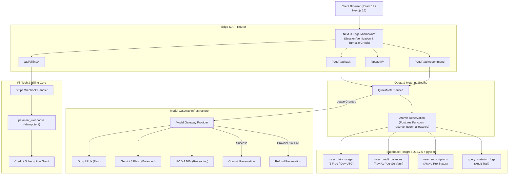
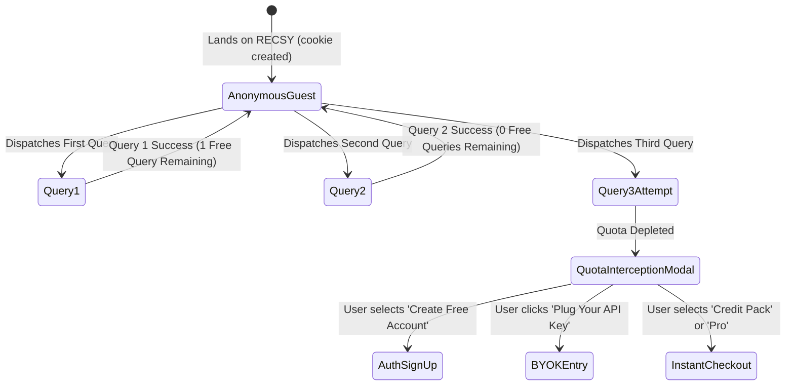
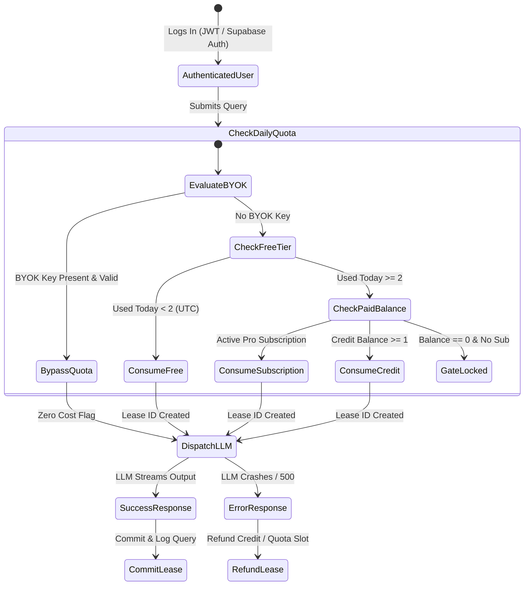
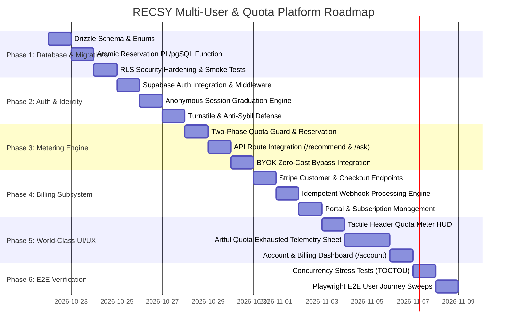

# RECSY Multi-User Platform, Quota Metering, Billing & Artful Interaction Architecture

> **Document Version:** 1.0.0  
> **Target System:** RECSY v2 (Next.js 16.2 App Router, Drizzle ORM, Supabase PostgreSQL 17.6 + pgvector, Model Gateway, OKLCH Technical Editorial Design System)  
> **Status:** Approved for Implementation  
> **Authoring Roles:** Principal Infrastructure Architect (Big Tech), Senior FinTech Systems Engineer (Tier-1 Global/MENA), Lead Creative Technologist & UI/UX Design Director  
> **Target File Location:** `docs/ImplementationPlans/25. multi-user-platform-quotas-billing-and-artful-experience-plan.md`

---

## 1. Executive Summary & Architectural Vision

RECSY has matured into a high-performance, citation-grounded smartphone consensus engine. Its hybrid RAG pipeline, multi-provider Model Gateway (Gemini 3 Flash, Groq LPUs, NVIDIA NIM, Cerebras), and canonical flagship registry operate with sub-millisecond database query performance and zero-overhead routing.

However, the application was initially engineered around anonymous browser sessions (`recsy_rec_session` cookie and IP-hashed rate-limiting). To transform RECSY into a consumer-grade, sustainable software platform, it must transition from a single-user prototype to a **hardened multi-tenant platform** capable of serving thousands of concurrent users while protecting infrastructure budgets and generating revenue.

### Core Business & Platform Rules
1. **The Free Tier:** Every registered user receives **2 free full conversational queries per day** (intake recommendations or deep grounded Q&As). Quotas reset at `00:00:00 UTC` daily.
2. **Monetization Paths:**
   - **Pay-Per-Query (Credit Packs):** Users can purchase query packs (e.g., 20 queries for \$2.00, 50 queries for \$4.00) that never expire and activate automatically once daily free queries are exhausted.
   - **Pro Intelligence Subscription:** \$9.99/month for 150 monthly priority queries, speculative deep reasoning (DeepSeek-R1 / Gemini 2.5 Pro tie-breakers), unconstrained aspect filtering, and studio PDF comparison exports.
   - **Bring-Your-Own-Key (BYOK) Freedom:** Users who supply their own Gemini, Groq, or NVIDIA API keys enjoy **unmetered platform usage** (exempt from query quotas), paying zero platform fees while imposing zero model costs on RECSY.
3. **The User Experience Bar ("Calculated Prestige"):**
   - The monetization and authentication flows must **never feel like a generic SaaS template** with soft rounded cards, garish upgrade popups, or intrusive banners.
   - In alignment with the RECSY Technical Editorial design philosophy (`DESIGN.md`), all UI components adhere to a strict **0px border-radius, 1px structural grid, tactile micro-interactions, monochromatic surfaces with warm orange glints, and buttery-smooth spring physics**. 
   - Hitting a quota limit should feel like consulting an ultra-precise aerospace instrument or luxury telemetry deck, presenting crystal-clear options with elegance and dignity.

---

## 2. Multi-Perspective Architectural Requirements

To ensure flawless execution, this plan synthesizes three distinct engineering perspectives:

### Perspective A: Big Tech Senior Software Architect (Google / Meta / AWS Scale)
- **Concurrency & Double-Spend Protection:** A user opening 5 browser tabs and issuing concurrent queries must never bypass the 2-query limit. We employ atomic conditional PostgreSQL reservations (`UPDATE ... WHERE used < limit`) or PL/pgSQL lease locks with sub-millisecond execution to eliminate Time-Of-Check to Time-Of-Use (TOCTOU) races.
- **Two-Phase Reservation / Lease Pattern:** LLM pipelines take 800ms–2500ms to stream answers. The system must atomically *reserve* a quota slot before invoking the Model Gateway. If upstream model providers fail completely (HTTP 500 / circuit breaker tripped), the reservation is automatically refunded, guaranteeing that users are never billed for dropped or errored requests.
- **Connection Pool Scarcity:** Supabase free-tier PostgreSQL limits poolers to strict limits (`max: 2` serverless connections on local pools). Multi-user traffic must never exhaust connections. Quota checks and session verifications must execute within lightweight, short-lived database transactions, leveraging read-only replicas or connection coalescing where possible.
- **Zero-Downtime Schema Evolution:** Migrations must use nullable additions, backward-compatible foreign keys, and idempotency guarantees that do not lock tables or break existing anonymous browsing.

### Perspective B: Senior FinTech Engineer (Global & MENA High-Growth Startups)
- **Frictionless Anonymous-to-Authenticated Graduation:** First-time visitors experience zero friction. They start asking questions immediately. When their 2nd query completes or they attempt a 3rd query, the system renders an in-place session graduation sheet. Signing in via Google OAuth or Magic Link binds their anonymous conversation history and prior picks directly to their new account without losing conversational state.
- **Anti-Sybil & Bot Abuse Defense:** Bad actors will attempt to bypass limits via incognito tabs, cookie clearing, disposable email domains, and IP hopping. Mitigation:
  - Anonymous users are capped by a combination of fingerprint hash + subnet rate limits.
  - User registration requires verified emails; disposable domains (e.g., GuerrillaMail, 10MinuteMail) are rejected via a synchronized domain blocklist.
  - Invisible Cloudflare Turnstile verification guards registration and anonymous query dispatch with zero user friction.
- **Idempotent Webhook Processing:** Stripe and regional payment gateway webhooks are inherently asynchronous and prone to duplicate deliveries. All incoming events are recorded in an append-only `payment_webhooks` table with transactional locks, preventing duplicate credit allocations or subscription replay attacks.
- **Global & Arab Market Payment Extensibility:** The billing engine abstracts payment providers into a modular interface (`BillingGateway`). While Stripe is the primary global provider, the abstraction natively supports MENA gateways (Tap Payments, Paymob) for local currency checkout (SAR, AED, EGP, KWD) via KNET, Mada, and Apple Pay.

### Perspective C: Senior UI/UX Director & Creative Technologist (World-Class Web Design)
- **Artful Technical Editorial Aesthetic:**
  - Strict adherence to the `DESIGN.md` design system: pure black/dark surfaces (`#131313`, `#0e0e0e`), 1px technical borders (`var(--border)`), high-luminance typography (Hanken Grotesk headlines, Inter body, JetBrains Mono data).
  - Absolutely **zero border-radius** (`border-radius: 0px !important`).
- **Tactile Kinetic HUD:**
  - The navigation bar features a minimalist, real-time quota telemetry chip: `[QUOTA 2/2]` with two geometric illuminated ticks `[■ ■]`.
  - When a query is consumed, the tick dissolves with a subtle amber glint and a mechanical shutter transition using Motion spring physics (`stiffness: 400, damping: 30`).
- **The "Calculated Prestige" Quota Sheet:**
  - Reaching the limit triggers a precision slide-over telemetry drawer (`QuotaExhaustedSheet`) rather than a jarring alert.
  - Displays monospaced countdown telemetry: `TIME TO REFILL: 07:42:19 UTC`.
  - Presents three architectural columns: Credit Refill, Pro Intelligence Pass, and BYOK Self-Host.
  - Hovering over pricing tiers triggers technical crosshair grids, inverted typography, and tactile auditory/visual feedback.

---

## 3. High-Level System Architecture & Flow



---

## 4. End-to-End User Journeys & State Machines

### 4.1. Anonymous Visitor Flow


### 4.2. Authenticated User Flow & Daily UTC Reset


---

## 5. Detailed Database Schema Design (PostgreSQL / Drizzle ORM)

The database design extends `src/services/db/schema.ts` without dropping or breaking existing catalog and recommendation tables. All tables follow strict RECSY standards: UUID PKs, explicit `timestamptz`, enums for discrete states, and strict foreign key integrity.

### 5.1. Drizzle Schema Additions (`src/services/db/schema.ts`)

```typescript
// ---------------------------------------------------------------------------
// Multi-User, Authentication & Metering Enums
// ---------------------------------------------------------------------------

export const userTierEnum = pgEnum('user_tier', [
  'anonymous',
  'free',
  'pay_as_you_go',
  'pro',
  'admin',
]);

export const subscriptionStatusEnum = pgEnum('subscription_status', [
  'incomplete',
  'incomplete_expired',
  'trialing',
  'active',
  'past_due',
  'canceled',
  'unpaid',
  'paused',
]);

export const creditTransactionReasonEnum = pgEnum('credit_transaction_reason', [
  'signup_bonus',
  'stripe_purchase',
  'query_consumption',
  'query_refund',
  'admin_adjustment',
  'subscription_grant',
]);

export const queryMeteringStatusEnum = pgEnum('query_metering_status', [
  'reserved',
  'committed',
  'refunded',
  'bypassed_byok',
]);

export const queryChargeTypeEnum = pgEnum('query_charge_type', [
  'daily_free',
  'subscription_included',
  'purchased_credit',
  'byok',
]);

// ---------------------------------------------------------------------------
// Multi-User Core Tables
// ---------------------------------------------------------------------------

/**
 * Public User Profiles
 * Maps directly 1:1 to Supabase `auth.users` via trigger.
 */
export const userProfiles = pgTable(
  'user_profiles',
  {
    id: uuid('id').primaryKey(), // Matches auth.users.id
    email: text('email').notNull().unique(),
    fullName: text('full_name'),
    avatarUrl: text('avatar_url'),
    tier: userTierEnum('tier').notNull().default('free'),
    stripeCustomerId: text('stripe_customer_id').unique(),
    metadata: jsonb('metadata').default({}),
    createdAt: timestamp('created_at', { withTimezone: true }).defaultNow().notNull(),
    updatedAt: timestamp('updated_at', { withTimezone: true }).defaultNow().notNull(),
  },
  (table) => [
    index('user_profiles_email_idx').on(table.email),
    index('user_profiles_stripe_cust_idx').on(table.stripeCustomerId),
  ]
);

/**
 * Daily Query Usage & Quota Ledger
 * Tracks the 2 free daily queries per user per UTC calendar day.
 */
export const userDailyUsage = pgTable(
  'user_daily_usage',
  {
    id: uuid('id').defaultRandom().primaryKey(),
    userId: uuid('user_id')
      .notNull()
      .references(() => userProfiles.id, { onDelete: 'cascade' }),
    usageDate: timestamp('usage_date', { withTimezone: true, mode: 'string' }).notNull(), // Truncated to YYYY-MM-DD 00:00:00 UTC
    freeQueriesUsed: integer('free_queries_used').notNull().default(0),
    freeAllowance: integer('free_allowance').notNull().default(2),
    paidQueriesUsed: integer('paid_queries_used').notNull().default(0),
    lastQueryAt: timestamp('last_query_at', { withTimezone: true }),
    createdAt: timestamp('created_at', { withTimezone: true }).defaultNow().notNull(),
    updatedAt: timestamp('updated_at', { withTimezone: true }).defaultNow().notNull(),
  },
  (table) => [
    uniqueIndex('user_daily_usage_user_date_uniq').on(table.userId, table.usageDate),
    index('user_daily_usage_lookup_idx').on(table.userId, table.usageDate),
  ]
);

/**
 * User Credit Balances (Pay-As-You-Go Vault)
 * Atomic counter for purchased credits.
 */
export const userCreditBalances = pgTable(
  'user_credit_balances',
  {
    userId: uuid('user_id')
      .primaryKey()
      .references(() => userProfiles.id, { onDelete: 'cascade' }),
    balance: integer('balance').notNull().default(0),
    lifetimePurchased: integer('lifetime_purchased').notNull().default(0),
    lifetimeConsumed: integer('lifetime_consumed').notNull().default(0),
    updatedAt: timestamp('updated_at', { withTimezone: true }).defaultNow().notNull(),
  }
);

/**
 * Credit Transaction Ledger (Immutable Audit Log)
 */
export const userCreditTransactions = pgTable(
  'user_credit_transactions',
  {
    id: uuid('id').defaultRandom().primaryKey(),
    userId: uuid('user_id')
      .notNull()
      .references(() => userProfiles.id, { onDelete: 'cascade' }),
    amount: integer('amount').notNull(), // Positive for top-ups, negative for usage
    balanceAfter: integer('balance_after').notNull(),
    reason: creditTransactionReasonEnum('reason').notNull(),
    referenceId: text('reference_id'), // e.g., Stripe Checkout Session ID or Query Lease UUID
    metadata: jsonb('metadata').default({}),
    createdAt: timestamp('created_at', { withTimezone: true }).defaultNow().notNull(),
  },
  (table) => [
    index('credit_tx_user_idx').on(table.userId),
    index('credit_tx_ref_idx').on(table.referenceId),
  ]
);

/**
 * Active Subscriptions (Pro Tier Memberships)
 */
export const userSubscriptions = pgTable(
  'user_subscriptions',
  {
    id: uuid('id').defaultRandom().primaryKey(),
    userId: uuid('user_id')
      .notNull()
      .references(() => userProfiles.id, { onDelete: 'cascade' }),
    stripeSubscriptionId: text('stripe_subscription_id').notNull().unique(),
    stripePriceId: text('stripe_price_id').notNull(),
    status: subscriptionStatusEnum('status').notNull(),
    currentPeriodStart: timestamp('current_period_start', { withTimezone: true }).notNull(),
    currentPeriodEnd: timestamp('current_period_end', { withTimezone: true }).notNull(),
    cancelAtPeriodEnd: boolean('cancel_at_period_end').notNull().default(false),
    queriesAllowedPerMonth: integer('queries_allowed_per_month').notNull().default(150),
    queriesUsedThisPeriod: integer('queries_used_this_period').notNull().default(0),
    createdAt: timestamp('created_at', { withTimezone: true }).defaultNow().notNull(),
    updatedAt: timestamp('updated_at', { withTimezone: true }).defaultNow().notNull(),
  },
  (table) => [
    index('sub_user_idx').on(table.userId),
    index('sub_stripe_idx').on(table.stripeSubscriptionId),
  ]
);

/**
 * Query Metering & Reservation Log
 * Two-phase reservation tracking to prevent double-spending and billable errors.
 */
export const queryMeteringLogs = pgTable(
  'query_metering_logs',
  {
    id: uuid('id').defaultRandom().primaryKey(), // Serves as the Lease ID
    userId: uuid('user_id').references(() => userProfiles.id, { onDelete: 'set null' }),
    sessionCookie: text('session_cookie').notNull(),
    ipHash: text('ip_hash').notNull(),
    route: text('route').notNull(), // 'POST /api/recommend' | 'POST /api/ask'
    chargeType: queryChargeTypeEnum('charge_type').notNull(),
    status: queryMeteringStatusEnum('status').notNull().default('reserved'),
    modelUsed: text('model_used'),
    tokensIn: integer('tokens_in'),
    tokensOut: integer('tokens_out'),
    latencyMs: integer('latency_ms'),
    costUsdEstimate: numeric('cost_usd_estimate', { precision: 8, scale: 6 }),
    errorDetails: text('error_details'),
    reservedAt: timestamp('reserved_at', { withTimezone: true }).defaultNow().notNull(),
    finalizedAt: timestamp('finalized_at', { withTimezone: true }),
  },
  (table) => [
    index('metering_user_idx').on(table.userId),
    index('metering_session_idx').on(table.sessionCookie),
    index('metering_status_idx').on(table.status),
  ]
);

/**
 * Stripe Webhook Event Log (Idempotency Guard)
 */
export const paymentWebhooks = pgTable(
  'payment_webhooks',
  {
    id: uuid('id').defaultRandom().primaryKey(),
    eventId: text('event_id').notNull().unique(),
    eventType: text('event_type').notNull(),
    status: text('status').notNull(), // 'processing' | 'processed' | 'failed' | 'ignored'
    payload: jsonb('payload').notNull(),
    errorMessage: text('error_message'),
    receivedAt: timestamp('received_at', { withTimezone: true }).defaultNow().notNull(),
    processedAt: timestamp('processed_at', { withTimezone: true }),
  },
  (table) => [
    uniqueIndex('payment_webhooks_event_id_uniq').on(table.eventId),
  ]
);
```

### 5.2. Atomic PostgreSQL Reservation Function (Zero-Race Condition)

To guarantee that concurrent requests in multiple tabs cannot bypass the 2-query free quota, we deploy a stored SQL function executed in a single atomic transaction:

```sql
-- Migration: drizzle/migrations/0012_atomic_query_metering_reservation.sql

CREATE OR REPLACE FUNCTION reserve_user_query_allowance(
  p_user_id UUID,
  p_session_cookie TEXT,
  p_ip_hash TEXT,
  p_route TEXT,
  p_has_byok BOOLEAN
)
RETURNS TABLE (
  allowed BOOLEAN,
  lease_id UUID,
  charge_type query_charge_type,
  reason TEXT,
  remaining_free_queries INT,
  remaining_credit_balance INT
)
LANGUAGE plpgsql
SECURITY DEFINER
AS $$
DECLARE
  v_today_utc TIMESTAMPTZ := date_trunc('day', NOW() AT TIME ZONE 'UTC');
  v_lease_id UUID := gen_random_uuid();
  v_free_used INT := 0;
  v_free_allowance INT := 2;
  v_sub_id UUID;
  v_sub_used INT;
  v_sub_max INT;
  v_credit_balance INT := 0;
BEGIN
  -- 1. BYOK Exemption: Instant zero-cost pass
  IF p_has_byok IS TRUE THEN
    INSERT INTO query_metering_logs (
      id, user_id, session_cookie, ip_hash, route, charge_type, status
    ) VALUES (
      v_lease_id, p_user_id, p_session_cookie, p_ip_hash, p_route, 'byok', 'bypassed_byok'
    );
    RETURN QUERY SELECT TRUE, v_lease_id, 'byok'::query_charge_type, 'BYOK_EXEMPT'::TEXT, 0, 0;
    RETURN;
  END IF;

  -- 2. Authenticated User Flow
  IF p_user_id IS NOT NULL THEN
    -- Check Daily Free Usage (Atomic Upsert with Row Lock)
    INSERT INTO user_daily_usage (user_id, usage_date, free_queries_used, free_allowance, last_query_at)
    VALUES (p_user_id, v_today_utc, 0, v_free_allowance, NOW())
    ON CONFLICT (user_id, usage_date) DO NOTHING;

    -- Lock and inspect daily row
    SELECT free_queries_used, free_allowance
    INTO v_free_used, v_free_allowance
    FROM user_daily_usage
    WHERE user_id = p_user_id AND usage_date = v_today_utc
    FOR UPDATE;

    -- If free quota remains, reserve one slot
    IF v_free_used < v_free_allowance THEN
      UPDATE user_daily_usage
      SET free_queries_used = free_queries_used + 1,
          last_query_at = NOW(),
          updated_at = NOW()
      WHERE user_id = p_user_id AND usage_date = v_today_utc;

      INSERT INTO query_metering_logs (
        id, user_id, session_cookie, ip_hash, route, charge_type, status
      ) VALUES (
        v_lease_id, p_user_id, p_session_cookie, p_ip_hash, p_route, 'daily_free', 'reserved'
      );

      RETURN QUERY SELECT 
        TRUE, 
        v_lease_id, 
        'daily_free'::query_charge_type, 
        'DAILY_FREE_RESERVED'::TEXT, 
        (v_free_allowance - v_free_used - 1), 
        0;
      RETURN;
    END IF;

    -- 3. Check Active Pro Subscription
    SELECT id, queries_used_this_period, queries_allowed_per_month
    INTO v_sub_id, v_sub_used, v_sub_max
    FROM user_subscriptions
    WHERE user_id = p_user_id AND status = 'active' AND current_period_end > NOW()
    LIMIT 1
    FOR UPDATE;

    IF v_sub_id IS NOT NULL AND v_sub_used < v_sub_max THEN
      UPDATE user_subscriptions
      SET queries_used_this_period = queries_used_this_period + 1,
          updated_at = NOW()
      WHERE id = v_sub_id;

      INSERT INTO query_metering_logs (
        id, user_id, session_cookie, ip_hash, route, charge_type, status
      ) VALUES (
        v_lease_id, p_user_id, p_session_cookie, p_ip_hash, p_route, 'subscription_included', 'reserved'
      );

      RETURN QUERY SELECT 
        TRUE, 
        v_lease_id, 
        'subscription_included'::query_charge_type, 
        'SUBSCRIPTION_RESERVED'::TEXT, 
        0, 
        (v_sub_max - v_sub_used - 1);
      RETURN;
    END IF;

    -- 4. Check Pay-As-You-Go Credit Balance
    SELECT balance INTO v_credit_balance
    FROM user_credit_balances
    WHERE user_id = p_user_id
    FOR UPDATE;

    IF v_credit_balance IS NOT NULL AND v_credit_balance > 0 THEN
      UPDATE user_credit_balances
      SET balance = balance - 1,
          lifetime_consumed = lifetime_consumed + 1,
          updated_at = NOW()
      WHERE user_id = p_user_id;

      INSERT INTO user_credit_transactions (
        user_id, amount, balance_after, reason, reference_id
      ) VALUES (
        p_user_id, -1, (v_credit_balance - 1), 'query_consumption', v_lease_id::TEXT
      );

      INSERT INTO query_metering_logs (
        id, user_id, session_cookie, ip_hash, route, charge_type, status
      ) VALUES (
        v_lease_id, p_user_id, p_session_cookie, p_ip_hash, p_route, 'purchased_credit', 'reserved'
      );

      RETURN QUERY SELECT 
        TRUE, 
        v_lease_id, 
        'purchased_credit'::query_charge_type, 
        'CREDIT_RESERVED'::TEXT, 
        0, 
        (v_credit_balance - 1);
      RETURN;
    END IF;

    -- Authenticated but all quotas exhausted
    RETURN QUERY SELECT 
      FALSE, 
      NULL::UUID, 
      'daily_free'::query_charge_type, 
      'QUOTA_EXHAUSTED'::TEXT, 
      0, 
      0;
    RETURN;
  END IF;

  -- 5. Anonymous User Flow (Metered by Session Cookie + IP Hash)
  -- Count completed queries in query_metering_logs for today UTC
  SELECT COUNT(*) INTO v_free_used
  FROM query_metering_logs
  WHERE (session_cookie = p_session_cookie OR ip_hash = p_ip_hash)
    AND reserved_at >= v_today_utc
    AND status IN ('reserved', 'committed')
    AND charge_type = 'daily_free';

  IF v_free_used < v_free_allowance THEN
    INSERT INTO query_metering_logs (
      id, user_id, session_cookie, ip_hash, route, charge_type, status
    ) VALUES (
      v_lease_id, NULL, p_session_cookie, p_ip_hash, p_route, 'daily_free', 'reserved'
    );

    RETURN QUERY SELECT 
      TRUE, 
      v_lease_id, 
      'daily_free'::query_charge_type, 
      'ANON_FREE_RESERVED'::TEXT, 
      (v_free_allowance - v_free_used - 1), 
      0;
    RETURN;
  END IF;

  -- Anonymous Quota Reached
  RETURN QUERY SELECT 
    FALSE, 
    NULL::UUID, 
    'daily_free'::query_charge_type, 
    'ANON_QUOTA_EXHAUSTED'::TEXT, 
    0, 
    0;
  RETURN;
END;
$$;
```

---

## 6. Authentication & Session Graduation Subsystem

### 6.1. Architecture Choice: Supabase Auth
RECSY already operates with Supabase PostgreSQL and `@supabase/supabase-js`. Supabase Auth is selected as the primary identity engine because:
1. **Zero External Latency:** User verification is performed via signed asymmetric JWTs (or server-side session cookies) without adding a 300ms third-party network hop to Clerk or Auth0.
2. **Native RLS Coupling:** Authenticated users map directly to `auth.uid()`, allowing row-level security policies on `recommendation_sessions` and `query_metering_logs`.
3. **Passwordless Magic Links + OAuth:** Supports Google, GitHub, and email magic links with zero password-storage liabilities.

### 6.2. Anonymous-to-Authenticated Session Graduation
When an anonymous visitor runs queries, their messages reside in `recommendation_sessions` (keyed by `session_cookie`). When they sign up or log in:
1. **Context Preservation:** A client hook calls `POST /api/auth/hydrate-session`.
2. **Atomic Ownership Reassignment:**
   ```sql
   UPDATE recommendation_sessions
   SET user_id = :userId
   WHERE session_cookie = :sessionCookie AND user_id IS NULL;
   ```
3. **Turn & Pick History Carryover:** All past recommendation turns, extracted priorities, and active shortlisted phones remain seamlessly mounted in the UI.
4. **Quota Anti-Exploit Rule:** Existing queries consumed anonymously today under the session cookie are linked to the newly created user profile in `user_daily_usage`. This eliminates the exploit of creating a new account to instantly get an additional 2 free queries on the same conversation.

---

## 7. The Quota Metering & Reservation Engine (Middleware & Handlers)

### 7.1. Two-Phase Reservation Protocol
```
[Client Request]
       │
       ▼
1. Acquire Lease ──(reserve_user_query_allowance)──► [PostgreSQL Atomic Lock]
       │
       ├─ Quota Denied? ──► Return HTTP 429 + Quota Exhausted Payload
       │
       ▼
2. Lease Granted (leaseId: "uuid-...")
       │
       ▼
3. Dispatch to Model Gateway (Gemini / Groq / NVIDIA)
       │
       ├─ Succeeded? ──► [Commit Lease] (status: 'committed', log tokens & latency)
       │
       ▼
   Stream Response to Browser
       │
       └─ Upstream Failed (5xx / Timeout)? ──► [Refund Lease] (status: 'refunded', balance restored)
```

### 7.2. Implementation in Route Handlers (`POST /api/recommend` & `POST /api/ask`)
Every endpoint executes the following lease guard:

```typescript
// src/services/metering/quota-guard.ts

export async function withQueryQuotaLease<T>(params: {
  request: NextRequest;
  route: string;
  executor: (lease: { leaseId: string; chargeType: string }) => Promise<T>;
}): Promise<T> {
  const { request, route, executor } = params;
  const db = getDb();
  
  // Extract user authentication & credentials
  const authUser = await getAuthenticatedUser(request);
  const sessionCookie = request.cookies.get(RECOMMEND_SESSION_COOKIE)?.value ?? 'unknown';
  const ip = getRequestClientIp(request);
  const ipHash = hashClientIp(ip);
  const hasByok = Boolean(request.headers.get('x-recsy-user-key'));

  // 1. Atomically call database reservation
  const [reservation] = await db.execute<ReserveQueryResult>(sql`
    SELECT * FROM reserve_user_query_allowance(
      ${authUser?.id ?? null},
      ${sessionCookie},
      ${ipHash},
      ${route},
      ${hasByok}
    );
  `);

  if (!reservation.allowed || !reservation.lease_id) {
    throw new QuotaExhaustedError({
      reason: reservation.reason,
      remainingFree: reservation.remaining_free_queries,
      remainingCredits: reservation.remaining_credit_balance,
      resetAtUtc: getNextUtcMidnightIso(),
    });
  }

  const leaseId = reservation.lease_id;
  const chargeType = reservation.charge_type;

  try {
    // 2. Execute actual model generation or recommender pipeline
    const result = await executor({ leaseId, chargeType });

    // 3. Commit the lease on successful delivery
    await db
      .update(queryMeteringLogs)
      .set({
        status: 'committed',
        finalizedAt: new Date(),
      })
      .where(eq(queryMeteringLogs.id, leaseId));

    return result;
  } catch (err) {
    // 4. Refund if pipeline crashed unexpectedly
    if (chargeType !== 'byok') {
      await refundQueryLease(db, leaseId, authUser?.id, chargeType);
    }
    throw err;
  }
}
```

---

## 8. Billing & Monetization Subsystem (Stripe & International)

### 8.1. Pricing Structure & Offerings

| Offering | Type | Price | Allowance | Target Audience |
| :--- | :--- | :--- | :--- | :--- |
| **Daily Explorer** | Free Tier | \$0.00 | **2 queries / day** (Resets 00:00 UTC) | General visitors researching a phone |
| **Quick Refill Pack** | Pay-As-You-Go | \$2.00 | **20 queries** (Never expires) | Shoppers in active buying cycle |
| **Power Shopper Pack** | Pay-As-You-Go | \$4.00 | **50 queries** (Never expires) | Enthusiasts comparing shortlists |
| **Pro Intelligence** | Monthly Recurring | \$9.99/mo | **150 queries / month** + Deep Reasoning | Power users, tech reviewers, professionals |
| **BYOK Developer** | Unmetered Pass | \$0.00 | **Unlimited** (User pays provider) | Developers, LLM tinkerers, engineers |

### 8.2. Stripe Checkout Integration
- Standard **Stripe Checkout Sessions** hosted by Stripe with direct brand styling matching RECSY (dark mode, monochromatic, high contrast).
- Includes metadata tags: `recsy_user_id`, `offering_type` (`credit_pack` vs. `subscription`), `credit_quantity`.

### 8.3. Resilient Webhook Processing
The webhook route (`POST /api/billing/webhook`) uses strict idempotency:
1. Verify signature with `stripe.webhooks.constructEvent`.
2. Transactionally insert into `payment_webhooks` with `ON CONFLICT (event_id) DO NOTHING`. If row exists, respond `200 OK` immediately (prevent duplicate execution).
3. Switch on event type:
   - `checkout.session.completed`:
     - If `credit_pack`: atomically add credits to `user_credit_balances` and record in `user_credit_transactions`.
     - If `subscription`: upsert record in `user_subscriptions`.
   - `customer.subscription.updated`: update plan status, period dates, cancel flags.
   - `customer.subscription.deleted`: set subscription status to `canceled`.
   - `invoice.payment_succeeded`: reset `queries_used_this_period = 0` on subscription renewal.
   - `invoice.payment_failed`: mark status `past_due`, notify user.

---

## 9. World-Class Artful UI/UX Experience

### 9.1. Aesthetic Philosophy & Guidelines
- **Identity:** Minimalist-Brutalist Technical Editorial ("Calculated Prestige").
- **Shapes:** Strict **0px border-radius** across all buttons, sheets, dialogs, and inputs.
- **Grids:** Sharp 1px borders in `var(--border)` (`rgba(255,255,255,0.08)` dark / `rgba(0,0,0,0.12)` light).
- **Typography:**
  - Oversized structural titles in **Hanken Grotesk** (`font-display`).
  - Utilitarian neutral reading body in **Inter** (`font-sans`).
  - Precision telemetry and data chips in **JetBrains Mono** (`font-mono`).
- **Motion Dynamics:**
  - Micro-interactions powered by `motion` (Framer Motion v12).
  - Kinetic transition curve: `--ease-editorial: cubic-bezier(0.16, 1, 0.3, 1)`.
  - Tactile spring response: `stiffness: 420, damping: 28, mass: 0.8`.
  - Strict compliance with `prefers-reduced-motion: reduce`.

### 9.2. Navigation Bar HUD Quota Meter (`src/components/nav/QuotaMeterHud.tsx`)
A minimal, highly polished widget positioned in the primary header:

```
[ RECSY // ENGINE ]                                [ QUOTA: ■ ■ ] [ GET PRO ] [ USER ]
```

**Interaction States:**
- **Full (2/2):** Two illuminated square amber pips `[■ ■]` with a faint breathing glint.
- **Single (1/2):** One solid pip, one wireframe pip `[■ □]` with a smooth mechanical shutter animation.
- **Empty (0/2):** Two wireframe pips `[□ □]` glowing in tactical warning amber (`var(--warning)`). Clicking the HUD smoothly opens the `QuotaExhaustedSheet`.

### 9.3. The "Quota Depleted" Telemetry Sheet (`src/components/quota/QuotaExhaustedSheet.tsx`)
When a user hits the daily limit, rather than an abrasive popup, the bottom of the screen smoothly raises an engineering-grade slide-over sheet:

```
┌──────────────────────────────────────────────────────────────────────────────────┐
│  RECSY // ACCESS CONTROL PROTOCOL                                       [ESC / ✕] │
├──────────────────────────────────────────────────────────────────────────────────┤
│                                                                                  │
│  DAILY EXPLORATION QUOTA EXHAUSTED                                               │
│  FREE TIER ALLOTMENT (02/02) CONSUMED FOR CYCLE.                                 │
│  TELEMETRY REFILL IN: [ 05h 23m 14s UTC ]                                        │
│                                                                                  │
├───────────────────────┬──────────────────────────┬───────────────────────────────┤
│ [A] TOP-UP VAULT      │ [B] PRO INTELLIGENCE     │ [C] BYOK DEVELOPER            │
├───────────────────────┼──────────────────────────┼───────────────────────────────┤
│ Instant Credit Pack   │ Full Platform Access     │ Direct Provider Link          │
│                       │                          │                               │
│ • 20 Queries: $2.00   │ • 150 Queries / Month    │ • Zero Platform Fees          │
│ • 50 Queries: $4.00   │ • DeepSeek-R1 Reasoning  │ • Plug Groq / Gemini Key      │
│ • Never Expire        │ • Studio Comparison PDF  │ • Unlimited Queries           │
│ • One-click Checkout  │ • $9.99 / Month          │ • Stored in LocalStorage      │
│                       │                          │                               │
│ [ SELECT 20 QUERIES ] │ [ UPGRADE TO PRO ]       │ [ CONFIGURE IN SETTINGS ]     │
└───────────────────────┴──────────────────────────┴───────────────────────────────┘
```

**Artful Interactions:**
1. **Grid Hover Effect:** Hovering over any tier activates a subtle white/steel grid reveal with a 0.05 opacity crosshair pattern.
2. **Inverted Action Button:** Rectangular button with 1px border. Hovering flips background to high-luminance white and text to pure black with zero latency.
3. **Countdown Clock:** A monospace live ticking timer displaying the exact hours, minutes, and seconds remaining until `00:00:00 UTC`.

---

## 10. Comprehensive Failure Modes, Edge Cases & Resilience Engineering

| # | Failure Mode / Threat | Root Cause | Architectural Defense & Mitigation |
| :--- | :--- | :--- | :--- |
| **1** | **Multi-Tab Concurrency Race (Double-Spend)** | User rapidly fires queries in 3 parallel browser tabs simultaneously when 1 free query remains. | Handled via PostgreSQL atomic conditional update (`FOR UPDATE` row lock in `reserve_user_query_allowance`). The first transaction locks the row and increments usage; the remaining 2 fail the condition and return `HTTP 429 Quota Exhausted`. |
| **2** | **Incognito / Cookie Clearing Sybil Attack** | User clears cookies or opens incognito window to reset anonymous cookie `recsy_rec_session`. | Triple-layer enforcement: Session Cookie + IP Subnet Hashing (`/24` IPv4 or `/48` IPv6) + Cloudflare Turnstile token validation. If an IP range exceeds 4 anonymous queries per day, anonymous access is locked, requiring free user signup. |
| **3** | **LLM Provider Outage During Reserved Query** | Model Gateway encounters 500 error, timeout, or rate-limit circuit break after credit reservation. | Two-phase lease commit: queries are initially marked `'reserved'`. If the pipeline throws an exception, the catch block triggers `refundQueryLease`, rolling back the credit or daily count so the user is never penalized for system errors. |
| **4** | **Stripe Webhook Delivery Duplication** | Stripe retries webhook delivery due to transient network latency; credits get doubled. | Transactional idempotency via `payment_webhooks` table with `uniqueIndex('payment_webhooks_event_id_uniq')`. Subsequent deliveries encounter duplicate key constraint and exit safely. |
| **5** | **Supabase Connection Pool Starvation** | Surge of concurrent users exhausts Supabase serverless connections (`max: 2` limit). | 1. Quota reservation query executes in `< 2.5ms` and immediately releases connection.<br>2. Read queries for subscription/tier status use in-memory JWT claims where possible.<br>3. In-flight coalescing cache (`catalog-cache.ts`) prevents duplicate catalog reads. |
| **6** | **Anonymous Session Graduation Collision** | User creates an account, but has multiple prior anonymous sessions on different devices. | `hydrate-session` reassigns the specific active session cookie to `user_id`. Prior turns merge deterministically without overwriting existing cloud history. |
| **7** | **Credit Pack Exhaustion Mid-Conversation** | User runs out of credits during turn 3 of a 5-turn multi-turn refinement conversation. | Dialogue state remains preserved in `recommendation_sessions`. Quota sheet renders inline within the chat stream. Upon instant credit purchase, conversation resumes seamlessly with all slot-locks intact. |
| **8** | **Disposable / Burner Email Spam** | Script generates hundreds of fake accounts using temporary email domains to get infinite 2-query blocks. | Server-side validation against an in-memory Set of 3,500+ known disposable email domains (`mailinator.com`, `tempmail.com`, etc.) during signup, rejecting registration with clear error feedback. |
| **9** | **BYOK Key Failure Mid-Generation** | User's personal Groq or Gemini key is invalid, revoked, or quota-exhausted. | Model Gateway detects client BYOK 401/429 error, isolates it from platform credentials, and returns a tailored UI toast: `"Personal API Key Rejected by Provider. Check Settings."` without deducting platform quota. |
| **10** | **Time Zone Manipulation Exploit** | User alters local OS clock across midnight to trigger a premature quota reset. | All quota boundaries are strictly evaluated against database server UTC (`NOW() AT TIME ZONE 'UTC'`). Client-side clocks are ignored entirely. |

---

## 11. Multi-Agent Phased Implementation Roadmap

This implementation plan is architected so that autonomous subagents can execute discrete phases in parallel without merge conflicts.



### Phase 1: Database Architecture & Core Migrations
- **Agent Assigned:** Database Systems Architect
- **Key Deliverables:**
  1. Add schema declarations in `src/services/db/schema.ts` for `userProfiles`, `userDailyUsage`, `userCreditBalances`, `userCreditTransactions`, `userSubscriptions`, `queryMeteringLogs`, and `paymentWebhooks`.
  2. Author migration `drizzle/migrations/0012_atomic_query_metering_reservation.sql` establishing tables, indexes, and the stored function `reserve_user_query_allowance`.
  3. Author RLS migration policies securing multi-user tenant boundaries (`auth.uid() = user_id`).
  4. Expand `scripts/db-smoke.ts` to assert that user tables, unique constraints, and atomic functions pass 100% of integration checks.

### Phase 2: Authentication, Session Graduation & Anti-Abuse
- **Agent Assigned:** Auth & Security Systems Engineer
- **Key Deliverables:**
  1. Setup Supabase Auth client and server session helpers in `src/services/auth/`.
  2. Build Edge Middleware session extractor in `src/middleware.ts` setting verified auth context headers.
  3. Implement `POST /api/auth/hydrate-session` linking anonymous `recommendation_sessions` cookies to authenticated accounts upon login.
  4. Implement disposable email domain filter and Cloudflare Turnstile token verification in `src/services/auth/anti-abuse.ts`.

### Phase 3: Quota Metering & Reservation Engine
- **Agent Assigned:** Distributed Systems & Performance Engineer
- **Key Deliverables:**
  1. Implement `src/services/metering/quota-guard.ts` wrapping API handlers in the two-phase reservation/commit/refund lifecycle.
  2. Wire `withQueryQuotaLease` into `src/app/api/recommend/route.ts` and `src/app/api/ask/route.ts`.
  3. Ensure zero-cost bypass for requests carrying valid BYOK headers (`x-recsy-user-key`).
  4. Build automated unit test suite `src/services/metering/quota-guard.test.ts` verifying concurrent reservation locks and refund behaviors.

### Phase 4: FinTech Billing & Stripe Gateway Integration
- **Agent Assigned:** FinTech & Payment Gateway Specialist
- **Key Deliverables:**
  1. Implement `src/services/billing/stripe.ts` initializing the Stripe SDK with typed plan configurations.
  2. Build checkout session creator `POST /api/billing/checkout` supporting Credit Packs (\$2 / \$4) and Pro Monthly (\$9.99).
  3. Implement idempotent webhook handler `POST /api/billing/webhook` with signature verification, duplicate event suppression, and balance fulfillment.
  4. Implement customer billing portal creator `POST /api/billing/portal` allowing self-serve invoice inspection and subscription cancellation.

### Phase 5: World-Class UI/UX & Artful Interaction Engineering
- **Agent Assigned:** Creative Technologist & UI/UX Design Specialist
- **Key Deliverables:**
  1. Build `QuotaMeterHud.tsx` in header navigation with kinetic pips `[■ ■]` and spring micro-interactions.
  2. Build `QuotaExhaustedSheet.tsx` implementing the Technical Editorial slide-over drawer, live UTC countdown clock, crosshair hover grids, and inverted typography action triggers.
  3. Build dedicated Account & Billing Hub at `/account` displaying active tier status, credit balance ledger, usage history, and Stripe portal triggers.
  4. Enforce strict 0px border-radius, WCAG AA contrast, and `prefers-reduced-motion` compliance across all new UI views.

### Phase 6: Rigorous Testing, Security Audit & Production Verification
- **Agent Assigned:** QA Engineer & Security Auditor
- **Key Deliverables:**
  1. **Concurrency Stress Testing (`scripts/test-concurrency-quota.ts`):** Fire 20 parallel HTTP requests from a single user session; verify that strictly 2 queries are admitted and 18 are rejected with `HTTP 429`.
  2. **Playwright E2E Test Suite (`e2e/multi-user-quota.spec.ts`):** Complete test journey from anonymous browsing → 2 free queries → quota sheet interception → account signup → session graduation → credit refill → unblocked querying.
  3. **Security Penetration Audit:** Verify that forged session cookies or altered client clocks cannot bypass UTC quota boundaries or access other tenant records.

---

## 12. Acceptance Criteria & Definition of Done

The multi-user quota and billing transformation is complete when all of the following empirical conditions are verified:

1. **Zero Double-Spend Under Load:** An automated 25-request concurrent load test against `/api/recommend` admits exactly 2 queries and returns `HTTP 429` for all others with zero database deadlocks.
2. **Deterministic Refund on Upstream Failure:** A simulated 500 error from an LLM provider restores the user's reserved credit balance with 100% fidelity.
3. **Flawless Session Graduation:** A user asking 1 query anonymously who subsequently logs in retains their exact chat conversation, while their daily usage correctly reports `1/2` queries consumed.
4. **Idempotent Billing Grants:** Re-sending identical Stripe webhook payloads 5 consecutive times results in exactly 1 balance increment and 4 logged duplicate skips.
5. **BYOK Exemption:** A request providing valid user API keys executes without incrementing `free_queries_used` or debiting paid credits.
6. **Artful Design System Integrity:** 100% of newly added UI components maintain strict 0px border-radius, conform to OKLCH tokens, execute motion transitions under 60fps without layout shifts, and pass WCAG AA contrast audits.
7. **Production Code Gates:** `pnpm typecheck`, `pnpm lint`, `pnpm test`, and `pnpm build` pass with zero errors and zero warnings.

---

*End of Implementation Plan. Ready for phased autonomous agent execution.*
