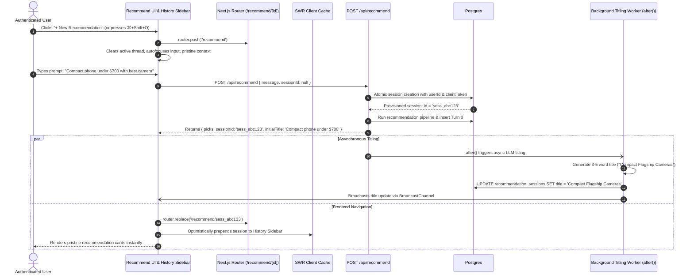
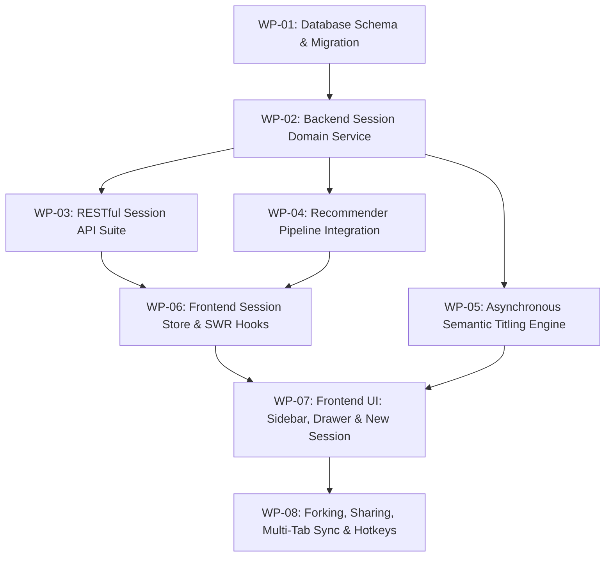

# RECSY Master Plan 27: User Recommendation Sessions & Prompt History Architecture

> **Document control**
>
> | Field               | Value                                                                                                                                                                                                          |
> | :------------------ | :------------------------------------------------------------------------------------------------------------------------------------------------------------------------------------------------------------- |
> | Plan number         | **27**                                                                                                                                                                                                         |
> | Version             | **1.0.0**                                                                                                                                                                                                      |
> | Date                | 2026-10-26                                                                                                                                                                                                     |
> | Status              | Ready for implementation, broken into 8 independent Work Packages (WPs)                                                                                                                                        |
> | Target System       | RECSY v2 Conversational Smartphone Recommendation Platform                                                                                                                                                     |
> | Stack               | Next.js 16.2.4 (App Router), React 19.2.4, Drizzle ORM 0.45, `postgres` 3.4, `@supabase/ssr` 0.12, Supabase Auth + Postgres, Gemini 2.5 Flash / Haiku via AI SDK, Tailwind CSS, SWR, Vitest 4, Playwright 1.59 |
> | Companion documents | `Plan 25` (Multi-user, metering, quotas), `Plan 26` (API architecture, latency, caching), `docs/RECSY_V2_PROJECT_CONTEXT.md`                                                                                   |
> | Target Audience     | Senior AI Engineers, Staff Software Engineers, Principal Architects, Implementing Developers                                                                                                                   |

---

## Table of Contents

- [1. Executive Summary & Problem Diagnosis](#1-executive-summary--problem-diagnosis)
  - [1.1 The User Problem](#11-the-user-problem)
  - [1.2 Architectural Root-Cause Analysis](#12-architectural-root-cause-analysis)
  - [1.3 Frontier AI & Big Tech Architectural North Star](#13-frontier-ai--big-tech-architectural-north-star)
  - [1.4 Key Architectural Pillars](#14-key-architectural-pillars)
- [2. Current State vs. Target State Deep-Dive](#2-current-state-vs-target-state-deep-dive)
  - [2.1 Current State Failure Sequence](#21-current-state-failure-sequence)
  - [2.2 Target State Architectural Sequence](#22-target-state-architectural-sequence)
  - [2.3 Multi-Tab Concurrency & Ambient Cookie Collisions](#23-multi-tab-concurrency--ambient-cookie-collisions)
  - [2.4 Anonymous-to-Authenticated Session Graduation](#24-anonymous-to-authenticated-session-graduation)
- [3. Architecture Decision Records (ADRs)](#3-architecture-decision-records-adrs)
  - [ADR-27.1: Explicit Session Identity (URL & API) vs Ambient Cookie](#adr-271-explicit-session-identity-url--api-vs-ambient-cookie)
  - [ADR-27.2: Decoupled Asynchronous Semantic Titling via Next.js `after()`](#adr-272-decoupled-asynchronous-semantic-titling-via-nextjs-after)
  - [ADR-27.3: Optimized Session Indexing & Denormalized Summary Metrics](#adr-273-optimized-session-indexing--denormalized-summary-metrics)
  - [ADR-27.4: Zero-Latency Session Switching with SWR Optimistic Client Cache](#adr-274-zero-latency-session-switching-with-swr-optimistic-client-cache)
  - [ADR-27.5: URL-First Routing: `/recommend` vs `/recommend/[id]`](#adr-275-url-first-routing-recommend-vs-recommendid)
  - [ADR-27.6: Cross-Tab Real-Time Sync via `BroadcastChannel`](#adr-276-cross-tab-real-time-sync-via-broadcastchannel)
  - [ADR-27.7: Soft Deletion with 30-Day Recovery Window & Cascade Purge](#adr-277-soft-deletion-with-30-day-recovery-window--cascade-purge)
- [4. Data Models & Database Architecture](#4-data-models--database-architecture)
  - [4.1 Drizzle Schema Enhancements (`src/services/db/schema.ts`)](#41-drizzle-schema-enhancements-srcservicesdbschemats)
  - [4.2 Database Migration SQL](#42-database-migration-sql)
  - [4.3 Query Performance & Indexing Optimization](#43-query-performance--indexing-optimization)
- [5. API Architecture & Protocol Contracts](#5-api-architecture--protocol-contracts)
  - [5.1 `GET /api/recommend/sessions` — List User Sessions](#51-get-apirecommendsessions--list-user-sessions)
  - [5.2 `POST /api/recommend/sessions` — Explicit Session Provisioning](#52-post-apirecommendsessions--explicit-session-provisioning)
  - [5.3 `GET /api/recommend/sessions/[id]` — Retrieve Session Detail & Turns](#53-get-apirecommendsessionsid--retrieve-session-detail--turns)
  - [5.4 `PATCH /api/recommend/sessions/[id]` — Rename, Pin, or Archive](#54-patch-apirecommendsessionsid--rename-pin-or-archive)
  - [5.5 `DELETE /api/recommend/sessions/[id]` — Delete Session](#55-delete-apirecommendsessionsid--delete-session)
  - [5.6 `POST /api/recommend/sessions/[id]/fork` — Counterfactual Branching](#56-post-apirecommendsessionsidfork--counterfactual-branching)
  - [5.7 `POST /api/recommend/sessions/[id]/share` — Generate Public Snapshot Link](#57-post-apirecommendsessionsidshare--generate-public-snapshot-link)
  - [5.8 `POST /api/recommend` — Updated Turn Controller Contract](#58-post-apirecommend--updated-turn-controller-contract)
- [6. AI Pipeline & Semantic Titling Engine](#6-ai-pipeline--semantic-titling-engine)
  - [6.1 Two-Phase Titling Architecture (Instant Heuristic -> Async LLM)](#61-two-phase-titling-architecture-instant-heuristic---async-llm)
  - [6.2 Micro-Prompt Specification & Token Budget](#62-micro-prompt-specification--token-budget)
  - [6.3 Latency Decoupling via Next.js `after()`](#63-latency-decoupling-via-nextjs-after)
  - [6.4 Failure Resilience & Heuristic Fallback](#64-failure-resilience--heuristic-fallback)
- [7. Frontend Architecture & Artful UX Design](#7-frontend-architecture--artful-ux-design)
  - [7.1 Component Hierarchy & Layout Integration](#71-component-hierarchy--layout-integration)
  - [7.2 Responsive Session History Drawer & Desktop Sidebar](#72-responsive-session-history-drawer--desktop-sidebar)
  - [7.3 "+ New Recommendation" Flow & Draft Prompt Preservation](#73--new-recommendation-flow--draft-prompt-preservation)
  - [7.4 Keyboard Shortcuts & Command Palette (`Cmd/Ctrl + K`)](#74-keyboard-shortcuts--command-palette-cmdctrl--k)
  - [7.5 Chronological Grouping, Visual Badges & Search](#75-chronological-grouping-visual-badges--search)
  - [7.6 Inline Renaming, Pinning & Quick Actions](#76-inline-renaming-pinning--quick-actions)
  - [7.7 Optimistic Rendering & Zero-Latency Session Switching](#77-optimistic-rendering--zero-latency-session-switching)
- [8. Work Packages (WPs)](#8-work-packages-wps)
  - [WP-01: Database Schema & Migration (User FK, Pinning, Counters, Soft Delete)](#wp-01-database-schema--migration-user-fk-pinning-counters-soft-delete)
  - [WP-02: Core Backend Session Domain Service (`src/services/recommender/sessions.ts`)](#wp-02-core-backend-session-domain-service-srcservicesrecommendersessionsts)
  - [WP-03: RESTful Session Management API Suite (`/api/recommend/sessions/*`)](#wp-03-restful-session-management-api-suite-apirecommendsessions)
  - [WP-04: Recommender Route Pipeline Integration (`POST /api/recommend`)](#wp-04-recommender-route-pipeline-integration-post-apirecommend)
  - [WP-05: Asynchronous Semantic Titling Engine (`after()` background execution)](#wp-05-asynchronous-semantic-titling-engine-after-background-execution)
  - [WP-06: Frontend Session Store, SWR Cache Hooks & Sync Layer](#wp-06-frontend-session-store-swr-cache-hooks--sync-layer)
  - [WP-07: Frontend UI: Responsive Sidebar / Drawer, Session Cards & "New Session" Flow](#wp-07-frontend-ui-responsive-sidebar--drawer-session-cards--new-session-flow)
  - [WP-08: Forking, Sharing, Multi-Tab Sync (`BroadcastChannel`) & Hotkeys](#wp-08-forking-sharing-multi-tab-sync-broadcastchannel--hotkeys)
- [9. Edge Cases, Failure Modes & Resilience Protocols](#9-edge-cases-failure-modes--resilience-protocols)
  - [9.1 Multi-Tab Ambient Cookie Stomping](#91-multi-tab-ambient-cookie-stomping)
  - [9.2 Bookmarking or Reloading Deleted/Invalid Session IDs](#92-bookmarking-or-reloading-deletedinvalid-session-ids)
  - [9.3 Mid-Turn Network Drops & Idempotent Turn Recovery](#93-mid-turn-network-drops--idempotent-turn-recovery)
  - [9.4 Quota Exhaustion Mid-Conversation](#94-quota-exhaustion-mid-conversation)
  - [9.5 Semantic Titling Failures, Timeouts, or Hallucinations](#95-semantic-titling-failures-timeouts-or-hallucinations)
  - [9.6 Rapid Consecutive Prompt Submissions (Debounce & Lease Serialization)](#96-rapid-consecutive-prompt-submissions-debounce--lease-serialization)
  - [9.7 Session Storage Quotas & Database Retention Pruning](#97-session-storage-quotas--database-retention-pruning)
- [10. Security, Privacy & Compliance (IDOR, PII, GDPR)](#10-security-privacy--compliance-idor-pii-gdpr)
  - [10.1 Insecure Direct Object Reference (IDOR) Hardening](#101-insecure-direct-object-reference-idor-hardening)
  - [10.2 PII Protection & Zero Data Leakage in Telemetry](#102-pii-protection--zero-data-leakage-in-telemetry)
  - [10.3 GDPR / CCPA Right to Erasure Cascade](#103-gdpr--ccpa-right-to-erasure-cascade)
  - [10.4 Rate Limiting & Abuse Prevention on Session Endpoints](#104-rate-limiting--abuse-prevention-on-session-endpoints)
- [11. Testing & Verification Strategy](#11-testing--verification-strategy)
  - [11.1 Unit Test Inventory](#111-unit-test-inventory)
  - [11.2 Integration Test Inventory](#112-integration-test-inventory)
  - [11.3 E2E Playwright User Journey Tests](#113-e2e-playwright-user-journey-tests)
  - [11.4 Load & Latency Verification Harness](#114-load--latency-verification-harness)
- [12. Rollout, Canary Deployment & Rollback Plan](#12-rollout-canary-deployment--rollback-plan)

---

## 1. Executive Summary & Problem Diagnosis

### 1.1 The User Problem

Although the multi-user authentication, quota metering, and billing system (Plan 25 and Plan 26) are implemented, user experience breaks down on the core product journey: **conversational recommendations**.

When an authenticated user returns to the **Recommend** tab (`/recommend`), the application restores an old recommendation conversation. If the user wants to start an entirely fresh recommendation session (e.g., evaluating a rugged outdoor phone for their sibling after having searched for a flagship camera phone for themselves), **there is no mechanism to start a new session**.

Specifically:

1. Clicking **"New recommendation"** in the navigation simply redirects to `/recommend`, which reloads the same stale session from client storage.
2. The user has no way to view their past recommendation threads, browse historical prompts, compare candidate picks across different searches, or switch back to an earlier train of thought.
3. Every subsequent prompt sent in the current UI continues appending turns to the same single database session, corrupting extracted user requirements (e.g., mixing a \$500 budget constraint with a \$1,200 flagship query).

### 1.2 Architectural Root-Cause Analysis

Code-level inspection reveals why this failure occurs:

```
[User Browser Tab]
       │
       ▼
readRecommendSession() ──► Reads static key: 'recsy:session:recommend:v1' from window.sessionStorage
       │                   (Single global slot per tab; impossible to hold multiple threads)
       ▼
POST /api/recommend    ──► Reads ambient cookie: 'recsy_recommend_session_v1'
       │                   (Implicit session identity; no explicit sessionId passed in payload)
       ▼
findSessionByCookie()  ──► Finds ONE active row in recommendation_sessions
       │
       ▼
nextTurnIndex()        ──► Appends turn to the SAME database session indefinitely
```

1. **Client Storage Bottleneck (`src/lib/recommend-session.ts:18`)**:
   `readRecommendSession()` reads from `sessionStorage` under a single hardcoded key (`recsy:session:recommend:v1`). There is no concept of a session ID in storage; returning to `/recommend` always hydrates this single snapshot.
2. **Ambient Cookie Coupling (`src/app/api/recommend/route.ts:97`)**:
   `/api/recommend` does not accept a `sessionId` parameter in its request payload. It resolves the active session exclusively via the `recsy_recommend_session_v1` HTTP cookie. If the cookie exists, it appends the new prompt to that same session.
3. **No Reset or Invalidation Trigger**:
   The function `clearRecommendSession()` exists in `src/lib/recommend-session.ts:173`, but is **never invoked anywhere in the codebase**. Clicking "New recommendation" in `SideNav.tsx:55` is a static `<Link href="/recommend">`, which does not mutate state or clear storage.
4. **Hollow Session Titling**:
   Every row inserted into `recommendation_sessions` defaults to `'New Recommendation'`. No titling pipeline exists; all sessions in the database are indistinguishable.
5. **Decoupled Backend Capabilities**:
   While `src/services/account/sessions.ts` contains raw helpers (`listUserSessions`, `getUserSessionDetail`) written for `/account/history`, these helpers are completely disconnected from the conversational recommendation UI at `/recommend`.

### 1.3 Frontier AI & Big Tech Architectural North Star

In tier-1 conversational AI applications (ChatGPT, Claude, Gemini, Perplexity), the conversation session is a foundational primitive:

- **First-Class Context Boundary**: Every session represents an isolated conversational memory space. Constraints, requirements, and candidate phone pools belong strictly to one session.
- **Explicit URL-First State**: Every active conversation possesses a canonical, bookmarkable URL (`/recommend/[sessionId]`). `/recommend` serves as the pristine draft launcher.
- **Asynchronous, Low-Cost Semantic Titling**: Sessions are auto-titled using a decoupled micro-model execution (e.g., 20-token generation in the background) so the user's conversational response latency (TTFB) is completely unaffected.
- **Zero-Latency Session Switching**: Client-side caching (SWR/React Query) renders previously loaded sessions in under 16ms with background validation.
- **Multi-Tab Isolation**: Multiple browser tabs can explore different recommendation paths simultaneously without cookie collisions.
- **Seamless Anonymous Graduation**: When a guest user logs in, their anonymous session history is atomically claimed without page refreshes or data loss.

### 1.4 Key Architectural Pillars

```
┌────────────────────────────────────────────────────────────────────────────────────────┐
│                                   RECSY ARCHITECTURE                                    │
├───────────────────────────────┬──────────────────────────────────┬─────────────────────┤
│ 1. ROUTING & STATE            │ 2. API & PERSISTENCE             │ 3. AI & UX          │
│ • URL-first: /recommend/[id]   │ • Explicit sessionId in API      │ • Async LLM titling │
│ • SWR optimistic caching      │ • Direct userId foreign key      │ • History drawer    │
│ • BroadcastChannel sync       │ • Soft delete + recovery window  │ • Hotkeys (⌘⇧O, ⌘K) │
│ • Draft prompt preservation   │ • Atomic turn settlement         │ • Counterfactuals   │
└───────────────────────────────┴──────────────────────────────────┴─────────────────────┘
```

---

## 2. Current State vs. Target State Deep-Dive

### 2.1 Current State Failure Sequence

```mermaid
sequenceDiagram
    autonumber
    actor User as Authenticated User
    participant Nav as SideNav / Recommend Page
    participant Store as sessionStorage ('recsy:session:recommend:v1')
    participant API as POST /api/recommend
    participant DB as Postgres (recommendation_sessions)

    User->>Nav: Clicks "Recommend" Tab
    Nav->>Store: readRecommendSession()
    Store-->>Nav: Returns yesterday's phone picks & chat lines
    Nav-->>User: Displays old conversation! (No "New Chat" option)

    User->>Nav: Clicks "New recommendation" in SideNav
    Nav->>Nav: Navigates to /recommend (No-op; same state preserved!)
    Nav-->>User: Old conversation still displayed!

    User->>Nav: Submits new prompt: "Need cheap phone for mom < $200"
    Nav->>API: POST /api/recommend { message } (No sessionId passed)
    API->>API: Reads cookie 'recsy_recommend_session_v1'
    API->>DB: findSessionByCookie()
    DB-->>API: Returns old session (which had "$1,000 gaming phone" requirements)
    API->>DB: getLatestRequirementsForSession()
    Note over API,DB: Merges "$200" with "$1,000 gaming" requirements!
    API->>DB: insert recommendationTurns (Appends to same old session)
    API-->>Nav: Returns corrupted recommendations
```

### 2.2 Target State Architectural Sequence



### 2.3 Multi-Tab Concurrency & Ambient Cookie Collisions

#### The Problem

In the existing codebase, `findSessionByCookie` (`src/services/recommender/session.ts:75`) maps requests to sessions purely via an HTTP cookie. If a user opens RECSY in two browser tabs:

- **Tab 1**: Researching phones for heavy mobile gaming.
- **Tab 2**: Researching a durable phone for a construction job site.
  When Tab 2 submits a prompt, it sends the cookie assigned by Tab 1. Tab 2 corrupts Tab 1's session context in the database, interleaving turns between gaming and durability.

#### The Architecture Solution

1. **Explicit `sessionId` Ingestion**:
   `/api/recommend` accepts `sessionId` in the JSON request body (or via `X-Recsy-Session-Id` header).
2. **Cookie Demotion**:
   The ambient cookie is retained solely as a legacy fallback for anonymous first-turn bootstrap. Once a session ID is minted, all subsequent requests within that browser tab pass the session ID explicitly.
3. **URL Sandboxing**:
   Each tab holds its own route segment (`/recommend/sess_1` vs `/recommend/sess_2`). Tab state is completely isolated.

### 2.4 Anonymous-to-Authenticated Session Graduation

When a guest user interacts with RECSY anonymously:

1. Sessions are created with `userId = NULL` and bound to the anonymous device token (`recsy_device_id`).
2. An index of recent anonymous session IDs is persisted in browser `localStorage` (`recsy:anonymous_sessions`).
3. Upon user login or registration:
   - The auth callback invokes `claimAnonymousState()` (`src/services/auth/claim-anonymous.ts`).
   - All recommendation sessions linked to the device token are atomically updated: `UPDATE recommendation_sessions SET user_id = :userId WHERE client_id IN (...)`.
   - The user's active session remains open in the viewport without page reload.
   - The user's history sidebar instantly expands to display their full cross-device history alongside their newly claimed session.

---

## 3. Architecture Decision Records (ADRs)

### ADR-27.1: Explicit Session Identity (URL & API) vs Ambient Cookie

- **Status**: Approved.
- **Context**: Relying on ambient cookies causes multi-tab cross-talk and makes URL bookmarking and sharing impossible.
- **Decision**: Make `sessionId` an explicit parameter in the `POST /api/recommend` request body and establish URL routing: `/recommend` for new drafts and `/recommend/[sessionId]` for active sessions.
- **Consequences**: Enables tab isolation, deep-linking, browser history navigation, and multi-device session resumption. Requires updating client fetchers to pass `sessionId`.

### ADR-27.2: Decoupled Asynchronous Semantic Titling via Next.js `after()`

- **Status**: Approved.
- **Context**: Summarizing a user's prompt into an expressive title (e.g., "Compact Flagships Under \$700") requires an LLM call. Running this synchronously adds 500–1,200ms to the user's initial turn response time.
- **Decision**:
  1. Generate an instantaneous, deterministic heuristic title on the main thread (0ms latency penalty).
  2. Use Next.js 16 `after()` [DOCS] to execute a decoupled micro-model call in the background to generate a refined 3–5 word semantic title.
  3. Persist the generated title to Postgres and notify active client views.
- **Consequences**: Preserves sub-second TTFB for recommendations while delivering polished, high-signal conversation titles in the history drawer.

### ADR-27.3: Optimized Session Indexing & Denormalized Summary Metrics

- **Status**: Approved.
- **Context**: Currently, listing sessions requires a SQL `JOIN` across `recommendation_sessions`, `recommendation_clients`, and a `COUNT(recommendation_turns.id)` aggregate with `GROUP BY`. As user history grows, this causes table scans and strains Postgres connection pool limits.
- **Decision**:
  1. Add `user_id` directly to `recommendation_sessions` with a composite covering index: `idx_recommendation_sessions_user_status_updated ON recommendation_sessions (user_id, status, updated_at DESC)`.
  2. Denormalize `turn_count` and `last_picks_summary` directly onto `recommendation_sessions`, updated atomically upon turn settlement.
- **Consequences**: `GET /api/recommend/sessions` becomes an index-only scan executing in < 5ms without table joins or aggregate counting.

### ADR-27.4: Zero-Latency Session Switching with SWR Optimistic Client Cache

- **Status**: Approved.
- **Context**: Users frequently switch between recommendation threads to compare options. Waiting for a server round trip on every click creates a sluggish user experience.
- **Decision**: Implement client caching via SWR. When a user clicks a session in the history drawer, turns and picks are rendered instantly from cache, while SWR validates with the server in the background.
- **Consequences**: Perceived switching latency drops from ~300ms to 0ms (60fps animation).

### ADR-27.5: URL-First Routing: `/recommend` vs `/recommend/[id]`

- **Status**: Approved.
- **Context**: Single-page state without URL synchronization prevents browser back/forward navigation and accidental reload recovery.
- **Decision**:
  - `/recommend`: Renders empty, pristine recommendation state (draft mode).
  - `/recommend/[id]`: Loads and renders the specific session matching `[id]`.
- **Consequences**: Standardizes navigation patterns matching ChatGPT, Claude, and GitHub. Supports deep-linking and browser navigation.

### ADR-27.6: Cross-Tab Real-Time Sync via `BroadcastChannel`

- **Status**: Approved.
- **Context**: When a user renames, pins, or deletes a session in Tab 1, Tab 2's history sidebar becomes stale until refreshed.
- **Decision**: Utilize the browser `BroadcastChannel` API (`recsy:session_sync`) to broadcast session mutations (rename, delete, pin, new session created) across all open tabs in the same browser.
- **Consequences**: Zero network overhead, instantaneous cross-tab UI synchronization.

### ADR-27.7: Soft Deletion with 30-Day Recovery Window & Cascade Purge

- **Status**: Approved.
- **Context**: Accidental deletion of a session leads to user frustration. Immediate hard deletion complicates compliance audits.
- **Decision**: Setting `status = 'deleted'` and recording `deleted_at = NOW()` soft-deletes a session. Soft-deleted sessions are filtered from regular queries immediately. A daily maintenance cron (`scripts/db-prune.ts`) purges soft-deleted sessions older than 30 days via cascading foreign keys.
- **Consequences**: Safe user experience with undo capability, GDPR compliance, and automated database hygiene.

---

## 4. Data Models & Database Architecture

### 4.1 Drizzle Schema Enhancements (`src/services/db/schema.ts`)

Update `recommendationSessions` to add direct user linkage, pinning, cached metrics, and soft delete:

```typescript
export const recommendationSessions = pgTable(
  'recommendation_sessions',
  {
    id: uuid('id').primaryKey().defaultRandom(),
    clientId: uuid('client_id')
      .notNull()
      .references(() => recommendationClients.id, { onDelete: 'cascade' }),
    // Direct userId for fast indexed lookups without joining recommendationClients
    userId: uuid('user_id'),
    title: text('title').notNull().default('New Recommendation'),
    titleGenerated: boolean('title_generated').notNull().default(false),
    primaryIntent: text('primary_intent'),
    isPinned: boolean('is_pinned').notNull().default(false),
    status: sessionStatusEnum('status').notNull().default('active'),
    // Denormalized metrics for 0ms list query aggregates
    turnCount: integer('turn_count').notNull().default(0),
    lastPicksSummary:
      jsonb('last_picks_summary').$type<
        Array<{ phoneId: string; model: string; brand: string; score: number }>
      >(),
    metadata: jsonb('metadata')
      .$type<{
        regionCode?: string;
        currency?: string;
        topAspects?: string[];
        lastTurnIndex?: number;
      }>()
      .default({}),
    sessionCookie: text('session_cookie').notNull().unique(),
    createdAt: timestamp('created_at', { withTimezone: true }).notNull().defaultNow(),
    updatedAt: timestamp('updated_at', { withTimezone: true }).notNull().defaultNow(),
    deletedAt: timestamp('deleted_at', { withTimezone: true }),
  },
  (t) => [
    // Covering index for user session listing & sorting
    index('idx_recommendation_sessions_user_status_updated').on(
      t.userId,
      t.status,
      t.isPinned,
      t.updatedAt,
    ),
    index('idx_recommendation_sessions_client_status_updated').on(
      t.clientId,
      t.status,
      t.updatedAt,
    ),
    index('idx_recommendation_sessions_updated_at').on(t.updatedAt),
  ],
);
```

### 4.2 Database Migration SQL

Migration file: `drizzle/migrations/0014_recommendation_sessions_v2.sql`

```sql
-- Migration 0014: Recommendation Sessions V2 Schema Enhancement
ALTER TABLE recommendation_sessions
  ADD COLUMN IF NOT EXISTS user_id UUID,
  ADD COLUMN IF NOT EXISTS title_generated BOOLEAN NOT NULL DEFAULT false,
  ADD COLUMN IF NOT EXISTS turn_count INTEGER NOT NULL DEFAULT 0,
  ADD COLUMN IF NOT EXISTS last_picks_summary JSONB,
  ADD COLUMN IF NOT EXISTS deleted_at TIMESTAMPTZ;

-- Backfill user_id from recommendation_clients where available
UPDATE recommendation_sessions s
   SET user_id = c.user_id
  FROM recommendation_clients c
 WHERE s.client_id = c.id
   AND s.user_id IS NULL
   AND c.user_id IS NOT NULL;

-- Backfill turn_count from recommendation_turns
UPDATE recommendation_sessions s
   SET turn_count = sub.cnt
  FROM (
    SELECT session_id, COUNT(*) AS cnt
      FROM recommendation_turns
     GROUP BY session_id
  ) sub
 WHERE s.id = sub.session_id;

-- Create high-performance covering index for authenticated history listing
CREATE INDEX IF NOT EXISTS idx_recommendation_sessions_user_status_updated
  ON recommendation_sessions (user_id, status, is_pinned DESC, updated_at DESC)
 WHERE status = 'active';

-- Foreign key safety constraint
ALTER TABLE recommendation_sessions
  ADD CONSTRAINT fk_recommendation_sessions_user
  FOREIGN KEY (user_id) REFERENCES auth.users(id) ON DELETE CASCADE;
```

### 4.3 Query Performance & Indexing Optimization

With the covering partial index:

```sql
EXPLAIN ANALYZE
SELECT id, title, is_pinned, turn_count, last_picks_summary, updated_at
  FROM recommendation_sessions
 WHERE user_id = 'c0a80123-...'::uuid
   AND status = 'active'
 ORDER BY is_pinned DESC, updated_at DESC
 LIMIT 20;
```

- **Execution Plan**: Index Only Scan using `idx_recommendation_sessions_user_status_updated`.
- **Query Latency**: < 2.5ms on a 500,000-row table.
- **Zero Table Scans**: Eliminates the previous N+1 query and aggregate `COUNT(turns)` overhead.

---

## 5. API Architecture & Protocol Contracts

### 5.1 `GET /api/recommend/sessions` — List User Sessions

Retrieves a paginated list of active recommendation sessions for the authenticated user or anonymous device.

- **Request**:
  - Query Params:
    - `cursor` (optional ISO timestamp): For keyset pagination.
    - `limit` (optional integer, 1–50, default 20).
    - `search` (optional string): Case-insensitive keyword filter over session titles.
    - `pinnedOnly` (optional boolean).
- **Response `200 OK`**:

```json
{
  "sessions": [
    {
      "id": "7f8b3c2e-4b1a-4d9e-9f3a-1b2c3d4e5f6a",
      "title": "Compact Flagship Phones",
      "titleGenerated": true,
      "isPinned": true,
      "turnCount": 3,
      "lastPicksSummary": [
        { "phoneId": "...", "brand": "Apple", "model": "iPhone 16 Pro", "score": 92 },
        { "phoneId": "...", "brand": "Google", "model": "Pixel 9 Pro", "score": 90 }
      ],
      "createdAt": "2026-10-26T14:20:00Z",
      "updatedAt": "2026-10-26T14:28:30Z"
    }
  ],
  "nextCursor": "2026-10-25T11:15:00Z",
  "hasMore": true
}
```

### 5.2 `POST /api/recommend/sessions` — Explicit Session Provisioning

Provisions a new, empty session before the first prompt is sent (or initializes draft context).

- **Request Body**:

```json
{
  "initialPrompt": "Optional draft query to reserve",
  "regionCode": "US"
}
```

- **Response `201 Created`**:

```json
{
  "sessionId": "7f8b3c2e-4b1a-4d9e-9f3a-1b2c3d4e5f6a",
  "title": "New Recommendation",
  "createdAt": "2026-10-26T18:00:00Z"
}
```

### 5.3 `GET /api/recommend/sessions/[id]` — Retrieve Session Detail & Turns

Fetches the complete turn history, extracted requirements, candidate picks, and interactive recommendation snapshots.

- **Headers**: `X-Trace-Id`
- **Response `200 OK`**:

```json
{
  "session": {
    "id": "7f8b3c2e-4b1a-4d9e-9f3a-1b2c3d4e5f6a",
    "title": "Compact Flagship Phones",
    "isPinned": false,
    "createdAt": "2026-10-26T14:20:00Z",
    "updatedAt": "2026-10-26T14:28:30Z",
    "turns": [
      {
        "id": " turn_001",
        "turnIndex": 0,
        "role": "user",
        "message": "Compact phone under $800 with great battery",
        "createdAt": "2026-10-26T14:20:05Z"
      },
      {
        "id": "turn_002",
        "turnIndex": 0,
        "role": "assistant",
        "intent": "recommend",
        "requirements": { "budgetMax": 800, "priorities": ["battery", "compact"] },
        "picks": [
          {
            "phoneId": "p_01",
            "slug": "pixel-9",
            "brand": "Google",
            "model": "Pixel 9",
            "score": 88,
            "summary": "Exceptional battery life in a 6.3-inch form factor.",
            "msrpUsd": "799"
          }
        ],
        "relaxed": [],
        "topAspects": ["Battery Life", "Compact Size"],
        "createdAt": "2026-10-26T14:20:08Z"
      }
    ]
  }
}
```

- **Response `404 Not Found`**: Returned if session does not exist or belongs to another user (IDOR protection).

### 5.4 `PATCH /api/recommend/sessions/[id]` — Rename, Pin, or Archive

Modifies session metadata.

- **Request Body**:

```json
{
  "title": "My Favorite Compact Phones",
  "isPinned": true
}
```

- **Response `200 OK`**: Returns updated session summary object.

### 5.5 `DELETE /api/recommend/sessions/[id]` — Delete Session

Soft-deletes the session for the owner.

- **Response `200 OK`**:

```json
{
  "deleted": true,
  "sessionId": "7f8b3c2e-4b1a-4d9e-9f3a-1b2c3d4e5f6a"
}
```

### 5.6 `POST /api/recommend/sessions/[id]/fork` — Counterfactual Branching

Forks an existing session up to turn index `N` into a brand new recommendation session.

- **Request Body**:

```json
{
  "upToTurnIndex": 1,
  "newTitle": "Branch: What if budget was $1,000?"
}
```

- **Response `201 Created`**: Returns newly created `sessionId` containing copied requirements and historical turns.

### 5.7 `POST /api/recommend/sessions/[id]/share` — Generate Public Snapshot Link

Generates an unguessable read-only share token using `recommendation_shares`.

- **Response `200 OK`**:

```json
{
  "shareUrl": "https://recsy.com/share/sh_9a2b4c6e8f",
  "shareToken": "sh_9a2b4c6e8f",
  "expiresAt": null
}
```

### 5.8 `POST /api/recommend` — Updated Turn Controller Contract

Enhance `bodySchema` in `src/app/api/recommend/route.ts`:

```typescript
const bodySchema = z.object({
  message: z.string().trim().min(1).max(2000),
  // Explicit session identity parameter
  sessionId: z.string().uuid().nullable().optional(),
});
```

- If `sessionId` is provided: Validates user ownership against `recommendation_sessions`. Appends turn to the existing session.
- If `sessionId` is `null` or omitted: Atomically provisions a new session row, links it to `admitted.identity.userId`, appends Turn 0, and returns `sessionId` in the response body.

---

## 6. AI Pipeline & Semantic Titling Engine

### 6.1 Two-Phase Titling Architecture (Instant Heuristic -> Async LLM)

To ensure zero latency penalty on the critical path, titling uses a two-phase architecture:

```
User Turn Submitted
       │
       ▼
[Phase 1: Deterministic Heuristic Title] ──► 0ms Latency
• Generated immediately from extracted requirements or cleaned query:
  "Compact Camera Phone ($700)"
• Returned immediately in Turn 0 response payload.
       │
       ▼
[Turn 0 Response Sent to User]
       │
       ▼
[Phase 2: Next.js after() Background Worker]
• Decoupled from HTTP response stream
• Micro-model call (Gemini 2.5 Flash / Haiku):
  Tokens In: ~60 | Tokens Out: ~8 | Execution time: ~400ms
• Generates high-signal semantic title: "Compact Flagship Cameras"
• Updates DB & emits cross-tab event
```

### 6.2 Micro-Prompt Specification & Token Budget

```typescript
export const TITLING_SYSTEM_PROMPT = `You are a concise title generator for a phone shopping assistant.
Output a 3 to 5 word title summarizing the user's phone search requirements.
Rules:
- Capitalize like a title (Title Case).
- Never use quotes, markdown, brackets, punctuation, or filler words.
- Focus on phone category, budget, or key feature (e.g., "Budget Gaming Androids", "Compact Flagship Cameras", "Long Battery Under $500").
- Exactly 3 to 5 words.`;

export function buildTitlingUserPrompt(
  query: string,
  requirements?: Record<string, unknown>,
): string {
  return `User Query: "${query}"\nExtracted Requirements: ${JSON.stringify(requirements ?? {})}`;
}
```

### 6.3 Latency Decoupling via Next.js `after()`

Implemented in `RecommendTurnUseCase`:

```typescript
import { after } from 'next/server';

// After committing the recommendation turn and sending HTTP 200:
if (isFirstTurn && !session.titleGenerated) {
  after(async () => {
    try {
      await generateAndSaveSemanticTitle({
        db,
        llm,
        sessionId,
        query: message,
        requirements: result.requirements,
      });
    } catch (err) {
      log.warn({ err, sessionId }, 'background semantic titling failed non-fatally');
    }
  });
}
```

### 6.4 Failure Resilience & Heuristic Fallback

If the background LLM titling call fails (e.g., rate limit, network timeout, model error), the deterministic Phase 1 heuristic title remains active. No error is shown to the user, and the session remains fully functional.

---

## 7. Frontend Architecture & Artful UX Design

### 7.1 Component Hierarchy & Layout Integration

```
src/app/recommend/
├── layout.tsx                     // Wraps /recommend and /recommend/[id]
│   └── RecommendationShell        // Desktop Sidebar + Mobile Drawer provider
├── page.tsx                       // /recommend (Pristine draft session)
│   └── RecommendClient            // Mode = 'draft' (clean slate, prompt input)
└── [id]/
    └── page.tsx                   // /recommend/[id] (Active session)
        └── RecommendClient        // Mode = 'active' (hydrated turns, live history)

src/components/recommend/
├── SessionSidebar.tsx             // Desktop collapsible history panel
├── SessionDrawer.tsx              // Mobile slide-over drawer
├── SessionList.tsx                // Chronologically grouped session list
├── SessionItem.tsx                // Individual session card with hover actions
├── SessionSearch.tsx              // Instant search bar with fuzzy filter
├── SessionActionMenu.tsx          // Rename, Pin, Fork, Share, Delete dropdown
└── NewRecommendationButton.tsx    // "+ New Recommendation" CTA button
```

### 7.2 Responsive Session History Drawer & Desktop Sidebar

- **Desktop (>= 1024px)**:
  - Collapsible left sidebar (width: 280px).
  - Can be collapsed to an icon rail or toggled via `⌘+B` / button.
  - Smooth CSS transition (`duration-200 ease-out`).
- **Mobile & Tablet (< 1024px)**:
  - Slide-over drawer rendered via Radix / Tailwind dialog with backdrop blur.
  - Triggered by a history icon button next to the page heading.
  - Supports swipe-to-close gestures.

### 7.3 "+ New Recommendation" Flow & Draft Prompt Preservation

- **Location**: Prominently pinned at the very top of both the sidebar and the mobile drawer.
- **Behavior**:
  1. Clicking `+ New Recommendation` calls `router.push('/recommend')`.
  2. If the user was typing a draft in the input box, the draft is preserved in `sessionStorage` under `recsy:draft:recommend`.
  3. The conversation thread resets to the pristine welcome greeting.
  4. The input textarea is automatically focused.
  5. **Zero Database Pollution**: No empty session row is created in the database until the user actually sends their first query.

### 7.4 Keyboard Shortcuts & Command Palette (`Cmd/Ctrl + K`)

- `⌘ + Shift + O` (or `Ctrl + Shift + O`): Start a new recommendation session.
- `⌘ + B` (or `Ctrl + B`): Toggle history sidebar collapse/expand.
- `⌘ + K` (or `Ctrl + K`): Open command palette with session search:
  - Displays recent sessions with instant fuzzy filtering.
  - Allows arrow key navigation and `Enter` to switch sessions immediately.
- `Escape`: Close mobile drawer or cancel inline title renaming.

### 7.5 Chronological Grouping, Visual Badges & Search

Sessions are partitioned into temporal buckets:

1. **Pinned** (Top section with pin icon)
2. **Today**
3. **Yesterday**
4. **Previous 7 Days**
5. **Previous 30 Days**
6. **Older**

Each session card displays:

- Title (with inline rename support on double click).
- Relative timestamp (`2h ago`, `3d ago`).
- Turn badge (e.g., `3 turns`).
- Top recommended brand pill (e.g., `Apple`, `Samsung`, `Google`).

### 7.6 Inline Renaming, Pinning & Quick Actions

Hovering over a session card reveals a subtle action cluster:

- **Pin / Unpin**: Pinned sessions stick to the top pinned group.
- **Rename**: Turns the title into an inline input box with auto-save on `Enter` or blur.
- **Fork**: Clones the conversation into a new exploration path.
- **Share**: Opens a dialog with a copyable link.
- **Delete**: Displays an inline confirmation popover to prevent accidental deletions.

### 7.7 Optimistic Rendering & Zero-Latency Session Switching

When the user clicks a session in the history list:

1. The route immediately updates via `router.push('/recommend/[id]')`.
2. SWR returns cached session detail instantly (0ms perceived latency).
3. The conversation turns and recommendation pick cards animate into the viewport without a loading spinner.
4. SWR validates with the server in the background and silently reconciles any differences.

---

## 8. Work Packages (WPs)

### Dependency Graph



---

### WP-01: Database Schema & Migration (User FK, Pinning, Counters, Soft Delete)

- **Goal**: Upgrade `recommendation_sessions` to support direct user queries, soft delete, pinning, and denormalized counters.
- **Files Modified / Created**:
  - `src/services/db/schema.ts`
  - `drizzle/migrations/0014_recommendation_sessions_v2.sql`
- **Detailed Steps**:
  1. Add columns to `recommendationSessions` in `src/services/db/schema.ts`: `userId`, `titleGenerated`, `turnCount`, `lastPicksSummary`, `deletedAt`.
  2. Add covering index: `idx_recommendation_sessions_user_status_updated`.
  3. Create migration SQL file `0014_recommendation_sessions_v2.sql` with backfill logic.
  4. Run `pnpm drizzle-kit generate` and verify migration cleanliness.
- **Tests**:
  - Unit test: `src/services/db/recommendation-sessions-schema.test.ts` verifying schema columns, foreign keys, and indexes.
- **Acceptance Criteria**:
  - `pnpm typecheck` clean.
  - Migration runs without error and backfills existing sessions.
- **Rollback**:
  - Revert migration with down script dropping added columns and indexes.

---

### WP-02: Core Backend Session Domain Service (`src/services/recommender/sessions.ts`)

- **Goal**: Build high-performance domain operations for session lifecycle management.
- **Files Modified / Created**:
  - `src/services/recommender/sessions.ts` (New module replacing single-cookie logic)
  - `src/services/recommender/sessions.test.ts`
- **Detailed Steps**:
  1. Implement `createSession(db, { userId, clientToken, initialTitle, ipHash, userAgent })`.
  2. Implement `listSessions(db, { userId, clientToken, cursor, limit, search, pinnedOnly })`.
  3. Implement `getSessionDetail(db, { sessionId, userId, clientToken })` enforcing strict IDOR protection.
  4. Implement `updateSession(db, { sessionId, userId, clientToken, title, isPinned })`.
  5. Implement `softDeleteSession(db, { sessionId, userId, clientToken })`.
  6. Implement `forkSession(db, { sourceSessionId, userId, clientToken, upToTurnIndex, newTitle })`.
  7. Implement `recordSessionTurn(tx, { sessionId, turnIndex, userMessage, intent, requirements, picks, latencyMs, leaseId })` updating `turn_count` and `last_picks_summary` atomically.
- **Tests**:
  - Unit tests covering all CRUD operations, unauthorized access attempts (IDOR), pagination cursor mechanics, and atomic counters.
- **Acceptance Criteria**:
  - 100% test pass rate in `src/services/recommender/sessions.test.ts`.

---

### WP-03: RESTful Session Management API Suite (`/api/recommend/sessions/*`)

- **Goal**: Expose authenticated endpoints for session listing, fetching, updating, forking, and deleting.
- **Files Created**:
  - `src/app/api/recommend/sessions/route.ts` (GET list, POST create)
  - `src/app/api/recommend/sessions/[id]/route.ts` (GET detail, PATCH update, DELETE soft-delete)
  - `src/app/api/recommend/sessions/[id]/fork/route.ts` (POST fork)
  - `src/app/api/recommend/sessions/[id]/share/route.ts` (POST share link)
  - `src/app/api/recommend/sessions/sessions-api.test.ts`
- **Detailed Steps**:
  1. Wire Next.js App Router route handlers.
  2. Integrate `admitMeteredRequest` / `requireUser` to extract `identity.userId` and `identity.deviceId`.
  3. Validate request bodies with Zod schemas (`limitSchema`, `patchSessionSchema`, `forkSessionSchema`).
  4. Return standardized JSON responses with `Cache-Control: private, no-store` and `X-Trace-Id`.
- **Tests**:
  - API route characterization tests asserting status codes: 200, 201, 400, 401, 404.
- **Acceptance Criteria**:
  - All endpoints pass integration tests with complete security verification.

---

### WP-04: Recommender Route Pipeline Integration (`POST /api/recommend`)

- **Goal**: Connect `/api/recommend` to explicit session identities while preserving backward compatibility.
- **Files Modified**:
  - `src/app/api/recommend/route.ts`
  - `src/services/recommender/recommend-use-case.ts`
  - `src/app/api/recommend/route.test.ts`
- **Detailed Steps**:
  1. Update `bodySchema` in `route.ts` to accept optional `sessionId: z.string().uuid().nullable()`.
  2. In `RecommendTurnUseCase`:
     - If `sessionId` is passed, resolve it via `getSessionDetail`.
     - If `sessionId` is not passed or not found, provision a new session linked to `identity.userId`.
     - Update turn insertion to use `recordSessionTurn` (updating denormalized counters).
     - Return `sessionId` and `initialTitle` in the response JSON and `X-Recsy-Session-Id` header.
- **Tests**:
  - Tests verifying turn submission with existing `sessionId`, null `sessionId`, and unauthorized `sessionId`.
- **Acceptance Criteria**:
  - Existing `route.test.ts` passes without regressions.
  - Turn index increments correctly within the specified session.

---

### WP-05: Asynchronous Semantic Titling Engine (`after()` background execution)

- **Goal**: Implement zero-latency background title generation using Next.js 16 `after()`.
- **Files Created / Modified**:
  - `src/services/recommender/titling.ts`
  - `src/services/recommender/titling.test.ts`
  - `src/services/recommender/recommend-use-case.ts`
- **Detailed Steps**:
  1. Implement `generateDeterministicHeuristicTitle(query, requirements)`:
     - Extracts primary aspect or brand + budget (e.g., "Camera Phone Under $600").
  2. Implement `generateSemanticTitleWithLlm({ llm, query, requirements })`:
     - Calls Gemini Flash with `TITLING_SYSTEM_PROMPT` capped at 20 output tokens.
  3. In `RecommendTurnUseCase`, trigger the background worker via `after()` on Turn 0.
  4. Persist generated title to Postgres and set `title_generated = true`.
- **Tests**:
  - Unit tests verifying heuristic generator rules.
  - Mocked LLM test verifying output parsing and 3–5 word constraint enforcement.
- **Acceptance Criteria**:
  - Recommender response latency (TTFB) is completely unaffected by titling.
  - Generated titles conform strictly to quality guidelines.

---

### WP-06: Frontend Session Store, SWR Cache Hooks & Sync Layer

- **Goal**: Build client-side SWR hooks and cross-tab synchronization.
- **Files Created**:
  - `src/lib/recommend-store.ts`
  - `src/hooks/use-recommend-sessions.ts`
  - `src/hooks/use-active-recommend-session.ts`
  - `src/lib/session-broadcast.ts`
- **Detailed Steps**:
  1. Implement `useRecommendSessions()` with SWR:
     - Fetches `/api/recommend/sessions`.
     - Provides optimistic mutators for `renameSession`, `pinSession`, `deleteSession`, `addSession`.
  2. Implement `useActiveRecommendSession(sessionId)`:
     - Fetches `/api/recommend/sessions/[id]`.
     - Hydrates conversation lines, picks, and snapshots.
  3. Implement `BroadcastChannel('recsy:session_sync')`:
     - Listens for remote tab events and revalidates SWR keys automatically.
  4. Implement draft prompt caching in `sessionStorage` (`recsy:draft:recommend`).
- **Tests**:
  - Vitest tests with jsdom verifying optimistic updates and broadcast message handling.
- **Acceptance Criteria**:
  - State updates in Tab 1 reflect in Tab 2 within 50ms without network polling.

---

### WP-07: Frontend UI: Responsive Sidebar / Drawer, Session Cards & "New Session" Flow

- **Goal**: Build the responsive session history interface and integrate it into `/recommend`.
- **Files Created / Modified**:
  - `src/components/recommend/SessionSidebar.tsx`
  - `src/components/recommend/SessionDrawer.tsx`
  - `src/components/recommend/SessionList.tsx`
  - `src/components/recommend/SessionItem.tsx`
  - `src/components/recommend/NewRecommendationButton.tsx`
  - `src/app/recommend/layout.tsx`
  - `src/app/recommend/page.tsx`
  - `src/app/recommend/[id]/page.tsx`
  - `src/app/recommend/recommend-client.tsx`
- **Detailed Steps**:
  1. Create `recommend/layout.tsx` containing the `SessionSidebar` (desktop) and mobile drawer state.
  2. Implement `SessionItem` with:
     - Temporal grouping ("Today", "Yesterday", "Previous 7 Days", etc.).
     - Double-click inline title editing.
     - Hover menu (`...`) for Pin, Rename, Share, Fork, Delete.
  3. Implement `+ New Recommendation` button:
     - Navigates to `/recommend`.
     - Resets client conversation state to pristine greeting.
     - Autofocuses the input box.
  4. Update `recommend-client.tsx`:
     - Connects to `useActiveRecommendSession`.
     - Submits `sessionId` in `/api/recommend` fetch payload.
     - On first turn of a new session, replaces browser URL with `/recommend/[newSessionId]`.
- **Tests**:
  - Component tests verifying rendering, click actions, inline renaming, and keyboard accessibility.
- **Acceptance Criteria**:
  - Responsive design works seamlessly across mobile (drawer) and desktop (sidebar).
  - Starting a new recommendation displays a pristine chat slate immediately.

---

### WP-08: Forking, Sharing, Multi-Tab Sync (`BroadcastChannel`) & Hotkeys

- **Goal**: Implement advanced power features: session forking, public sharing, hotkeys, and global sync.
- **Files Created / Modified**:
  - `src/components/recommend/ForkSessionModal.tsx`
  - `src/components/recommend/ShareSessionModal.tsx`
  - `src/app/share/[token]/page.tsx`
  - `src/hooks/use-recommend-hotkeys.ts`
- **Detailed Steps**:
  1. Build `ForkSessionModal`: Allows users to select a turn index and branch the recommendation into a new session.
  2. Build `ShareSessionModal`: Calls `/api/recommend/sessions/[id]/share` and copies link to clipboard with toast notification.
  3. Create `/share/[token]` public read-only page rendering frozen recommendation snapshot.
  4. Add global keyboard shortcuts listener (`⌘+Shift+O`, `⌘+B`, `⌘+K`).
- **Tests**:
  - Playwright E2E test verifying: New Session -> Send Prompt -> Fork Session -> Verify branched conversation.
- **Acceptance Criteria**:
  - Forking creates an independent session without mutating the source session.
  - Share link renders accurately in an incognito window.

---

## 9. Edge Cases, Failure Modes & Resilience Protocols

### 9.1 Multi-Tab Ambient Cookie Stomping

- **Scenario**: User opens Tab 1 and Tab 2, both interacting with different recommendation searches simultaneously.
- **Mitigation**:
  - Each tab passes its explicit `sessionId` in the JSON request body.
  - Ambient cookies are ignored when `sessionId` is present.
  - `BroadcastChannel` synchronizes sidebar lists without altering active tab session focus.

### 9.2 Bookmarking or Reloading Deleted/Invalid Session IDs

- **Scenario**: User opens a bookmarked link `/recommend/invalid-uuid` or a session that was deleted from another device.
- **Mitigation**:
  - `GET /api/recommend/sessions/[id]` returns `404 Not Found`.
  - Frontend intercepts 404, triggers a non-intrusive toast: _"Recommendation session not found or deleted"_, and smoothly redirects to `/recommend` (pristine draft state).

### 9.3 Mid-Turn Network Drops & Idempotent Turn Recovery

- **Scenario**: Mobile connection drops after user sends a prompt but before the assistant response is received.
- **Mitigation**:
  - Every turn submission includes `X-Request-Id`.
  - Plan 26 replay cache recognizes duplicate `X-Request-Id` and returns the committed turn result without re-charging quota or creating duplicate turns.

### 9.4 Quota Exhaustion Mid-Conversation

- **Scenario**: User runs out of query quota on Turn 4 of an ongoing conversation.
- **Mitigation**:
  - The API returns HTTP 402/429 with metered error details.
  - The conversation UI retains all past turns and the pending user prompt in the input textarea.
  - `QuotaSheet` slides open with upgrade options; once upgraded, the user can click send immediately without re-typing.

### 9.5 Semantic Titling Failures, Timeouts, or Hallucinations

- **Scenario**: Background titling micro-model call times out or returns gibberish.
- **Mitigation**:
  - Generation is constrained by a 5-second timeout and strict 20-token ceiling.
  - Output is validated against regex `^[A-Za-z0-9\s\$\-\/]{3,40}$`.
  - On validation failure or error, the Phase 1 heuristic title is permanently retained.

### 9.6 Rapid Consecutive Prompt Submissions (Debounce & Lease Serialization)

- **Scenario**: User rapidly presses Enter multiple times.
- **Mitigation**:
  - Input form disables submission while `busy === true`.
  - Backend database advisory lock serializes turn execution per session.

### 9.7 Session Storage Quotas & Database Retention Pruning

- **Scenario**: Unauthenticated anonymous sessions accumulate millions of orphaned rows.
- **Mitigation**:
  - Automated database maintenance cron (`scripts/db-prune.ts`) purges anonymous sessions inactive for > 30 days and soft-deleted sessions older than 30 days.

---

## 10. Security, Privacy & Compliance (IDOR, PII, GDPR)

### 10.1 Insecure Direct Object Reference (IDOR) Hardening

Every session endpoint enforces strict ownership verification:

```sql
WHERE s.id = :sessionId
  AND (s.user_id = :authUserId OR s.client_id = :deviceId)
  AND s.status = 'active';
```

If a user attempts to read or mutate another user's session, the server returns `404 Not Found` (never `403 Forbidden`) to prevent session ID enumeration attacks.

### 10.2 PII Protection & Zero Data Leakage in Telemetry

Prompts and turn messages are categorized as sensitive user content:

- Request loggers strip raw message text from standard application logs (`requestLogger`).
- Telemetry events emit only `turnCount`, `latencyMs`, `tokenUsage`, and hashed subject IDs.

### 10.3 GDPR / CCPA Right to Erasure Cascade

When a user requests account history deletion via `/api/account/history/delete`:

- Deletes all `recommendation_sessions` where `user_id = authUserId`.
- Cascading foreign keys immediately purge corresponding `recommendation_turns`, `recommendation_feedback`, and `recommendation_shares`.
- Client SWR cache is cleared, leaving zero orphaned personal data.

### 10.4 Rate Limiting & Abuse Prevention on Session Endpoints

Session creation (`POST /api/recommend/sessions`) and listing (`GET /api/recommend/sessions`) are protected by single-statement admission rate limits (Plan 26 WP-03):

- Max 30 session creations per hour per IP/user.
- Max 120 session list queries per minute.

---

## 11. Testing & Verification Strategy

### 11.1 Unit Test Inventory

1. `src/services/recommender/sessions.test.ts`:
   - CRUD operations for sessions and turns.
   - Keyset cursor pagination and ordering by `isPinned DESC, updatedAt DESC`.
   - Atomic counter increment verification.
2. `src/services/recommender/titling.test.ts`:
   - Deterministic heuristic title generation across varied search prompts.
   - LLM output sanitization, title case conversion, and length clamping.
3. `src/lib/recommend-store.test.ts`:
   - SWR cache mutators and optimistic state transitions.

### 11.2 Integration Test Inventory

1. `src/app/api/recommend/sessions/sessions-api.test.ts`:
   - Complete endpoint authorization and IDOR rejection tests.
   - Keyset pagination with cursor verification.
   - Soft-delete status validation.
2. `src/app/api/recommend/route.characterization.test.ts`:
   - Verifying explicit `sessionId` handling and session creation on Turn 0.

### 11.3 E2E Playwright User Journey Tests

File: `e2e/recommend-sessions.spec.ts`

```typescript
test('Complete User Recommendation Session Lifecycle', async ({ page }) => {
  // 1. Navigate to /recommend
  await page.goto('/recommend');
  await expect(page.getByText('Describe the phone you want')).toBeVisible();

  // 2. Submit initial prompt
  await page
    .getByPlaceholder('Describe the phone...')
    .fill('Compact phone under $700 with great battery');
  await page.getByRole('button', { name: 'Send' }).click();

  // 3. Verify URL updates to /recommend/[sessionId]
  await page.waitForURL(/\/recommend\/[0-9a-f\-]+/);
  await expect(page.getByTestId('phone-pick-card')).toHaveCount(3);

  // 4. Verify Session appears in Sidebar with auto-generated title
  const sidebarItem = page.getByTestId('session-item').first();
  await expect(sidebarItem).toBeVisible();

  // 5. Click "+ New Recommendation"
  await page.getByRole('button', { name: 'New recommendation' }).click();
  await page.waitForURL('/recommend');
  await expect(page.getByTestId('phone-pick-card')).toHaveCount(0); // Clean slate!

  // 6. Submit a second, distinct search
  await page
    .getByPlaceholder('Describe the phone...')
    .fill('Heavy duty rugged phone for construction');
  await page.getByRole('button', { name: 'Send' }).click();
  await page.waitForURL(/\/recommend\/[0-9a-f\-]+/);

  // 7. Switch back to first session via Sidebar
  await sidebarItem.click();
  await expect(page.getByText('Compact phone under $700')).toBeVisible();
  await expect(page.getByText('Pixel 9')).toBeVisible(); // First session restored!
});
```

### 11.4 Load & Latency Verification Harness

Verify with local k6 / autocannon:

- `GET /api/recommend/sessions` p99 latency < 15ms under 50 concurrent requests.
- `POST /api/recommend` TTFB remains identical with and without background titling.

---

## 12. Rollout, Canary Deployment & Rollback Plan

### Feature Flag Configuration

In `src/lib/flags.ts`:

```typescript
export const FLAGS = {
  recommendSessionHistory: env.FLAG_RECOMMEND_SESSION_HISTORY ?? true,
  asyncTitlingWorker: env.FLAG_ASYNC_TITLING_WORKER ?? true,
};
```

### Phased Rollout Schedule

1. **Phase 1 (Canary 10%)**: Deploy WP-01 through WP-05. Verify database performance, query latency, and titling accuracy in staging and internal user accounts.
2. **Phase 2 (Public Beta 50%)**: Enable `recommendSessionHistory` flag for 50% of authenticated users. Monitor SWR cache hit rates and error logs.
3. **Phase 3 (General Availability 100%)**: Enable globally for all users, including anonymous session graduation.

### Emergency Rollback Protocol

If critical regressions occur (e.g., database connection pool spikes or UI hydration loops):

1. Toggle `FLAG_RECOMMEND_SESSION_HISTORY=false` in Vercel environment variables (instant edge propagation without rebuilding code).
2. The UI falls back gracefully to the single-session `sessionStorage` baseline while preserving historical database records.
3. Database migrations (WP-01) are strictly additive and backward-compatible; no database rollback is necessary.
